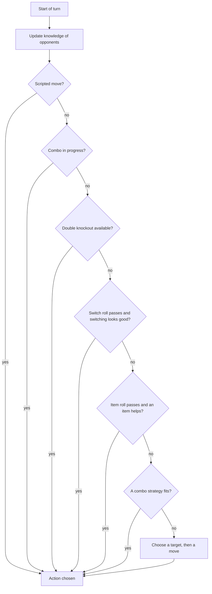

# Pokémon XD battle AI: a simplified overview

This is a plain-language summary of how computer-controlled trainers fight in *Pokémon XD: Gale of Darkness* (PAL). It leaves out code details; every statement here is backed by the full technical writeup, [battle-ai.md](battle-ai.md), which gives the evidence, exact values and rule numbers.

## In one paragraph

Every turn, each AI trainer works through a fixed checklist: follow a scripted move if the battle has one, finish a combo it started, try to knock out both opponents at once, consider switching, consider an item, consider a new combo, and finally pick a move the ordinary way. For an ordinary move it first decides **which opponent to attack** (the most threatening one), then **which move to use** against it, by adding up points for things like "this move can hit", "this move is super effective" and "this move knocks the target out". Ties are broken at random, and most trainers also add some random noise to every score. How much of this a given trainer actually does depends on its own configuration, and many story trainers are configured to play quite simply.

## How a turn's decision is made

The AI goes through these steps in order. The first step that settles a Pokémon's action wins, and later steps only handle Pokémon that are still undecided.

1. **Update what it knows** about the opponents (moves it has seen, predicted moves, abilities).
2. **Scripted moves.** Some battles, notably the Battle CDs, script the enemy's moves turn by turn.
3. **Continue a combo** it started on an earlier turn.
4. **Double knockout.** In double battles, if it controls two Pokémon, it looks for a pair of moves predicted to knock out both opponents.
5. **Switch**, if a random roll passes the trainer's switch rate and a Pokémon has good reasons to leave.
6. **Use an item**, if the battle allows items and a random roll passes the trainer's item rate.
7. **Start a combo**, using the trainer's predefined combo strategies (double battles).
8. **Forced moves** such as Struggle or a move locked in by Encore.
9. **Pick a move normally**, Pokémon by Pokémon in turn order, so the second Pokémon can react to what the first one chose.

## How each trainer is configured

Three kinds of data drive the AI:

- **Trainer entry.** Each opponent trainer in the game's deck files: who they are, their party, and which AI settings they use.
- **AI record.** A small block of settings that a trainer entry points to. Several trainers can share one. It holds:
  - **On/off switches**: whether to calculate damage, consider type matchups, consider abilities, respect key players, use move scores at all, or pick moves and targets at random.
  - **Rates (percentages)**: how often to consider switching, how often to consider items, when HP or PP counts as "low", and how eager it is to go for a double knockout.
  - **Preferences**: up to two favourite move types and two favourite kinds of moves (damaging, healing, stat changes, protection and so on).
  - **Randomness**: how much random noise to add to each score.
- **Global rule table.** One shared table of a few hundred point values ("+20 if the move can knock the target out", "−200 if it cannot hit at all"). Every trainer uses the same table; the AI record decides which parts apply.

Each Pokémon in an AI party can also be marked as a **key player**, an **ace** or a **boss** (see below), and given a **role** (attacker, supporter, weather setter and so on) that makes certain kinds of moves more attractive.

## Choosing a move

**Step 1: pick a target.** The AI rates each opponent as a threat. An opponent is more threatening if:

- it has (or is expected to have) strong moves that are super effective against the AI's Pokémon, or that could knock one out;
- it is higher level, faster, or has boosted its stats;
- it knows Selfdestruct, Explosion or Earthquake;
- it is low on HP with a "pinch" ability (Overgrow, Blaze, Torrent, Swarm).

An opponent is a much better target if one of the AI's moves can knock it out, and a much worse one if no move can hit it. The most threatening opponent is attacked. Many trainers skip this and pick the target at random.

Before that, in double battles the AI may decide to **help its partner** instead: for example using a Fire move on an ally with Flash Fire, or Skill Swap on an ally with Truant.

**Step 2: pick a move against that target.** Each move starts from a score specific to the move (for example Fake Out is worth a lot on the first turn and nothing afterwards), then gains or loses points:

| Situation | Effect |
|---|---|
| The move cannot work on the target | Very large penalty |
| Not very effective or no effect | Large penalty |
| Fits the Pokémon's role, or the trainer's favourite types or kinds of moves | Bonus |
| Does the most damage of all its moves | Bonus |
| Knocks the target out, especially with the best accuracy | Bonus |
| High accuracy | Small bonus |
| Low on PP | Small penalty |
| Risky move (when the trainer cares about risk) | Penalty |
| Random noise | Up to ± the trainer's randomness setting |

The highest score wins; if several moves tie, one is picked at random.

**Damage estimates** use the game's real damage formula on the real Pokémon, with the highest damage roll and no critical hits.

## What the AI knows, and where it cheats

| Information | What the AI uses |
|---|---|
| Opponent's moves | Only moves it has **seen** used (up to four), plus a list of **typical moves** per species for 150 species |
| Opponent's ability | The real one once it has been revealed, or if the species has only one; otherwise a guess |
| HP, stats, stat changes, held item, status and other conditions | The **real values**, read directly from the battle |
| Types and turn order | The real values |

So the AI does not know your moveset in advance, but it does know your exact HP, your held item and your stats.

## Double battles: combos and double knockouts

- **Double knockout.** If the trainer's "annihilation" setting is above zero and it controls two Pokémon, it looks for a pair of moves predicted to knock out both opponents (or at least one), and takes it if the moves are likely enough to succeed.
- **Combos.** Each trainer can have up to four planned combos, each with a willingness percentage. The game defines 50 combo strategies, for example Rain Dance followed by Thunder, Sunny Day followed by SolarBeam, a spread move or Earthquake paired with Protect or with a partner immune to it, or Shadow Sky followed by Shadow moves. A combo is used if it scores well and a random roll, raised by the willingness percentage, passes.
- Because the second Pokémon decides after the first one, ordinary move choice can also react to the partner, for example by valuing Earthquake more when the partner has chosen Protect.

## Switching

Switching is considered only when a random roll passes the trainer's switch rate. On the disc, no story-mode trainer and no Battle CD opponent has a switch rate above 0, so they never switch voluntarily; nearly every Colosseum trainer and about half of the 100-trainer deck can. A Pokémon then wants to leave if it **cannot hit any opponent**, its stats have been **lowered a lot**, or it suffers from **infatuation, Curse, Nightmare, Encore, Yawn** or an imminent **Perish Song**. It is less willing to leave if it is a key player, ace or boss, if its stats are boosted, or if it can knock an opponent out.

The **replacement** is chosen by scoring each Pokémon in reserve: whether its moves can hit, whether it is faster, its type matchups, whether it completes a combo, whether it has a useful switch-in ability (Intimidate, Trace, Cloud Nine, Air Lock) or benefits from the weather, and whether it is a key player or ace (preferred) or the boss (held back).

## Items

Items are considered only when the battle mode allows them and a random roll passes the trainer's item rate. On the disc, no story-mode, Colosseum or Battle CD trainer has an item rate above 0; item use is limited to about half of the 100-trainer deck and a few sample trainers. The AI looks at the healing and battle items in its bag:

- HP-restoring items when its Pokémon is low on HP;
- status cures when its Pokémon has a status problem;
- stat-boosting X items when its stats are not already high;
- items that raise the critical-hit rate, for Pokémon with the attacker role.

Healing and cures are never used on an unpurified Shadow Pokémon. The AI uses the **first** suitable item in its bag rather than the best one (a bug).

## Key players, aces and bosses

Each AI Pokémon can carry one of three labels:

- **Key player:** slightly preferred as a replacement and a little less willing to switch out.
- **Ace:** sent out early and strongly preferred as a replacement.
- **Boss:** held back and only sent in when nothing better is left.

These labels only matter for trainers whose settings tell the AI to respect them; on the disc, about 30% of trainers do.

## Scripted battles

Some battles give the enemy a fixed script of moves and targets, turn by turn, which may repeat in a loop. This is used almost exclusively by the **Battle CDs**, the puzzle battles with a set solution. A scripted move is only used if it would actually work; otherwise the AI falls back to normal choice for that turn. In a few double-battle CDs the script carries over to a replacement Pokémon after a faint.

## Shadow Pokémon

- **No Hyper Mode or Reverse Mode for the AI.** Only the player's Shadow Pokémon can enter it.
- **Shadow moves are treated as typeless,** so the AI never thinks a Shadow move is resisted.
- Its damage estimates include the Shadow-move bonus against normal Pokémon.
- Several Shadow moves have their own scoring: Shadow Sky is valued when it is not already active and the AI has Shadow Pokémon, Shadow Hold is valued against opponents with status conditions, and so on. There are also Shadow combos, such as Shadow Sky followed by Shadow attacks.

## How strong is the AI in practice?

The disc's settings show that most trainers use only part of the system:

| Group | Typical behaviour |
|---|---|
| Most story-mode trainers (about two thirds; no story trainer switches or uses items) | No damage calculation and no move scores: they mostly avoid moves that cannot hit or are resisted, pick the target at random, and add large random noise (±50). In effect, close to random among sensible moves |
| A smaller group of story trainers | Pick both moves and targets completely at random |
| Story bosses and important battles (about 50 trainers, including Miror B.) | Full analysis (damage, move scores, roles), usually with **no** random noise, though many still pick the target at random |
| Colosseum challenges and the 100-trainer deck (*likely* Mt. Battle) | Full analysis for every trainer, with some random noise. Colosseum trainers can switch; about half of the 100-trainer deck can switch and use items |
| Battle CDs | Mostly full analysis with no randomness, plus scripted moves; no switching or items |

So the "smart" AI described above is mainly what you face in colosseum-style challenges, Battle CDs and key story battles; ordinary story trainers are deliberately much simpler.

## Notable bugs and quirks

- **The second opposing trainer never learns your moves** in battles with two enemy trainers: everything it sees is recorded for the first trainer instead.
- **Items:** the AI uses the first usable item rather than the best, and two item rules (Guard Spec., saving items for the ace or boss) can never apply.
- **Spread moves:** the damage estimate for a move hitting both opponents counts the same target twice.
- **Combo selection** has a few small bugs (an uninitialised tie count, a speed filter that can drop the wrong candidate).
- **Random noise applies to everything,** including "best damage" and "can knock out" bonuses, so a noisy trainer can pass up an obvious knockout.

See [battle-ai.md](battle-ai.md) for the complete list, the exact rule values and the per-trainer data.
