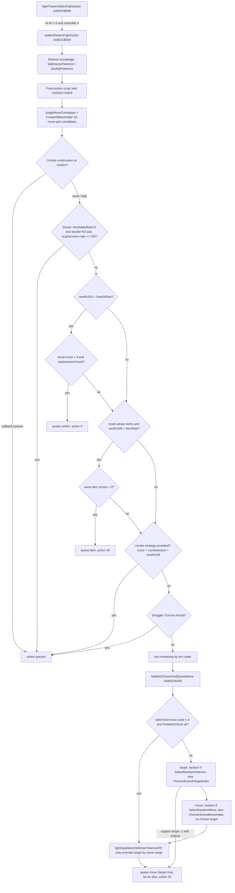

# Pokémon XD battle AI

This document describes how computer-controlled trainers choose their actions in Pokémon XD: Gale of Darkness (PAL, GameCube). Everything here comes from the `ram_xd.i64` database (decompiled functions, disassembly and the AI tables loaded in that RAM image) and, for per-trainer data and the move table, from the PAL disc image (`GXXP01`).

**Evidence conventions.** Plain statements were checked against the code or the loaded data. Statements prefixed with *Inference:* are interpretations that the code supports but does not prove. *Open:* marks a question that is still unresolved. Functions are cited as `name` (`0x...`). Rule numbers (`R64`, etc.) index the global score-rule table described in section 2.2. Their values are the PAL values loaded at `0x80B81D54`.

Move, ability, type and condition numbers use the game's internal IDs. Move names come from the loaded move table at `0x80C1C1AC` (56-byte records, name message ID at `+0x20`) and the English message archive at `0x80BD67E4`. Weather codes are 1 sun, 2 rain, 3 sandstorm, 4 hail and 5 Shadow Sky. This mapping is fixed by the Weather Ball type mapping in `battleAIGetMoveTypeData_ThinkWeatherBall` (`0x802C33A8`) and `battleAIGetEffectiveMoveTypeId` (`0x802CA560`), and by the Shadow Sky checks.

## Contents

1. [Overview and entry points](#1-overview-and-entry-points)
2. [Data the AI uses](#2-data-the-ai-uses)
3. [Move scoring pipeline](#3-move-scoring-pipeline)
4. [Double battles and combos](#4-double-battles-and-combos)
5. [Switching and items](#5-switching-and-items)
6. [Shadow Pokémon specifics](#6-shadow-pokémon-specifics)
7. [Rule and score tables](#7-rule-and-score-tables)
8. [Known quirks and bugs](#8-known-quirks-and-bugs)
9. [Open questions](#9-open-questions)
- [Appendix A: complete score-rule table](#appendix-a-complete-score-rule-table)
- [Appendix B: initial-score callbacks by move](#appendix-b-initial-score-callbacks-by-move)

---

## 1. Overview and entry points

### 1.1 When the AI runs

Each turn, the battle action flow asks every trainer for its actions. `_fightActionFlowFightTrainerSelectFightAction__FPvUsPv` (`0x8020BEDC`) calls `fightTrainerSelectFightAction` (`0x801FBB08`). That function clears the trainer's queued actions, aborts if the battle already has a global result, and then dispatches as follows:

| Condition | Handler |
|---|---|
| `fightTrainerDB_GetAiDataId(trainerId)` (`0x80201904`) is nonzero **and** `fightTrainer_GetControllerId(trainer) == 0` | `battleAISelectFightAction` (`0x802CB004`), the AI |
| otherwise, trainer definition control kind 1 | `fightMenuFightTrainerAgbHeroOpenMenu` (GBA-linked player) |
| otherwise | `fightMenuFightTrainerGcHeroOpenMenu` (player menu) |

The AI data ID comes from the deck trainer entry (`XDDeck_GetTrainerRecord` `0x8028CE70`, then `XDDeckTrainer_GetAIId` `0x8028DC24`). Trainer IDs of `0x1388` or higher always return 0, which means no AI.

Replacement after a faint follows the same pattern. `fightTrainerSelectIrekaeFightPokemon` (`0x801FBC38`) calls `battleAISelectSwitchReplacementPartyRecord` (`0x802CD244`) for AI trainers, unless the debug flag that makes every trainer controllable is set. The starting party order for an AI trainer is built by `battleAISortFirstSelectPokemonAry` (`0x802C6A28`), called from `battleTrainerSelectAndReorderParty` (`0x801FBF7C`). See section 4.6.

### 1.2 The per-trainer orchestrator

`battleAISelectFightAction` (`0x802CB004`) runs once per AI trainer per turn. It works through a fixed sequence of stages. Each later stage only acts on active combatants that still have no valid queued action (`fightTrainerGetNoActionFightOutPokemonPtr`, `0x801FB300`), so the first stage to queue something for a combatant decides its action.

| # | Stage | Function | Effect |
|---:|---|---|---|
| 1 | Refresh knowledge | `battleAISetEnemyPokemon` (`0x802CAAB4`), `battleAISetAllyPokemon` (`0x802CA8F4`) | Updates the interaction records for opponents (abilities, predicted moves, "lowest/highest" flags) and the expected-damage matrix in own party records |
| 2 | Clear actions | `battleCombatantClearActions` | For active combatants that are allowed to select |
| 3 | Fixed-action script | `battleAIFixedAct` (`0x802CB56C`) | Writes the scripted move code (combatant `+0x815`) and target code (`+0x816`) for this turn (section 1.4) |
| 4 | Build move-pair candidates | `battleAIJudgeMoveCombatant` (`0x802C6874`), `battleAICreateAllMoveValid` (`0x802C451C`) | Removes combatants that cannot choose: conditions 18 and 34 (*Inference:* recharge and charging turn), sleep (8), freeze (7), not owned by this trainer, known Truant on a loafing turn and fills the 64-entry `AIMovePair` table (section 4.1) |
| 5 | Continue combos | `battleAIComboActContinue` (`0x802CCA18`) | Runs the continuation callback of the combo strategy stored at combatant `+0x814` |
| 6 | Double-KO ("stroke") | `battleAICheckDoFightActionStroke` (`0x802C61F0`) | With the trainer's annihilation rate, queues a move pair predicted to KO both opponents (section 4.2) |
| 7 | Switch | `battleAICheckDoFightActionSwitch` (`0x802C781C`), then `battleAISelectFightActionSwitch` (`0x802CD194`) | `HSD_Rand() % 100 < PokemonSwitchRate`. Then, for each idle and untrapped combatant, a recall score above 0 plus a valid replacement queues a switch (section 5.1) |
| 8 | Item | `fightFloor_GetFightKindUseItemFlag` (`0x801F910C`), `battleAICheckDoFightActionItem` (`0x802C77B8`), `battleAISelectFightActionItem` (`0x802CCAE4`) | Only if the battle mode allows items and `HSD_Rand() % 100 < ItemUseRate` (section 5.2) |
| 9 | New combos | `battleAIComboAct` (`0x802CC90C`) | Tries the trainer's four combo slots on the idle combatants (section 4.3) |
| 10 | Forced moves | `battleQueueForcedMoveOrStruggle` (`0x80202D70`) | Queues Struggle or an Encore-locked move. Those combatants skip scoring |
| 11 | Normal move choice | `battleSortCombatantsByTurnOrder` (`0x801F5E3C`), then `battleAiChooseAndQueueMove` (`0x802DAA08`) for each remaining combatant | Combatants are processed in turn order. A later combatant's scoring can therefore see the first one's queued action (for example, "ally chose Helping Hand" rules) |

### 1.3 How actions are queued

Every combatant embeds one queued `Action` at combatant `+0x7D8` (`getCombatantQueuedAction`, `0x8014A1A8`). The AI uses three action kinds:

| Kind | Meaning | Builder | Definition table | Payload |
|---:|---|---|---|---|
| 19 (`0x13`) | Use a move | `battleQueueMoveAction` (`0x80206104`) | `battleMoveActionDefinitions` (`0x8044E590`) | Move ID as action value. The move context also receives the move slot, the target token from `battleGetFirstSideObjectToken`, and a flag (0 for AI choices, 1 for forced Struggle) |
| 18 (`0x12`) | Use a bag item | `fightOutPokemonCreateFightActionUseItem` (`0x80205F20`) | `fightActionDefinitionUseItem` (`0x8044E658`) | Item ID, target token (the user), visible index -1 |
| 9 | Switch | `battleInitializeCombatantAction` (`0x802061A0`) | `fightActionDefinitionMenuCommand` (`0x8044E618`) | Party token of the replacement |

`battleQueueMoveAction` first initializes the attacker's move context (`battleInitializeMoveContext`) with slot, move and target. It then calls `battleInitializeCombatantAction` to fill the action itself (kind, selector, definition pointer, value).

Before a move is queued, `battleAiChooseAndQueueMove` and `battleAICreateAction_FromAllMoveValid` (`0x802C440C`) call `fightSeqSelectDefensePokemonPtr` (`0x8021A734`), passing the do-nothing selector `battleAiTargetSelectionNoop` (`0x802DBDE4`). If that call returns a combatant, it replaces the AI's chosen target. *Inference:* this normalizes targets for self-targeting, spread and field moves.

### 1.4 Fixed-action scripts

Some trainers follow scripted openings. `battleAIFixedAct` (`0x802CB56C`) reads `XDDeckTrainer_GetFixedActionId` from the **enemy** trainer of the battle definition (trainer slot 1, or the tournament enemy deck). It then indexes `battleAIFixedActionTable` (`0x8045A218`, 12-byte rows: one flag byte and two script pointers, one per active slot).

- A script is a sequence of byte pairs `(moveCode, targetCode)`, read at offset `2*(turn-1)`.
- Move code 1–4 selects Pokémon move slot 0–3. Code 0 maps to 6, and 6 means "no fixed move".
- A step byte of 6 ends the script. A step of 7 loops back with `offset % (length-1)`. The length counts bytes up to and including the first 6 or 7, with at most 10 bytes.
- Target code 0 disables the fixed action. Codes 1–4 resolve in `battleAIResolveFixedActionTarget` (`0x802CB474`): 1 self, 2 object selector 14 (partner), 3 selector 15, 4 selector 16 (the opponents). Code 5 resolves to null. `battleAiChooseAndQueueMove` then uses the scored target, so 5 effectively means "AI picks the target". The loaded scripts use code 5 often.
- A fixed move is used only if `battleAIFixedActCheck` (`0x802CB3A4`) passes: the move's hit callback succeeds, the target has not fainted, and `battleAICanMoveAppointMove` (`0x802C5460`) is nonzero. Otherwise code 6 is stored and normal scoring runs.
- On switch-in or faint (`fightSeqIrekaeInitSub`, `fightSeqKizetuInit`), `battleAIFixedActSwitchInit` (`0x802CB334`) sets code 6 unless the row's flag byte is nonzero. In the loaded table, rows 7, 9 and 12 have the flag set. *Inference:* the flag means "keep the script after switching".

#### Fixed-action rows in the deck data

The table at `0x8045A218` (DOL `.data`; the bytes match the IDB) has 17 rows (0–16). The rows after 16 are other data. The flag is nonzero only in rows 7, 9 and 12. Only `DeckData_Virtual` (the `Vdisk*` / `Tutor01` trainers) and one `DeckData_Colosseum` trainer (O23, row 15) set `fixedActionId`. No `Story`, `Hundred`, `Imasugu`, `Sample` or `Bingo` trainer uses a fixed action.

| Row | Flag | Enemy trainer | Enemy party size | Script(s) (move, target pairs) |
|---:|---:|---|---:|---|
| 1 | 0 | Vdisk02_e | 1 | `01 03 02 03 07` (loops) |
| 2 | 0 | Vdisk04_e | 2 | `01 05 01 05 06` / `01 05 02 05 06` |
| 3 | 0 | Vdisk05_e | 1 | `01 03 02 03 03 03 04 03 06` |
| 4 | 0 | Vdisk07_e | 1 | `01 05 02 03 03 03 06` |
| 5 | 0 | Vdisk10_e | 1 | `01 03 07` (loops) |
| 6 | 0 | Vdisk12_e | 1 | `01 03 02 05 06` |
| **7** | **1** | Vdisk24_e | **3** | both slots `01 05 02 05 07` (loops) |
| 8 | 0 | Vdisk25_e | 3 | `01 05 02 05 03 05 06` / `01 05 02 05 02 05 06` |
| **9** | **1** | Vdisk26_e | **3** | both slots `01 05 02 05 07` (loops) |
| 10 | 0 | Vdisk27_e | 2 | both slots `01 05 02 05 06` |
| 11 | 0 | Vdisk30_e | 2 | both slots `01 05 02 05 03 05 07` (loops) |
| **12** | **1** | Vdisk35_e | **4** | `04 04 03 05 02 05 04 05 04 05…` / `01 05 03 04 03 03 03 03 03 03 06` |
| 14 | 0 | Tutor01_e | 1 | `01 05 02 05 03 05 07` |
| 15 | 0 | O23 (Colosseum) | — | `01 02 06` |
| 16 | 0 | Vdisk09_e | 1 | `01 04 02 03 06` |

The only reader is `battleAIFixedActSwitchInit` (`0x802CB334`), called from `fightSeqIrekaeInitSub` (`0x8022CC70`, switch-in) and `fightSeqKizetuInit` (`0x8022CD28`, faint). When the flag is 0 it stores code 6 for the incoming combatant. `battleAIFixedAct` skips any combatant whose code is 6. The only other writer of the code is `battleResetCombatant` (`0x80206B78`), which stores 0. It is called from `battleInitializeCombatant`, `battleResetCombatantArray`, `battleResetTrainer`, `fightSeqZenmetuCheckSubFightOutPokemon` and, for an auxiliary combatant, `WS_APPEAR_EFFECT_WAIT`. With flag 0, the switch-in/faint hook therefore stops the script for the incoming Pokémon. With a nonzero flag, that Pokémon continues the slot's script at the current turn offset. The relative order of the reset paths and the hook was not traced.

The flagged rows are exactly the scripted double battles in which the enemy has more Pokémon than active slots (3, 3 and 4), and two of them loop. The one other 3-Pokémon double (row 8) has finite scripts and flag 0. All other rows are for parties that cannot bring in a replacement in a double, or are single battles. The data is consistent with "keep the script for replacement Pokémon". No disc data writes the table or names the field. `battleAIFixedActSwitchInit` always reads `VirtualDeck_GetEnemyDeck(tournamentId)`, which matches the fact that only `Virtual` decks use these rows (section 8, item 18).

---

## 2. Data the AI uses

**Terminology.** A *trainer entry* is one trainer in a deck's `DTNR` section (identity, party, and links such as the AI ID at `+0x28`). An *AI record* is one 32-byte `ckAIRecord` in the deck's `DTAI` section; a trainer entry selects its AI record through that AI ID, and several trainer entries can share one. *Rule entries* are the rows of the single global score-rule table (section 2.2), which is shared by all trainers.

### 2.1 Per-trainer AI record (`ckAIRecord`, 32 bytes)

The AI records are loaded from the deck's AI section (`DTAI`). `XDDeck_GetAIRecord` (`0x8028CDFC`) returns `base + 32*index` when `index` is below the section count (SDA `0x80526154`, base `0x80526144`). The RAM image has no deck AI section loaded (count 0); the per-trainer values are decoded from the disc below. Every `fightTrainerAiDB_Get*` getter (`0x80200120`–`0x80201070`) returns 0 for a missing AI record.

| Offset | Field (`XDDeckAI_*` accessor) | AI-side getter | Used for |
|---:|---|---|---|
| `+0` bit 0 | CalculateMoveDamage | `fightTrainerAiDB_GetWazaDamageFlag` | If 0, all damage estimates return 0 |
| `+0` bit 1 | AbilityDetermination | `GetTokuseiCheckFlag` | If 0, `battleAIGetCombatantAbilityId` returns 0 (no ability knowledge) |
| `+0` bit 2 | AttributeDetermination | `GetZokuseiCheckFlag` | If 0, types read as 9 (typeless). This disables type checks and preferences |
| `+0` bit 3 | RespectKeyPlayer | `GetKeyPlayerFlag` | If 0, key-player/ace/boss flags read as 0 |
| `+0` bit 4 | SelectAceBoss | `GetPokemonDataOrderAceBossFlag` | Party-order selection |
| `+0` bit 5 | Order | `GetPokemonDataOrderOutFlag` | Send out in deck order (lowest template ID) |
| `+0` bit 6 | AvoidSameWeakPoint | `GetPokemonSelectWeakPointFlag` | Enables R39 in replacement scoring |
| `+0` bit 7 | SelectRandomPokemon | `GetPokemonSelectRandomFlag` | Random replacement and random party order |
| `+1` bit 1 | RespectPokemonCondition | `GetPokemonJoutaiFlag` | If 0, `battleAIIsCombatantConditionId` (`0x802C88A4`) always returns false |
| `+1` bit 2 | RespectMoveRisk | `GetWazaRiskFlag` | Enables R72 |
| `+1` bit 3 | RespectMoveHit | `GetWazaHitFlag` | If 0, the hit-feasibility dispatcher always returns 1 |
| `+1` bit 4 | RespectRole | `GetPartFlag` | If 0, every Pokémon's role reads as 1 (Free) |
| `+1` bit 5 | RespectMoveAssessment | `GetWazaInitValueFlag` | If 0, initial move scores are 0 |
| `+1` bit 6 | SelectRandomMove | `GetWazaRndSelectFlag` | Uniform random move instead of scoring |
| `+1` bit 7 | SelectRandomDefence | `GetDefensePokemonRndSelectFlag` | Uniform random target instead of scoring |
| `+4..+0xB` | StatusDecisionMin/Max, low/high nibble per stat 0–7 | `GetPhyAtkMaxValue` (0), `PhyDef` (1), `SpeAtk` (2), `SpeDef` (3), `Nimbleness` (4), `AvoidMin/Max` (6) | Stage thresholds for "stat high"/"evasion low" predicates |
| `+0xC` / `+0xD` | TotalStatusDecisionMaximum / Minimum | `GetAbicntMaxValue` / `GetAbicntMinValue` | "Total stat stages high/low" (`0x802C7BF4`, `0x802C7B84`) |
| `+0xE` | PokemonSwitchRate (%) | `GetIrekaeValue` | Stage 7 gate |
| `+0xF` | ItemUseRate (%) | `GetItemValue` | Stage 8 gate |
| `+0x10` | HitRate (%) | `GetWazaAvgValue` | "High accuracy" threshold (R69) |
| `+0x11` | AnnihilateDecisionRate | `GetStrokeValue` | Double-KO bonus (stage 6) |
| `+0x12` | LowHPDecisionRate (%) | `GetNokoriHpValue` | "HP low" means `100*hp/maxHp <= rate` |
| `+0x13` | LastPPDecisionRate (%) | `GetWazaNokoriPpValue` | "PP low" means `100*pp/maxPp <= rate` |
| `+0x14..0x15` | AttributeTypeId[2] | `GetZokuseiReviseZokuseiDataId` | Preferred elemental types (9 = none) |
| `+0x16..0x17` | AttributeTypeParameter[2] | `GetZokuseiReviseValue` | Percentage used with R62 and R32 |
| `+0x18..0x1B` | MoveCategoryId[2] (u16) | `GetWazaTypeReviseTypeDataId` | Preferred move categories |
| `+0x1C..0x1D` | MoveCategoryParameter[2] | `GetWazaTypeReviseValue` | Percentage used with R63 |
| `+0x1E` | TotalCorrection | `GetLastValueRevise` | Jitter radius (section 3.4) |
| `+1` bit 0, `+2..3`, `+0x1F` | (no getter found) | | *Open* |

Three getters are constants: `fightTrainerAiDB_GetParamStoreFlag` (`0x80200120`) returns 1, `fightTrainerAiDB_GetParamExpectFlag` (`0x8020012C`) returns 1, and `fightTrainerAiDB_GetComboValue` (`0x80200138`) returns 100.

#### AI records on the disc

The deck files are in `deck_archive.fsys` (FSYS archive 2114). Each is a `DECK` container: a 16-byte header (`'DECK'`, total size, deck ID, 0) followed by sections. Each section has a 16-byte header (`magic`, section size including the header, entry count, 0) and then its entries. `DeckData_DarkPokemon.bin` (also in `common.fsys`) has only a `DDPK` section. Every other deck has `DTNR` (56-byte trainer entries), `DPKM` (32-byte Pokémon), `DTAI` (32-byte AI records) and `DSTR` (strings). Each file has an `_EU` twin. The twins differ only in a few `DTNR`/`DPKM` bytes; their `DTAI` sections are byte-identical.

| Deck resource | Resource ID | DTAI data offset | Trainer entries | AI records | Distinct AI records |
|---|---|---:|---:|---:|---:|
| `DeckData_Story.bin` | `0x18503400` | `0x9A18` | 233 | 233 | 23 |
| `DeckData_Colosseum.bin` | `0x184C3400` | `0x3738` | 69 | 25 | 20 |
| `DeckData_Virtual.bin` | `0x18513400` | `0x3EE8` | 127 | 25 | 15 |
| `DeckData_Hundred.bin` | `0x184E3400` | `0x3E98` | 101 | 12 | 12 |
| `DeckData_Imasugu.bin` | `0x184F3400` | `0x1358` | 41 | 12 | 12 |
| `DeckData_Sample.bin` | `0x195F3400` | `0x0540` | 8 | 7 | 6 |
| `DeckData_Bingo.bin` | `0x184B3400` | `0x0190` | 2 | 2 | 2 |

`XDDeck_GetAIRecord` (`0x8028CDFC`) returns `DTAI + 32*index` for the currently bound deck. `fightTrainerDB_GetAiDataId` (`0x80201904`) reads `aiId` (DTNR `+0x28`, `XDDeckTrainer_GetAIId` `0x8028DC24`) from the same deck. In every deck each `aiId` is in range, and every AI record is used by at least one trainer entry. AI record 0 is all zero and belongs only to the deck's `NULL` trainer (DTNR index 0). In `DeckData_Story` each trainer entry has its own AI record (`aiId == trainer index` for all 233). The other decks share AI records between trainer entries.

Bit numbering below follows the accessors: bit *n* is `(byte >> n) & 1` (for example `XDDeckAI_GetCalculateMoveDamage` uses `clrlwi r3,r0,31`). The status nibbles come from `XDDeckAI_GetStatusDecisionMinimum` (low nibble) and `...Maximum` (high nibble) of byte `+4+stat`.

#### Distinct AI records

Terminology:

- **Group (one table row).** A set of AI records in one deck whose 32 bytes are identical. Each distinct AI behaviour therefore appears once per deck.
- **AI record index.** The position of an AI record in the deck's `DTAI` section; a trainer entry's AI ID (`+0x28`) is this index.
- **Trainer entry.** One trainer in the deck's `DTNR` section. Several trainer entries can point at the same AI record, and different AI records can have identical contents.
- **Omitted.** AI record 0 is all zero and used only by the deck's `NULL` trainer, so it is not listed.

Columns (field offsets refer to the AI record layout in section 2.1):

- **Deck.** The deck file, `DeckData_<Deck>.bin`.
- **AI record indices.** The indices of the AI records in the group, as ranges, with the group size in brackets for large groups.
- **Trainers.** How many trainer entries use any AI record in the group.
- **Flags.** The switches that are set in bytes `+0` and `+1`; a switch that is not listed is off ("-" means none). Abbreviations:
  - byte `+0`: Dmg = CalculateMoveDamage, Abl = AbilityDetermination, Typ = AttributeDetermination (type matchups), Key = RespectKeyPlayer, Ace = SelectAceBoss, Ord = Order, Weak = AvoidSameWeakPoint, RndPkm = SelectRandomPokemon
  - byte `+1`: Cond = RespectPokemonCondition, Risk = RespectMoveRisk, Hit = RespectMoveHit, Role = RespectRole, Init = RespectMoveAssessment (initial move scores), RndMove = SelectRandomMove, RndTgt = SelectRandomDefence (random target)
- **Stat max (0–4,6) / AvoidMin.** The "stat stage is high" thresholds for Attack, Defense, Sp. Atk, Sp. Def, Speed and evasion (the high nibbles of `+4..+0xB` that have getters), then, after the slash, the "evasion is low" threshold (stat 6 low nibble).
- **TotMax/Min.** The "total stat stages high / low" thresholds (`+0xC` / `+0xD`).
- **Switch.** PokemonSwitchRate (`+0xE`), a percentage that gates the switching stage of the pipeline (stage 7, section 1.2).
- **Item.** ItemUseRate (`+0xF`), a percentage that gates the item stage of the pipeline (stage 8, section 1.2).
- **Hit.** HitRate (`+0x10`), the accuracy threshold (%) for the "high accuracy" bonus R69. Not the same as the Hit flag.
- **Stroke.** AnnihilateDecisionRate (`+0x11`), the double-KO ("stroke") bonus applied in stage 6 (section 4.2).
- **LowHP.** LowHPDecisionRate (`+0x12`): a Pokémon counts as low on HP when `100*hp/maxHp` is at or below this value.
- **LastPP.** LastPPDecisionRate (`+0x13`): a move counts as low on PP when `100*pp/maxPp` is at or below this value.
- **Types (pct).** The two preferred elemental types (`+0x14..0x15`) and their percentages (`+0x16..0x17`), written `type1,type2 (pct1,pct2)`. Type 9 means "none".
- **Categories (pct).** The two preferred move categories (`+0x18..0x1B`, names in section 2.3) and their percentages (`+0x1C..0x1D`), written the same way. Category 0 means "none".
- **Jitter.** TotalCorrection (`+0x1E`): each move, target and replacement score gets a random offset in `[-Jitter, +Jitter]`; 0 means none.
- **Example users.** Up to six trainers using the group, then "+N" for the rest. Names are the English names from each trainer's `nameId`; a DSTR label is shown when the name is missing or has control codes.

| Deck | AI record indices | Trainers | Flags | Stat max (0–4,6) / AvoidMin | TotMax/Min | Switch | Item | Hit | Stroke | LowHP | LastPP | Types (pct) | Categories (pct) | Jitter | Example users |
|---|---|---:|---|---|---|---:|---:|---:|---:|---:|---:|---|---|---:|---|
| Story | 1 | 1 | - | 12,12,12,12,12,12/0 | 84/0 | 0 | 0 | 0 | 0 | 0 | 0 | 9,9 (0,0) | 0,0 (0,0) | 0 | HORDEL |
| Story | 2–7, 60–61, 72, 87, 104, 124–128, 134–135, 166–167, 194, 199, 203–215, 221–222 (37 identical) | 37 | Dmg Abl Typ Ord Cond Hit Role Init RndTgt | 0,0,0,0,0,0/0 | 0/0 | 0 | 0 | 0 | 0 | 0 | 0 | 9,9 (0,0) | 0,0 (0,0) | 0 | BLUSIX, BROWSIX, CAIL, CHOBIN, EAGUN, EXOL +12 |
| Story | 8, 11–16, 18–27, 29–32 (21 identical) | 21 | Abl Typ Ord Cond RndMove RndTgt | 0,0,0,0,0,0/0 | 0/0 | 0 | 0 | 0 | 0 | 0 | 0 | 9,9 (0,0) | 0,0 (0,0) | 0 | AFERD, BARDO, BELISH, BERK, BOST, CHOBIN +13 |
| Story | 9,10,147,148 | 4 | Dmg Abl Typ Ord Cond Hit Role Init | 0,0,0,0,0,0/0 | 0/0 | 0 | 0 | 0 | 0 | 0 | 0 | 9,9 (0,0) | 0,0 (0,0) | 0 | ARDOS, BIDEN, ZOOK |
| Story | 17 | 1 | Dmg Abl Typ Ord Cond Hit Role Init | 0,0,0,0,0,0/0 | 0/0 | 0 | 0 | 0 | 0 | 0 | 0 | 9,9 (0,0) | 3,0 (100,0) | 0 | NAPS |
| Story | 28,86 | 2 | Abl Typ Ord Cond Hit RndTgt | 0,0,0,0,0,0/0 | 0/0 | 0 | 0 | 0 | 0 | 0 | 0 | 9,9 (0,0) | 0,0 (0,0) | 0 | EAGUN, FELDAS |
| Story | 33–59, 62–71, 73–85, 88–97, 99, 101–103, 105–123, 136–143, 146, 149–164, 168–172, 174–175, 177–190, 192, 195, 197–198, 202, 216–220, 223–232 (149 identical) | 149 | Abl Typ Ord Cond Hit RndTgt | 0,0,0,0,0,0/0 | 0/0 | 0 | 0 | 0 | 0 | 0 | 0 | 9,9 (0,0) | 0,0 (0,0) | 50 | ABSON, ACROD, AFERD, AGREV, ANGIC, BASTIL +103 |
| Story | 98 | 1 | Abl Typ Ord Cond Hit Role RndTgt | 0,0,0,0,0,0/0 | 0/0 | 0 | 0 | 0 | 0 | 0 | 0 | 9,9 (0,0) | 0,0 (0,0) | 50 | ELOIN |
| Story | 100 | 1 | Dmg Abl Typ Ord Cond Hit Role Init RndTgt | 0,0,0,0,0,7/0 | 0/0 | 0 | 0 | 0 | 0 | 0 | 0 | 9,9 (0,0) | 4,0 (100,0) | 0 | FOSTIN |
| Story | 129 | 1 | Abl Typ Ord Cond Hit RndTgt | 0,0,0,0,0,7/0 | 0/0 | 0 | 0 | 0 | 0 | 0 | 0 | 9,9 (0,0) | 4,0 (100,0) | 0 | QUELOR |
| Story | 130 | 1 | Abl Typ Ord Cond Hit RndTgt | 0,0,0,0,0,8/0 | 0/0 | 0 | 0 | 0 | 0 | 0 | 0 | 9,9 (0,0) | 4,0 (100,0) | 0 | TESLOR |
| Story | 131 | 1 | Abl Typ Ord Cond Hit RndTgt | 0,0,0,0,0,9/0 | 0/0 | 0 | 0 | 0 | 0 | 0 | 0 | 9,9 (0,0) | 4,0 (100,0) | 0 | NOPEL |
| Story | 132 | 1 | Abl Typ Ord Cond Hit RndTgt | 0,0,0,0,0,10/0 | 0/0 | 0 | 0 | 0 | 0 | 0 | 0 | 9,9 (0,0) | 4,0 (100,0) | 0 | KALUS |
| Story | 133 | 1 | Dmg Abl Typ Ord Cond Hit Role Init RndTgt | 0,0,0,0,0,11/0 | 0/0 | 0 | 0 | 0 | 0 | 0 | 0 | 9,9 (0,0) | 4,10 (100,50) | 0 | JUSTY |
| Story | 144 | 1 | Dmg Abl Typ Ord Cond Hit Role Init RndTgt | 0,0,0,0,0,0/0 | 0/0 | 0 | 0 | 0 | 0 | 0 | 0 | 9,9 (0,0) | 5,0 (100,0) | 0 | WAKIN |
| Story | 145 | 1 | Dmg Abl Typ Ord Cond Hit Role Init RndTgt | 2,0,0,0,0,0/0 | 0/0 | 0 | 0 | 0 | 0 | 0 | 0 | 0,9 (75,0) | 5,1 (100,70) | 3 | GONZAP |
| Story | 165 | 1 | Dmg Abl Typ Ord Cond Hit Role Init RndTgt | 0,0,0,0,0,0/0 | 0/0 | 0 | 0 | 80 | 0 | 0 | 0 | 9,9 (0,0) | 0,0 (0,0) | 0 | GORIGAN |
| Story | 173 | 1 | Dmg Abl Typ Ord Cond Hit Role Init RndTgt | 0,0,0,0,0,0/0 | 0/0 | 0 | 0 | 0 | 0 | 0 | 0 | 9,9 (0,0) | 5,5 (100,100) | 0 | LOVRINA |
| Story | 176,191 | 2 | Dmg Abl Typ Ord Cond Hit Role Init RndTgt | 7,0,0,0,0,0/0 | 0/0 | 0 | 0 | 0 | 0 | 0 | 0 | 9,9 (0,0) | 4,0 (100,0) | 0 | GRASON, SNATTLE |
| Story | 193 | 1 | Dmg Abl Typ Ord Cond Hit Role Init RndTgt | 0,0,0,0,0,0/0 | 0/0 | 0 | 0 | 0 | 0 | 0 | 0 | 9,9 (0,0) | 10,0 (100,0) | 0 | ARDOS |
| Story | 196 | 1 | Dmg Abl Typ Ord Cond Hit Role Init RndTgt | 0,0,0,0,0,0/0 | 0/0 | 0 | 0 | 0 | 0 | 0 | 0 | 9,9 (0,0) | 7,0 (100,0) | 0 | ELDES |
| Story | 200,201 | 2 | Dmg Abl Typ Ord Cond Hit Role Init RndTgt | 0,0,0,0,0,0/0 | 0/0 | 0 | 0 | 0 | 0 | 0 | 0 | 9,9 (0,0) | 5,10 (100,100) | 0 | GREEVIL |
| Colosseum | 1,2,3,4 | 4 | Dmg Abl Typ Key Ord Cond Risk Hit Role Init RndTgt | 7,7,7,7,7,8/2 | 44/39 | 30 | 0 | 50 | 30 | 20 | 0 | 9,9 (50,50) | 9,9 (50,50) | 15 | MIROR B. |
| Colosseum | 5,7,8 | 3 | Dmg Abl Typ Key Ord Cond Hit Role Init | 7,7,7,7,7,8/2 | 44/39 | 50 | 0 | 80 | 30 | 20 | 10 | 9,9 (50,50) | 9,9 (50,50) | 10 | MIROR B. |
| Colosseum | 6 | 1 | Dmg Abl Typ Key Ord Cond Hit Role Init | 7,7,7,7,7,8/2 | 44/39 | 50 | 0 | 80 | 30 | 20 | 10 | 11,11 (0,0) | 9,9 (50,50) | 10 | MIROR B. |
| Colosseum | 9 | 12 | Dmg Abl Typ Key Cond Risk Hit Role Init RndTgt | 7,7,7,7,7,8/2 | 44/39 | 30 | 0 | 50 | 20 | 20 | 0 | 9,9 (50,50) | 9,9 (50,50) | 30 | HAXER, MESTIL, MIFIS, MONAR, NOSTAL, NOVIL +6 |
| Colosseum | 10 | 4 | Dmg Abl Typ Key Cond Risk Hit Role Init RndTgt | 7,7,7,7,7,8/2 | 44/39 | 30 | 0 | 50 | 30 | 20 | 0 | 9,9 (50,50) | 9,9 (50,50) | 15 | FOSS, JUPEX, ORILL, TEBU |
| Colosseum | 11 | 11 | Dmg Abl Typ Key Cond Hit Role Init RndTgt | 7,7,7,7,7,8/2 | 44/39 | 50 | 0 | 80 | 30 | 20 | 10 | 9,9 (50,50) | 9,9 (50,50) | 20 | AFTIN, AGOLL, AXON, FEPER, HALSION, HEBSON +5 |
| Colosseum | 12 | 4 | Dmg Abl Typ Key Cond Hit Role Init RndTgt | 7,7,7,7,7,8/2 | 44/39 | 50 | 0 | 80 | 30 | 20 | 10 | 9,9 (50,50) | 9,9 (50,50) | 10 | ARULE, BESTOL, CARBEN, MALEX |
| Colosseum | 13 | 9 | Dmg Abl Typ Key Cond Hit Role Init | 7,7,7,7,7,8/2 | 44/39 | 80 | 0 | 80 | 30 | 20 | 10 | 9,9 (50,50) | 9,9 (50,50) | 8 | FELPS, GREEL, LESTOR, LIMAR, LOAR, LOBEL +3 |
| Colosseum | 14 | 3 | Dmg Abl Typ Key Cond Hit Role Init | 7,7,7,7,7,7/2 | 44/39 | 80 | 0 | 80 | 30 | 20 | 10 | 9,9 (50,50) | 9,9 (50,50) | 4 | GONZAP, GORIGAN, HERLAM |
| Colosseum | 15 | 1 | Dmg Abl Typ Key Cond Hit Role Init | 7,7,7,7,7,8/2 | 44/39 | 80 | 0 | 80 | 30 | 0 | 10 | 7,9 (75,50) | 3,1 (75,25) | 4 | LOVRINA |
| Colosseum | 16 | 1 | Dmg Abl Typ Key Cond Hit Role Init | 7,7,7,7,7,7/2 | 44/39 | 80 | 0 | 80 | 30 | 20 | 10 | 0,9 (50,50) | 13,13 (0,50) | 4 | SNATTLE |
| Colosseum | 17 | 6 | Dmg Abl Typ Key Cond Hit Role Init | 7,7,7,7,7,8/2 | 44/39 | 80 | 0 | 80 | 50 | 20 | 10 | 9,9 (50,50) | 9,9 (50,50) | 8 | DAKS, DARGS, JEDO, PIXEN, REKIX, WAKIN |
| Colosseum | 18 | 2 | Dmg Abl Typ Key Ace Cond Hit Role Init | 7,7,7,7,7,7/2 | 44/39 | 80 | 0 | 80 | 30 | 20 | 0 | 9,9 (50,50) | 9,9 (50,50) | 8 | BIDEN, NAONO |
| Colosseum | 19 | 1 | Dmg Abl Typ Key Cond Hit Role Init | 8,7,7,7,8,7/4 | 46/39 | 0 | 0 | 80 | 20 | 20 | 10 | 9,9 (50,50) | 9,9 (50,50) | 2 | CHOBIN |
| Colosseum | 20 | 1 | Dmg Abl Typ Key Cond Hit Role Init | 7,7,7,7,7,7/2 | 44/39 | 80 | 0 | 80 | 30 | 20 | 10 | 9,9 (50,50) | 7,7 (100,75) | 8 | JEBOL |
| Colosseum | 21 | 2 | Dmg Abl Typ Key Weak Cond Hit Role Init | 7,7,7,7,7,7/2 | 44/39 | 80 | 0 | 80 | 100 | 20 | 10 | 9,9 (50,50) | 9,9 (50,50) | 4 | ARDOS, EBSON |
| Colosseum | 22 | 1 | Dmg Abl Typ Key Weak Cond Hit Role Init | 7,7,7,7,8,7/6 | 44/39 | 80 | 0 | 80 | 30 | 20 | 0 | 9,9 (50,50) | 4,9 (0,50) | 4 | LEST |
| Colosseum | 23 | 1 | Dmg Abl Typ Key Ace Weak Cond Hit Role Init | 7,7,7,7,7,7/6 | 44/39 | 80 | 0 | 80 | 40 | 20 | 0 | 9,9 (50,50) | 9,9 (50,50) | 4 | KLEPT |
| Colosseum | 24 | 1 | Dmg Abl Typ Key Weak Cond Hit Role Init | 8,7,7,7,7,7/6 | 44/39 | 80 | 0 | 80 | 50 | 20 | 0 | 9,9 (50,50) | 9,9 (50,50) | 4 | ELDES |
| Virtual | 1,3,7 | 105 | Dmg Abl Typ Ord Cond Hit Init | 7,7,7,7,7,8/2 | 44/39 | 0 | 0 | 0 | 0 | 0 | 0 | 9,9 (0,0) | 0,0 (0,0) | 0 | ACEL, ASTOR, BARSTO, BASIN, BIXY, CLIKS +25 |
| Virtual | 2 | 1 | Abl Typ Cond Hit Role Init | 7,12,7,7,7,8/2 | 54/39 | 0 | 0 | 0 | 0 | 0 | 0 | 12,9 (100,0) | 0,0 (0,0) | 0 | HOLIT |
| Virtual | 4 | 1 | Abl Typ Cond Hit RndMove | 7,7,7,7,7,8/2 | 44/39 | 0 | 0 | 0 | 0 | 0 | 0 | 9,9 (0,0) | 0,0 (0,0) | 0 | HECTER |
| Virtual | 5 | 1 | Abl Typ Ord Cond Hit Role Init | 7,7,7,7,7,8/2 | 44/39 | 0 | 0 | 0 | 0 | 0 | 0 | 9,9 (0,0) | 6,0 (100,0) | 0 | LEEZ |
| Virtual | 6 | 1 | Dmg Abl Typ Cond Hit Role Init | 7,7,7,7,7,8/2 | 44/39 | 0 | 0 | 0 | 0 | 0 | 0 | 0,9 (100,0) | 10,10 (100,100) | 0 | HAVEK |
| Virtual | 8 | 1 | Dmg Abl Typ Ord Cond Hit Role Init | 12,7,7,7,7,8/2 | 54/39 | 0 | 0 | 0 | 0 | 0 | 0 | 9,9 (0,0) | 0,0 (0,0) | 0 | ABONO |
| Virtual | 9 | 1 | Dmg Abl Typ Ord Cond Hit Role Init | 6,6,6,6,6,6/6 | 42/42 | 0 | 0 | 0 | 0 | 0 | 0 | 11,9 (100,0) | 0,0 (0,0) | 0 | AGORA |
| Virtual | 10 | 1 | Dmg Abl Typ Ord RndMove | 6,6,6,6,6,6/6 | 42/42 | 0 | 0 | 0 | 0 | 0 | 0 | 9,9 (0,0) | 0,0 (0,0) | 10 | CABEN |
| Virtual | 11,13,15,20,21,22 | 6 | Dmg Abl Typ Ord Cond Risk Hit Role Init | 7,7,7,7,7,7/3 | 44/39 | 0 | 0 | 80 | 50 | 0 | 0 | 9,9 (0,0) | 0,0 (0,0) | 5 | BURG, BYNDS, CABEN, KABEL, KILF |
| Virtual | 12,14,16,18 | 4 | Dmg Abl Typ Ord Cond Risk Hit Role Init | 7,7,7,7,7,7/3 | 44/39 | 0 | 0 | 80 | 50 | 0 | 0 | 9,9 (0,0) | 0,0 (0,0) | 10 | BURG, CUKI, DILSON, KABEL |
| Virtual | 17 | 1 | Dmg Abl Typ Ord Cond Risk Hit Role Init | 7,7,7,7,7,7/3 | 44/39 | 0 | 0 | 80 | 50 | 0 | 0 | 9,9 (0,0) | 0,0 (0,0) | 0 | DILSON |
| Virtual | 19 | 1 | Dmg Abl Typ Ord Cond Risk Hit Role Init | 7,7,7,7,7,8/3 | 44/39 | 0 | 0 | 80 | 50 | 0 | 0 | 9,9 (0,0) | 1,0 (60,0) | 5 | CUKI |
| Virtual | 23 | 1 | Dmg Abl Typ Ord Cond Hit Role Init RndTgt | 7,7,7,7,7,7/3 | 44/39 | 0 | 0 | 80 | 37 | 0 | 0 | 5,0 (0,100) | 9,13 (100,100) | 20 | CORBIN |
| Virtual | 24 | 1 | Dmg Abl Typ Ord Cond Risk Hit Role Init | 7,7,7,7,7,7/3 | 44/39 | 0 | 0 | 80 | 0 | 0 | 0 | 9,9 (0,0) | 0,0 (0,0) | 5 | DIBIT |
| Hundred | 1 | 27 | Dmg Abl Typ Key RndPkm Cond Hit Role Init RndTgt | 7,7,7,7,7,8/3 | 44/38 | 0 | 0 | 80 | 10 | 0 | 10 | 9,9 (50,50) | 9,9 (50,50) | 50 | ATILL, BARDO, CIDLOR, CRIDEL, DABIL, DELF +21 |
| Hundred | 2 | 29 | Dmg Abl Typ Key Cond Hit Role Init | 7,7,7,7,7,7/3 | 44/38 | 100 | 100 | 80 | 30 | 0 | 10 | 9,9 (50,50) | 9,9 (50,50) | 20 | ADESON, ALBAH, BOYDEN, CARK, COPIN, EBILO +23 |
| Hundred | 3 | 1 | Dmg Abl Typ Key Cond Hit Role Init | 7,7,7,7,7,7/3 | 44/38 | 100 | 100 | 80 | 40 | 0 | 10 | 13,9 (100,50) | 4,9 (50,50) | 20 | TARIA |
| Hundred | 4 | 27 | Dmg Abl Typ Key Cond Hit Role Init RndTgt | 7,7,7,7,7,8/3 | 44/38 | 0 | 0 | 80 | 10 | 0 | 10 | 9,9 (50,50) | 9,9 (50,50) | 40 | ATLES, BLIST, BURDON, CARLON, CREX, DEGIN +21 |
| Hundred | 5 | 1 | Dmg Abl Typ Key Cond Hit Role Init | 7,7,7,7,7,7/3 | 44/38 | 100 | 100 | 80 | 40 | 0 | 10 | 5,9 (100,50) | 4,9 (50,50) | 20 | CALUS |
| Hundred | 6 | 2 | Dmg Abl Typ Key Cond Hit Role Init | 7,7,7,7,8,7/3 | 46/38 | 100 | 100 | 80 | 20 | 0 | 10 | 9,9 (50,50) | 9,9 (50,50) | 4 | ORDES, SIVIL |
| Hundred | 7 | 2 | Dmg Abl Typ Key Cond Hit Role Init | 7,7,7,7,8,7/3 | 46/38 | 100 | 100 | 80 | 20 | 0 | 10 | 9,9 (50,50) | 9,9 (50,50) | 10 | GINNER, LASK |
| Hundred | 8 | 1 | Dmg Abl Typ Key Cond Hit Role Init | 7,7,7,7,7,7/3 | 44/38 | 100 | 100 | 80 | 20 | 0 | 10 | 9,9 (50,50) | 4,9 (100,50) | 10 | NADAY |
| Hundred | 9 | 2 | Dmg Abl Typ Key Cond Hit Role Init | 7,7,7,7,7,7/3 | 44/38 | 100 | 100 | 80 | 20 | 0 | 10 | 2,9 (100,50) | 9,9 (50,50) | 8 | RAGEN, ROBEN |
| Hundred | 10 | 6 | Dmg Abl Typ Key Cond Hit Role Init | 7,7,7,7,7,7/3 | 44/38 | 100 | 100 | 80 | 40 | 0 | 10 | 9,9 (50,50) | 9,9 (50,50) | 8 | BATTLUS, LIBAL, NEWIN, RILLIAN, SOLOG, TETIL |
| Hundred | 11 | 2 | Dmg Abl Typ Key Ace Cond Hit Role Init | 7,7,7,7,7,7/3 | 44/38 | 100 | 100 | 80 | 40 | 0 | 10 | 9,9 (50,50) | 9,9 (50,50) | 6 | FLOSTIN, SAKEN |
| Imasugu | 1 | 20 | Dmg Abl Typ Cond Risk Hit Role Init | 7,7,7,7,7,7/5 | 43/40 | 0 | 0 | 85 | 50 | 0 | 20 | 9,9 (0,0) | 8,0 (88,0) | 4 | CUDSY, DODIN, ELKAIN, GOSTIN, GRON, JUNDER +14 |
| Imasugu | 2 | 5 | Hit Init RndTgt | 7,7,7,7,7,7/5 | 43/40 | 0 | 0 | 80 | 0 | 0 | 0 | 9,9 (0,0) | 0,0 (0,0) | 50 | LOAKEN, ROSIL, SCRIB, TESSI, TOBIN |
| Imasugu | 3 | 1 | Dmg Typ Cond Hit Role Init RndTgt | 7,7,7,7,7,7/5 | 43/41 | 0 | 0 | 80 | 0 | 0 | 0 | 15,9 (64,0) | 5,1 (100,25) | 12 | SENDIL |
| Imasugu | 4 | 3 | Dmg Abl Typ Cond Hit Role Init RndTgt | 7,7,7,7,7,7/5 | 43/40 | 0 | 0 | 80 | 30 | 20 | 10 | 9,9 (0,0) | 0,0 (0,0) | 15 | AGRIS, NORBEL, OGOIN |
| Imasugu | 5 | 1 | Dmg Abl Typ Cond Hit Role Init RndTgt | 7,7,7,7,7,7/5 | 43/40 | 0 | 0 | 80 | 20 | 20 | 10 | 0,9 (100,0) | 0,0 (0,0) | 15 | JUSK |
| Imasugu | 6 | 1 | Dmg Abl Typ Cond Risk Hit Role Init RndTgt | 7,7,7,7,7,7/5 | 43/40 | 0 | 0 | 80 | 30 | 0 | 20 | 1,9 (0,0) | 0,0 (0,0) | 6 | DARGUS |
| Imasugu | 7 | 4 | Dmg Abl Typ Cond Risk Hit Role Init RndTgt | 7,7,7,7,7,7/5 | 43/40 | 0 | 0 | 80 | 30 | 0 | 20 | 9,9 (0,0) | 0,0 (0,0) | 6 | MADSIN, NILED, OKONA, TENSIN |
| Imasugu | 8 | 1 | Dmg Abl Typ Cond Risk Hit Role Init RndTgt | 7,7,7,7,7,7/5 | 43/40 | 0 | 0 | 85 | 0 | 0 | 20 | 9,9 (0,0) | 8,0 (88,0) | 4 | MORKOR |
| Imasugu | 9 | 1 | Dmg Abl Typ Cond Risk Hit Role Init RndTgt | 7,7,7,7,7,7/5 | 43/40 | 0 | 0 | 85 | 0 | 0 | 20 | 10,9 (75,0) | 0,0 (0,0) | 4 | KERDIN |
| Imasugu | 10 | 2 | Dmg Abl Typ Cond Risk Hit Role Init RndTgt | 7,7,7,7,7,7/5 | 43/40 | 0 | 0 | 85 | 50 | 0 | 20 | 9,9 (0,0) | 8,0 (88,0) | 4 | KASTER, LORGO |
| Imasugu | 11 | 1 | Dmg Abl Typ Cond Risk Hit Role Init RndTgt | 7,7,7,7,7,7/5 | 43/40 | 0 | 0 | 85 | 50 | 0 | 20 | 9,9 (0,0) | 0,0 (0,0) | 4 | KRILOK |
| Sample | 1,5 | 3 | Dmg Abl Typ Key Ord Cond Risk Hit Role Init RndTgt | 8,8,8,8,8,8/4 | 50/30 | 100 | 80 | 80 | 80 | 90 | 90 | 10,9 (30,0) | 6,5 (60,60) | 50 | BOST, EXOL |
| Sample | 2 | 1 | - | 12,12,12,12,12,12/0 | 84/0 | 0 | 0 | 0 | 0 | 0 | 0 | 9,9 (0,0) | 0,0 (0,0) | 0 | NAPS |
| Sample | 3 | 1 | Dmg Abl Typ Key Ace Weak Cond Risk Hit Role Init | 8,8,8,8,8,8/4 | 50/30 | 50 | 50 | 50 | 50 | 50 | 50 | 9,9 (0,0) | 0,0 (0,0) | 0 | LOBAR |
| Sample | 4 | 1 | RndPkm | 12,12,12,12,12,12/0 | 84/0 | 100 | 50 | 0 | 0 | 0 | 0 | 9,9 (0,0) | 0,0 (0,0) | 40 | AFERD |
| Sample | 6 | 1 | Dmg Abl Typ Key Weak Cond Risk Hit Role Init | 7,7,7,7,7,7/5 | 43/41 | 50 | 100 | 50 | 50 | 50 | 50 | 9,9 (0,0) | 0,0 (0,0) | 0 | story_01_16 |
| Bingo | 1 | 1 | RndPkm | 12,12,12,12,12,12/0 | 84/0 | 100 | 50 | 0 | 0 | 0 | 0 | 9,9 (0,0) | 0,0 (0,0) | 40 | bingo_01_01 |

#### Value distributions

Counts are over the 309 non-null AI records and, in brackets, over the 574 trainer entries that use them (the `NULL` trainers are excluded).

| Field | Values: AI records [trainer entries] |
|---|---|
| CalculateMoveDamage | 1: 124 [385], 0: 185 [189] |
| AbilityDetermination | 1: 303 [564], 0: 6 [10] |
| AttributeDetermination | 1: 304 [565], 0: 5 [9] |
| RespectKeyPlayer | 1: 39 [173], 0: 270 [401] |
| SelectAceBoss | 1: 4 [6] |
| Order | 1: 262 [365], 0: 47 [209] |
| AvoidSameWeakPoint | 1: 6 [7] |
| SelectRandomPokemon | 1: 3 [29] (`Hundred` AI record 1, `Sample` AI record 4, `Bingo` AI record 1) |
| `+1` bit 0 | **0 in all 309** |
| RespectPokemonCondition | 1: 303 [564], 0: 6 [10] |
| RespectMoveRisk | 1: 30 [68] |
| RespectMoveHit | 1: 283 [548], 0: 26 [26] |
| RespectRole | 1: 123 [282], 0: 186 [292] |
| RespectMoveAssessment | 1: 126 [391], 0: 183 [183] |
| SelectRandomMove | 1: 23 [23] (21 of them in `Story`) |
| SelectRandomDefence | 1: 249 [339], 0: 60 [235] |
| `+2`, `+3` | **0 in all 309** |
| Stat max nibbles (stats 0–4, 6) | all 0 in 222 AI records (all in `Story`); otherwise mostly 7, with 8, 12, 6 or 2 in a few AI records |
| AvoidMin (stat 6 low nibble) | 0, 2, 3, 4, 5, 6 |
| Unread nibbles | Stat 5 min/max and the min nibbles of stats 0–5 hold values (for example `0x73` = max 7, min 3). Stat 7 is 0 everywhere |
| TotalStatusDecisionMaximum / Minimum | 0/0 in 231/235 AI records; otherwise 42–54 / 30–42 (44/39 most common) |
| PokemonSwitchRate | 0 [454], 100 [51], 80 [28], 50 [21], 30 [20] |
| ItemUseRate | 0 [521], 100 [47], 80 [3], 50 [3] |
| HitRate | 0 [346], 80 [181], 85 [25], 50 [22] |
| AnnihilateDecisionRate | 0 [356], 30 [82], 10 [54], 50 [44], 20 [21], 40 [11], 80 [3], 100 [2], 37 [1] |
| LowHPDecisionRate | 0 [498], 20 [71], 90 [3], 50 [2] |
| LastPPDecisionRate | 0 [392], 10 [147], 20 [30], 90 [3], 50 [2] |
| AttributeTypeId | `9,9` [555]; otherwise one preferred type (0, 1, 2, 5, 7, 10, 11, 12, 13, 15), `11,11` once, `5,0` once |
| MoveCategoryId | `0,0` [359], `9,9` [161, always with 50/50, a neutral setting]; otherwise 1, 3, 4, 5, 6, 7, 8, 10, 13. No AI record uses 2, 11 or 12 |
| TotalCorrection | 0 [196], 50 [185], 20 [43], 4 [37], 40 [29], 8 [26], 10 [16], 15 [12], 30 [12], 5 [8], 6 [7], 2, 3, 12 [1 each] |
| `+0x1F` | **0 in all 309** |

Per deck, by trainers:

| Deck | Trainers | Damage calc on | Initial scores on | Random move | Random target | Jitter radius (trainers) |
|---|---:|---:|---:|---:|---:|---|
| Story | 232 | 54 | 54 | 21 | 226 | 0 (81), 50 (150), 3 (1) |
| Colosseum | 68 | 68 | 68 | 0 | 35 | 2–30 (all nonzero) |
| Virtual | 126 | 123 | 124 | 2 | 1 | 0 (112), 5, 10, 20 |
| Hundred | 100 | 100 | 100 | 0 | 54 | 50 (27), 40 (27), 20 (31), 4–10 (15) |
| Imasugu | 40 | 35 | 40 | 0 | 20 | 4, 6, 12, 15, 50 |
| Sample | 7 | 5 | 5 | 0 | 3 | 0, 40, 50 |
| Bingo | 1 | 0 | 0 | 0 | 0 | 40 |

The largest `Story` group (149 trainers, `D1_*`, `M*_*`, `S*_*` labels, AI record bytes `268a…3200`) has CalculateMoveDamage, RespectMoveAssessment and RespectRole off, SelectRandomDefence on and `TotalCorrection = 50`. For these trainers, initial scores and damage estimates are 0, and the role reads as Free (50%, so R61 adds 0). A move's score is then the hit test (R57 −200 / R56 0) and the type test (R60 −100 for no effect), plus R69 (+5, which every move passes with HitRate 0), the R64 best-damage bonus (+15, which is evaluated against all-zero estimates) and ±50 jitter. The ±50 jitter outweighs the small bonuses but not R57/R60. The choice is therefore close to uniform among moves that can hit and are not immune, and the target is random. A second group of 21 `Story` AI records (`26c2…`) sets SelectRandomMove and SelectRandomDefence. The 37 AI records `27ba…` (Miror B.'s `Mirabo_Esaba_*` battles and others) enable damage calculation, initial scores and roles, with no jitter. A few `Story` AI records are tuned per opponent: for example AI records 129–132 set an increasing AvoidMax nibble (7, 8, 9, 10) with category 4 preferred at 100%.

#### Bytes with no getter

`+1` bit 0, `+2`, `+3` and `+0x1F` are **zero in all 309 non-null AI records in all seven decks** (and in the `_EU` copies). Nothing can correlate with them. The stat-7 nibbles are also 0 everywhere, while the other unread nibbles (stat 5, and the min nibbles of stats 0–5) do hold values.

The developer field labels in message bank 3 (archive `0x803EE754`, IDs 60389–60413, the "AI data editor") include three settings whose game-side accessors are constants with empty setters:

| Label (ID) | Gloss | Accessor |
|---|---|---|
| 固定行動頻度（常に１００％） (60393) | Fixed-action frequency (always 100%) | `fightTrainerAiDB_GetComboValue` returns 100; `...SetComboValue` is `blr` |
| 相手の情報を予想（常にＯＮ） (60396) | Predict opponent information (always ON) | `GetParamExpectFlag` returns 1; setter is `blr` |
| 相手の情報を蓄積（常にＯＮ） (60397) | Store opponent information (always ON) | `GetParamStoreFlag` returns 1; setter is `blr` |

*Inference:* the unread storage (one flag bit and three bytes) is the retired storage for these settings (two flags and the fixed-action frequency). The disc data cannot confirm this, because the bytes are 0 everywhere.

### 2.2 Global score-rule table

Every score change goes through one global table, the AI "value add/sub" database. There are 727 rule entries of 20 bytes at `0x80B81D54`. The count pointer is in SDA `0x80522F38` and the base in `0x80522F3C`, read through `fightTrainerAiValueAddsubDataBiosGetPtr` (`0x801FF63C`). Each rule entry holds:

| Offset | Content |
|---:|---|
| `+0` | signed 32-bit value |
| `+4` | message ID: action group (for example "move action" or "switch action") |
| `+8` | message ID: sub-group (for example "move initial score value") |
| `+0xC` | message ID: rule label |
| `+0x10` | sort/ordinal ID |

The labels are Japanese developer strings in the message archive at `0x803EE754` (bank 3). Appendix A lists every rule with an English gloss. These values are global, not per trainer. `battleTrainerGetAttribute(nullptr, rule, 0x3E, 0)` (`0x801FEA50`) reads the same value. Some callbacks use that path to fetch a rule value as a multiplier or divisor.

The arithmetic helpers are:

| Function | Formula |
|---|---|
| `battleAIAddValue` (`0x802CA8B0`) | `clamp(score + delta, -200, 200)`. Saturation only applies in the direction of the delta |
| `battleAIAddValueByScoreRuleId` (`0x802CA82C`) | `AddValue(score, value[rule])` |
| `battleAIReviseValue` (`0x802CA868`) | `AddValue(score, (s16)((pct - 50) * delta / 50))`. 50 is neutral, 100 gives `+delta`, 0 gives `-delta` |
| `battleAIReviseValueByScoreRuleId` (`0x802CA7E8`) | `ReviseValue(score, pct, value[rule])` |

Each addition saturates on its own. A long chain of positive rules therefore stops at 200 and further negatives subtract from 200.

### 2.3 Roles, key players and move categories

The deck Pokémon template (`XDDeck_GetPokemonRecord`) supplies two AI fields:

- **Role** (`fightTrainerPokemonDB_GetPartDataId`, `0x80201224`). This indexes a role table of 79 records of 24 bytes (SDA `0x80522F28`/`0x80522F2C`, base `0x80B85884`). `fightTrainerPokemonPartDB_GetWazaTypeRevise` (`0x802010F4`) returns byte `+8+category` for move categories 0–13. Roles include Free (1), Attacker (2), Supporter (3), Specialist (4), reserved slots 5–12, Weather (13), Fatal/OHKO (14), Attention/Follow Me (15), Boost (16), Baton (17/18), Supporter 2 (19), 20 "scenario" roles, 20 "8-person double" roles, and several Pokémon-specific roles. For example, Attacker has 100 for category 1 and 50 elsewhere. Supporter has 78/100/100/100/78 for categories 2–6.
- **Key player flag** (`fightTrainerPokemonDB_GetKeyPlayerFlag`, `0x80201298`). A per-Pokémon label described below.

#### Key players, aces and bosses

Each Pokémon in an AI trainer's party carries a key-player flag. The names come from the developer labels of the rules that test it:

| Value | Label | Meaning in play |
|---:|---|---|
| 0 | — | Ordinary party member |
| 1 | Key player (R29) | Kept in when possible; mildly preferred as a replacement |
| 2 | Ace (R30) | Strongly preferred on the field: sent in first and favoured as a replacement |
| 3 | Boss (R31) | Held back: sent in only when nothing better is left |

How the AI uses it:

- **Recall** (section 5.1). R1 gives −10 to the recall score of any flagged Pokémon (1, 2 or 3). A flagged Pokémon can still be switched out, but needs more reasons: with the PAL values, the +20 "no move can hit" rule or two +10 conditions.
- **Replacement** (section 5.1). Candidates get +10 as a key player (R29), +30 as the ace (R30) and −100 as the boss (R31).
- **Starting order** (section 4.6). After any combo lead pair, the order is filled with aces, then bosses, then key players, then the rest, chosen at random within each group. With the Order switch on, Pokémon go out in deck order instead.
- **Moves** (section 3.2). A few initial scores refer to it: for example Follow Me gets +30 when the ally is the ace (R492), and the Skill Swap combo considers aces and bosses with Huge Power or Pure Power.
- **Items** (section 5.2). R55 was meant to save items for the ace or boss, but its test is contradictory and it never applies (section 8, quirk 6).

Two switches in the AI record (section 2.1) control this per trainer:

- **RespectKeyPlayer** (byte `+0` bit 3). When it is off, every flag reads as 0, so the trainer ignores key players, aces and bosses entirely. On the disc, 39 of the 309 non-null AI records turn it on, used by 173 trainer entries.
- **SelectAceBoss** (byte `+0` bit 4). Read by the party-order code (`GetPokemonDataOrderAceBossFlag`). Its exact effect on the order is not established here.

#### Move categories

Move "categories" are the three bytes `XDMoveDefinition.conditionEffects[3]` at `+0x34..+0x36`. They are tested by `battleAIHasMoveConditionEffect` (`0x802CA470`) and read by `battleAIGetMoveConditionEffect` (`0x802CA4B0`); this is not the elemental type.

#### Source

`battleAIHasMoveConditionEffect` (`0x802CA470`) and `battleAIGetMoveConditionEffect` (`0x802CA4B0`) call `moveHasConditionEffect` (`0x8013E9DC`) and `moveGetConditionEffect` (`0x8013FD80`). These read `XDMoveDefinition.conditionEffects[3]` at `+0x34..+0x36` of the 56-byte move definition. The move table is in `common.fsys` resource `common_rel` (ID `0x01871C00`), decoded offset `0xA758C`, 375 records. It is byte-identical to the RAM table at `0x80C1C1AC`. Move names come from the English message table in the same resource (name message ID at `+0x20`).

#### Category names

The developer labels in bank 3 name the categories, and a DOL layout table gives their order. The table at `0x8042F9E0` (DOL `.data`) has 28-byte rows (`2`, message ID, 0, row index `0xFC…0x109`, flags, x, y). In order, it lists the title 技タイプ補正値 ("move-type correction value") and then one label per category:

| Cat. | Label (message ID) | Meaning | Moves | Members (PAL move table) |
|---:|---|---|---:|---|
| 1 | 威力技 (60496) | Damaging ("power") moves | 220 | All damaging moves, including Shadow Blitz…Shadow Blast |
| 2 | 回復技 (60497) | Recovery | 16 | Recover, Softboiled, Dream Eater, Rest, Giga Drain, Milk Drink, Heal Bell, Morning Sun, Synthesis, Moonlight, Swallow, Wish, Ingrain, Refresh, Slack Off, Aromatherapy |
| 3 | 能力変更技 (60498) | Stat-change (in practice, lowering or resetting the target's stages) | 35 | Sand-Attack, Tail Whip, Leer, Growl, String Shot, Rage, Screech, Smokescreen, Haze, Kinesis, Flash, Cotton Spore, Scary Face, Mud-Slap, Octazooka, Foresight, Icy Wind, Charm, Swagger, Sweet Scent, Rock Smash, Flatter, Memento, Luster Purge, Mist Ball, FeatherDance, Fake Tears, Odor Sleuth, Rock Tomb, Metal Sound, Tickle, Mud Shot, Shadow Mist, Shadow Down, Shadow Shed |
| 4 | 強化技 (60681) | Strengthening (raising the user's stages) | 23 | Swords Dance, Growth, Meditate, Agility, Double Team, Harden, Minimize, Withdraw, Defense Curl, Barrier, Focus Energy, Amnesia, Acid Armor, Sharpen, Curse, Belly Drum, Tail Glow, Cosmic Power, Iron Defense, Howl, Bulk Up, Calm Mind, Dragon Dance |
| 5 | ポケモン状態変更技 (60499) | Pokémon condition change (major status and volatile conditions) | 55 | Bind, Wrap, Sing, Supersonic, Disable, Leech Seed, PoisonPowder, Stun Spore, Sleep Powder, Fire Spin, Thunder Wave, Toxic, Hypnosis, Minimize, Confuse Ray, Clamp, Glare, Poison Gas, Lovely Kiss, Spore, Spider Web, Mind Reader, Nightmare, Curse, Sweet Kiss, Zap Cannon, Foresight, Lock-On, Swagger, Mean Look, Attract, Sacred Fire, DynamicPunch, Encore, Psych Up, Whirlpool, Fake Out, Torment, Flatter, Will-O-Wisp, Charge, Taunt, Helping Hand, Ingrain, Yawn, Teeter Dance, Odor Sleuth, GrassWhistle, Sand Tomb, Block, Shadow Fire, Shadow Bolt, Shadow Chill, Shadow Hold, Shadow Panic |
| 6 | 戦場状態変更技 (60500) | Field condition change | 13 | Mist, Light Screen, Reflect, Spikes, Sandstorm, Safeguard, Rain Dance, Sunny Day, Hail, Imprison, Mud Sport, Water Sport, Shadow Sky |
| 7 | 守り技 (60501) | Protecting | 4 | Protect, Detect, Endure, Follow Me |
| 8 | 一撃必殺技 (60502) | One-hit KO | 5 | Guillotine, Horn Drill, Fissure, Focus Punch, Sheer Cold |
| 9 | タメ技 (60503) | Charge (two-turn) | 8 | Razor Wind, Fly, SolarBeam, Skull Bash, Dig, Sky Attack, Dive, Bounce |
| 10 | 特殊技 (60504) | Special (miscellaneous) | 35 | Whirlwind, Roar, Counter, Mimic, Bide, Metronome, Mirror Move, Transform, Conversion, Super Fang, Substitute, Sketch, Thief, Conversion 2, Spite, Destiny Bond, Perish Song, Sleep Talk, Baton Pass, Mirror Coat, Stockpile, Nature Power, Trick, Role Play, Assist, Magic Coat, Recycle, Knock Off, Skill Swap, Grudge, Snatch, Camouflage, Covet, Shadow End, Shadow Half |
| 11 | EXPLOSION (move-name message 2153) | Editor slot named after Explosion | 0 | none |
| 12 | EARTHQUAKE (move-name message 2089) | Editor slot named after Earthquake | 0 | none |
| 13 | 非戦闘技 (60505) | Non-battle moves | 7 | Pay Day, Teleport, Amnesia, Splash, Explosion, Mean Look, Imprison |

Category 0 is "none". Moves 0, 355 and 374 have no category. A move can have up to three categories. For example, Explosion is `1,13,13` and Imprison is `6,13,13`, which is why counting slots gives 9 for category 13 while it has 7 distinct moves. The label for category 4 (60681) sits apart from the 60496–60505 run. This shows that 強化技 was added after the list was first numbered, so the dense list 60496–60505 maps to categories 1–3 and 5–10 plus 13.

Category 13 is a mixed set (money, escape, no-effect, Amnesia, Explosion, trapping, Imprison). The role table (`common_rel` offset `0x10C64`, identical to `0x80B85884`) uses its column only for named special roles. For example, role 69 ふういん (Imprison) and role 74 (an OHKO set) give 100, while role 78 大爆発 (Explosion) gives 20. Columns 0, 11 and 12 are 0 in all 79 roles. The AI code tests only categories 1 (damaging), 2 (healing, R68) and 4 (Snatch, Protect/Detect, Follow Me + stat boost combo). Trainers' preferred-category fields use 1, 3–10 and 13.

### 2.4 Trainer deck fields used by the AI

| Field | Accessor | Use |
|---|---|---|
| `aiId` | `XDDeckTrainer_GetAIId` (`0x8028DC24`) | Selects the `ckAIRecord`. 0 means a human-controlled trainer |
| `comboIds[4]` | `XDDeckTrainer_GetComboId` (`0x8028DBC8`) | Rows of `battleAIComboDefinitions` (section 4.3) |
| `comboActive[4]` | `XDDeckTrainer_GetComboActive` (`0x8028DB98`) | Enables each slot (nonzero) and is also its acceptance bias |
| `fixedActionId` | `XDDeckTrainer_GetFixedActionId` (`0x8028DBFC`) | Row of `battleAIFixedActionTable` |

Each Pokémon also carries combo "pair flags" in byte `+188` of its record (`getPkmMovePairFlag`, `0x8014A7DC`). That gives two bits per combo slot: a lead bit (`0x80/0x20/0x08/0x02`) and a follow bit (`0x40/0x10/0x04/0x01`).

### 2.5 The Interaction record (what the AI remembers about opponents)

Each trainer has 12 `Interaction` records of 38 bytes each (`battleTrainerGetInteraction`, `0x801FFED8`). They are keyed by the opposing Pokémon's party token (`fightTrainerGetFightEntryIdToEnemyPokemonPtr`, `0x801FF044`).

| Offset | Field | Written by |
|---:|---|---|
| `+0` | `objectToken` (party token, -1 if free) | `battleAddInteraction` (`0x80201E7C`) |
| `+2` | `observedMoveCount` | `battleAIAddStoreMove` (`0x802C5E60`) |
| `+3` | `expectedMoveCount` | `battleAISetEnemyPokemon` (writes the active-opponent count, see section 8) |
| `+4` | `observedMoveIds[4]` | `battleAIAddStoreMove` |
| `+0xC` | `expectedMoveIds[8]` | `battleAISetEnemyPokemon`. Pruned by `battleAIDeleteExpectMove` (`0x802C5D5C`) |
| `+0x1C` | `abilityObservedFlag` | `WS_TOKUSEI_SET` (`0x8021B6BC`), `battleAIAddStoreAbility` (`0x802C5AFC`) |
| `+0x1E` | `observedAbilityId` | same |
| `+0x20..+0x24` | hint flags: lowest current HP%, lowest level, lowest Defense, has the most damaging moves, highest stat product | `battleAISetEnemyPokemon`. Cleared each turn by `battleResetInteractionFlags` (`0x80202158`) |

How the records are filled:

- **Observed moves.** When a move's use message is displayed, `WS_ATTACK_MESSAGE` (`0x802190C4`) calls `battleAIAddStoreMove` and `battleAIDeleteExpectMove` for the observing trainers (format object selectors 9 and 10 relative to the user's owner). The move goes into the first free of 4 slots. Once 4 are known, all 8 expected slots are cleared.
- **Expected moves.** On each AI turn, `battleAISetEnemyPokemon` searches a 150-entry species table `battleAIExpectedMoveTable` (`0x8045A460`) (18 bytes: species and up to 8 move IDs). For a match, it copies the predicted moves into empty expected slots, but only while the slots are still empty (it stops at the first nonzero slot). For example, the first rows give species 3 Earthquake/Sleep Powder/Sludge Bomb/Giga Drain and species 6 Earthquake/Flamethrower/Aerial Ace/Dragon Claw/Slash.
- **Abilities.** `WS_TOKUSEI_SET` records the real ability when an ability announces itself. `battleAIAddStoreAbility` also records the real ability every turn if the species has only one possible ability. Otherwise `battleAIGetCombatantAbilityId` (`0x802C90B4`) guesses. It uses the species' second ability if the species is in `battleAISecondAbilitySpecies` (`0x8045AEFC`, 68 entries), otherwise the first ability, and 0 for the 8 species in `battleAIUnknownAbilitySpecies` (`0x8045AEEC`).
- `battleAIGetEnemyMoveAndFlag` (`0x802C5F78`) exposes 12 slots: 0–3 observed (confidence 2) and 4–11 expected (confidence 1). `battleAIGetMoveHaveFlag` (`0x802C6068`) and `battleAIGetAbilityHaveFlag` (`0x802C5BD4`) return the same 0/1/2 confidence levels. For the AI's own side they return 2 from the real data.

### 2.6 What the AI knows versus what it reads directly

| Information | Opponent | Gate |
|---|---|---|
| Move list used for scoring opponents (`battleAIGetCombatantMoveIds`, `0x802C83AC`) | **Observed moves only** (up to 4). Own side uses real moves | none |
| Predicted moves | Species table (threat scoring, combo checks) | none |
| Ability | Observed or species-guessed (see above) | AbilityDetermination flag |
| Types | **Real** current types (`battleCombatantGetType`) | AttributeDetermination flag, otherwise 9 |
| Battle conditions (sleep counters, Encore, Disable, Lock-On, semi-invulnerable, Yawn…) | **Real** (`battleCombatantHasCondition`) | RespectPokemonCondition flag |
| Current HP, max HP | **Real, exact** (`getPkmCurrentHP`) | none |
| Speed comparisons | **Real stats** (`getPkmSpeedStat`) and real turn order (`battleSortCombatantsByTurnOrder` in `fightTrainerAiWazaHitCheck`) | none |
| Held item | **Real** (`battleAIGetPartyRecordHeldItemEffectId`, `0x802CA208`) | none |
| Stat stages | **Real** | none |
| Damage | **Real battle formula** run on the real combatants (section 3.3) | CalculateMoveDamage flag |

In other words, the AI is limited in which *moves* it believes an opponent has, and in which *ability* it attributes to it. HP, stats, stages, held items and conditions are read straight from the battle state. *Inference:* because the damage simulation runs the real damage script on the real combatants, ability, item and stat effects inside the damage formula are applied even when the AI's own ability knowledge says "unknown".

---

## 3. Move scoring pipeline

### 3.1 The move callback table (`MoveCallbacks`)

`moveCallbackTable` at `0x80437568` is `MoveCallbacks[375]`, with 24 bytes per row. The row index is the halfword at move definition `+0x1E`. In the loaded data every move ID from 0 to 374 maps to the row with the same number, except 355, which maps to row 0. `moveGetCallbackTable` (`0x8013F8DC`) bounds-checks the index.

| Slot | Getter | Role | Dispatcher |
|---:|---|---|---|
| 0 `aiInitialScore` | `moveGetAiInitialScoreCallback` (`0x8013FC98`) | Initial AI score of the move | `battleAiGetMoveInitialScore` (`0x802DC428`). Returns 0 if RespectMoveAssessment is off. A null entry falls back to `battleAiInitialScoreZero` (`0x802EB67C`) |
| 1 `hitCheck` | `moveGetHitCheckCallback` (`0x8013FC4C`) | Can this move work on this target (the `fightTrainerAiWazaHitNNN` family) | `battleAiCheckMoveHitFeasibility` (`0x802DC0E4`). Returns 1 if RespectMoveHit is off. Fallback `fightTrainerAiWazaHitNull` |
| 2 `combatantDamageEstimate` | `moveGetCombatantDamageEstimateCallback` (`0x8013FC00`) | Damage against an active combatant | `battleAiEstimateMoveDamageAgainstCombatant` (`0x802DBF68`) |
| 3 `partyDamageEstimate` | `moveGetPartyDamageEstimateCallback` (`0x8013FBB4`) | Damage against a party record (reserve) | `battleAiEstimateMoveDamageAgainstParty` (`0x802DBDEC`) |
| 4 `animationLoadHandler` | `moveGetAnimationLoadHandler` (`0x8013FB68`) | Not AI. Loads the move animation (`battleLoadMoveAnimation`) | |
| 5 `animationVariationSelector` | `moveGetAnimationVariationSelector` (`0x8013FB1C`) | Not AI. Selects the animation variant | |

All four AI slots take `(Trainer *observer, Combatant *attacker, u16 moveId, target)` and return a signed integer.

### 3.2 Initial scores and usability callbacks

**Initial-score callbacks (slot 0).** There are 148 distinct callbacks, at `0x802DFC30`–`0x802EB67C` (the `battleAiScore*` and `battleAiEffectNNNInitialScore` functions). Appendix B lists every callback and the moves that use it. Each one starts from 0 and applies rule values according to tests on the attacker, target, allies and field. Representative policies:

- **Default damaging move** (`battleAiEffect1InitialScore`, `0x802EB610`, 70 moves). R73 (+30) if an ally's queued action is Helping Hand (270) targeting this attacker. Otherwise 0.
- **Fake Out** (`battleAiScoreFakeOut`, `0x802E9298`). R199 (+150) on the first turn (combatant first-turn countdown nonzero), R200 (-150) against Inner Focus or Shield Dust, R201 (-150) against a Substitute.
- **"Use anyway"** (`battleAiEffect73InitialScore`, `0x802E465C`: Leech Seed, Focus Energy, Perish Song, Safeguard, Future Sight, Wish, Ingrain, Mud/Water Sport, Doom Desire). Always R434 (0). In move selection this callback alone gets R58 (+20) instead of R56 when it can hit.
- **Stat boosters** (`battleAiScoreRaiseAttack` and others). They call `battleAiAdjustStatStageScore` (`0x802E16B8`), which applies "not at maximum" (+30), "an ally has Follow Me" (+10), "at maximum" (-30), and `-5` per stage above neutral (stage 6).
- **Shadow moves** are covered in section 6.

**Usability callbacks (slot 1, `fightTrainerAiWazaHitNNN`, `0x8022EB68`–`0x80233420`).** Most of them combine a move-specific predicate with `fightTrainerAiWazaHitCheck` (`0x802335C8`):

- It rejects the move via `fightSeqRegulationCheck` and via `fightTrainerAiCheckGuard` (`0x8022E8E4`, Protect-type states).
- It returns -1 ("sure hit") if the target is Locked-On by this user (condition 29), or if the move is a weather sure-hit or never-miss move.
- If the user moves before the target in the current turn order, it rejects semi-invulnerable targets (conditions 31/32/33) unless the move can reach them.
- It never rolls accuracy.

Status moves add ability blockers through `fightTrainerAiWazaHitCheckTokusei` (`0x80233428`), for example Immunity vs poison and Insomnia/Vital Spirit vs sleep. Stat-changing moves use `fightTrainerAiCheckAbiCnt` (`0x8022E6A0`): a stage cap of 0 or 12, Mist, Clear Body, White Smoke, Hyper Cutter, Keen Eye, Shield Dust. Damaging moves (`fightTrainerAiWazaHit000`, `0x80233370`) additionally reject a target whose type chart result is "no effect" (symbol 67). The individual callbacks normalize the -1 "sure hit" to a boolean before returning.

The hit dispatcher also runs `battleAiTargetPassesAbilityImmunityCheck` (`0x802DC2A0`), which models Volt Absorb, Water Absorb, Flash Fire (unless the target is frozen) and Soundproof. Soundproof uses the per-move flag at definition `+0x10`. For spread moves (target ranges 2, 4 and 6), the callback runs against each opponent until one succeeds, but the immunity check is always given the originally supplied target (section 8).

Type effectiveness for the AI is `battleAIGetTypeEffectivenessRuleId` (`0x802C8E04`). It returns chart symbols 63 (neutral), 65 (super effective), 66 (not very effective) or 67 (no effect). It adds Levitate vs Ground (67), Foresight on Ghost for Normal/Fighting moves (63), and Wonder Guard (67 unless super effective). The attack type comes from `battleAIGetEffectiveMoveTypeId` (`0x802CA560`), which:

- resolves Hidden Power from the attacker's IVs and Weather Ball from the current weather;
- returns 9 (typeless) for Struggle (165), Future Sight (248), Doom Desire (353) and **all Shadow moves**;
- returns 9 when type knowledge is off.

### 3.3 Damage estimates

Both damage dispatchers return 0 when CalculateMoveDamage is off. A null slot falls back to a zero callback. With `aggregateTargets = 1` and a spread target range (2, 4, 6), they call the callback once per active opponent, but always with the same target pointer, so the total is "damage to this target times the number of opponents" (section 8).

Most rows use `battleAiSimulateCombatantDamage` (`0x802DE13C`). That function calls `battleSimulateMoveAgainstCombatant` (`0x8020FBFC`) with both mode flags 0. The simulator:

- saves the attacker, the defender, the move context, the script pointer and the message state;
- initializes a move context for the move;
- runs the real damage script commands `WS_DAMAGE_CALC` (`0x80218AB0`) and `WS_TYPE_CHECK` (`0x80217FA4`);
- skips `WS_CRITICAL_CHECK` and `WS_DAMAGE_LOSS`, the random 85–100% roll, because both flags are 0;
- reads the calculated damage, then restores everything.

The estimate is therefore the deterministic maximum roll without critical hits. No PRNG call is reachable from the two executed commands within three call levels.

The reserve path uses `battleSimulateMoveAgainstPartyRecord` (`0x8020F69C`). Special callbacks replace the simulation for moves whose damage is not formula-based:

| Callback (examples) | Behavior |
|---|---|
| `battleAiEffect49CombatantDamageConstant20`, `...Effect180...Constant5` | Fixed 20 / 5 |
| `battleAiEffect69/149CombatantDamageAttackerLevel` | Attacker level |
| `battleAiEffect206CombatantDamageLeaveOneHp` (False Swipe) | `min(sim, hp-1)` |
| `battleAiEffect220CombatantDamagePainSplitDelta` | `targetHp - (atkHp+targetHp)/2` (signed) |
| `battleAiSwallowCombatantHealing` (`0x802DCB84`) | Negative (healing) `maxHp/4, /2, /1` by Stockpile count |
| `battleAiEffect105...`, `battleAiEffect135CombatantDamageHealHalfMaxHp` | Negative half or full max HP |
| `battleAiFacadeCombatantDamage` (`0x802DCAFC`) | Doubles if the attacker is poisoned, paralyzed or burned (status knowledge gated) |
| `battleAiEffect237CombatantDamageHiddenPower` | Installs the computed power and type, then simulates |
| `battleAiEffect311CombatantDamageWeatherTyped` | Weather Ball type by weather, doubled under any weather |
| `battleAiEffect1CombatantDamageDefaultWithMove57Condition33` (`0x802DE0BC`) | Default. Surf (57) doubles against a diving target (condition 33) |
| Shadow Half (373), Shadow Sky/Mist/Hold/Down/Shed/Panic | 0 (not damaging for the AI) |

### 3.4 Combining scores: target first, then move

`battleAiChooseAndQueueMove` (`0x802DAA08`) first collects the attacker's usable moves (`battleAIGetCombatantMoveIds(..., requireUsable=1)`). That skips IDs 0, 355 and 374, and slots blocked by `battleGetMoveRestriction`. It then collects the active opponents. If either list is empty it returns 0. It chooses the **target first**, then the **move against that target**.

**Step A: target selection** (`battleAiChooseScoredTargetIndex`, `0x802DB5B0`), or `HSD_Rand() % enemyCount` when SelectRandomDefence is set.

1. *Ally support* (only when there is no fixed move, code 6). For each other active ally that can act, the first match below writes the ally and a move slot to the outputs and returns -1. The caller then queues that move on the ally.
   - The ally has Flash Fire (18) and is not yet boosted (condition 58). Uses a random fire move from the list at `0x802FDD78` (`battleAIFlashFireMoveIds`): Ember, Fire Spin, Flame Wheel, Flamethrower, Fire Blast, Blaze Kick, Fire Punch, Overheat, Blast Burn, Sacred Fire, or Hidden Power if it is Fire.
   - The ally has Guts (62) or Marvel Scale (63) and no status. Uses a random move from Toxic (92), **Mega Punch (5)**, PoisonPowder (77) or Poison Gas (139).
   - Skill Swap (285) if the ally has Truant, or the ally is an ace with Huge/Pure Power, or the ally is a boss and the attacker has Huge/Pure Power.
   - Swagger (207) if the ally's total stages are not high and it has Own Tempo or holds a hold-effect 8/9 berry.
   - Psych Up (244) if the ally's total stages are high and the attacker's are not.
2. *Feasibility.* For each opponent and usable move, it records "some move can hit". It also records "some damaging move KOs": `hp < estimate` and the hit check returns 1.
3. *Score.* Each opponent gets `battleAIThreatEnemyValue` (`0x802C3568`) plus optional jitter. The highest threat is attacked. The threat rules are:

| Rule | Value | Test |
|---|---:|---|
| R648 / R649 | +10 / +4 | For each observed (R648) or expected (R649) opponent move whose type matches one of the opponent's own types and is super effective on the attacker |
| R650 | 0 | Own move test (see section 8) |
| R651 | ×2 per level | Added as `(opponentLevel - maxOwnActiveLevel) * value`, without clamping |
| R652 / R654 | +5 / +5 | Opponent knows Selfdestruct/Explosion, or Earthquake (slots 3–11) |
| R655 / R656 | +10 / +4 | An observed or expected opponent move would KO one of the AI's active Pokémon |
| R657 | +5 | Opponent's Speed stat is higher |
| R658 | ×3 | `(totalStages - 42) * value` if positive, without clamping |
| R659 / R660 | +10 / +5 | Opponent is at 1/3 HP or less with a known or guessed pinch ability (Overgrow/Blaze/Torrent/Swarm) |
| R661 | -200 | No usable move hits it |
| R662 | +30 | A usable move KOs it |

**Step B: move selection** (`battleAiChooseScoredMoveIndex`, `0x802DAE8C`), or `HSD_Rand() % moveCount` when SelectRandomMove is set. Up to 8 moves are scored against the chosen target. Before scoring, the function computes:

- the estimated damage `D[j]`;
- `targetHp - D[j]`;
- `maxDamage` (the largest nonzero estimate among category-1 moves);
- `bestKoAccuracy` (the best accuracy among damaging moves that bring HP to 0 or below).

Each move's score is built as follows. Every step is an `AddValue` and is clamped:

| Step | Rule (value) | Condition |
|---|---|---|
| 1 | initial score | Slot-0 callback (section 3.2) |
| 2 | R56 (0) / R58 (+20) / R57 (-200) | Hit check returns 1 (R58 for the "use anyway" callback), or does not |
| 3 | R59 (0) / R60 (-100) | Damaging, typed move that is not very effective (66) or has no effect (67) on the target |
| 4 | R61 (+20) revised by role % | For each of the move's up to 3 categories: `ReviseValue(R61, role[category])` |
| 5 | R62 (+20) revised by trainer % | Move type equals one of the trainer's preferred types (not 9) |
| 6 | R63 (+20) revised by trainer % | One of the move's categories equals a preferred category |
| 7 | R64 (+15) | Damaging and `D[j] >= maxDamage` (best damage, ties included) |
| 8 | R65 (0) | Damaging and HP after the hit `< 0` (overkill) |
| 9 | R66 (+20), then R67 (+20) | Damaging and HP after the hit `<= 0` (KO), plus R67 if its accuracy `>= bestKoAccuracy` |
| 10 | R68 (0) | Healing category and the attacker's HP is low |
| 11 | R69 (+5) | Accuracy (100 for weather/never-miss moves) `>= HitRate` |
| 12 | R70 (0) | Target range 4 and at least 2 targets |
| 13 | R71 (-10) | This slot's PP is low |
| 14 | R72 (-20) | `moveGetEffectKind(move) == 1` and RespectMoveRisk is on |
| 15 | jitter | If `XDDebugGetTrainerAiFinalValueRevisionEnabled()` (`0x800070CC`) returns 1, add `HSD_Rand() % (2r+1) - r` with `r = TotalCorrection`. The flag byte at `0x80522414` is 1 in the DOL's initialized data and only the debug battle-flag menu changes it, so jitter is active in normal play for every trainer with `TotalCorrection > 0` (378 of the 574 AI trainers on the disc) |

Rules R59–R60 and the type preference are skipped for typeless moves (type 9), which includes Shadow moves. The labels of R71 and R72 mention "the opponent has a usable reserve", but the code does not test that.

**Step C: picking.** Both selectors use `battleAIChooseMaximumSignedScoreIndex` (`0x802CA6BC`). It starts with a floor of -200, collects up to 16 indices whose score equals the maximum, and picks one with `HSD_Rand() % ties` (random ties are always requested). It returns -1 only if the count is 0. Opponents skipped as invalid keep score 0 and can still win a tie.

**Step D: fixed actions and queueing.**

- If a valid fixed move exists and its target resolves, `battleAIFixedActCheck` decides directly.
- If the fixed target was null (codes 0/5), the scored target is used. Range 5 (self) moves get the attacker, and the partner selector 14 is tried as an alternative target.
- An invalid fixed action stores code 6.
- The final move goes through `fightSeqSelectDefensePokemonPtr` and is queued as action 19.

---

## 4. Double battles and combos

### 4.1 Move-pair candidates (`AIMovePair`)

`battleAICreateAllMoveValid` (`0x802C451C`) fills the global table `battleAIMovePairScratch` (`0x805218F0`, 64 entries of 44 bytes). It covers every combination of attacker 1 move (4) × target (2) × attacker 2 move (4) × target (2). The AI attacker count is stored in the global `battleAIMovePairAttackerCount` (`0x80526390`).

| Offset | Field | Content |
|---:|---|---|
| `0x00` | `attackers[2]` | The two AI combatants |
| `0x08` | `targets[2]` | Representative target per actor |
| `0x10` | `moves[2]` | Move IDs. 0 if the hit callback or the hit dispatcher rejects the move |
| `0x14` | `slots[2]` | Move slots |
| `0x16` | `targetModes[2]` | From `battleAICreateAllMoveValid_GetDefense` (`0x802C4E7C`): 0/1 opponent 0/1 (single target), 2 both (ranges 2/4/6), 3 field (ranges 1/7, uses opponent 0), 4 self (range 5), 5 random opponent (range 3) |
| `0x18` | `success[2]` | `battleAIMoveSuccessProbability` (`0x802C585C`). Move accuracy × 75% if one opponent is faster, × 50% if both are. Then × 75% if usability grade is 3, × 50% if grade is 1–2, 0 if not usable |
| `0x1A` | `comboScore` | `battleAIGetMoveCombValue` (`0x802C51FC`). Damage fraction of HP (capped at 1) weighted by success. Two KOs give the average success; one KO uses weights of 0.5 each; no KO uses 0.25 each |
| `0x1C` | `damage[2][2]` | Estimated damage by actor and opponent |
| `0x24` | `outcomes[2]` | Per opponent, from `battleAIAttackResult` (`0x802C4EF8`): 0 normal, 1 both moves have no effect, 2 blocked by a semi-invulnerable state, 3 combined damage `>=` current HP |

Usability grades come from `battleAICanMoveAppointMove` (`0x802C5460`). It returns 0 if the move is not known, has no PP, is blocked by Encore/Disable/Taunt/Imprison/Torment, or is not usable while asleep/frozen/Truant loafing, and also for Fake Out after the first turn. It returns 1 for always-allowed cases, 2 if the user is confused or infatuated, 3 if paralyzed, and 4 otherwise.

### 4.2 "Stroke": the double-KO shortcut

`battleAICheckDoFightActionStroke` (`0x802C61F0`) runs only if AnnihilateDecisionRate is nonzero.

1. It sorts the 64 candidates by `comboScore`, descending.
2. Pass 1 looks for a candidate where both attackers have no valid queued action, **both** outcomes are 3, and neither move is Skill Swap (285), Selfdestruct (120) or Explosion (153). That list is in `battleAICheckDoFightActionStrokeCheckIgnoreMove`, `0x802C681C`. The candidate must also satisfy `averageSuccess + rate >= 100`. The best such candidate is queued for both attackers (move 355 and 374 are never queued).
3. If nothing was queued, pass 2 accepts the first candidate where **either** outcome is 3 under the same conditions.

The test requires both attackers' action slots to exist, so this only applies when the AI controls two active Pokémon.

### 4.3 Combo strategies (`battleAIComboDefinitions`)

`battleAIComboDefinitions` at `0x8044E6D8` has 50 rows of 12 bytes:

| Offset | Content |
|---:|---|
| `+0` | kind: 1 = single-Pokémon setup, 2 = two-Pokémon pair |
| `+1` | 1 = partner stays in reserve ("switch" combos) |
| `+4` | start callback (7 arguments: trainer, allies, ally count, opponents, opponent count, out pair, acceptance bias) |
| `+8` | continuation callback (trainer, attacker, opponents, count) |

`battleAIComboAct` (`0x802CC90C`) tries combo slots 0–3 in order. For each enabled slot it calls the start callback with `comboActive[slot]` as the bias. A paired strategy that returns 1 has its pair queued by `battleAICreateAction_FromAllMoveValid`. Single-actor strategies queue their action themselves and return 0. Strategies that need later turns write their row number to combatant `+0x814`. Stage 5 of the next turn then calls the continuation. A zero result clears the state (`battleAIComboActContinue`, `0x802CCA18`).

| Row | Start callback | Continuation | Plan |
|---:|---|---|---|
| 0 | `battleAiComboStartNoop` | no-op | none |
| 1–8 | `battleAiTrySunnyDaySolarBeam`, `...SunnyDayFireAttack`, `...RainDanceThunder`, `...RainDanceWaterAttack`, `...SunnyDay/RainDance/Sandstorm/HailWeatherBall` | no-op | Weather setter plus a weather-boosted partner move |
| 9–15 | `...SporeWithFocusPunch`, `...SleepWithDreamEater`, `...SpreadAttackWithEndure`, `...HelpingHandForKnockout`, `...SpreadAttackWithProtect`, `...BellyDrumWithPsychUp`, `...DoubleExplosion` | no-op | Classic double-battle pairs |
| 16–18 | `...TeeterDanceOwnTempoSwitch`, `...GroundSpreadWithImmuneSwitch`, `...ExplosionWithGhostSwitch` | no-op | Spread move plus a switch to an immune partner (kind 2, reserve partner) |
| 19 | `battleAiTryBatonPassStatBoostSetup` | no-op | Single setup |
| 20 | `battleAIComboPrepareBatonPassFakeOut` (`0x802CFD04`) | `battleAiContinueSelfBatonPassStrategy` (`0x802EB990`) | Baton Pass setup. The continuation uses Protect, then Baton Pass |
| 21 | `battleAIComboPrepareBatonPassPsychUp` (`0x802CF478`) | `battleAiContinuePartnerBatonPassStrategy` (`0x802EB768`) | Baton Pass setup with the partner. The continuation goes Fake Out, Psych Up, then Baton Pass |
| 22–25 | `...SpikesWithPhazing`, `...ConfusionDefenseDrop`, `...SweetScentOrShadowMistSpreadAttack`, `...SunnyDayWeatherHealing` | row 24: `battleAiContinueSpreadAttackAgainstLowEvasion` (`0x802EBC00`) | Row 24 follows up with Blizzard/Rock Slide against targets whose evasion is at or below AvoidMin |
| 26–28 | `...SunnyDayChlorophyllSwitch`, `...RainDanceSwiftSwimSwitch`, `...SandstormSandVeilSwitch` | no-op | Weather plus a switch to a weather abuser |
| 29 | `battleAiTrySkillSwapTruantPartner` | `battleAiTrySwitchForAcquiredAbility54` (`0x802EBB2C`) | Give Truant to the partner, then switch |
| 30–38 | `...FollowMeStatBoost`, `...FollowMeFocusPunch`, `...PerishSongShadowTagSwitch`, `...AllyStatusFacade`, `...FireMoveFlashFireSwitch`, `...PerishSongSoundproofSwitch`, `...SwaggerOwnTempoSwitch`, `...RechargeAttackWithAllyPhazing`, `...ExplosionWithPerishSong` | no-op | |
| 39–43 | `battleAiTrySubstituteReversalOrFlailSetup`, `...SingleTrick`, `...SingleConfusionDefenseDropSetup`, `...SingleSweetScentOrShadowMist`, `...SingleTruantSkillSwap` | 43: `...SwitchForAcquiredAbility54` | Single-Pokémon (kind 1) |
| 44–48 | `battleAIComboShadowSky_ShadowAttack_2`, `...ShadowMist_ShadowPanic_2`, `...ShadowMist_ShadowHold_2`, `...ShadowMist_ShadowEnd_2`, `...ShadowDown_PhyatkPower_2` | no-op | Shadow pairs (section 6) |
| 49 | `battleAiTryShadowSkyWeatherBall` | no-op | Shadow Sky plus Weather Ball |

**Common structure of a paired strategy**, shown with `battleAiTryRainDanceThunder` (`0x802DA074`):

1. Require at least two AI attackers and two allies. Reject if the weather is already the target weather, and reject if a known Cloud Nine or Air Lock is present (an opponent's guessed one counts).
2. Filter the 64 candidates with `battleAIAllMoveValid_AddComboList` (`0x802C415C`). The criteria are kind 1 for an exact move, 2 for a move category, 3 for a computed type. Both actor orders are accepted. Then `battleAIAllMoveValid_DelListFromSpeed` (`0x802C2CC8`) keeps only pairs where the setter is at least as fast as the partner (stage-adjusted real Speed).
3. Compute a team base score with `battleAIComboGetValidValue` (`0x802CB7F4`). It starts at 50 and adds R663 (+10) / R664 (-10) from relative speed order. Then add combo-validity penalties per opponent, for example R672–R674 (-10 each) for Water types, Rain Dish and Swift Swim.
4. Score each candidate with `battleAIComboGetAllMoveTableDefValue` (`0x802CBAEC`):
   - start from `base * avgSuccess / 100`;
   - apply the pair power/condition/stat helpers (`battleAIScorePairPowerMove` `0x802CC620`, `...ConditionChangeMove` `0x802CC584`, `...StatusDownMove` `0x802CBE7C`, `...StatusUpMove` `0x802CBD3C`);
   - with 2 or more opponents, adjust each damaging move by the difference in `battleAIThreatEnemyValue` between the targeted and the other opponent;
   - add `100 * damageSum / targetHp / 10`, with a floor of 0.

   `battleAIComboGetAllMoveMaxValueTable` (`0x802CC7D0`) keeps the positive maximum and its ties.
5. Accept if `best > 0` and `best + comboActive[slot] > HSD_Rand() % 100`.

### 4.4 Spread and weather combos

- **Weather combos** (rows 1–8, 25–28, 49) use the weather-setting move ID (240 Rain Dance, 241 Sunny Day, 201 Sandstorm, 258 Hail, 367 Shadow Sky) as criterion 1, and the partner move (87 Thunder, 76 SolarBeam, 311 Weather Ball, a Fire-type or Water-type move, Morning Sun, or a switch) as criterion 2. Opponents who would benefit cost R668–R709 (-10 each). The "switch" variants (row byte `+1` = 1) put an ally with Chlorophyll, Swift Swim or Sand Veil in reserve and queue the switch (action 9) for the partner.
- **Spread combos** pair a spread or ground move with Protect/Detect/Endure (rows 11, 13), with a switch to an immune Pokémon (rows 16–18), or with an Explosion partner (rows 15, 38). The matching initial-score rules on the attacker side are R154–R162 (self-destruct) and R176–R183 (Earthquake): +70 if the ally *selected* Protect/Detect/Endure, -70 if the ally would faint. On the partner side, Protect-type moves get R543/R544 (+10/+60) when the ally has or selected such a move, and R547–R550 apply penalties for Ghost or Flying/Levitate allies who do not need protection.
- The AI scores the second combatant after the first one has queued its move (stage 11 order), so "ally selected" rules work even without a combo.

### 4.5 Continuation states

The continuations for rows 20, 21 and 24 each select among at most four own move slots. They give 50 to the preferred move and 0 to the others, then call `battleAiChooseMaximumIndexedByteScore` (`0x802EBE0C`):

- Row 20: Protect (182) when Attack and Speed are boosted (stage 7 or more), then Baton Pass (226) after a Protect if Speed is boosted.
- Row 21: after Fake Out (252), Psych Up (244) if the partner's Speed is boosted. After Protect or Psych Up, Baton Pass.
- Row 24: Blizzard (59) or Rock Slide (157) against low-evasion targets.

### 4.6 Party order and lead pairs

`battleAISortFirstSelectPokemonAry` (`0x802C6A28`) builds the starting order:

- **Random mode.** With SelectRandomPokemon set, it picks uniformly at random.
- **Normal mode.** If any combo slot is used, it first places a lead pair from `battleAI_SelectComboPartner` (`0x802C2670`). That function shuffles the four combo slots (20 random swaps). For pair combos it picks a random Pokémon with the lead bit and a random different one with the follow bit; for "reserve" combos it picks one *without* the follow bit. For single combos it picks one flagged Pokémon. After the lead pair, the function adds aces (key flag 2), bosses (3), key players and the rest, each chosen at random among eligible candidates.
- **Order mode.** With the Order flag set, it sorts by deck template ID. Otherwise aces are moved forward, after any combo pair.

---

## 5. Switching and items

### 5.1 Switching

**When.** Stage 7 runs only if `HSD_Rand() % 100 < PokemonSwitchRate`. It then considers each idle combatant that is free to switch, meaning `fightFloorCheckFightActionFightOutPokemonIrekaeSelect` (`0x801F42C4`) returns 0, so it is not trapped by a condition or by Shadow Tag, Arena Trap or Magnet Pull. A switch is queued if `battleAIGetCombatantSwitchRecallValue` (`0x802CDDC0`) is above 0 and a replacement is found.

Recall score (starting at 0):

| Rule | Value | Test |
|---|---:|---|
| R1 | -10 | Is a key player/ace/boss (flag nonzero) |
| R2 | 0 | HP **not** low |
| R3 | 0 | Key player and HP low |
| R4 | -10 | Total stat stages high (`>= AbicntMax`) |
| R5 | +10 | Total stat stages low (`<= AbicntMin`) |
| R6 | +20 | No usable move can hit any opponent, and no opponent is semi-invulnerable |
| R7 | -30 | Some damaging move KOs an opponent |
| R8 | 0 | HP low, once per opponent with a higher base Speed |
| R9–R24 | 0 or +10 | First matching condition: confusion (R9, 0), infatuation (+10), Perish Song about to end and HP not low (+10), bound, Nightmare (+10), Curse (+10), Foresight, Torment, Leech Seed, Lock-On, Yawn (+10), Imprison, Grudge, Disable, Encore (+10), Taunt (`battleAIGetCombatantSwitchConditionBadConditionScoreRuleId`, `0x802CE394`) |
| R26 | 0 | An opponent's charging move (condition 34) would KO it |

With the PAL values, the AI switches only for no-hit situations (+20), low total stages (+10), or the +10 conditions. That still requires no key-player flag and no KO move, and the switch roll must pass first.

**Choosing the replacement** (`battleAISelectSwitchReplacementPartyRecord`, `0x802CD244`):

- With SelectRandomPokemon set, it returns a random candidate (`battleTrainerCollectSwitchCandidates`, at most 6).
- With the Order flag set, it returns the first candidate with the lowest deck template ID.
- Otherwise each candidate is scored. Its moves are hit-tested against the active opponents by **temporarily overwriting the active combatant** with the candidate (`battleInitializeCombatant`) and restoring it afterwards (`battleCopyCombatantChecked`). The candidate then gets:

| Rule | Value | Test |
|---|---:|---|
| R27 / R28 | +30 / -30 | `battleAISwitch_SelectComboPartner` (`0x802CCFC8`) returns 1 (sending it out completes a pair combo with the current partner) or 2 (it is the reserve member of a combo) |
| R29 / R30 / R31 | +10 / +30 / -100 | Key player / ace / boss. The boss is held back |
| R32 | 0, revised by % | Has a preferred type |
| R33 | -10 | HP low |
| R34 | -200 | No move can hit any opponent |
| R36 | +10 | Speed is the highest among candidates |
| R35 | +10 | Highest `battleAIGetPartyRecordTypeAisyouValue(...,2)` (labelled "fewest weaknesses") |
| R37 | +10 | **Per** (opponent, own damaging move) pair that is super effective |
| R38 | 0 | Per opponent move that is super effective on it |
| R39 | -10 | AvoidSameWeakPoint is on: per shared weakness with an active or incoming ally |
| R40–R43 | +10 | Intimidate vs an opponent whose Attack is at least its Sp. Atk, Trace with no blocking ability, or Air Lock/Cloud Nine while weather is active (`0x802CE1A4`) |
| R44–R47 | +10 | Weather abusers: rain with Swift Swim/Rain Dish, sun with Chlorophyll, sand with Sand Veil/Rock/Ground/Steel, hail with Ice |
| R49 | 0 | Would faint to a charging move |
| jitter | ±r | Same jitter as for moves |

The best candidate is chosen with random ties and returned as a party token.

### 5.2 Items

`battleAISelectFightActionItem` (`0x802CCAE4`) collects up to 30 items from bag pocket 2 (`battleTrainerCollectAvailableItems`, `0x801FACD8`, which excludes items already queued this turn). It skips items with type 7. It also skips items that would have no effect: `battleAISelectFightActionItemSubCheckUseItem` (`0x802CCF70`) does a dry run of `XDItem_ApplyWithBattleSnapshot` on the user's party record. Item types come from `fightSeqGetItemType` (`0x8021093C`):

| Type | Items | Rule |
|---:|---|---|
| 1 | Item 19 only (*Inference:* Full Restore) | R50 and R51 |
| 2 | HP restore | R50 (+15) if HP is low and the user is **not** an unpurified Shadow Pokémon |
| 3 | Status/confusion cure | R51 (+20) if the user has a status and is not an unpurified Shadow Pokémon |
| 4 | Raises the critical-hit stage | R53 (+10) if the user's role is 2 (Attacker) |
| 5 | Stat-stage boost (X items) | R52 (+10) if total stages are not high |
| 6 | Prevents stat drops (Guard Spec.) | R54 (+15), never reached (section 8) |
| 7 | Anything else | Skipped |

R55 (-50, "not ace/boss while an ace/boss is alive") is also unreachable (section 8). The item is queued as action 18, targeting the user. The function picks the **first** positive-scoring item in bag order, not the best one (section 8).

---

## 6. Shadow Pokémon specifics

**No Hyper Mode or Reverse Mode logic in the AI.** Reverse Mode (condition 62) is handled in `fightSeqCheckDarkPokemonJoutaiHyperAct` (`0x80228538`). That function returns immediately unless `battleCombatantIsPlayerOwned(combatant)` and the battle mode flag `fightFloor_GetFightKindDarkpokemonHypermodeFlag` (`0x801F8C8C`) are both true. So AI-owned Shadow Pokémon never enter Reverse Mode. No function in the AI ranges calls a Reverse Mode or Hyper Mode helper, and none tests condition 62.

**Shadow moves in the damage estimate.** The simulator runs the real `WS_DAMAGE_CALC`, which multiplies Shadow-move damage by 2 against non-Shadow targets and by 0.5 against unpurified Shadow targets. The AI's damage estimates, KO checks and threat values therefore include that factor. Shadow Blitz, Rush, Break, Wave, Rave, Storm and Blast (356–358, 360–362, 366) use the default damage estimate and `battleAiEffect1InitialScore`. Shadow Fire, Bolt and Chill share the burn, paralysis and freeze secondary policies of ordinary moves.

**Shadow moves are typeless for the AI.** `battleAIGetEffectiveMoveTypeId` returns 9 for any `moveIdIsShadowMove` (`0x8013E900`) move. As a result they never get the not-very-effective or no-effect penalties (R59/R60) or type-preference bonuses, and `fightTrainerAiWazaHit000` never rejects them for type immunity.

**Shadow-specific initial scores:**

| Move | Callback | Policy |
|---|---|---|
| Shadow Sky (367) | `battleAiScoreShadowSky` (`0x802E0500`), hit `fightTrainerAiWazaHit215` (usable unless the weather is already 5) | R410 (+30) if the raw weather is not Shadow Sky, R411 (+5) once if any own eligible party member is an unpurified Shadow Pokémon, R412 (+5) if Castform (internal 385) is in the party, R413 (0) if Shadow Sky is already up, R414 (0) if an ally queued Shadow Sky |
| Shadow Hold (368) | `battleAiScoreShadowHold` (`0x802E0150`) | Per opponent and per condition R626–R634 (poison +10, toxic +15, burn +10, paralysis +20, confusion +10, infatuation +30, curse +20, Perish Song +30, Leech Seed +10). R635 (+10) per non-Shadow opponent under Shadow Sky. R636 (-50) if the target is already unable to switch |
| Shadow End (359) | `battleAiScoreShadowEnd` (`0x802DFFB4`) | `(u16(targetMaxHp*damage/100) / u16(atkMaxHp*halfHp/100) - 1) * value(R637)`, then R638 (+10) if target evasion `<= 5` |
| Shadow Half (373) | `battleAiScoreShadowHalf` (`0x802DFE24`) | `(oppHpProduct / allyHpProduct - 1) * value(R639)`, then R640 (-5), then R641 (+10) if target evasion `<= 5`. Its damage estimate is 0 |
| Shadow Mist (369) | `battleAiScoreShadowMist` (`0x802DFCF4`) | R642 (+10) if an ally has a move below the hit-rate threshold (looked up with the wrong ID, section 8), R643 (-10) if target evasion `<= 5` |
| Shadow Panic (370) | `battleAiEffect370InitialScore` (`0x802DFC9C`) | R644 (+10) if target evasion `<= 5` |
| Shadow Down (371) | `battleAiScoreLowerDefense` (`0x802E400C`) | Same as Tail Whip/Leer/Screech |
| Shadow Shed (372) | `battleAiEffect372InitialScore` (`0x802E00B8`), hit `fightTrainerAiWazaHit216` | Usable only if the target side has Reflect/Light Screen/Safeguard (side conditions 0x48/0x49/0x4B), then R621 (+10) |

Escape-prevention moves (`battleAiScorePreventEscape`, `0x802E3470`) add R490 (+10) under Shadow Sky against a non-Shadow target. *Inference:* Shadow Sky damages non-Shadow Pokémon, so trapping them is worth more.

**Shadow combos** (rows 44–49):

- `battleAIComboShadowSky_ShadowAttack_2` (`0x802CF078`) pairs Shadow Sky with a Shadow move. It adds R709 (+10) per Shadow attacker and R708 (-10) per Shadow defender, and zeroes any pair whose moves are not Shadow Sky or a Shadow move.
- The Shadow Mist pairs (rows 45–47) use Shadow Mist (369) before Shadow End (359), Shadow Hold (368) or Shadow Panic (370).
- Shadow Down (371) is paired with a physical attack.
- Shadow Sky + Weather Ball (row 49) uses R686/R687.

**Items.** HP and status-cure items are never scored for an unpurified Shadow Pokémon (R50/R51 tests).

---

## 7. Rule and score tables

### 7.1 Rules by category

| Group (developer label) | Rule IDs | Count | Consumer |
|---|---|---:|---|
| Switch / recall | 1–26 | 26 | `battleAIGetCombatantSwitchRecallValue` |
| Switch / send-in | 27–49 | 23 | `battleAISelectSwitchReplacementPartyRecord` |
| Item | 50–55 | 6 | `battleAISelectFightActionItem` |
| Move selection | 56–72 | 17 | `battleAiChooseScoredMoveIndex` |
| Move initial score | 73–647 | 575 | 148 initial-score callbacks |
| Threat | 648–662 | 15 | `battleAIThreatEnemyValue` |
| Combo timing | 663–667 | 5 | `battleAIComboGetValidValue` (663, 664 only) |
| Combo validity | 668–709 | 42 | Strategy start callbacks |
| Combo value | 710–722 | 13 | No direct reference found |
| Label only | 0, 723–726 | 5 | None (0 is also the "no rule" sentinel) |

### 7.2 Representative values

| Rule | Value | Meaning |
|---:|---:|---|
| 57 | -200 | Move cannot hit |
| 60 | -100 | Damaging move has no effect on the target type |
| 64 / 66 / 67 | +15 / +20 / +20 | Best damage / KO / KO with best accuracy |
| 72 | -20 | Risky move |
| 157 / 179 | +70 / +70 | Selfdestruct/Earthquake when the ally selected Protect/Detect/Endure |
| 162 / 183 | -70 / -70 | Selfdestruct/Earthquake would KO the ally |
| 199 / 200 / 201 | +150 / -150 / -150 | Fake Out first turn / Inner Focus or Shield Dust / Substitute |
| 271 | +50 | Self-thawing fire move while frozen |
| 388 / 393 / 398 / 404 / 410 | +30 each | Weather move when that weather is not up |
| 501 / 503–506 | +20 / -50 | Helping Hand when the ally chose an attack / the ally cannot use it |
| 536 | +50 | Sleep Talk/Snore with sleep counter 2 or more |
| 544 | +60 | Protect when the ally selected Earthquake/Explosion |
| 645 / 646 | +100 / +100 | Imprison on the user's or a target's first turn |
| 661 / 662 | -200 / +30 | Threat: cannot hit / can KO |
| 34 | -200 | Replacement cannot hit anything |
| 31 | -100 | Replacement is the boss |

Many rules hold 0 in the PAL data (for example R56, R59, R65, R68, R70, R2, R3, R8). Those tests still run but do not change scores. Appendix A is the full list.

---

## 8. Known quirks and bugs

These are behaviors of the shipped code. "Verified" means checked at the instruction level.

1. **Uninitialized tie counts in combo pickers (verified).** `battleAIComboGetAllMoveMaxValueTable` (`0x802CC7D0`) sets the tie count `r27 = 1` only when a positive maximum is found, but runs `HSD_Rand`, `divw` by `r27` and a candidate copy on every loop iteration (`0x802CC8B4`–`0x802CC8E0`). A leading zero-score candidate therefore divides by the caller's leftover `r27` and reads an uninitialized index byte. The same pattern occurs in `battleAiChooseMaximumIndexedByteScore` (`0x802EBE0C`, register `r29`, `divw` at `0x802EBE98`) and in about 30 strategy callbacks. `battleAIComboShadowSky_ShadowAttack_2` initializes its count to 0, so it divides by zero when nothing scores. The function still returns "no combo" afterwards. No crash claim is made: PowerPC `divw` by zero does not trap.
2. **Wrong candidate deleted by the speed filter (verified).** `battleAIAllMoveValid_DelListFromSpeed` (`0x802C2CC8`) zeroes the rejected candidate and then shifts the list starting at index 0 (`li r28,0` at `0x802C2E38`). Candidate 0 is lost and the zeroed record stays in the list.
3. **Wrong combo membership test (verified).** In `0x802CC7D0`, the candidate filter evaluates `((a0==A0 || a0==A1) && a1==A0) || a1==A1`. *Inference:* the intended test was that both actors belong to the pair.
4. **Second opposing trainer never learns moves (verified).** In `WS_ATTACK_MESSAGE` (`0x802190C4`), the block for the second observer (`r28`) still passes the first observer (`r29`) to `battleAIAddStoreMove`/`battleAIDeleteExpectMove` (`0x8021925C`, `0x8021926C`). `WS_TOKUSEI_SET` (`0x8021B6BC`) sets the second observer's "ability seen" flag, but stores the ability ID in the first observer's record (`0x8021B7D8`).
5. **Unreachable Guard Spec. scoring (verified).** In `battleAISelectFightActionItem`, `r24` starts at 0, and the only other write (`0x802CCBB4`) also stores 0. R54 (`0x802CCDB0`) therefore never applies.
6. **Contradictory ace/boss item test (verified).** R55 requires a key flag that is neither 2 nor 3 and, inside that branch, one that is 2 or 3. It also reads the user's flag instead of the party member's. R55 is dead code.
7. **Item choice ignores the maximum (verified).** The item selector calls the max picker only to test for a non-negative result, then queues the first item whose score is above 0 (`0x802CCF00`).
8. **Spread damage counts the same target several times.** In `0x802DBF68`/`0x802DBDEC`, the aggregate loop calls the callback once per opponent, always with the same target. The hit dispatcher's spread path likewise checks immunity against the original target only.
9. **Shadow Mist uses the trainer ID as an AI ID.** `battleAiScoreShadowMist` calls `fightTrainerAiDB_GetWazaAvgValue(trainerId)` without first converting through `fightTrainerDB_GetAiDataId`.
10. **Expected-move count stores the opponent count.** `battleAISetEnemyPokemon` calls `fightTrainer_SetEnemyExpectWazaNum(observer, token, active)` with the number of active opponents.
11. **Off-by-one bound.** `fightTrainer_GetEnemyExpectWazaData` accepts `slot <= 8` for an 8-entry array. Slot 8 would read the ability flag/padding. The known callers pass 0–7.
12. **"Bad move" percentage uses the attacker's HP.** `battleAISetEnemyPokemon` divides the damage an opponent can deal to the AI's Pokémon by the **opponent's** current HP.
13. **Threat-rule slices.** The Explosion/Earthquake scan in `battleAIThreatEnemyValue` starts at slot 3 instead of 4 (expected) or 0 (all), so it includes the last observed slot and skips observed slots 0–2. R650 is labelled "own move has no effect on the enemy" but tests a super-effective result using the defender's type (value 0, so no effect). The KO test compares damage done to one Pokémon against the HP of every AI combatant.
14. **Odd support list.** The "status an ally with Guts/Marvel Scale" list in `battleAiChooseScoredTargetIndex` contains Mega Punch (5) next to Toxic, PoisonPowder and Poison Gas. *Inference:* a wrong ID (for example Will-O-Wisp 261 or Thunder Wave 86 may have been intended).
15. **Stroke ignore list.** The double-KO exclusion list contains Skill Swap (285) alongside Selfdestruct and Explosion.
16. **Success probability per actor, not per move.** In `battleAICreateAllMoveValid`, `successProbabilities[attacker]` is overwritten for each move in the loop, so every pair stores the success rate of that attacker's *last* nonzero move.
17. **Defender order logic in `battleAIComboGetValidValue` (`0x802CB7F4`).** The defender loop's outer and inner conditions exclude each other. When both defenders are present, the "first" and "second" defender become the same combatant. The final `battleCombatantActsBefore` result is discarded.
18. **Fixed-action asymmetry.** `battleAIFixedAct` picks between the tournament deck and trainer slot 1 using `battleIsTournamentDefinition`. `battleAIFixedActSwitchInit` always reads `VirtualDeck_GetEnemyDeck(tournamentId)`.
19. **Jitter applies even to "best" heuristics.** With `TotalCorrection = r`, every move and target score gets a uniform `[-r, r]` offset. That can overturn small rule differences (for example R64 +15 or R69 +5).
20. **Dead call.** `battleAISelectSwitchReplacementPartyRecord` calls `fightOutPokemonIsFightActionAttackWazaOut(combatant, 226, 0)` (Baton Pass) and discards the result.

Other implemented quirks inside individual initial-score callbacks are recorded in the repository notes and were spot-checked rather than re-verified one by one. Examples: Sandstorm/Hail checking a queued Sunny Day, Overheat using `stage+6`, Focus Punch testing the attacker's previous move, and the Fake Out first-turn test using "nonzero" instead of "== 2".

---

## 9. Open questions

- Byte `+1` bit 0, bytes `+2..3` and `+0x1F` of the AI record have no getter and are 0 in every AI record on the disc. They may be the retired storage of the constant "store / predict opponent information" flags and the fixed-action frequency setting; nothing confirms it.
- Categories 11 and 12 (editor labels EXPLOSION and EARTHQUAKE) are unused by any move, role or trainer. Category 13 (非戦闘技, "non-battle moves") has a mixed membership.
- Rules 25, 48, 392, 607, 624, 625, 653, 665–667, 696, 697 and 710–722 have no reference in the DOL (direct, computed or through battle bytecode), the 270 REL modules on the disc or the deck data. They appear to be defined but unused in the PAL build.
- The fixed-action flag's meaning ("replacement Pokémon keep the script") rests on its single reader and on the deck data; no label for it exists on the disc, and the relative order of the reset paths and the switch-in hook was not traced.

---

## Appendix A: complete score-rule table

These are all 727 entries of the global rule table at `0x80B81D54` (20-byte stride), read from the loaded PAL RAM. "Value" is the signed word at `+0`. "Meaning" is an English rendering of the Japanese developer label (message ID at `+0xC` in archive `0x803EE754`). "?" in a gloss comes from a literal "?" placeholder in the original label. Rows marked "(no label)" have a zero label ID, so their meaning comes from the code that uses them. "Referenced by" lists functions that pass the rule ID as an immediate to `battleAIAddValueByScoreRuleId`, `battleAIReviseValueByScoreRuleId`, `fightTrainerAiValueAddsubDB_GetValue`, `battleTrainerGetAttribute(...,0x3E,...)` or `battleAiAdjustStatStageScore`, or that return it (R9–R24, R40–R43). "(no direct reference found)" means that scan found nothing. It does not prove the rule is unused.

| ID | Hex | Value | Group | Meaning (English gloss of the developer label) | Referenced by |
|---:|---:|---:|---|---|---|
| 0 | 0x0 | 0 | Label only | (none); 0 is also the "no rule" sentinel passed to `battleAiAdjustStatStageScore` | sentinel only |
| 1 | 0x1 | -10 | Switch / recall | Recall: is a key player | `battleAIGetCombatantSwitchRecallValue` |
| 2 | 0x2 | 0 | Switch / recall | Recall: remaining HP not low | `battleAIGetCombatantSwitchRecallValue` |
| 3 | 0x3 | 0 | Switch / recall | Recall: key player with low HP | `battleAIGetCombatantSwitchRecallValue` |
| 4 | 0x4 | -10 | Switch / recall | Recall: total stat stages high, so do not recall | `battleAIGetCombatantSwitchRecallValue` |
| 5 | 0x5 | 10 | Switch / recall | Recall: total stat stages low | `battleAIGetCombatantSwitchRecallValue` |
| 6 | 0x6 | 20 | Switch / recall | Recall: has no move that hits | `battleAIGetCombatantSwitchRecallValue` |
| 7 | 0x7 | -30 | Switch / recall | Recall: can knock out an opponent | `battleAIGetCombatantSwitchRecallValue` |
| 8 | 0x8 | 0 | Switch / recall | Recall: lower base Speed than opponent and low HP | `battleAIGetCombatantSwitchRecallValue` |
| 9 | 0x9 | 0 | Switch / recall | Recall: condition - confusion | battleAIGetCombatantSwitchConditionBadConditionScoreRuleId (returned id) |
| 10 | 0xA | 10 | Switch / recall | Recall: condition - infatuation | battleAIGetCombatantSwitchConditionBadConditionScoreRuleId (returned id) |
| 11 | 0xB | 10 | Switch / recall | Recall: condition - Perish Song | battleAIGetCombatantSwitchConditionBadConditionScoreRuleId (returned id) |
| 12 | 0xC | 0 | Switch / recall | Recall: condition - bound/trapped | battleAIGetCombatantSwitchConditionBadConditionScoreRuleId (returned id) |
| 13 | 0xD | 10 | Switch / recall | Recall: condition - Nightmare | battleAIGetCombatantSwitchConditionBadConditionScoreRuleId (returned id) |
| 14 | 0xE | 10 | Switch / recall | Recall: condition - cursed | battleAIGetCombatantSwitchConditionBadConditionScoreRuleId (returned id) |
| 15 | 0xF | 0 | Switch / recall | Recall: condition - identified (Foresight) | battleAIGetCombatantSwitchConditionBadConditionScoreRuleId (returned id) |
| 16 | 0x10 | 0 | Switch / recall | Recall: condition - Torment | battleAIGetCombatantSwitchConditionBadConditionScoreRuleId (returned id) |
| 17 | 0x11 | 0 | Switch / recall | Recall: condition - Leech Seed | battleAIGetCombatantSwitchConditionBadConditionScoreRuleId (returned id) |
| 18 | 0x12 | 0 | Switch / recall | Recall: condition - Lock-On (targeted) | battleAIGetCombatantSwitchConditionBadConditionScoreRuleId (returned id) |
| 19 | 0x13 | 10 | Switch / recall | Recall: condition - Yawn | battleAIGetCombatantSwitchConditionBadConditionScoreRuleId (returned id) |
| 20 | 0x14 | 0 | Switch / recall | Recall: condition - Imprison | battleAIGetCombatantSwitchConditionBadConditionScoreRuleId (returned id) |
| 21 | 0x15 | 0 | Switch / recall | Recall: condition - Grudge | battleAIGetCombatantSwitchConditionBadConditionScoreRuleId (returned id) |
| 22 | 0x16 | 0 | Switch / recall | Recall: condition - Disable | battleAIGetCombatantSwitchConditionBadConditionScoreRuleId (returned id) |
| 23 | 0x17 | 10 | Switch / recall | Recall: condition - Encore | battleAIGetCombatantSwitchConditionBadConditionScoreRuleId (returned id) |
| 24 | 0x18 | 0 | Switch / recall | Recall: condition - Taunt | battleAIGetCombatantSwitchConditionBadConditionScoreRuleId (returned id) |
| 25 | 0x19 | 10 | Switch / recall | Recall: can trigger a fixed action | (no direct reference found) |
| 26 | 0x1A | 0 | Switch / recall | Recall: would faint to the enemy's charging move | `battleAIGetCombatantSwitchRecallValue` |
| 27 | 0x1B | 30 | Switch / send-in | Send-in: sending it out completes a combo | `battleAISelectSwitchReplacementPartyRecord` |
| 28 | 0x1C | -30 | Switch / send-in | Send-in: keeping it in reserve completes a combo | `battleAISelectSwitchReplacementPartyRecord` |
| 29 | 0x1D | 10 | Switch / send-in | Send-in: is a key player | `battleAISelectSwitchReplacementPartyRecord` |
| 30 | 0x1E | 30 | Switch / send-in | Send-in: is the ace | `battleAISelectSwitchReplacementPartyRecord` |
| 31 | 0x1F | -100 | Switch / send-in | Send-in: is the boss | `battleAISelectSwitchReplacementPartyRecord` |
| 32 | 0x20 | 0 | Switch / send-in | Send-in: Pokemon of the trainer's preferred type | `battleAISelectSwitchReplacementPartyRecord` |
| 33 | 0x21 | -10 | Switch / send-in | Send-in: remaining HP low | `battleAISelectSwitchReplacementPartyRecord` |
| 34 | 0x22 | -200 | Switch / send-in | Send-in: has no move that hits | `battleAISelectSwitchReplacementPartyRecord` |
| 35 | 0x23 | 10 | Switch / send-in | Send-in: fewest type weaknesses | `battleAISelectSwitchReplacementPartyRecord` |
| 36 | 0x24 | 10 | Switch / send-in | Send-in: highest Speed | `battleAISelectSwitchReplacementPartyRecord` |
| 37 | 0x25 | 10 | Switch / send-in | Send-in: has a move effective against all active opponents | `battleAISelectSwitchReplacementPartyRecord` |
| 38 | 0x26 | 0 | Switch / send-in | Send-in: all active opponents have moves effective against it | `battleAISelectSwitchReplacementPartyRecord` |
| 39 | 0x27 | -10 | Switch / send-in | Send-in: shares a type weakness with the active (or incoming) ally | `battleAISelectSwitchReplacementPartyRecord` |
| 40 | 0x28 | 10 | Switch / send-in | Send-in: has a switch-in ability - Intimidate | battleAIGetPartyRecordSwitchReplacementAbilityScoreRuleId (returned id) |
| 41 | 0x29 | 10 | Switch / send-in | Send-in: has a switch-in ability - Trace | battleAIGetPartyRecordSwitchReplacementAbilityScoreRuleId (returned id) |
| 42 | 0x2A | 10 | Switch / send-in | Send-in: has a switch-in ability - Air Lock | battleAIGetPartyRecordSwitchReplacementAbilityScoreRuleId (returned id) |
| 43 | 0x2B | 10 | Switch / send-in | Send-in: has a switch-in ability - Cloud Nine | battleAIGetPartyRecordSwitchReplacementAbilityScoreRuleId (returned id) |
| 44 | 0x2C | 10 | Switch / send-in | Send-in: rain and Swift Swim or Rain Dish | `battleAISelectSwitchReplacementPartyRecord` |
| 45 | 0x2D | 10 | Switch / send-in | Send-in: sun and Chlorophyll | `battleAISelectSwitchReplacementPartyRecord` |
| 46 | 0x2E | 10 | Switch / send-in | Send-in: sandstorm and Sand Veil or Steel/Rock/Ground type | `battleAISelectSwitchReplacementPartyRecord` |
| 47 | 0x2F | 10 | Switch / send-in | Send-in: hail and Ice type | `battleAISelectSwitchReplacementPartyRecord` |
| 48 | 0x30 | 0 | Switch / send-in | Send-in: will trigger a fixed action | (no direct reference found) |
| 49 | 0x31 | 0 | Switch / send-in | Send-in: would faint to the enemy's charging move | `battleAISelectSwitchReplacementPartyRecord` |
| 50 | 0x32 | 15 | Item | Item: low HP and not a Shadow Pokemon (HP restore) | `battleAISelectFightActionItem` |
| 51 | 0x33 | 20 | Item | Item: has a status condition and not a Shadow Pokemon (status cure) | `battleAISelectFightActionItem` |
| 52 | 0x34 | 10 | Item | Item: stat not at maximum (stat-stage item) | `battleAISelectFightActionItem` |
| 53 | 0x35 | 10 | Item | Item: is an attacker (critical-hit item) | `battleAISelectFightActionItem` |
| 54 | 0x36 | 15 | Item | Item: an ally has a minimum-stat Pokemon (Guard Spec.) | `battleAISelectFightActionItem` |
| 55 | 0x37 | -50 | Item | Item: not ace/boss while another ace/boss is alive, so do not choose | `battleAISelectFightActionItem` |
| 56 | 0x38 | 0 | Move selection | Move: hits | `battleAiChooseScoredMoveIndex` |
| 57 | 0x39 | -200 | Move selection | Move: does not hit | `battleAiChooseScoredMoveIndex` |
| 58 | 0x3A | 20 | Move selection | Move: "use anyway" class and hits | `battleAiChooseScoredMoveIndex` |
| 59 | 0x3B | 0 | Move selection | Move: not very effective on target type (damaging) | `battleAiChooseScoredMoveIndex` |
| 60 | 0x3C | -100 | Move selection | Move: no effect on target type (damaging) | `battleAiChooseScoredMoveIndex` |
| 61 | 0x3D | 20 | Move selection | Move: matches the Pokemon's role | `battleAiChooseScoredMoveIndex` |
| 62 | 0x3E | 20 | Move selection | Move: trainer's preferred move type (element) | `battleAiChooseScoredMoveIndex` |
| 63 | 0x3F | 20 | Move selection | Move: trainer's preferred move category | `battleAiChooseScoredMoveIndex` |
| 64 | 0x40 | 15 | Move selection | Move: highest damage (damaging) | `battleAiChooseScoredMoveIndex` |
| 65 | 0x41 | 0 | Move selection | Move: damage overkills (damaging) | `battleAiChooseScoredMoveIndex` |
| 66 | 0x42 | 20 | Move selection | Move: damage knocks out the defender (damaging) | `battleAiChooseScoredMoveIndex` |
| 67 | 0x43 | 20 | Move selection | Move: knocks out and has the highest accuracy (damaging) | `battleAiChooseScoredMoveIndex` |
| 68 | 0x44 | 0 | Move selection | Move: own HP low (healing move) | `battleAiChooseScoredMoveIndex` |
| 69 | 0x45 | 5 | Move selection | Move: high accuracy | `battleAiChooseScoredMoveIndex` |
| 70 | 0x46 | 0 | Move selection | Move: range hits two and there are several targets | `battleAiChooseScoredMoveIndex` |
| 71 | 0x47 | -10 | Move selection | Move: low PP (opponent has a usable reserve) | `battleAiChooseScoredMoveIndex` |
| 72 | 0x48 | -20 | Move selection | Move: risky (opponent has a usable reserve) | `battleAiChooseScoredMoveIndex` |
| 73 | 0x49 | 30 | Move initial score | Normal damage: ally chose Helping Hand | `battleAiEffect1InitialScore` |
| 74 | 0x4A | 5 | Move initial score | Sure-hit: target evasion raised ? stages | `battleAiEffect129InitialScore` |
| 75 | 0x4B | 5 | Move initial score | Sure-hit: own accuracy lowered ? stages | `battleAiEffect129InitialScore` |
| 76 | 0x4C | 30 | Move initial score | Sure-hit: ally chose Helping Hand | `battleAiEffect129InitialScore` |
| 77 | 0x4D | 5 | Move initial score | Physical high-crit: high critical rate | `battleAiEffect2InitialScore` |
| 78 | 0x4E | 30 | Move initial score | Physical high-crit: ally chose Helping Hand | `battleAiEffect2InitialScore` |
| 79 | 0x4F | 2 | Move initial score | Physical high-crit: target Defense raised ? stages | `battleAiEffect2InitialScore` |
| 80 | 0x50 | 5 | Move initial score | Physical high-crit: enemy side has Reflect | `battleAiEffect2InitialScore` |
| 81 | 0x51 | 5 | Move initial score | Special high-crit: high critical rate | `battleAiEffect75InitialScore` |
| 82 | 0x52 | 30 | Move initial score | Special high-crit: ally chose Helping Hand | `battleAiEffect75InitialScore` |
| 83 | 0x53 | 2 | Move initial score | Special high-crit: target Sp. Def raised ? stages | `battleAiEffect75InitialScore` |
| 84 | 0x54 | 5 | Move initial score | Special high-crit: enemy side has Light Screen | `battleAiEffect75InitialScore` |
| 85 | 0x55 | 5 | Move initial score | High priority: priority is high | `battleAiEffect98InitialScore` |
| 86 | 0x56 | 30 | Move initial score | High priority: ally chose Helping Hand | `battleAiEffect98InitialScore` |
| 87 | 0x57 | 5 | Move initial score | Special priority: priority bonus | `battleAiEffect118InitialScore` |
| 88 | 0x58 | 20 | Move initial score | Revenge: target's last move was a damaging move | `battleAiScoreRevenge` |
| 89 | 0x59 | -5 | Move initial score | Revenge: low priority | `battleAiScoreRevenge` |
| 90 | 0x5A | 2 | Move initial score | Vital Throw: target evasion raised ? stages | `battleAiEffect233InitialScore` |
| 91 | 0x5B | 2 | Move initial score | Vital Throw: own accuracy lowered ? stages | `battleAiEffect233InitialScore` |
| 92 | 0x5C | -5 | Move initial score | Vital Throw: low priority | `battleAiEffect233InitialScore` |
| 93 | 0x5D | 30 | Move initial score | Focus Punch: target's last move was Revenge | `battleAiScoreFocusPunch` |
| 94 | 0x5E | 30 | Move initial score | Focus Punch: an opponent is asleep | `battleAiScoreFocusPunch` |
| 95 | 0x5F | 30 | Move initial score | Focus Punch: an opponent is frozen | `battleAiScoreFocusPunch` |
| 96 | 0x60 | 5 | Move initial score | Focus Punch: target has Yawn and can switch | `battleAiScoreFocusPunch` |
| 97 | 0x61 | 0 | Move initial score | Focus Punch: low priority | `battleAiScoreFocusPunch` |
| 98 | 0x62 | 2 | Move initial score | Razor Wind: target Defense raised ? stages | `battleAiEffect13InitialScore` |
| 99 | 0x63 | 5 | Move initial score | Razor Wind: enemy side has Reflect | `battleAiEffect13InitialScore` |
| 100 | 0x64 | -5 | Move initial score | Razor Wind: needs a charge turn | `battleAiEffect13InitialScore` |
| 101 | 0x65 | 5 | Move initial score | Skull Bash: Defense rises 1 stage | `battleAiEffect130InitialScore` |
| 102 | 0x66 | -5 | Move initial score | Skull Bash: needs a charge turn | `battleAiEffect130InitialScore` |
| 103 | 0x67 | 5 | Move initial score | Draining: drains ?% HP | `battleAiScoreDrainingAttack` |
| 104 | 0x68 | 30 | Move initial score | Draining: ally chose Helping Hand | `battleAiScoreDrainingAttack` |
| 105 | 0x69 | -50 | Move initial score | Draining: target has Liquid Ooze | `battleAiScoreDrainingAttack` |
| 106 | 0x6A | 20 | Move initial score | Thrash-type: own ability Own Tempo | `battleAiEffect37InitialScore` |
| 107 | 0x6B | 20 | Move initial score | Thrash-type: holds a healing item | `battleAiEffect37InitialScore` |
| 108 | 0x6C | 30 | Move initial score | Thrash-type: ally chose Helping Hand | `battleAiEffect37InitialScore` |
| 109 | 0x6D | -10 | Move initial score | Thrash-type: locked for ? turns then confused | `battleAiEffect37InitialScore` |
| 110 | 0x6E | 10 | Move initial score | Fly-type: target poisoned | `battleAiScoreSemiInvulnerableAttack` |
| 111 | 0x6F | 15 | Move initial score | Fly-type: target badly poisoned | `battleAiScoreSemiInvulnerableAttack` |
| 112 | 0x70 | 10 | Move initial score | Fly-type: target burned | `battleAiScoreSemiInvulnerableAttack` |
| 113 | 0x71 | 20 | Move initial score | Fly-type: target paralyzed | `battleAiScoreSemiInvulnerableAttack` |
| 114 | 0x72 | 10 | Move initial score | Fly-type: target confused | `battleAiScoreSemiInvulnerableAttack` |
| 115 | 0x73 | 30 | Move initial score | Fly-type: target infatuated | `battleAiScoreSemiInvulnerableAttack` |
| 116 | 0x74 | 20 | Move initial score | Fly-type: target cursed | `battleAiScoreSemiInvulnerableAttack` |
| 117 | 0x75 | 30 | Move initial score | Fly-type: target under Perish Song | `battleAiScoreSemiInvulnerableAttack` |
| 118 | 0x76 | 10 | Move initial score | Fly-type: target seeded | `battleAiScoreSemiInvulnerableAttack` |
| 119 | 0x77 | 10 | Move initial score | Fly-type: faster than target | `battleAiScoreSemiInvulnerableAttack` |
| 120 | 0x78 | -10 | Move initial score | Fly-type: self poisoned | `battleAiScoreSemiInvulnerableAttack` |
| 121 | 0x79 | -15 | Move initial score | Fly-type: self badly poisoned | `battleAiScoreSemiInvulnerableAttack` |
| 122 | 0x7A | -10 | Move initial score | Fly-type: self burned | `battleAiScoreSemiInvulnerableAttack` |
| 123 | 0x7B | -20 | Move initial score | Fly-type: self paralyzed | `battleAiScoreSemiInvulnerableAttack` |
| 124 | 0x7C | -10 | Move initial score | Fly-type: self confused | `battleAiScoreSemiInvulnerableAttack` |
| 125 | 0x7D | -30 | Move initial score | Fly-type: self infatuated | `battleAiScoreSemiInvulnerableAttack` |
| 126 | 0x7E | -20 | Move initial score | Fly-type: self cursed | `battleAiScoreSemiInvulnerableAttack` |
| 127 | 0x7F | -30 | Move initial score | Fly-type: self under Perish Song | `battleAiScoreSemiInvulnerableAttack` |
| 128 | 0x80 | -10 | Move initial score | Fly-type: self seeded | `battleAiScoreSemiInvulnerableAttack` |
| 129 | 0x81 | -20 | Move initial score | Fly-type: enemy has a move that hits semi-invulnerable targets | `battleAiScoreSemiInvulnerableAttack` |
| 130 | 0x82 | -20 | Move initial score | Fly-type: Lock-On state | `battleAiScoreSemiInvulnerableAttack` |
| 131 | 0x83 | 10 | Move initial score | Bounce: target poisoned | `battleAiScoreBounce` |
| 132 | 0x84 | 15 | Move initial score | Bounce: target badly poisoned | `battleAiScoreBounce` |
| 133 | 0x85 | 10 | Move initial score | Bounce: target burned | `battleAiScoreBounce` |
| 134 | 0x86 | 20 | Move initial score | Bounce: target paralyzed | `battleAiScoreBounce` |
| 135 | 0x87 | 10 | Move initial score | Bounce: target confused | `battleAiScoreBounce` |
| 136 | 0x88 | 30 | Move initial score | Bounce: target infatuated | `battleAiScoreBounce` |
| 137 | 0x89 | 20 | Move initial score | Bounce: target cursed | `battleAiScoreBounce` |
| 138 | 0x8A | 30 | Move initial score | Bounce: target under Perish Song | `battleAiScoreBounce` |
| 139 | 0x8B | 10 | Move initial score | Bounce: target seeded | `battleAiScoreBounce` |
| 140 | 0x8C | 10 | Move initial score | Bounce: faster than target | `battleAiScoreBounce` |
| 141 | 0x8D | 10 | Move initial score | Bounce: may paralyze as a secondary effect | `battleAiScoreBounce` |
| 142 | 0x8E | -10 | Move initial score | Bounce: target has a Substitute | `battleAiScoreBounce` |
| 143 | 0x8F | -10 | Move initial score | Bounce: self poisoned | `battleAiScoreBounce` |
| 144 | 0x90 | -15 | Move initial score | Bounce: self badly poisoned | `battleAiScoreBounce` |
| 145 | 0x91 | -10 | Move initial score | Bounce: self burned | `battleAiScoreBounce` |
| 146 | 0x92 | -20 | Move initial score | Bounce: self paralyzed | `battleAiScoreBounce` |
| 147 | 0x93 | -10 | Move initial score | Bounce: self confused | `battleAiScoreBounce` |
| 148 | 0x94 | -30 | Move initial score | Bounce: self infatuated | `battleAiScoreBounce` |
| 149 | 0x95 | -20 | Move initial score | Bounce: self cursed | `battleAiScoreBounce` |
| 150 | 0x96 | -30 | Move initial score | Bounce: self under Perish Song | `battleAiScoreBounce` |
| 151 | 0x97 | -10 | Move initial score | Bounce: self seeded | `battleAiScoreBounce` |
| 152 | 0x98 | -20 | Move initial score | Bounce: enemy has a move that hits semi-invulnerable targets | `battleAiScoreBounce` |
| 153 | 0x99 | -20 | Move initial score | Bounce: Lock-On state | `battleAiScoreBounce` |
| 154 | 0x9A | 20 | Move initial score | Self-destruct: no effect on ally's type | `battleAiScoreSelfDestructAttack` |
| 155 | 0x9B | 10 | Move initial score | Self-destruct: not very effective on ally's type | `battleAiScoreSelfDestructAttack` |
| 156 | 0x9C | 10 | Move initial score | Self-destruct: ally has Protect, Detect or Endure | `battleAiScoreSelfDestructAttack` |
| 157 | 0x9D | 70 | Move initial score | Self-destruct: ally selected Protect, Detect or Endure | `battleAiScoreSelfDestructAttack` |
| 158 | 0x9E | 15 | Move initial score | Self-destruct: ally has a Substitute | `battleAiScoreSelfDestructAttack` |
| 159 | 0x9F | -30 | Move initial score | Self-destruct: enemy 1 has a Substitute | `battleAiScoreSelfDestructAttack` (computed rule ID, `0x802EA10C`) |
| 160 | 0xA0 | -30 | Move initial score | Self-destruct: enemy 2 has a Substitute | `battleAiScoreSelfDestructAttack` (computed rule ID, `0x802EA10C`) |
| 161 | 0xA1 | -20 | Move initial score | Self-destruct: ally's last move was Protect, Detect or Endure | `battleAiScoreSelfDestructAttack` |
| 162 | 0xA2 | -70 | Move initial score | Self-destruct: ally would faint from the damage | `battleAiScoreSelfDestructAttack` |
| 163 | 0xA3 | 20 | Move initial score | Rollout-type: Defense Curl already used | `battleAiEffect205InitialScore` |
| 164 | 0xA4 | 5 | Move initial score | Rollout-type: user's remaining HP is ?% | `battleAiEffect205InitialScore` |
| 165 | 0xA5 | -10 | Move initial score | Rollout-type: locked for 5 turns | `battleAiEffect205InitialScore` |
| 166 | 0xA6 | 10 | Move initial score | Binding: target can switch | `battleAiScoreTrappingAttack` |
| 167 | 0xA7 | 10 | Move initial score | Binding: target poisoned | `battleAiScoreTrappingAttack` |
| 168 | 0xA8 | 15 | Move initial score | Binding: target badly poisoned | `battleAiScoreTrappingAttack` |
| 169 | 0xA9 | 10 | Move initial score | Binding: target burned | `battleAiScoreTrappingAttack` |
| 170 | 0xAA | 10 | Move initial score | Binding: target seeded | `battleAiScoreTrappingAttack` |
| 171 | 0xAB | 10 | Move initial score | Binding: target confused | `battleAiScoreTrappingAttack` |
| 172 | 0xAC | 10 | Move initial score | Binding: target infatuated | `battleAiScoreTrappingAttack` |
| 173 | 0xAD | 10 | Move initial score | Binding: target cursed | `battleAiScoreTrappingAttack` |
| 174 | 0xAE | 10 | Move initial score | Binding: target under Perish Song | `battleAiScoreTrappingAttack` |
| 175 | 0xAF | -20 | Move initial score | Binding: target cannot switch | `battleAiScoreTrappingAttack` |
| 176 | 0xB0 | 20 | Move initial score | Earthquake: no effect on ally's type | `battleAiScoreAllyHittingGroundAttack` |
| 177 | 0xB1 | 0 | Move initial score | Earthquake: not very effective on ally's type | `battleAiScoreAllyHittingGroundAttack` |
| 178 | 0xB2 | 10 | Move initial score | Earthquake: ally has Protect, Detect or Endure | `battleAiScoreAllyHittingGroundAttack` |
| 179 | 0xB3 | 70 | Move initial score | Earthquake: ally selected Protect, Detect or Endure | `battleAiScoreAllyHittingGroundAttack` |
| 180 | 0xB4 | 30 | Move initial score | Earthquake: ally chose Helping Hand | `battleAiScoreAllyHittingGroundAttack` |
| 181 | 0xB5 | 10 | Move initial score | Earthquake-type: ally has a Substitute | `battleAiScoreAllyHittingGroundAttack` |
| 182 | 0xB6 | -30 | Move initial score | Earthquake: ally's last move was Protect, Detect or Endure | `battleAiScoreAllyHittingGroundAttack` |
| 183 | 0xB7 | -70 | Move initial score | Earthquake: ally would faint from the damage | `battleAiScoreAllyHittingGroundAttack` |
| 184 | 0xB8 | 5 | Move initial score | Flinch secondary: faster than target, ?% flinch chance | `battleAiScoreFlinchAttack` |
| 185 | 0xB9 | 10 | Move initial score | Flinch secondary: faster, target poisoned | `battleAiScoreFlinchAttack` |
| 186 | 0xBA | 15 | Move initial score | Flinch secondary: faster, target badly poisoned | `battleAiScoreFlinchAttack` |
| 187 | 0xBB | 10 | Move initial score | Flinch secondary: faster, target burned | `battleAiScoreFlinchAttack` |
| 188 | 0xBC | 10 | Move initial score | Flinch secondary: faster, target seeded | `battleAiScoreFlinchAttack` |
| 189 | 0xBD | 10 | Move initial score | Flinch secondary: faster, target cursed | `battleAiScoreFlinchAttack` |
| 190 | 0xBE | 10 | Move initial score | Flinch secondary: faster, target paralyzed | `battleAiScoreFlinchAttack` |
| 191 | 0xBF | 10 | Move initial score | Flinch secondary: faster, target confused | `battleAiScoreFlinchAttack` |
| 192 | 0xC0 | 10 | Move initial score | Flinch secondary: faster, target infatuated | `battleAiScoreFlinchAttack` |
| 193 | 0xC1 | 10 | Move initial score | Flinch secondary: faster, target under Perish Song | `battleAiScoreFlinchAttack` |
| 194 | 0xC2 | 30 | Move initial score | Flinch secondary: ally chose Helping Hand | `battleAiScoreFlinchAttack` |
| 195 | 0xC3 | -5 | Move initial score | Flinch secondary: faster, target has a Substitute | `battleAiScoreFlinchAttack` |
| 196 | 0xC4 | 10 | Move initial score | Sky Attack: faster than target, may flinch | `battleAiScoreSkyAttack` |
| 197 | 0xC5 | -5 | Move initial score | Sky Attack: needs a charge turn | `battleAiScoreSkyAttack` |
| 198 | 0xC6 | -10 | Move initial score | Sky Attack: faster, target has a Substitute | `battleAiScoreFlinchAttack`, `battleAiScoreSkyAttack` |
| 199 | 0xC7 | 150 | Move initial score | Fake Out: first turn on the field | `battleAiScoreFakeOut` |
| 200 | 0xC8 | -150 | Move initial score | Fake Out: target has Inner Focus or Shield Dust | `battleAiScoreFakeOut` |
| 201 | 0xC9 | -150 | Move initial score | Fake Out: target has a Substitute | `battleAiScoreFakeOut` |
| 202 | 0xCA | 2 | Move initial score | Aurora Beam: 10% chance to lower target Attack | `battleAiScoreAuroraBeam` |
| 203 | 0xCB | 30 | Move initial score | Aurora Beam: ally chose Helping Hand | `battleAiScoreAuroraBeam` |
| 204 | 0xCC | -2 | Move initial score | Aurora Beam: target Attack cannot drop further | `battleAiScoreAuroraBeam` |
| 205 | 0xCD | -2 | Move initial score | Aurora Beam: target has Clear Body, Shield Dust, White Smoke or Hyper Cutter | `battleAiScoreAuroraBeam` |
| 206 | 0xCE | -2 | Move initial score | Aurora Beam: target has a Substitute | `battleAiScoreAuroraBeam` |
| 207 | 0xCF | 5 | Move initial score | Defense-drop secondary: ?% chance to lower Defense | `battleAiScoreDefenseDropSecondary` |
| 208 | 0xD0 | 30 | Move initial score | Defense-drop secondary: ally chose Helping Hand | `battleAiScoreDefenseDropSecondary` |
| 209 | 0xD1 | -5 | Move initial score | Defense-drop secondary: target Defense cannot drop further | `battleAiScoreDefenseDropSecondary` |
| 210 | 0xD2 | -5 | Move initial score | Defense-drop secondary: target has Clear Body, Shield Dust or White Smoke | `battleAiScoreDefenseDropSecondary` |
| 211 | 0xD3 | -5 | Move initial score | Defense-drop secondary: target has a Substitute | `battleAiScoreDefenseDropSecondary` |
| 212 | 0xD4 | 5 | Move initial score | Speed-drop secondary: ?% chance to lower Speed | `battleAiScoreSpeedDropSecondary` |
| 213 | 0xD5 | 30 | Move initial score | Speed-drop secondary: ally chose Helping Hand | `battleAiScoreSpeedDropSecondary` |
| 214 | 0xD6 | -10 | Move initial score | Speed-drop secondary: target paralyzed | `battleAiScoreSpeedDropSecondary` |
| 215 | 0xD7 | -5 | Move initial score | Speed-drop secondary: target Speed cannot drop further | `battleAiScoreSpeedDropSecondary` |
| 216 | 0xD8 | -5 | Move initial score | Speed-drop secondary: target has Clear Body, Shield Dust or White Smoke | `battleAiScoreSpeedDropSecondary` |
| 217 | 0xD9 | -5 | Move initial score | Speed-drop secondary: target has a Substitute | `battleAiScoreSpeedDropSecondary` |
| 218 | 0xDA | -5 | Move initial score | Speed-drop secondary: target slower than every Pokemon on own side | `battleAiScoreSpeedDropSecondary` |
| 219 | 0xDB | 20 | Move initial score | Guaranteed Speed drop: target faster than own side | `battleAiScoreGuaranteedSpeedDropAttack` |
| 220 | 0xDC | 30 | Move initial score | Guaranteed Speed drop: ally chose Helping Hand | `battleAiScoreGuaranteedSpeedDropAttack` |
| 221 | 0xDD | -30 | Move initial score | Guaranteed Speed drop: target Speed cannot drop further | `battleAiScoreGuaranteedSpeedDropAttack` |
| 222 | 0xDE | -10 | Move initial score | Guaranteed Speed drop: target has Clear Body, Shield Dust or White Smoke | `battleAiScoreGuaranteedSpeedDropAttack` |
| 223 | 0xDF | -10 | Move initial score | Guaranteed Speed drop: target has a Substitute | `battleAiScoreGuaranteedSpeedDropAttack` |
| 224 | 0xE0 | 7 | Move initial score | Icy Wind: ? opponents faster than own side | `battleAiScoreIcyWind` |
| 225 | 0xE1 | 0 | Move initial score | Icy Wind: double battle | `battleAiScoreIcyWind` |
| 226 | 0xE2 | 30 | Move initial score | Icy Wind: ally chose Helping Hand | `battleAiScoreIcyWind` |
| 227 | 0xE3 | 0 | Move initial score | Icy Wind: target slower than own side | `battleAiScoreIcyWind` |
| 228 | 0xE4 | -14 | Move initial score | Icy Wind: ? targets have Clear Body, Shield Dust or White Smoke | `battleAiScoreIcyWind` |
| 229 | 0xE5 | -14 | Move initial score | Icy Wind: ? targets have a Substitute | `battleAiScoreIcyWind` |
| 230 | 0xE6 | 10 | Move initial score | Sp. Atk-drop secondary: ?% chance to lower Sp. Atk | `battleAiScoreMistBall` |
| 231 | 0xE7 | 30 | Move initial score | Sp. Atk-drop secondary: ally chose Helping Hand | `battleAiScoreMistBall` |
| 232 | 0xE8 | -10 | Move initial score | Sp. Atk-drop secondary: target Sp. Atk cannot drop further | `battleAiScoreMistBall` |
| 233 | 0xE9 | -10 | Move initial score | Sp. Atk-drop secondary: target has Clear Body, Shield Dust or White Smoke | `battleAiScoreMistBall` |
| 234 | 0xEA | -10 | Move initial score | Sp. Atk-drop secondary: target has a Substitute | `battleAiScoreMistBall` |
| 235 | 0xEB | 5 | Move initial score | Sp. Def-drop secondary: ?% chance to lower Sp. Def | `battleAiScoreSpecialDefenseDropSecondary` |
| 236 | 0xEC | 30 | Move initial score | Sp. Def-drop secondary: ally chose Helping Hand | `battleAiScoreSpecialDefenseDropSecondary` |
| 237 | 0xED | -5 | Move initial score | Sp. Def-drop secondary: target Sp. Def cannot drop further | `battleAiScoreSpecialDefenseDropSecondary` |
| 238 | 0xEE | -5 | Move initial score | Sp. Def-drop secondary: target has Clear Body, Shield Dust or White Smoke | `battleAiScoreSpecialDefenseDropSecondary` |
| 239 | 0xEF | -5 | Move initial score | Sp. Def-drop secondary: target has a Substitute | `battleAiScoreSpecialDefenseDropSecondary` |
| 240 | 0xF0 | 5 | Move initial score | Accuracy-drop secondary: ?% chance to lower accuracy | `battleAiScoreAccuracyDropSecondary` |
| 241 | 0xF1 | 30 | Move initial score | Accuracy-drop secondary: ally chose Helping Hand | `battleAiScoreAccuracyDropSecondary` |
| 242 | 0xF2 | -5 | Move initial score | Accuracy-drop secondary: target accuracy cannot drop further | `battleAiScoreAccuracyDropSecondary` |
| 243 | 0xF3 | -5 | Move initial score | Accuracy-drop secondary: target has Clear Body, Shield Dust, White Smoke or Keen Eye | `battleAiScoreAccuracyDropSecondary` |
| 244 | 0xF4 | -5 | Move initial score | Accuracy-drop secondary: target has a Substitute | `battleAiScoreAccuracyDropSecondary` |
| 245 | 0xF5 | 10 | Move initial score | Mud-Slap: secondary always lowers accuracy | `battleAiScoreMudSlap` |
| 246 | 0xF6 | -30 | Move initial score | Mud-Slap: target accuracy cannot drop further | `battleAiScoreMudSlap` |
| 247 | 0xF7 | -20 | Move initial score | Mud-Slap: target has Clear Body, Shield Dust, White Smoke or Keen Eye | `battleAiScoreMudSlap` |
| 248 | 0xF8 | -20 | Move initial score | Mud-Slap: target accuracy already down 2+ stages | `battleAiScoreMudSlap` |
| 249 | 0xF9 | -10 | Move initial score | Mud-Slap: target has a Substitute | `battleAiScoreMudSlap` |
| 250 | 0xFA | 5 | Move initial score | Confusion secondary: ?% chance to confuse | `battleAiScoreConfusionSecondary` |
| 251 | 0xFB | 30 | Move initial score | Confusion secondary: ally chose Helping Hand | `battleAiScoreConfusionSecondary` |
| 252 | 0xFC | -5 | Move initial score | Confusion secondary: target already confused | `battleAiScoreConfusionSecondary` |
| 253 | 0xFD | -5 | Move initial score | Confusion secondary: target has Own Tempo or Shield Dust | `battleAiScoreConfusionSecondary` |
| 254 | 0xFE | -5 | Move initial score | Confusion secondary: target has a Substitute | `battleAiScoreConfusionSecondary` |
| 255 | 0xFF | 2 | Move initial score | Fire damage: ? targets can be burned | `battleAiScoreBurnAttack` |
| 256 | 0x100 | 30 | Move initial score | Fire damage: ally chose Helping Hand | `battleAiScoreBurnAttack` |
| 257 | 0x101 | -20 | Move initial score | Fire damage: ? targets are frozen | `battleAiScoreBurnAttack` |
| 258 | 0x102 | -2 | Move initial score | Fire damage: ? targets have status, Fire type or Water Veil | `battleAiScoreBurnAttack` |
| 259 | 0x103 | -2 | Move initial score | Fire damage: ? targets have a Substitute | `battleAiScoreBurnAttack` |
| 260 | 0x104 | 10 | Move initial score | Fire Spin: target can switch | `battleAiScoreFireSpin` |
| 261 | 0x105 | 10 | Move initial score | Fire Spin: target poisoned | `battleAiScoreFireSpin` |
| 262 | 0x106 | 15 | Move initial score | Fire Spin: target badly poisoned | `battleAiScoreFireSpin` |
| 263 | 0x107 | 10 | Move initial score | Fire Spin: target burned | `battleAiScoreFireSpin` |
| 264 | 0x108 | 10 | Move initial score | Fire Spin: target seeded | `battleAiScoreFireSpin` |
| 265 | 0x109 | 10 | Move initial score | Fire Spin: target confused | `battleAiScoreFireSpin` |
| 266 | 0x10A | 10 | Move initial score | Fire Spin: target infatuated | `battleAiScoreFireSpin` |
| 267 | 0x10B | 10 | Move initial score | Fire Spin: target cursed | `battleAiScoreFireSpin` |
| 268 | 0x10C | 10 | Move initial score | Fire Spin: target under Perish Song | `battleAiScoreFireSpin` |
| 269 | 0x10D | -20 | Move initial score | Fire Spin: target frozen | `battleAiScoreFireSpin` |
| 270 | 0x10E | -20 | Move initial score | Fire Spin: target cannot switch | `battleAiScoreFireSpin` |
| 271 | 0x10F | 50 | Move initial score | Self-thawing fire: self frozen | `battleAiScoreSelfThawingBurnAttack` |
| 272 | 0x110 | 5 | Move initial score | Self-thawing fire: ?% chance to burn | `battleAiScoreSelfThawingBurnAttack` |
| 273 | 0x111 | 30 | Move initial score | Self-thawing fire: ally chose Helping Hand | `battleAiScoreSelfThawingBurnAttack` |
| 274 | 0x112 | -30 | Move initial score | Self-thawing fire: target frozen | `battleAiScoreSelfThawingBurnAttack` |
| 275 | 0x113 | -5 | Move initial score | Self-thawing fire: target has status, Fire type, Water Veil or Shield Dust | `battleAiScoreSelfThawingBurnAttack` |
| 276 | 0x114 | -5 | Move initial score | Self-thawing: target has a Substitute | `battleAiScoreSelfThawingBurnAttack` |
| 277 | 0x115 | 2 | Move initial score | Blaze Kick: target Sp. Def raised ? stages | `battleAiScoreBlazeKick` |
| 278 | 0x116 | 2 | Move initial score | Blaze Kick: may burn target | `battleAiScoreBlazeKick` |
| 279 | 0x117 | 30 | Move initial score | Blaze Kick: ally chose Helping Hand | `battleAiScoreBlazeKick` |
| 280 | 0x118 | 5 | Move initial score | Blaze Kick: enemy side has Light Screen | `battleAiScoreBlazeKick` |
| 281 | 0x119 | -20 | Move initial score | Blaze Kick: target frozen | `battleAiScoreBlazeKick` |
| 282 | 0x11A | -2 | Move initial score | Blaze Kick: target has status, Fire type, Water Veil or Shield Dust | `battleAiScoreBlazeKick` |
| 283 | 0x11B | -2 | Move initial score | Blaze Kick: target has a Substitute | `battleAiScoreBlazeKick` |
| 284 | 0x11C | 3 | Move initial score | Freeze secondary: ? targets can be frozen | `battleAiScoreFreezeSecondary` |
| 285 | 0x11D | 30 | Move initial score | Freeze secondary: ally chose Helping Hand | `battleAiScoreFreezeSecondary` |
| 286 | 0x11E | -3 | Move initial score | Freeze secondary: another opponent (incl. reserve) already frozen | `battleAiScoreFreezeSecondary` |
| 287 | 0x11F | -3 | Move initial score | Freeze secondary: ? targets have status, Ice type, Magma Armor or Shield Dust | `battleAiScoreFreezeSecondary` |
| 288 | 0x120 | -3 | Move initial score | Freeze secondary: ? targets have a Substitute | `battleAiScoreFreezeSecondary` |
| 289 | 0x121 | 5 | Move initial score | Paralysis secondary: ?% chance to paralyze | `battleAiScoreParalysisSecondary` |
| 290 | 0x122 | 30 | Move initial score | Paralysis secondary: ally chose Helping Hand | `battleAiScoreParalysisSecondary` |
| 291 | 0x123 | -5 | Move initial score | Paralysis secondary: target has status, Limber or Shield Dust | `battleAiScoreParalysisSecondary` |
| 292 | 0x124 | -5 | Move initial score | Paralysis secondary: target has a Substitute | `battleAiScoreParalysisSecondary` |
| 293 | 0x125 | 10 | Move initial score | Zap Cannon: target faster than own side | `battleAiScoreZapCannon` |
| 294 | 0x126 | 20 | Move initial score | Zap Cannon: target Locked-On | `battleAiScoreZapCannon` |
| 295 | 0x127 | 30 | Move initial score | Zap Cannon: ally chose Helping Hand | `battleAiScoreZapCannon` |
| 296 | 0x128 | -20 | Move initial score | Zap Cannon: target has status, Limber or Shield Dust | `battleAiScoreZapCannon` |
| 297 | 0x129 | -20 | Move initial score | Zap Cannon: target has a Substitute | `battleAiScoreZapCannon` |
| 298 | 0x12A | 20 | Move initial score | DynamicPunch: target Locked-On | `battleAiScoreDynamicPunch` |
| 299 | 0x12B | 10 | Move initial score | DynamicPunch: secondary always confuses | `battleAiScoreDynamicPunch` |
| 300 | 0x12C | 30 | Move initial score | DynamicPunch: ally chose Helping Hand | `battleAiScoreDynamicPunch` |
| 301 | 0x12D | -10 | Move initial score | DynamicPunch: target confused or has Own Tempo | `battleAiScoreDynamicPunch` |
| 302 | 0x12E | -10 | Move initial score | DynamicPunch: target has a Substitute | `battleAiScoreDynamicPunch` |
| 303 | 0x12F | 2 | Move initial score | Sleep secondary: ?% chance to sleep | `battleAiScoreSleepSecondary` |
| 304 | 0x130 | -2 | Move initial score | Sleep secondary: another opponent (incl. reserve) already asleep | `battleAiScoreSleepSecondary` |
| 305 | 0x131 | -2 | Move initial score | Sleep secondary: target has status, Insomnia or Shield Dust | `battleAiScoreSleepSecondary` |
| 306 | 0x132 | 30 | Move initial score | Recharge: ally chose Helping Hand | `battleAiEffect63InitialScore` |
| 307 | 0x133 | 15 | Move initial score | Recharge: own ability Truant | `battleAiEffect63InitialScore` |
| 308 | 0x134 | -5 | Move initial score | Recharge: cannot act next turn | `battleAiEffect63InitialScore` |
| 309 | 0x135 | 5 | Move initial score | Poison secondary: ?% chance to poison | `battleAiScorePoisonSecondary` |
| 310 | 0x136 | 30 | Move initial score | Poison secondary: ally chose Helping Hand | `battleAiScorePoisonSecondary` |
| 311 | 0x137 | -5 | Move initial score | Poison secondary: target has status, Immunity or Shield Dust | `battleAiScorePoisonSecondary` |
| 312 | 0x138 | -5 | Move initial score | Poison secondary: target has a Substitute | `battleAiScorePoisonSecondary` |
| 313 | 0x139 | 2 | Move initial score | Poison Tail: may poison | `battleAiScorePoisonTailStatusAndCritical` |
| 314 | 0x13A | 2 | Move initial score | Poison Tail: target Defense raised ? stages | `battleAiScorePoisonTailStatusAndCritical` |
| 315 | 0x13B | 30 | Move initial score | Poison Tail: ally chose Helping Hand | `battleAiScorePoisonTailStatusAndCritical` |
| 316 | 0x13C | 5 | Move initial score | Poison Tail: enemy side has Reflect | `battleAiScorePoisonTailStatusAndCritical` |
| 317 | 0x13D | -2 | Move initial score | Poison Tail: target has status, Immunity or Shield Dust | `battleAiScorePoisonTailStatusAndCritical` |
| 318 | 0x13E | -2 | Move initial score | Poison Tail: target has a Substitute | `battleAiScorePoisonTailStatusAndCritical` |
| 319 | 0x13F | 5 | Move initial score | Poison Fang: ?% chance to badly poison | `battleAiScorePoisonFangStatus` |
| 320 | 0x140 | 30 | Move initial score | Poison Fang: ally chose Helping Hand | `battleAiScorePoisonFangStatus` |
| 321 | 0x141 | -5 | Move initial score | Poison Fang: target has status, Immunity or Shield Dust | `battleAiScorePoisonFangStatus` |
| 322 | 0x142 | -5 | Move initial score | Poison Fang: target has a Substitute | `battleAiScorePoisonFangStatus` |
| 323 | 0x143 | 5 | Move initial score | Tri Attack: may inflict status | `battleAiScoreTriAttackStatus` |
| 324 | 0x144 | 30 | Move initial score | Tri Attack: ally chose Helping Hand | `battleAiScoreTriAttackStatus` |
| 325 | 0x145 | -5 | Move initial score | Tri Attack: target already has status | `battleAiScoreTriAttackStatus` |
| 326 | 0x146 | 0 | Move initial score | Tri Attack: target has Shield Dust, Limber, Water Veil or Magma Armor | `battleAiScoreTriAttackStatus` |
| 327 | 0x147 | -5 | Move initial score | Tri Attack: target has a Substitute | `battleAiScoreTriAttackStatus` |
| 328 | 0x148 | 5 | Move initial score | SolarBeam: weather is sun | `battleAiEffect76InitialScore` |
| 329 | 0x149 | 30 | Move initial score | SolarBeam: ally chose Helping Hand | `battleAiEffect76InitialScore` |
| 330 | 0x14A | -30 | Move initial score | SolarBeam: weather is rain, hail or sandstorm | `battleAiEffect76InitialScore` |
| 331 | 0x14B | -15 | Move initial score | SolarBeam: weather is normal | `battleAiEffect76InitialScore` |
| 332 | 0x14C | 10 | Move initial score | Item steal: can steal target's item | `battleAiEffect168InitialScore` |
| 333 | 0x14D | -10 | Move initial score | Item steal: target has Sticky Hold | `battleAiEffect168InitialScore` |
| 334 | 0x14E | 10 | Move initial score | Knock Off: can knock off target's item | `battleAiEffect282InitialScore` |
| 335 | 0x14F | -10 | Move initial score | Knock Off: target has Sticky Hold | `battleAiEffect282InitialScore` |
| 336 | 0x150 | 10 | Move initial score | Overheat-type: holds a healing item | `battleAiScoreOverheat` |
| 337 | 0x151 | 30 | Move initial score | Overheat-type: ally chose Helping Hand | `battleAiScoreOverheat` |
| 338 | 0x152 | -5 | Move initial score | Overheat: Sp. Atk lowered ? stages | `battleAiScoreOverheat` |
| 339 | 0x153 | -30 | Move initial score | Overheat-type: target frozen | `battleAiScoreOverheat` |
| 340 | 0x154 | 10 | Move initial score | Superpower: holds a healing item | `battleAiScoreSuperpower` |
| 341 | 0x155 | 30 | Move initial score | Superpower: ally chose Helping Hand | `battleAiScoreSuperpower` |
| 342 | 0x156 | 10 | Move initial score | Superpower: holds White Herb | `battleAiScoreSuperpower` |
| 343 | 0x157 | -5 | Move initial score | Superpower: stats drop after use | `battleAiScoreSuperpower` |
| 344 | 0x158 | -5 | Move initial score | Superpower: Attack lowered ? stages | `battleAiScoreSuperpower` |
| 345 | 0x159 | 10 | Move initial score | Psycho Boost: holds a healing item | `battleAiScorePsychoBoost` |
| 346 | 0x15A | 30 | Move initial score | Psycho Boost: ally chose Helping Hand | `battleAiScorePsychoBoost` |
| 347 | 0x15B | 10 | Move initial score | Psycho Boost: holds White Herb | `battleAiScorePsychoBoost` |
| 348 | 0x15C | -5 | Move initial score | Psycho Boost: stats drop after use | `battleAiScorePsychoBoost` |
| 349 | 0x15D | -5 | Move initial score | Psycho Boost: Sp. Atk lowered ? stages | `battleAiScorePsychoBoost` |
| 350 | 0x15E | 4 | Move initial score | Steel Wing: may raise own Defense 1 stage | `battleAiEffect211InitialScore` |
| 351 | 0x15F | 30 | Move initial score | Steel Wing: ally chose Helping Hand | `battleAiEffect211InitialScore` |
| 352 | 0x160 | -4 | Move initial score | Steel Wing: own Defense cannot rise further | `battleAiEffect211InitialScore` |
| 353 | 0x161 | 5 | Move initial score | Attack-raise secondary: ?% chance to raise own Attack 1 stage | `battleAiScoreAttackRaisingSecondary` |
| 354 | 0x162 | 30 | Move initial score | Attack-raise secondary: ally chose Helping Hand | `battleAiScoreAttackRaisingSecondary` |
| 355 | 0x163 | -5 | Move initial score | Attack-raise secondary: own Attack cannot rise further | `battleAiScoreAttackRaisingSecondary` |
| 356 | 0x164 | 10 | Move initial score | All-stats raise: may raise each stat 1 stage | `battleAiEffect246InitialScore` |
| 357 | 0x165 | 30 | Move initial score | All-stats raise: ally chose Helping Hand | `battleAiEffect246InitialScore` |
| 358 | 0x166 | 10 | Move initial score | OHKO: may knock out in one hit | `battleAiEffect12InitialScore` |
| 359 | 0x167 | -10 | Move initial score | OHKO: target has a Substitute | `battleAiEffect12InitialScore` |
| 360 | 0x168 | 20 | Move initial score | Weather Ball: weather is sun or rain | `battleAiScoreWeatherBall` |
| 361 | 0x169 | 15 | Move initial score | Weather Ball: weather is hail | `battleAiScoreWeatherBall` |
| 362 | 0x16A | 10 | Move initial score | Weather Ball: weather is sandstorm | `battleAiScoreWeatherBall` |
| 363 | 0x16B | 10 | Move initial score | Weather Ball: weather is darkness (Shadow Sky) | `battleAiScoreWeatherBall` |
| 364 | 0x16C | 30 | Move initial score | Weather Ball: ally chose Helping Hand | `battleAiScoreWeatherBall` |
| 365 | 0x16D | 10 | Move initial score | Pursuit: target poisoned | `battleAiScorePursuitSwitchPressure` |
| 366 | 0x16E | 15 | Move initial score | Pursuit: target badly poisoned | `battleAiScorePursuitSwitchPressure` |
| 367 | 0x16F | 10 | Move initial score | Pursuit: target burned | `battleAiScorePursuitSwitchPressure` |
| 368 | 0x170 | 10 | Move initial score | Pursuit: target seeded | `battleAiScorePursuitSwitchPressure` |
| 369 | 0x171 | 10 | Move initial score | Pursuit: target confused | `battleAiScorePursuitSwitchPressure` |
| 370 | 0x172 | 20 | Move initial score | Pursuit: target infatuated | `battleAiScorePursuitSwitchPressure` |
| 371 | 0x173 | 20 | Move initial score | Pursuit: target cursed | `battleAiScorePursuitSwitchPressure` |
| 372 | 0x174 | 20 | Move initial score | Pursuit: target under Perish Song | `battleAiScorePursuitSwitchPressure` |
| 373 | 0x175 | 20 | Move initial score | Pursuit: target has Yawn | `battleAiScorePursuitSwitchPressure` |
| 374 | 0x176 | -10 | Move initial score | Pursuit: target cannot switch | `battleAiScorePursuitSwitchPressure` |
| 375 | 0x177 | 10 | Move initial score | SmellingSalt: target paralyzed | `battleAiEffect265InitialScore` |
| 376 | 0x178 | 30 | Move initial score | SmellingSalt: ally chose Helping Hand | `battleAiEffect265InitialScore` |
| 377 | 0x179 | 10 | Move initial score | Recovery 1: weather is sun | `battleAiEffect234InitialScore` |
| 378 | 0x17A | 30 | Move initial score | Recovery 1: current HP at or below half | `battleAiEffect234InitialScore` |
| 379 | 0x17B | -10 | Move initial score | Recovery 1: weather is rain, hail or sandstorm | `battleAiEffect234InitialScore` |
| 380 | 0x17C | 20 | Move initial score | Recovery 2: current HP at or below half | `battleAiEffect105InitialScore` |
| 381 | 0x17D | 20 | Move initial score | Rest: holds a healing item | `battleAiScoreRest` |
| 382 | 0x17E | 30 | Move initial score | Rest: current HP at or below half | `battleAiScoreRest` |
| 383 | 0x17F | 5 | Move initial score | Rest: self has a status condition | `battleAiScoreRest` |
| 384 | 0x180 | -25 | Move initial score | Rest: cannot act for 2 turns | `battleAiScoreRest` |
| 385 | 0x181 | 10 | Move initial score | Inflict sleep: target has no status | `battleAiScoreInflictSleep` |
| 386 | 0x182 | -20 | Move initial score | Inflict sleep: another opponent (incl. reserve) already asleep | `battleAiScoreInflictSleep` |
| 387 | 0x183 | -10 | Move initial score | Inflict sleep: ally chose a status move on the same defender | `battleAiScoreInflictSleep` |
| 388 | 0x184 | 30 | Move initial score | Rain Dance: weather is not rain | `battleAiScoreRainDanceSetup` |
| 389 | 0x185 | 5 | Move initial score | Rain Dance: own party (incl. reserve) has Water type, Swift Swim or Rain Dish | `battleAiScoreRainDanceSetup` |
| 390 | 0x186 | 5 | Move initial score | Rain Dance: own party (incl. reserve) has Castform | `battleAiScoreRainDanceSetup` |
| 391 | 0x187 | 0 | Move initial score | Rain Dance: weather is rain | `battleAiScoreRainDanceSetup` |
| 392 | 0x188 | 0 | Move initial score | Rain Dance: ally chose Rain Dance | (no direct reference found) |
| 393 | 0x189 | 30 | Move initial score | Sunny Day: weather is not sun | `battleAiScoreSunnyDaySetup` |
| 394 | 0x18A | 5 | Move initial score | Sunny Day: own party (incl. reserve) has Fire/Grass type or Chlorophyll | `battleAiScoreSunnyDaySetup` |
| 395 | 0x18B | 5 | Move initial score | Sunny Day: own party (incl. reserve) has Castform | `battleAiScoreSunnyDaySetup` |
| 396 | 0x18C | 0 | Move initial score | Sunny Day: weather is sun | `battleAiScoreSunnyDaySetup` |
| 397 | 0x18D | 0 | Move initial score | Sunny Day: ally chose Sunny Day | `battleAiEffect48InitialScore`, `battleAiEffect78InitialScore`, `battleAiScorePoisonStatus` +1 more |
| 398 | 0x18E | 30 | Move initial score | Hail: weather is not hail | `battleAiScoreHailSetup` |
| 399 | 0x18F | 5 | Move initial score | Hail: own party (incl. reserve) has Ice type | `battleAiScoreHailSetup` |
| 400 | 0x190 | 10 | Move initial score | Hail: enemy side has Shedinja | `battleAiScoreHailSetup` |
| 401 | 0x191 | 5 | Move initial score | Hail: own party (incl. reserve) has Castform | `battleAiScoreHailSetup` |
| 402 | 0x192 | 0 | Move initial score | Hail: weather is hail | `battleAiScoreHailSetup` |
| 403 | 0x193 | 0 | Move initial score | Hail: ally chose Hail | `battleAiScoreHailSetup` |
| 404 | 0x194 | 30 | Move initial score | Sandstorm: weather is not sandstorm | `battleAiScoreSandstormSetup` |
| 405 | 0x195 | 5 | Move initial score | Sandstorm: own party (incl. reserve) has Rock/Ground/Steel type or Sand Veil | `battleAiScoreSandstormSetup` |
| 406 | 0x196 | 10 | Move initial score | Sandstorm: enemy has Shedinja | `battleAiScoreSandstormSetup` |
| 407 | 0x197 | 5 | Move initial score | Sandstorm: own party (incl. reserve) has Castform | `battleAiScoreSandstormSetup` |
| 408 | 0x198 | 0 | Move initial score | Sandstorm: weather is sandstorm | `battleAiScoreSandstormSetup` |
| 409 | 0x199 | 0 | Move initial score | Sandstorm: ally chose Sandstorm | `battleAiScoreSandstormSetup` |
| 410 | 0x19A | 30 | Move initial score | (no label) Shadow Sky: raw weather is not Shadow Sky [code] | `battleAiScoreShadowSky` |
| 411 | 0x19B | 5 | Move initial score | (no label) Shadow Sky: own party has an unpurified Shadow Pokemon [code] | `battleAiScoreShadowSky` |
| 412 | 0x19C | 5 | Move initial score | (no label) Shadow Sky: own party has Castform [code] | `battleAiScoreShadowSky` |
| 413 | 0x19D | 0 | Move initial score | (no label) Shadow Sky: raw weather is already Shadow Sky [code] | `battleAiScoreShadowSky` |
| 414 | 0x19E | 0 | Move initial score | Shadow Sky: ally chose Shadow Sky | `battleAiScoreShadowSky` |
| 415 | 0x19F | 20 | Move initial score | Refresh: self has a status condition | `battleAiScoreRefresh` |
| 416 | 0x1A0 | 20 | Move initial score | Aromatherapy-type: own party (incl. reserve) has a status condition | `battleAiScorePartyStatusCure` |
| 417 | 0x1A1 | 10 | Move initial score | Counter: an enemy has Attack higher than Sp. Atk | `battleAiScoreCounter` |
| 418 | 0x1A2 | 10 | Move initial score | Counter: target last used a physical move | `battleAiScoreCounter` |
| 419 | 0x1A3 | 10 | Move initial score | Mirror Coat: an enemy has Sp. Atk higher than Attack | `battleAiScoreMirrorCoat` |
| 420 | 0x1A4 | 10 | Move initial score | Mirror Coat: target last used a special move | `battleAiScoreMirrorCoat` |
| 421 | 0x1A5 | 20 | Move initial score | Magic Coat: first action after entering | `battleAiEffect277InitialScore` |
| 422 | 0x1A6 | 30 | Move initial score | Foresight-type: target is Ghost type | `battleAiScoreRevealGhostAndEvasion` |
| 423 | 0x1A7 | 20 | Move initial score | Foresight-type: target evasion raised 2+ stages | `battleAiScoreRevealGhostAndEvasion` |
| 424 | 0x1A8 | -30 | Move initial score | Foresight-type: target already identified | `battleAiScoreRevealGhostAndEvasion` |
| 425 | 0x1A9 | 5 | Move initial score | Endure: target's type hits own weakness | `battleAiScoreEndure` |
| 426 | 0x1AA | 15 | Move initial score | Endure: own HP at or below 50% | `battleAiScoreEndure` |
| 427 | 0x1AB | 10 | Move initial score | Endure: ally has an Earthquake-type or self-destruct-type move | `battleAiScoreEndure` |
| 428 | 0x1AC | 20 | Move initial score | Endure: ally selected an Earthquake-type or self-destruct-type move | `battleAiScoreEndure` |
| 429 | 0x1AD | -50 | Move initial score | Endure: self burned, poisoned, badly poisoned, paralyzed, cursed or seeded | `battleAiScoreEndure` |
| 430 | 0x1AE | -20 | Move initial score | Endure: Endure already succeeded | `battleAiScoreEndure` |
| 431 | 0x1AF | 0 | Move initial score | Endure: does not hold Salac Berry or Liechi Berry | `battleAiScoreEndure` |
| 432 | 0x1B0 | -50 | Move initial score | Endure: own HP is 1 | `battleAiScoreEndure` |
| 433 | 0x1B1 | -20 | Move initial score | Endure: weather is hail or sandstorm | `battleAiScoreEndure` |
| 434 | 0x1B2 | 0 | Move initial score | Use-anyway class: usable | `battleAiEffect73InitialScore` |
| 435 | 0x1B3 | 10 | Move initial score | Curse: Ghost user with HP at least half | `battleAiScoreCurse` |
| 436 | 0x1B4 | 20 | Move initial score | Curse: Ghost user with HP at most a quarter | `battleAiScoreCurse` |
| 437 | 0x1B5 | 20 | Move initial score | Curse: non-Ghost user, stat stages not at maximum | `battleAiScoreCurse` |
| 438 | 0x1B6 | -5 | Move initial score | Curse: Ghost user loses half of current HP | `battleAiScoreCurse` |
| 439 | 0x1B7 | -20 | Move initial score | Curse: non-Ghost user, stat stages at maximum | `battleAiScoreCurse` |
| 440 | 0x1B8 | 10 | Move initial score | Lock-On type: target not Locked-On | `battleAiEffect170InitialScore` |
| 441 | 0x1B9 | -10 | Move initial score | Lock-On type: target Locked-On | `battleAiEffect170InitialScore` |
| 442 | 0x1BA | 10 | Move initial score | Nightmare: target not under Nightmare | `battleAiEffect171InitialScore` |
| 443 | 0x1BB | 10 | Move initial score | Pain Split: target HP gauge at least 2x own | `battleAiEffect220InitialScore` |
| 444 | 0x1BC | 20 | Move initial score | Pain Split: target HP gauge at least 3x own | `battleAiEffect220InitialScore` |
| 445 | 0x1BD | -10 | Move initial score | Pain Split: own HP gauge at least 2x target | `battleAiEffect220InitialScore` |
| 446 | 0x1BE | -20 | Move initial score | Pain Split: own HP gauge at least 3x target | `battleAiEffect220InitialScore` |
| 447 | 0x1BF | 1 | Move initial score | Endeavor: target remaining HP is ? times own | `battleAiScoreEndeavor` |
| 448 | 0x1C0 | 10 | Move initial score | Speed-lowering: target faster than ally | `battleAiScoreLowerSpeed` |
| 449 | 0x1C1 | -20 | Move initial score | Speed-lowering: target slower than ally | `battleAiScoreLowerSpeed` |
| 450 | 0x1C2 | 10 | Move initial score | Attack-lowering: target Attack higher than Sp. Atk | `battleAiEffect45InitialScore` |
| 451 | 0x1C3 | -20 | Move initial score | Attack-lowering: stat already down 2+ stages | `battleAiEffect45InitialScore` |
| 452 | 0x1C4 | 10 | Move initial score | Defense-lowering: ? targets have Defense higher than Sp. Def | `battleAiScoreLowerDefense` |
| 453 | 0x1C5 | -20 | Move initial score | Defense-lowering: ? targets have Defense down 2+ stages | `battleAiScoreLowerDefense` |
| 454 | 0x1C6 | 10 | Move initial score | Sp. Def-lowering: target Sp. Def higher than Defense | `battleAiEffect313InitialScore` |
| 455 | 0x1C7 | -20 | Move initial score | Sp. Def-lowering: stat already down 2+ stages | `battleAiEffect313InitialScore` |
| 456 | 0x1C8 | -20 | Move initial score | Accuracy-lowering: stat already down 2+ stages | `battleAiEffect28InitialScore` |
| 457 | 0x1C9 | 10 | Move initial score | Evasion-lowering: own side has a move below the trainer's accuracy threshold | `battleAiEffect230InitialScore` |
| 458 | 0x1CA | 0 | Move initial score | Evasion-lowering: target evasion raised 1+ stages | `battleAiEffect230InitialScore` |
| 459 | 0x1CB | -20 | Move initial score | Evasion-lowering: stat already down 2+ stages | `battleAiEffect230InitialScore` |
| 460 | 0x1CC | 10 | Move initial score | Tickle: target Attack higher than Sp. Atk | `battleAiEffect321InitialScore` |
| 461 | 0x1CD | 10 | Move initial score | Tickle: target Defense higher than Sp. Def | `battleAiEffect321InitialScore` |
| 462 | 0x1CE | -20 | Move initial score | Tickle: both stats already down 2+ stages | `battleAiEffect321InitialScore` |
| 463 | 0x1CF | 10 | Move initial score | Super Fang: target HP gauge at least 50% | `battleAiEffect162InitialScore` |
| 464 | 0x1D0 | 20 | Move initial score | Encore: faster than target and its last move was non-damaging | `battleAiScoreEncore` |
| 465 | 0x1D1 | 10 | Move initial score | Swagger: target base Sp. Atk higher than Attack | `battleAiScoreSwagger` |
| 466 | 0x1D2 | 0 | Move initial score | Swagger: target base Attack higher than Defense | `battleAiScoreSwagger` |
| 467 | 0x1D3 | -50 | Move initial score | Swagger: target has Own Tempo | `battleAiScoreSwagger` |
| 468 | 0x1D4 | -50 | Move initial score | Swagger: target already confused | `battleAiScoreSwagger` |
| 469 | 0x1D5 | -50 | Move initial score | Swagger: ally chose a confusing move on the same defender | `battleAiScoreSwagger` |
| 470 | 0x1D6 | 10 | Move initial score | Flatter: target base Attack higher than Sp. Atk | `battleAiScoreFlatter` |
| 471 | 0x1D7 | 0 | Move initial score | Flatter: target base Attack higher than Defense | `battleAiScoreFlatter` |
| 472 | 0x1D8 | -50 | Move initial score | Flatter: target has Own Tempo | `battleAiScoreFlatter` |
| 473 | 0x1D9 | -50 | Move initial score | Flatter: target already confused | `battleAiScoreFlatter` |
| 474 | 0x1DA | -50 | Move initial score | Flatter: ally chose a confusing move on the same defender | `battleAiScoreFlatter` |
| 475 | 0x1DB | 20 | Move initial score | Spite: faster than target, last move max PP <= 5 | `battleAiScoreSpite` |
| 476 | 0x1DC | 10 | Move initial score | Spite: faster than target, last move max PP <= 10 | `battleAiScoreSpite` |
| 477 | 0x1DD | 10 | Move initial score | Destiny Bond-type: own HP at most 50% of max | `battleAiEffect194InitialScore` |
| 478 | 0x1DE | 20 | Move initial score | Destiny Bond-type: own HP at most 30% of max | `battleAiEffect194InitialScore` |
| 479 | 0x1DF | 30 | Move initial score | Destiny Bond-type: own HP at most 10% of max | `battleAiEffect194InitialScore` |
| 480 | 0x1E0 | 10 | Move initial score | Disable: faster than target and its last move was damaging | `battleAiScoreDisable` |
| 481 | 0x1E1 | 10 | Move initial score | Escape-prevention: target poisoned | `battleAiScorePreventEscape` |
| 482 | 0x1E2 | 15 | Move initial score | Escape-prevention: target badly poisoned | `battleAiScorePreventEscape` |
| 483 | 0x1E3 | 10 | Move initial score | Escape-prevention: target burned | `battleAiScorePreventEscape` |
| 484 | 0x1E4 | 20 | Move initial score | Escape-prevention: target paralyzed | `battleAiScorePreventEscape` |
| 485 | 0x1E5 | 10 | Move initial score | Escape-prevention: target confused | `battleAiScorePreventEscape` |
| 486 | 0x1E6 | 30 | Move initial score | Escape-prevention: target infatuated | `battleAiScorePreventEscape` |
| 487 | 0x1E7 | 20 | Move initial score | Escape-prevention: target cursed | `battleAiScorePreventEscape` |
| 488 | 0x1E8 | 30 | Move initial score | Escape-prevention: target under Perish Song | `battleAiScorePreventEscape` |
| 489 | 0x1E9 | 10 | Move initial score | Escape-prevention: target seeded | `battleAiScorePreventEscape` |
| 490 | 0x1EA | 10 | Move initial score | (no label) Escape-prevention: Shadow Sky and target not a Shadow Pokemon [code] | `battleAiScorePreventEscape` |
| 491 | 0x1EB | 20 | Move initial score | Follow Me: an enemy has a type that hits an ally's weakness | `battleAiScoreFollowMe` |
| 492 | 0x1EC | 30 | Move initial score | Follow Me: ally is the ace | `battleAiScoreFollowMe` |
| 493 | 0x1ED | -10 | Move initial score | Follow Me: enemy side has Ninjask, Scizor or Gorebyss active | `battleAiScoreFollowMe` |
| 494 | 0x1EE | 20 | Move initial score | Snatch: target last used a stat-boosting move | `battleAiScoreSnatch` |
| 495 | 0x1EF | 10 | Move initial score | Snatch: enemy side has Ninjask, Scizor or Gorebyss | `battleAiScoreSnatch` |
| 496 | 0x1F0 | -30 | Move initial score | Snatch: own last move was Snatch | `battleAiScoreSnatch` |
| 497 | 0x1F1 | 20 | Move initial score | Phazing: target stats raised 2+ stages | `battleAiScorePhaze` |
| 498 | 0x1F2 | 5 | Move initial score | Phazing: target side has 1 layer of Spikes | `battleAiScorePhaze` |
| 499 | 0x1F3 | 10 | Move initial score | Phazing: target side has 2 layers of Spikes | `battleAiScorePhaze` |
| 500 | 0x1F4 | 15 | Move initial score | Phazing: target side has 3 layers of Spikes | `battleAiScorePhaze` |
| 501 | 0x1F5 | 20 | Move initial score | Helping Hand: ally selected a damaging move | `battleAiScoreHelpingHand` |
| 502 | 0x1F6 | 10 | Move initial score | Helping Hand: ally has a damaging move | `battleAiScoreHelpingHand` |
| 503 | 0x1F7 | -50 | Move initial score | Helping Hand: ally did not select a damaging move | `battleAiScoreHelpingHand` |
| 504 | 0x1F8 | -50 | Move initial score | Helping Hand: ally must recharge | `battleAiScoreHelpingHand` |
| 505 | 0x1F9 | -50 | Move initial score | Helping Hand: ally loafing (Truant) | `battleAiScoreHelpingHand` |
| 506 | 0x1FA | -50 | Move initial score | Helping Hand: ally sleep counter 2+ | `battleAiScoreHelpingHand` |
| 507 | 0x1FB | 10 | Move initial score | Haze: an enemy has stats raised 2-3 stages | `battleAiEffect114InitialScore` |
| 508 | 0x1FC | 10 | Move initial score | Haze: an ally has stats lowered 2-3 stages | `battleAiEffect114InitialScore` |
| 509 | 0x1FD | 20 | Move initial score | Haze: an enemy has stats raised 4+ stages | `battleAiEffect114InitialScore` |
| 510 | 0x1FE | 20 | Move initial score | Haze: an ally has stats lowered 4+ stages | `battleAiEffect114InitialScore` |
| 511 | 0x1FF | -10 | Move initial score | Haze: an ally has stats raised 2-3 stages | `battleAiEffect114InitialScore` |
| 512 | 0x200 | -10 | Move initial score | Haze: an enemy has stats lowered 2-3 stages | `battleAiEffect114InitialScore` |
| 513 | 0x201 | -20 | Move initial score | Haze: an ally has stats raised 4+ stages | `battleAiEffect114InitialScore` |
| 514 | 0x202 | -20 | Move initial score | Haze: an enemy has stats lowered 4+ stages | `battleAiEffect114InitialScore` |
| 515 | 0x203 | 0 | Move initial score | Psych Up: target stats raised 2-3 stages | `battleAiEffect244InitialScore` |
| 516 | 0x204 | 0 | Move initial score | Psych Up: target stats raised 4+ stages | `battleAiEffect244InitialScore` |
| 517 | 0x205 | -10 | Move initial score | Psych Up: target stats lowered 2-3 stages | `battleAiEffect244InitialScore` |
| 518 | 0x206 | -20 | Move initial score | Psych Up: target stats lowered 4+ stages | `battleAiEffect244InitialScore` |
| 519 | 0x207 | 20 | Move initial score | Mist: enemy last used a stat-lowering move | `battleAiEffect54InitialScore` |
| 520 | 0x208 | 20 | Move initial score | Recycle: held item has been used | `battleAiScoreRecycle` |
| 521 | 0x209 | 15 | Move initial score | Spikes: no Spikes laid yet | `battleAiEffect191InitialScore` |
| 522 | 0x20A | 10 | Move initial score | Spikes: Spikes laid once | `battleAiEffect191InitialScore` |
| 523 | 0x20B | 5 | Move initial score | Spikes: Spikes laid twice | `battleAiEffect191InitialScore` |
| 524 | 0x20C | 10 | Move initial score | Teeter Dance: may confuse both enemies | `battleAiScoreTeeterDance` |
| 525 | 0x20D | 5 | Move initial score | Teeter Dance: holds a healing item | `battleAiScoreTeeterDance` |
| 526 | 0x20E | 10 | Move initial score | Teeter Dance: ally has Own Tempo | `battleAiScoreTeeterDance` |
| 527 | 0x20F | -5 | Move initial score | Teeter Dance: also confuses the ally | `battleAiScoreTeeterDance` |
| 528 | 0x210 | 20 | Move initial score | Random class: use when in the mood | `battleAiEffect102InitialScore` |
| 529 | 0x211 | 30 | Move initial score | Uproar: ally sleep counter 2+ | `battleAiScoreUproar` |
| 530 | 0x212 | -10 | Move initial score | Uproar: ally has Rest | `battleAiScoreUproar` |
| 531 | 0x213 | -10 | Move initial score | Uproar: target sleep counter 2+ | `battleAiScoreUproar` |
| 532 | 0x214 | 20 | Move initial score | Substitute: own HP gauge at least 80% | `battleAiScoreSubstitute` |
| 533 | 0x215 | 20 | Move initial score | Substitute: using it now triggers a pinch ability (Blaze etc.) | `battleAiScoreSubstitute` |
| 534 | 0x216 | 20 | Move initial score | Substitute: has Flail or Reversal and HP falls to 20% or less | `battleAiScoreSubstitute` |
| 535 | 0x217 | 20 | Move initial score | Substitute: triggers a stat-raising berry | `battleAiScoreSubstitute` |
| 536 | 0x218 | 50 | Move initial score | Sleep-only moves: user sleep counter 2+ | `battleAiEffect173InitialScore` |
| 537 | 0x219 | -10 | Move initial score | Sleep-only moves: user sleep counter 1 | `battleAiEffect173InitialScore` |
| 538 | 0x21A | 10 | Move initial score | Charge: has another Electric move | `battleAiScoreCharge` |
| 539 | 0x21B | -50 | Move initial score | Charge: already charged | `battleAiScoreCharge` |
| 540 | 0x21C | 10 | Move initial score | Stockpile: 0 stockpiled | `battleAiEffect254InitialScore` |
| 541 | 0x21D | 5 | Move initial score | Stockpile: 1 stockpiled | `battleAiEffect254InitialScore` |
| 542 | 0x21E | 2 | Move initial score | Stockpile: 2 stockpiled | `battleAiEffect254InitialScore` |
| 543 | 0x21F | 10 | Move initial score | Protect-type: ally has an Earthquake-type or self-destruct-type move | `battleAiScoreProtectOrDetect` |
| 544 | 0x220 | 60 | Move initial score | Protect-type: ally selected an Earthquake-type or self-destruct-type move | `battleAiScoreProtectOrDetect` |
| 545 | 0x221 | 10 | Move initial score | Protect-type: own Speed Boost and last move was a boosting move | `battleAiScoreProtectOrDetect` |
| 546 | 0x222 | -30 | Move initial score | Protect-type: Protect or Detect succeeded | `battleAiScoreProtectOrDetect` |
| 547 | 0x223 | -10 | Move initial score | Protect-type: self Ghost type, ally has a self-destruct-type move | `battleAiScoreProtectOrDetect` |
| 548 | 0x224 | -60 | Move initial score | Protect-type: self Ghost type, ally selected a self-destruct-type move | `battleAiScoreProtectOrDetect` |
| 549 | 0x225 | -10 | Move initial score | Protect-type: self Flying, Levitate or Wonder Guard, ally has an Earthquake-type move | `battleAiScoreProtectOrDetect` |
| 550 | 0x226 | -60 | Move initial score | Protect-type: self Flying, Levitate or Wonder Guard, ally selected an Earthquake-type move | `battleAiScoreProtectOrDetect` |
| 551 | 0x227 | -30 | Move initial score | Protect-type: ally has Follow Me | `battleAiScoreProtectOrDetect` |
| 552 | 0x228 | 10 | Move initial score | Skill Swap: self has Truant or Color Change | `battleAiScoreSkillSwap` |
| 553 | 0x229 | -10 | Move initial score | Skill Swap: target has Truant or Color Change | `battleAiScoreSkillSwap` |
| 554 | 0x22A | 20 | Move initial score | Trick: holds Choice Band or Macho Brace | `battleAiScoreTrick` |
| 555 | 0x22B | -20 | Move initial score | Trick: target has Sticky Hold | `battleAiScoreTrick` |
| 556 | 0x22C | 30 | Move initial score | Attack-raising: Attack stage not at maximum | `battleAiScoreRaiseAttack` |
| 557 | 0x22D | 10 | Move initial score | Attack-raising: ally has Follow Me | `battleAiScoreRaiseAttack` |
| 558 | 0x22E | -30 | Move initial score | Attack-raising: Attack stage at maximum | `battleAiScoreRaiseAttack` |
| 559 | 0x22F | -5 | Move initial score | Attack-raising: Attack raised ? stages | `battleAiScoreRaiseAttack` |
| 560 | 0x230 | 30 | Move initial score | Defense-raising: Defense stage not at maximum | `battleAiScoreRaiseDefense` |
| 561 | 0x231 | 10 | Move initial score | Defense-raising: ally has Follow Me | `battleAiScoreRaiseDefense` |
| 562 | 0x232 | -30 | Move initial score | Defense-raising: Defense stage at maximum | `battleAiScoreRaiseDefense` |
| 563 | 0x233 | -5 | Move initial score | Defense-raising: Defense raised ? stages | `battleAiScoreRaiseDefense` |
| 564 | 0x234 | 35 | Move initial score | Agility: Speed stage not at maximum | `battleAiScoreAgility` |
| 565 | 0x235 | 10 | Move initial score | Agility: ally has Follow Me | `battleAiScoreAgility` |
| 566 | 0x236 | -30 | Move initial score | Agility: Speed stage at maximum | `battleAiScoreAgility` |
| 567 | 0x237 | -5 | Move initial score | Agility: Speed raised ? stages | `battleAiScoreAgility` |
| 568 | 0x238 | 30 | Move initial score | Sp. Atk-raising: Sp. Atk stage not at maximum | `battleAiScoreRaiseSpecialAttack` |
| 569 | 0x239 | 10 | Move initial score | Sp. Atk-raising: ally has Follow Me | `battleAiScoreRaiseSpecialAttack` |
| 570 | 0x23A | -30 | Move initial score | Sp. Atk-raising: Sp. Atk stage at maximum | `battleAiScoreRaiseSpecialAttack` |
| 571 | 0x23B | -5 | Move initial score | Sp. Atk-raising: Sp. Atk raised ? stages | `battleAiScoreRaiseSpecialAttack` |
| 572 | 0x23C | 32 | Move initial score | Amnesia: Sp. Def stage not at maximum | `battleAiScoreAmnesia` |
| 573 | 0x23D | 10 | Move initial score | Amnesia: ally has Follow Me | `battleAiScoreAmnesia` |
| 574 | 0x23E | -30 | Move initial score | Amnesia: Sp. Def stage at maximum | `battleAiScoreAmnesia` |
| 575 | 0x23F | -5 | Move initial score | Amnesia: Sp. Def raised ? stages | `battleAiScoreAmnesia` |
| 576 | 0x240 | 30 | Move initial score | Evasion-raising: evasion stage not at maximum | `battleAiScoreRaiseEvasion` |
| 577 | 0x241 | 10 | Move initial score | Evasion-raising: ally has Follow Me | `battleAiScoreRaiseEvasion` |
| 578 | 0x242 | -30 | Move initial score | Evasion-raising: evasion stage at maximum | `battleAiScoreRaiseEvasion` |
| 579 | 0x243 | -5 | Move initial score | Evasion-raising: evasion raised ? stages | `battleAiScoreRaiseEvasion` |
| 580 | 0x244 | 15 | Move initial score | Cosmic Power: Defense/Sp. Def not at maximum | `battleAiScoreCosmicPower` |
| 581 | 0x245 | 10 | Move initial score | Cosmic Power: ally has Follow Me | `battleAiScoreCosmicPower` |
| 582 | 0x246 | -15 | Move initial score | Cosmic Power: Defense/Sp. Def at maximum | `battleAiScoreCosmicPower` |
| 583 | 0x247 | -5 | Move initial score | Cosmic Power: Sp. Def raised ? stages | `battleAiScoreCosmicPower` |
| 584 | 0x248 | 15 | Move initial score | Bulk Up: Attack/Defense not at maximum | `battleAiScoreBulkUp` |
| 585 | 0x249 | 10 | Move initial score | Bulk Up: ally has Follow Me | `battleAiScoreBulkUp` |
| 586 | 0x24A | -15 | Move initial score | Bulk Up: Attack/Defense at maximum | `battleAiScoreBulkUp` |
| 587 | 0x24B | -5 | Move initial score | Bulk Up: Attack raised ? stages | `battleAiScoreBulkUp` |
| 588 | 0x24C | 15 | Move initial score | Dragon Dance: Attack/Speed not at maximum | `battleAiScoreDragonDance` |
| 589 | 0x24D | 10 | Move initial score | Dragon Dance: ally has Follow Me | `battleAiScoreDragonDance` |
| 590 | 0x24E | -15 | Move initial score | Dragon Dance: Attack/Speed at maximum | `battleAiScoreDragonDance` |
| 591 | 0x24F | -5 | Move initial score | Dragon Dance: Speed raised ? stages | `battleAiScoreDragonDance` |
| 592 | 0x250 | 15 | Move initial score | Calm Mind: Sp. Atk/Sp. Def not at maximum | `battleAiScoreCalmMind` |
| 593 | 0x251 | 10 | Move initial score | Calm Mind: ally has Follow Me | `battleAiScoreCalmMind` |
| 594 | 0x252 | -15 | Move initial score | Calm Mind: Sp. Atk/Sp. Def at maximum | `battleAiScoreCalmMind` |
| 595 | 0x253 | -5 | Move initial score | Calm Mind: Sp. Def raised ? stages | `battleAiScoreCalmMind` |
| 596 | 0x254 | 30 | Move initial score | Defense Curl: Defense stage not at maximum | `battleAiScoreDefenseCurl` |
| 597 | 0x255 | 20 | Move initial score | Defense Curl: has Rollout or Ice Ball | `battleAiScoreDefenseCurl` |
| 598 | 0x256 | -30 | Move initial score | Defense Curl: Defense stage at maximum | `battleAiScoreDefenseCurl` |
| 599 | 0x257 | -5 | Move initial score | Defense Curl: Defense raised ? stages | `battleAiScoreDefenseCurl` |
| 600 | 0x258 | 30 | Move initial score | Belly Drum: Attack stage not at maximum | `battleAiScoreBellyDrum` |
| 601 | 0x259 | 10 | Move initial score | Belly Drum: ally has Follow Me | `battleAiScoreBellyDrum` |
| 602 | 0x25A | -30 | Move initial score | Belly Drum: Attack stage at maximum | `battleAiScoreBellyDrum` |
| 603 | 0x25B | -30 | Move initial score | Belly Drum: own HP at or below half | `battleAiScoreBellyDrum` |
| 604 | 0x25C | 30 | Move initial score | Baton Pass: stat stages at maximum | `battleAiScoreBatonPass` |
| 605 | 0x25D | 10 | Move initial score | Poisoning: target side has Wobbuffet, Wynaut, Shedinja or Shuckle | `battleAiScorePoisonStatus` |
| 606 | 0x25E | -10 | Move initial score | Poisoning: target last used Refresh | `battleAiScorePoisonStatus` |
| 607 | 0x25F | -10 | Move initial score | Poisoning: ally chose a status move on the same defender | (no direct reference found) |
| 608 | 0x260 | 10 | Move initial score | Will-O-Wisp: target side has Wobbuffet, Wynaut, Shedinja or Shuckle | `battleAiScoreWillOWisp` |
| 609 | 0x261 | 20 | Move initial score | Will-O-Wisp: target Attack stat higher than Sp. Atk | `battleAiScoreWillOWisp` |
| 610 | 0x262 | -10 | Move initial score | Will-O-Wisp: target last used Refresh | `battleAiScoreWillOWisp` |
| 611 | 0x263 | -10 | Move initial score | Will-O-Wisp: ally chose a status move on the same defender | `battleAiScoreWillOWisp` |
| 612 | 0x264 | 10 | Move initial score | Reflect: usable | `battleAiScoreReflect` |
| 613 | 0x265 | 10 | Move initial score | Reflect: target Attack stat higher than Sp. Atk | `battleAiScoreReflect` |
| 614 | 0x266 | -20 | Move initial score | Reflect: enemy last used Brick Break | `battleAiScoreReflect` |
| 615 | 0x267 | 10 | Move initial score | Light Screen: usable | `battleAiScoreLightScreen` |
| 616 | 0x268 | 10 | Move initial score | Light Screen: target Sp. Atk stat higher than Attack | `battleAiScoreLightScreen` |
| 617 | 0x269 | -20 | Move initial score | Light Screen: enemy last used Brick Break | `battleAiScoreLightScreen` |
| 618 | 0x26A | 10 | Move initial score | Fixed damage: target is Shuckle | `battleAiEffect49InitialScore` |
| 619 | 0x26B | 10 | Move initial score | Brick Break: enemy side has Reflect or Light Screen | `battleAiEffect280InitialScore` |
| 620 | 0x26C | 30 | Move initial score | Brick Break: ally chose Helping Hand | `battleAiEffect280InitialScore` |
| 621 | 0x26D | 10 | Move initial score | (no label) Shadow Shed: target side has Reflect, Light Screen or Safeguard [code] | `battleAiEffect372InitialScore` |
| 622 | 0x26E | 5 | Move initial score | Dream Eater: drains ?% HP | `battleAiScoreDreamEater` |
| 623 | 0x26F | 30 | Move initial score | Dream Eater: ally chose Helping Hand | `battleAiScoreDreamEater` |
| 624 | 0x270 | -10 | Move initial score | Confusing moves: ally chose a confusing move on the same defender | (no direct reference found) |
| 625 | 0x271 | -50 | Move initial score | Paralyzing moves: ally chose a status move on the same defender | (no direct reference found) |
| 626 | 0x272 | 10 | Move initial score | Shadow Hold: ? enemies poisoned | `battleAiScoreShadowHold` |
| 627 | 0x273 | 15 | Move initial score | Shadow Hold: ? enemies badly poisoned | `battleAiScoreShadowHold` |
| 628 | 0x274 | 10 | Move initial score | Shadow Hold: ? enemies burned | `battleAiScoreShadowHold` |
| 629 | 0x275 | 20 | Move initial score | Shadow Hold: ? enemies paralyzed | `battleAiScoreShadowHold` |
| 630 | 0x276 | 10 | Move initial score | Shadow Hold: ? enemies confused | `battleAiScoreShadowHold` |
| 631 | 0x277 | 30 | Move initial score | Shadow Hold: ? enemies infatuated | `battleAiScoreShadowHold` |
| 632 | 0x278 | 20 | Move initial score | Shadow Hold: ? enemies cursed | `battleAiScoreShadowHold` |
| 633 | 0x279 | 30 | Move initial score | Shadow Hold: ? enemies under Perish Song | `battleAiScoreShadowHold` |
| 634 | 0x27A | 10 | Move initial score | Shadow Hold: ? enemies seeded | `battleAiScoreShadowHold` |
| 635 | 0x27B | 10 | Move initial score | Shadow Hold: Shadow Sky and ? non-Shadow enemies | `battleAiScoreShadowHold` |
| 636 | 0x27C | -50 | Move initial score | Shadow Hold: target cannot switch | `battleAiScoreShadowHold` |
| 637 | 0x27D | 20 | Move initial score | Shadow End: attacks using own HP | `battleAiScoreShadowEnd` |
| 638 | 0x27E | 10 | Move initial score | Shadow End: target evasion lowered 1+ stages | `battleAiScoreShadowEnd` |
| 639 | 0x27F | 20 | Move initial score | Shadow Half: halves HP of every Pokemon on the field | `battleAiScoreShadowHalf` |
| 640 | 0x280 | -5 | Move initial score | Shadow Half: cannot act next turn (recharge) | `battleAiScoreShadowHalf` |
| 641 | 0x281 | 10 | Move initial score | Shadow Half: target evasion lowered 1+ stages | `battleAiScoreShadowHalf` |
| 642 | 0x282 | 10 | Move initial score | Shadow Mist: own side has a move below the trainer's accuracy threshold | `battleAiScoreShadowMist` |
| 643 | 0x283 | -10 | Move initial score | Shadow Mist: target evasion lowered 1+ stages | `battleAiScoreShadowMist` |
| 644 | 0x284 | 10 | Move initial score | Shadow Panic: target evasion lowered 1+ stages | `battleAiEffect370InitialScore` |
| 645 | 0x285 | 100 | Move initial score | Imprison: first turn on the field | `battleAiEffect286InitialScore` |
| 646 | 0x286 | 100 | Move initial score | Imprison: a target is on its first turn on the field | `battleAiEffect286InitialScore` |
| 647 | 0x287 | -50 | Move initial score | Attract: ally chose Attract on the same defender | `battleAiEffect213InitialScore` |
| 648 | 0x288 | 10 | Threat | Threat: enemy's known same-type move is super effective on self | `battleAIThreatEnemyValue` |
| 649 | 0x289 | 4 | Threat | Threat: enemy's predicted same-type move is super effective on self | `battleAIThreatEnemyValue` |
| 650 | 0x28A | 0 | Threat | Threat: own same-type move has no effect on enemy | `battleAIThreatEnemyValue` |
| 651 | 0x28B | 2 | Threat | Threat: higher level than self | `battleAIThreatEnemyValue` |
| 652 | 0x28C | 5 | Threat | Threat: enemy has Selfdestruct/Explosion (predicted) | `battleAIThreatEnemyValue` |
| 653 | 0x28D | 0 | Threat | Threat: enemy has Perish Song and self has no reserve (predicted) | (no direct reference found) |
| 654 | 0x28E | 5 | Threat | Threat: enemy has Earthquake (predicted) | `battleAIThreatEnemyValue` |
| 655 | 0x28F | 10 | Threat | Threat: enemy can KO one of mine (known move) | `battleAIThreatEnemyValue` |
| 656 | 0x290 | 4 | Threat | Threat: enemy can KO one of mine (predicted move) | `battleAIThreatEnemyValue` |
| 657 | 0x291 | 5 | Threat | Threat: faster than self | `battleAIThreatEnemyValue` |
| 658 | 0x292 | 3 | Threat | Threat: stats raised above a threshold | `battleAIThreatEnemyValue` |
| 659 | 0x293 | 10 | Threat | Threat: pinch ability (Blaze etc.) active (known ability) | `battleAIThreatEnemyValue` |
| 660 | 0x294 | 5 | Threat | Threat: pinch ability (Blaze etc.) active (predicted ability) | `battleAIThreatEnemyValue` |
| 661 | 0x295 | -200 | Threat | Threat: has no move that hits | `battleAIThreatEnemyValue` |
| 662 | 0x296 | 30 | Threat | Threat: has a move that knocks out | `battleAIThreatEnemyValue` |
| 663 | 0x297 | 10 | Combo timing (shared) | Validity: an enemy slower than our slower one | `battleAIComboGetValidValue` |
| 664 | 0x298 | -10 | Combo timing (shared) | Validity: an enemy faster than our faster one | `battleAIComboGetValidValue` |
| 665 | 0x299 | 10 | Combo timing (shared) | Validity: an opponent can be KO'd in one hit | (no direct reference found) |
| 666 | 0x29A | -10 | Combo timing (shared) | Validity: an enemy type favoured by the planned weather | (no direct reference found) |
| 667 | 0x29B | -10 | Combo timing (shared) | Validity: an enemy ability favoured by the planned weather | (no direct reference found) |
| 668 | 0x29C | -10 | Combo validity | Combo validity (Sunny Day + SolarBeam): Fire-type enemy | `battleAiTrySunnyDaySolarBeam` |
| 669 | 0x29D | -10 | Combo validity | Combo validity (Sunny Day + SolarBeam): enemy with Chlorophyll | `battleAiTrySunnyDaySolarBeam` |
| 670 | 0x29E | -10 | Combo validity | Combo validity (Sunny Day + Fire move): Fire-type enemy | `battleAiTrySunnyDayFireAttack` |
| 671 | 0x29F | -10 | Combo validity | Combo validity (Sunny Day + Fire move): enemy with Chlorophyll | `battleAiTrySunnyDayFireAttack` |
| 672 | 0x2A0 | -10 | Combo validity | Combo validity (Rain Dance + Thunder): Water-type enemy | `battleAiTryRainDanceThunder` |
| 673 | 0x2A1 | -10 | Combo validity | Combo validity (Rain Dance + Thunder): enemy with Rain Dish | `battleAiTryRainDanceThunder` |
| 674 | 0x2A2 | -10 | Combo validity | Combo validity (Rain Dance + Thunder): enemy with Swift Swim | `battleAiTryRainDanceThunder` |
| 675 | 0x2A3 | -10 | Combo validity | Combo validity (Rain Dance + Water move): Water-type enemy | `battleAiTryRainDanceWaterAttack` |
| 676 | 0x2A4 | -10 | Combo validity | Combo validity (Rain Dance + Water move): enemy with Rain Dish | `battleAiTryRainDanceWaterAttack` |
| 677 | 0x2A5 | -10 | Combo validity | Combo validity (Rain Dance + Water move): enemy with Swift Swim | `battleAiTryRainDanceWaterAttack` |
| 678 | 0x2A6 | -10 | Combo validity | Combo validity (Sunny Day + Weather Ball): Fire-type enemy | `battleAiTrySunnyDayWeatherBall` |
| 679 | 0x2A7 | -10 | Combo validity | Combo validity (Sunny Day + Weather Ball): enemy with Chlorophyll | `battleAiTrySunnyDayWeatherBall` |
| 680 | 0x2A8 | -10 | Combo validity | Combo validity (Rain Dance + Weather Ball): Water-type enemy | `battleAiTryRainDanceWeatherBall` |
| 681 | 0x2A9 | -10 | Combo validity | Combo validity (Rain Dance + Weather Ball): enemy with Rain Dish | `battleAiTryRainDanceWeatherBall` |
| 682 | 0x2AA | -10 | Combo validity | Combo validity (Rain Dance + Weather Ball): enemy with Swift Swim | `battleAiTryRainDanceWeatherBall` |
| 683 | 0x2AB | -10 | Combo validity | Combo validity (Sandstorm + Weather Ball): Rock/Steel/Ground enemy | `battleAiTrySandstormWeatherBall` |
| 684 | 0x2AC | -10 | Combo validity | Combo validity (Sandstorm + Weather Ball): enemy with Sand Veil | `battleAiTrySandstormWeatherBall` |
| 685 | 0x2AD | -10 | Combo validity | Combo validity (no pair label; used by Hail + Weather Ball): Ice-type enemy | `battleAiTryHailWeatherBall` |
| 686 | 0x2AE | -10 | Combo validity | Combo validity (Shadow Sky + Weather Ball): Shadow Pokemon enemy | `battleAiTryShadowSkyWeatherBall` |
| 687 | 0x2AF | 10 | Combo validity | Combo validity (Shadow Sky + Weather Ball): Shadow Pokemon ally | `battleAiTryShadowSkyWeatherBall` |
| 688 | 0x2B0 | 10 | Combo validity | Combo validity (Helping Hand + damaging): damaging move faster than defender, Helping Hand slower | `battleAiTryComboHelpingHandForKnockout` |
| 689 | 0x2B1 | -10 | Combo validity | Combo validity (Explosion + Explosion): Ghost-type enemy | `battleAiTryComboDoubleExplosion` |
| 690 | 0x2B2 | -10 | Combo validity | Combo validity (Explosion + Explosion): Rock/Steel enemy | `battleAiTryComboDoubleExplosion` |
| 691 | 0x2B3 | -10 | Combo validity | Combo validity (Teeter Dance + switch): enemy with Own Tempo | `battleAiTryTeeterDanceOwnTempoSwitch` |
| 692 | 0x2B4 | -10 | Combo validity | Combo validity (Earthquake + switch): Flying-type enemy | `battleAiTryComboGroundSpreadWithImmuneSwitch` |
| 693 | 0x2B5 | -10 | Combo validity | Combo validity (Earthquake + switch): enemy with Levitate | `battleAiTryComboGroundSpreadWithImmuneSwitch` |
| 694 | 0x2B6 | -10 | Combo validity | Combo validity (Explosion + switch): Ghost-type enemy | `battleAiTryComboExplosionWithGhostSwitch` |
| 695 | 0x2B7 | -10 | Combo validity | Combo validity (Explosion + switch): Rock/Steel enemy | `battleAiTryComboExplosionWithGhostSwitch` |
| 696 | 0x2B8 | -10 | Combo validity | Combo validity (Explosion + Focus Punch): Ghost-type enemy | (no direct reference found) |
| 697 | 0x2B9 | -10 | Combo validity | Combo validity (Explosion + Focus Punch): Rock/Steel enemy | (no direct reference found) |
| 698 | 0x2BA | -10 | Combo validity | Combo validity (Sunny Day + Morning Sun): Fire-type enemy | `battleAiTrySunnyDayWeatherHealing` |
| 699 | 0x2BB | -10 | Combo validity | Combo validity (Sunny Day + Morning Sun): enemy with Chlorophyll | `battleAiTrySunnyDayWeatherHealing` |
| 700 | 0x2BC | -10 | Combo validity | Combo validity (Sunny Day + switch): Fire-type enemy | `battleAiTrySunnyDayChlorophyllSwitch` |
| 701 | 0x2BD | -10 | Combo validity | Combo validity (Sunny Day + switch): enemy with Chlorophyll | `battleAiTrySunnyDayChlorophyllSwitch` |
| 702 | 0x2BE | -10 | Combo validity | Combo validity (Rain Dance + switch): Water-type enemy | `battleAiTryRainDanceSwiftSwimSwitch` |
| 703 | 0x2BF | -10 | Combo validity | Combo validity (Rain Dance + switch): enemy with Rain Dish | `battleAiTryRainDanceSwiftSwimSwitch` |
| 704 | 0x2C0 | -10 | Combo validity | Combo validity (Rain Dance + switch): enemy with Swift Swim | `battleAiTryRainDanceSwiftSwimSwitch` |
| 705 | 0x2C1 | -10 | Combo validity | Combo validity (Sandstorm + switch): Rock/Steel/Ground enemy | `battleAiTrySandstormSandVeilSwitch` |
| 706 | 0x2C2 | -10 | Combo validity | Combo validity (Sandstorm + switch): enemy with Sand Veil | `battleAiTrySandstormSandVeilSwitch` |
| 707 | 0x2C3 | -10 | Combo validity | Combo validity (Hyper Beam + Roar): no Intimidate in own reserve | `battleAiTryComboRechargeAttackWithAllyPhazing` |
| 708 | 0x2C4 | -10 | Combo validity | Combo validity (Shadow Sky + Shadow attack): Shadow Pokemon enemy | `battleAIComboShadowSky_ShadowAttack_2` |
| 709 | 0x2C5 | 10 | Combo validity | Combo validity (Shadow Sky + Shadow attack): Shadow Pokemon ally | `battleAIComboShadowSky_ShadowAttack_2` |
| 710 | 0x2C6 | -10 | Combo value | Combo value (Explosion + Endure): Flying-type enemy (Earthquake variant) | (no direct reference found) |
| 711 | 0x2C7 | -10 | Combo value | Combo value (Explosion + Endure): Ghost-type enemy (self-destruct variant) | (no direct reference found) |
| 712 | 0x2C8 | -10 | Combo value | Combo value (Explosion + Endure): Rock/Steel enemy (self-destruct variant) | (no direct reference found) |
| 713 | 0x2C9 | 10 | Combo value | Combo value (Explosion + Endure): Endure user has a pinch ability | (no direct reference found) |
| 714 | 0x2CA | 10 | Combo value | Combo value (Explosion + Endure): Endure user has Reversal or Flail | (no direct reference found) |
| 715 | 0x2CB | 10 | Combo value | Combo value (Explosion + Endure): Endure user holds a stat-raising berry | (no direct reference found) |
| 716 | 0x2CC | -10 | Combo value | Combo value (Earthquake + Protect): Flying-type enemy (Earthquake variant) | (no direct reference found) |
| 717 | 0x2CD | -10 | Combo value | Combo value (Earthquake + Protect): Ghost-type enemy (self-destruct variant) | (no direct reference found) |
| 718 | 0x2CE | -10 | Combo value | Combo value (Earthquake + Protect): Rock/Steel enemy (self-destruct variant) | (no direct reference found) |
| 719 | 0x2CF | -10 | Combo value | Combo value (Follow Me + boosting move): booster's total stat stages high | (no direct reference found) |
| 720 | 0x2D0 | 10 | Combo value | Combo value (Toxic + Facade): Facade user has Guts or Marvel Scale | (no direct reference found) |
| 721 | 0x2D1 | 10 | Combo value | Combo value (Substitute + Reversal): Substitute user has a pinch ability | (no direct reference found) |
| 722 | 0x2D2 | 10 | Combo value | Combo value (Substitute + Reversal): Substitute user holds a stat-raising berry | (no direct reference found) |
| 723 | 0x2D3 | 0 | Label only | Final value correction (label only) | (no direct reference found) |
| 724 | 0x2D4 | 0 | Label only | Final value (label only) | (no direct reference found) |
| 725 | 0x2D5 | 0 | Label only | Initial value (label only) | (no direct reference found) |
| 726 | 0x2D6 | 0 | Label only | Decision (label only) | (no direct reference found) |

## Appendix B: initial-score callbacks by move

Slot 0 of `moveCallbackTable` (`0x80437568`), grouped by callback. Move names come from the loaded move table and the English message archive. The fourth column lists the slot-1 usability callbacks used by the same moves.

| Callback | Address | Moves (ID) | Hit-check callbacks used by these moves |
|---|---:|---|---|
| `battleAiEffect213InitialScore` | `0x802DFC30` | ATTRACT (213) | `fightTrainerAiWazaHit120` |
| `battleAiEffect370InitialScore` | `0x802DFC9C` | SHADOW PANIC (370) | `fightTrainerAiWazaHit049` |
| `battleAiScoreShadowMist` | `0x802DFCF4` | SHADOW MIST (369) | `fightTrainerAiWazaHit214` |
| `battleAiScoreShadowHalf` | `0x802DFE24` | SHADOW HALF (373) | `fightTrainerAiWazaHit217` |
| `battleAiScoreShadowEnd` | `0x802DFFB4` | SHADOW END (359) | `fightTrainerAiWazaHit048` |
| `battleAiEffect372InitialScore` | `0x802E00B8` | SHADOW SHED (372) | `fightTrainerAiWazaHit216` |
| `battleAiScoreShadowHold` | `0x802E0150` | SHADOW HOLD (368) | `fightTrainerAiWazaHit106` |
| `battleAiScoreShadowSky` | `0x802E0500` | SHADOW SKY (367) | `fightTrainerAiWazaHit215` |
| `battleAiEffect286InitialScore` | `0x802E0680` | IMPRISON (286) | `fightTrainerAiWazaHit192` |
| `battleAiEffect78InitialScore` | `0x802E0728` | STUN SPORE (78), THUNDER WAVE (86), GLARE (137) | `fightTrainerAiWazaHit067` |
| `battleAiEffect48InitialScore` | `0x802E07C0` | SUPERSONIC (48), CONFUSE RAY (109), SWEET KISS (186) | `fightTrainerAiWazaHit049` |
| `battleAiScoreDreamEater` | `0x802E0858` | DREAM EATER (138) | `fightTrainerAiWazaHit008` |
| `battleAiEffect280InitialScore` | `0x802E093C` | BRICK BREAK (280) | `fightTrainerAiWazaHit186` |
| `battleAiEffect49InitialScore` | `0x802E09FC` | SONICBOOM (49), SEISMIC TOSS (69), DRAGON RAGE (82), NIGHT SHADE (101), PSYWAVE (149) | `fightTrainerAiWazaHit041`, `fightTrainerAiWazaHit087`, `fightTrainerAiWazaHit088`, `fightTrainerAiWazaHit130` |
| `battleAiScoreLightScreen` | `0x802E0A54` | LIGHT SCREEN (113) | `fightTrainerAiWazaHit035` |
| `battleAiScoreReflect` | `0x802E0B34` | REFLECT (115) | `fightTrainerAiWazaHit065` |
| `battleAiScoreWillOWisp` | `0x802E0C14` | WILL-O-WISP (261) | `fightTrainerAiWazaHit167` |
| `battleAiScorePoisonStatus` | `0x802E0DA0` | POISONPOWDER (77), TOXIC (92), POISON GAS (139) | `fightTrainerAiWazaHit033`, `fightTrainerAiWazaHit066` |
| `battleAiScoreBatonPass` | `0x802E0EF0` | BATON PASS (226) | `fightTrainerAiWazaHit127` |
| `battleAiScoreBellyDrum` | `0x802E0F44` | BELLY DRUM (187) | `fightTrainerAiWazaHit142` |
| `battleAiScoreDefenseCurl` | `0x802E0FDC` | DEFENSE CURL (111) | `fightTrainerAiWazaHit156` |
| `battleAiScoreCalmMind` | `0x802E10B8` | CALM MIND (347) | `fightTrainerAiWazaHit211` |
| `battleAiScoreDragonDance` | `0x802E1184` | DRAGON DANCE (349) | `fightTrainerAiWazaHit212` |
| `battleAiScoreBulkUp` | `0x802E1250` | BULK UP (339) | `fightTrainerAiWazaHit208` |
| `battleAiScoreCosmicPower` | `0x802E131C` | COSMIC POWER (322) | `fightTrainerAiWazaHit206` |
| `battleAiScoreRaiseEvasion` | `0x802E13E8` | DOUBLE TEAM (104), MINIMIZE (107) | `fightTrainerAiWazaHit016`, `fightTrainerAiWazaHit108` |
| `battleAiScoreAmnesia` | `0x802E1460` | AMNESIA (133) | `fightTrainerAiWazaHit054` |
| `battleAiScoreRaiseSpecialAttack` | `0x802E14D8` | GROWTH (74), TAIL GLOW (294) | `fightTrainerAiWazaHit013`, `fightTrainerAiWazaHit053` |
| `battleAiScoreAgility` | `0x802E1550` | AGILITY (97) | `fightTrainerAiWazaHit052` |
| `battleAiScoreRaiseDefense` | `0x802E15C8` | HARDEN (106), WITHDRAW (110), BARRIER (112), ACID ARMOR (151), IRON DEFENSE (334) | `fightTrainerAiWazaHit011`, `fightTrainerAiWazaHit051` |
| `battleAiScoreRaiseAttack` | `0x802E1640` | SWORDS DANCE (14), MEDITATE (96), SHARPEN (159), HOWL (336) | `fightTrainerAiWazaHit010`, `fightTrainerAiWazaHit050` |
| `battleAiScoreTrick` | `0x802E18A8` | TRICK (271) | `fightTrainerAiWazaHit177` |
| `battleAiScoreSkillSwap` | `0x802E1938` | SKILL SWAP (285) | `fightTrainerAiWazaHit191` |
| `battleAiScoreProtectOrDetect` | `0x802E1A00` | PROTECT (182), DETECT (197) | `fightTrainerAiWazaHit111` |
| `battleAiEffect254InitialScore` | `0x802E1E4C` | STOCKPILE (254) | `fightTrainerAiWazaHit160` |
| `battleAiScoreCharge` | `0x802E1F08` | CHARGE (268) | `fightTrainerAiWazaHit174` |
| `battleAiEffect173InitialScore` | `0x802E1FDC` | SNORE (173), SLEEP TALK (214) | `fightTrainerAiWazaHit092`, `fightTrainerAiWazaHit097` |
| `battleAiScoreSubstitute` | `0x802E2078` | SUBSTITUTE (164) | `fightTrainerAiWazaHit079` |
| `battleAiScoreUproar` | `0x802E22A4` | UPROAR (253) | `fightTrainerAiWazaHit159` |
| `battleAiEffect119InitialScore` | `0x802E241C` | MIRROR MOVE (119) | `fightTrainerAiWazaHit009` |
| `battleAiEffect102InitialScore` | `0x802E2488` | MIMIC (102), TRANSFORM (144), CONVERSION (160), CONVERSION 2 (176), TORMENT (259), TAUNT (269), ROLE PLAY (272), CAMOUFLAGE (293) | `fightTrainerAiWazaHit030`, `fightTrainerAiWazaHit057`, `fightTrainerAiWazaHit082`, `fightTrainerAiWazaHit093` +4 more |
| `battleAiScoreTeeterDance` | `0x802E24E4` | TEETER DANCE (298) | `fightTrainerAiWazaHit199` |
| `battleAiEffect191InitialScore` | `0x802E2668` | SPIKES (191) | `fightTrainerAiWazaHit112` |
| `battleAiScoreRecycle` | `0x802E2730` | RECYCLE (278) | `fightTrainerAiWazaHit184` |
| `battleAiEffect54InitialScore` | `0x802E2780` | MIST (54) | `fightTrainerAiWazaHit046` |
| `battleAiEffect244InitialScore` | `0x802E2870` | PSYCH UP (244) | `fightTrainerAiWazaHit143` |
| `battleAiEffect114InitialScore` | `0x802E2970` | HAZE (114) | `fightTrainerAiWazaHit025` |
| `battleAiScoreHelpingHand` | `0x802E2C1C` | HELPING HAND (270) | `fightTrainerAiWazaHit176` |
| `battleAiScorePhaze` | `0x802E3004` | WHIRLWIND (18), ROAR (46) | `fightTrainerAiWazaHit028` |
| `battleAiScoreSnatch` | `0x802E3108` | SNATCH (289) | `fightTrainerAiWazaHit195` |
| `battleAiScoreFollowMe` | `0x802E3264` | FOLLOW ME (266) | `fightTrainerAiWazaHit172` |
| `battleAiScorePreventEscape` | `0x802E3470` | SPIDER WEB (169), MEAN LOOK (212), BLOCK (335) | `fightTrainerAiWazaHit106` |
| `battleAiScoreDisable` | `0x802E3694` | DISABLE (50) | `fightTrainerAiWazaHit086` |
| `battleAiEffect194InitialScore` | `0x802E3744` | DESTINY BOND (194), MEMENTO (262), GRUDGE (288) | `fightTrainerAiWazaHit098`, `fightTrainerAiWazaHit168`, `fightTrainerAiWazaHit194` |
| `battleAiScoreSpite` | `0x802E3814` | SPITE (180) | `fightTrainerAiWazaHit100` |
| `battleAiScoreFlatter` | `0x802E38DC` | FLATTER (260) | `fightTrainerAiWazaHit166` |
| `battleAiScoreSwagger` | `0x802E3A48` | SWAGGER (207) | `fightTrainerAiWazaHit118` |
| `battleAiScoreEncore` | `0x802E3BB4` | ENCORE (227) | `fightTrainerAiWazaHit090` |
| `battleAiEffect162InitialScore` | `0x802E3C60` | SUPER FANG (162) | `fightTrainerAiWazaHit040` |
| `battleAiEffect321InitialScore` | `0x802E3CC0` | TICKLE (321) | `fightTrainerAiWazaHit205` |
| `battleAiEffect230InitialScore` | `0x802E3DBC` | SWEET SCENT (230) | `fightTrainerAiWazaHit024` |
| `battleAiEffect28InitialScore` | `0x802E3F18` | SAND-ATTACK (28), SMOKESCREEN (108), KINESIS (134), FLASH (148) | `fightTrainerAiWazaHit023` |
| `battleAiEffect313InitialScore` | `0x802E3F70` | FAKE TEARS (313), METAL SOUND (319) | `fightTrainerAiWazaHit062` |
| `battleAiScoreLowerDefense` | `0x802E400C` | TAIL WHIP (39), LEER (43), SCREECH (103), SHADOW DOWN (371) | `fightTrainerAiWazaHit019`, `fightTrainerAiWazaHit059` |
| `battleAiEffect45InitialScore` | `0x802E4158` | GROWL (45), CHARM (204), FEATHERDANCE (297) | `fightTrainerAiWazaHit018`, `fightTrainerAiWazaHit058` |
| `battleAiScoreLowerSpeed` | `0x802E41F4` | STRING SHOT (81), COTTON SPORE (178), SCARY FACE (184) | `fightTrainerAiWazaHit020`, `fightTrainerAiWazaHit060` |
| `battleAiScoreEndeavor` | `0x802E42B0` | ENDEAVOR (283) | `fightTrainerAiWazaHit189` |
| `battleAiEffect220InitialScore` | `0x802E4320` | PAIN SPLIT (220) | `fightTrainerAiWazaHit091` |
| `battleAiEffect171InitialScore` | `0x802E43F4` | NIGHTMARE (171) | `fightTrainerAiWazaHit107` |
| `battleAiEffect170InitialScore` | `0x802E444C` | MIND READER (170), LOCK-ON (199) | `fightTrainerAiWazaHit094` |
| `battleAiScoreCurse` | `0x802E4514` | CURSE (174) | `fightTrainerAiWazaHit109` |
| `battleAiEffect73InitialScore` | `0x802E465C` | LEECH SEED (73), FOCUS ENERGY (116), PERISH SONG (195), SAFEGUARD (219), FUTURE SIGHT (248), WISH (273), INGRAIN (275), MUD SPORT (300), WATER SPORT (346), DOOM DESIRE (353) | `fightTrainerAiWazaHit047`, `fightTrainerAiWazaHit084`, `fightTrainerAiWazaHit114`, `fightTrainerAiWazaHit124` +5 more |
| `battleAiScoreEndure` | `0x802E4688` | ENDURE (203) | `fightTrainerAiWazaHit116` |
| `battleAiScoreRevealGhostAndEvasion` | `0x802E4AD0` | FORESIGHT (193), ODOR SLEUTH (316) | `fightTrainerAiWazaHit113` |
| `battleAiEffect277InitialScore` | `0x802E4B8C` | MAGIC COAT (277) | `fightTrainerAiWazaHit183` |
| `battleAiScoreMirrorCoat` | `0x802E4BE0` | MIRROR COAT (243) | `fightTrainerAiWazaHit144` |
| `battleAiScoreCounter` | `0x802E4CFC` | COUNTER (68) | `fightTrainerAiWazaHit089` |
| `battleAiScorePartyStatusCure` | `0x802E4E18` | HEAL BELL (215), AROMATHERAPY (312) | `fightTrainerAiWazaHit102` |
| `battleAiScoreRefresh` | `0x802E4EB0` | REFRESH (287) | `fightTrainerAiWazaHit193` |
| `battleAiScoreSandstormSetup` | `0x802E4F00` | SANDSTORM (201) | `fightTrainerAiWazaHit115` |
| `battleAiScoreHailSetup` | `0x802E5148` | HAIL (258) | `fightTrainerAiWazaHit164` |
| `battleAiScoreSunnyDaySetup` | `0x802E533C` | SUNNY DAY (241) | `fightTrainerAiWazaHit137` |
| `battleAiScoreRainDanceSetup` | `0x802E54F8` | RAIN DANCE (240) | `fightTrainerAiWazaHit136` |
| `battleAiScoreInflictSleep` | `0x802E5678` | SING (47), SLEEP POWDER (79), HYPNOSIS (95), LOVELY KISS (142), SPORE (147), YAWN (281), GRASSWHISTLE (320) | `fightTrainerAiWazaHit001`, `fightTrainerAiWazaHit187` |
| `battleAiScoreRest` | `0x802E57C0` | REST (156) | `fightTrainerAiWazaHit037` |
| `battleAiEffect105InitialScore` | `0x802E5888` | RECOVER (105), SOFTBOILED (135), MILK DRINK (208), SWALLOW (256), SLACK OFF (303) | `fightTrainerAiWazaHit032`, `fightTrainerAiWazaHit157`, `fightTrainerAiWazaHit162` |
| `battleAiEffect234InitialScore` | `0x802E58E4` | MORNING SUN (234), SYNTHESIS (235), MOONLIGHT (236) | `fightTrainerAiWazaHit132`, `fightTrainerAiWazaHit133`, `fightTrainerAiWazaHit134` |
| `battleAiEffect265InitialScore` | `0x802E59AC` | SMELLINGSALT (265) | `fightTrainerAiWazaHit171` |
| `battleAiScorePursuitSwitchPressure` | `0x802E5A48` | PURSUIT (228) | `fightTrainerAiWazaHit128` |
| `battleAiScoreWeatherBall` | `0x802E5C84` | WEATHER BALL (311) | `fightTrainerAiWazaHit203` |
| `battleAiEffect267InitialScore` | `0x802E5D8C` | NATURE POWER (267) | `fightTrainerAiWazaHit173` |
| `battleAiEffect290InitialScore` | `0x802E5DFC` | SECRET POWER (290) | `fightTrainerAiWazaHit197` |
| `battleAiEffect12InitialScore` | `0x802E5F64` | GUILLOTINE (12), HORN DRILL (32), FISSURE (90), SHEER COLD (329) | `fightTrainerAiWazaHit038` |
| `battleAiEffect246InitialScore` | `0x802E5FDC` | ANCIENTPOWER (246), SILVER WIND (318) | `fightTrainerAiWazaHit140` |
| `battleAiScoreAttackRaisingSecondary` | `0x802E605C` | METAL CLAW (232), METEOR MASH (309) | `fightTrainerAiWazaHit139` |
| `battleAiEffect211InitialScore` | `0x802E6148` | STEEL WING (211) | `fightTrainerAiWazaHit138` |
| `battleAiScorePsychoBoost` | `0x802E61F4` | PSYCHO BOOST (354) | `fightTrainerAiWazaHit204` |
| `battleAiScoreSuperpower` | `0x802E6308` | SUPERPOWER (276) | `fightTrainerAiWazaHit182` |
| `battleAiScoreOverheat` | `0x802E641C` | OVERHEAT (315) | `fightTrainerAiWazaHit204` |
| `battleAiEffect282InitialScore` | `0x802E652C` | KNOCK OFF (282) | `fightTrainerAiWazaHit188` |
| `battleAiEffect168InitialScore` | `0x802E65CC` | THIEF (168), COVET (343) | `fightTrainerAiWazaHit105` |
| `battleAiEffect76InitialScore` | `0x802E66B8` | SOLARBEAM (76) | `fightTrainerAiWazaHit151` |
| `battleAiScoreTriAttackStatus` | `0x802E67A4` | TRI ATTACK (161) | `fightTrainerAiWazaHit036` |
| `battleAiScorePoisonFangStatus` | `0x802E6920` | POISON FANG (305) | `fightTrainerAiWazaHit202` |
| `battleAiScorePoisonTailStatusAndCritical` | `0x802E6A50` | POISON TAIL (342) | `fightTrainerAiWazaHit209` |
| `battleAiScorePoisonSecondary` | `0x802E6C08` | POISON STING (40), TWINEEDLE (41), SMOG (123), SLUDGE (124), SLUDGE BOMB (188) | `fightTrainerAiWazaHit002`, `fightTrainerAiWazaHit077` |
| `battleAiEffect63InitialScore` | `0x802E6DA4` | HYPER BEAM (63), BLAST BURN (307), HYDRO CANNON (308), FRENZY PLANT (338) | `fightTrainerAiWazaHit080` |
| `battleAiScoreDynamicPunch` | `0x802E6FDC` | DYNAMICPUNCH (223) | `fightTrainerAiWazaHit076` |
| `battleAiScoreZapCannon` | `0x802E7144` | ZAP CANNON (192) | `fightTrainerAiWazaHit006` |
| `battleAiScoreParalysisSecondary` | `0x802E72D8` | THUNDERPUNCH (9), BODY SLAM (34), THUNDERSHOCK (84), THUNDERBOLT (85), THUNDER (87), LICK (122), SPARK (209), DRAGONBREATH (225), SHADOW BOLT (364) | `fightTrainerAiWazaHit006`, `fightTrainerAiWazaHit152` |
| `battleAiScoreFreezeSecondary` | `0x802E7458` | ICE PUNCH (8), ICE BEAM (58), BLIZZARD (59), POWDER SNOW (181), SHADOW CHILL (365) | `fightTrainerAiWazaHit005` |
| `battleAiScoreBlazeKick` | `0x802E7788` | BLAZE KICK (299) | `fightTrainerAiWazaHit200` |
| `battleAiScoreSelfThawingBurnAttack` | `0x802E7974` | FLAME WHEEL (172), SACRED FIRE (221) | `fightTrainerAiWazaHit125` |
| `battleAiScoreFireSpin` | `0x802E7B70` | FIRE SPIN (83) | `fightTrainerAiWazaHit042` |
| `battleAiScoreBurnAttack` | `0x802E7DC8` | FIRE PUNCH (7), EMBER (52), FLAMETHROWER (53), FIRE BLAST (126), HEAT WAVE (257), SHADOW FIRE (363) | `fightTrainerAiWazaHit004` |
| `battleAiScoreConfusionSecondary` | `0x802E801C` | PSYBEAM (60), CONFUSION (93), DIZZY PUNCH (146), SIGNAL BEAM (324), WATER PULSE (352) | `fightTrainerAiWazaHit076` |
| `battleAiScoreMudSlap` | `0x802E81D8` | MUD-SLAP (189) | `fightTrainerAiWazaHit073` |
| `battleAiScoreAccuracyDropSecondary` | `0x802E8328` | OCTAZOOKA (190), MUDDY WATER (330) | `fightTrainerAiWazaHit073` |
| `battleAiScoreSpecialDefenseDropSecondary` | `0x802E8514` | PSYCHIC (94), CRUNCH (242), SHADOW BALL (247), LUSTER PURGE (295) | `fightTrainerAiWazaHit072` |
| `battleAiScoreMistBall` | `0x802E86E4` | MIST BALL (296) | `fightTrainerAiWazaHit071` |
| `battleAiScoreIcyWind` | `0x802E8828` | ICY WIND (196) | `fightTrainerAiWazaHit070` |
| `battleAiScoreGuaranteedSpeedDropAttack` | `0x802E8AC0` | ROCK TOMB (317), MUD SHOT (341) | `fightTrainerAiWazaHit070` |
| `battleAiScoreSpeedDropSecondary` | `0x802E8C84` | BUBBLEBEAM (61), CONSTRICT (132), BUBBLE (145) | `fightTrainerAiWazaHit070` |
| `battleAiScoreDefenseDropSecondary` | `0x802E8F38` | ACID (51), IRON TAIL (231), ROCK SMASH (249), CRUSH CLAW (306) | `fightTrainerAiWazaHit069` |
| `battleAiScoreAuroraBeam` | `0x802E9108` | AURORA BEAM (62) | `fightTrainerAiWazaHit068` |
| `battleAiScoreFakeOut` | `0x802E9298` | FAKE OUT (252) | `fightTrainerAiWazaHit158` |
| `battleAiScoreSkyAttack` | `0x802E9384` | SKY ATTACK (143) | `fightTrainerAiWazaHit075` |
| `battleAiScoreFlinchAttack` | `0x802E941C` | STOMP (23), ROLLING KICK (27), HEADBUTT (29), BITE (44), BONE CLUB (125), ROCK SLIDE (157), HYPER FANG (158), TWISTER (239), NEEDLE ARM (302), ASTONISH (310), EXTRASENSORY (326) | `fightTrainerAiWazaHit031`, `fightTrainerAiWazaHit146`, `fightTrainerAiWazaHit150` |
| `battleAiScoreAllyHittingGroundAttack` | `0x802E96E4` | EARTHQUAKE (89), MAGNITUDE (222) | `fightTrainerAiWazaHit126`, `fightTrainerAiWazaHit147` |
| `battleAiScoreTrappingAttack` | `0x802E9B3C` | BIND (20), WRAP (35), CLAMP (128), WHIRLPOOL (250), SAND TOMB (328) | `fightTrainerAiWazaHit042` |
| `battleAiEffect205InitialScore` | `0x802E9D64` | ROLLOUT (205), ICE BALL (301) | `fightTrainerAiWazaHit117` |
| `battleAiScoreSelfDestructAttack` | `0x802E9DF8` | SELFDESTRUCT (120), EXPLOSION (153) | `fightTrainerAiWazaHit007` |
| `battleAiScoreBounce` | `0x802EA278` | BOUNCE (340) | `fightTrainerAiWazaHit155` |
| `battleAiScoreSemiInvulnerableAttack` | `0x802EA778` | FLY (19), DIG (91), DIVE (291) | `fightTrainerAiWazaHit155` |
| `battleAiEffect37InitialScore` | `0x802EAC74` | THRASH (37), PETAL DANCE (80), OUTRAGE (200) | `fightTrainerAiWazaHit027` |
| `battleAiScoreDrainingAttack` | `0x802EAD54` | ABSORB (71), MEGA DRAIN (72), LEECH LIFE (141), GIGA DRAIN (202) | `fightTrainerAiWazaHit003` |
| `battleAiEffect130InitialScore` | `0x802EAE54` | SKULL BASH (130) | `fightTrainerAiWazaHit145` |
| `battleAiEffect13InitialScore` | `0x802EAE98` | RAZOR WIND (13) | `fightTrainerAiWazaHit039` |
| `battleAiScoreFocusPunch` | `0x802EAF68` | FOCUS PUNCH (264) | `fightTrainerAiWazaHit170` |
| `battleAiEffect233InitialScore` | `0x802EB0F8` | VITAL THROW (233) | `fightTrainerAiWazaHit078` |
| `battleAiScoreRevenge` | `0x802EB1C4` | REVENGE (279) | `fightTrainerAiWazaHit185` |
| `battleAiEffect118InitialScore` | `0x802EB258` | METRONOME (118), HIDDEN POWER (237), ASSIST (274) | `fightTrainerAiWazaHit083`, `fightTrainerAiWazaHit135`, `fightTrainerAiWazaHit180` |
| `battleAiEffect98InitialScore` | `0x802EB284` | QUICK ATTACK (98), MACH PUNCH (183), EXTREMESPEED (245) | `fightTrainerAiWazaHit103` |
| `battleAiEffect75InitialScore` | `0x802EB304` | RAZOR LEAF (75), CRABHAMMER (152), LEAF BLADE (348) | `fightTrainerAiWazaHit043` |
| `battleAiEffect2InitialScore` | `0x802EB40C` | KARATE CHOP (2), SLASH (163), AEROBLAST (177), CROSS CHOP (238), AIR CUTTER (314) | `fightTrainerAiWazaHit043` |
| `battleAiEffect129InitialScore` | `0x802EB514` | SWIFT (129), FAINT ATTACK (185), SHADOW PUNCH (325), AERIAL ACE (332), MAGICAL LEAF (345), SHOCK WAVE (351) | `fightTrainerAiWazaHit017` |
| `battleAiEffect1InitialScore` | `0x802EB610` | POUND (1), DOUBLESLAP (3), COMET PUNCH (4), MEGA PUNCH (5), PAY DAY (6), SCRATCH (10), VICEGRIP (11), CUT (15), GUST (16), WING ATTACK (17), SLAM (21), VINE WHIP (22), ... (70 moves in total; default damaging-move policy) | `fightTrainerAiWazaHit000`, `fightTrainerAiWazaHit026`, `fightTrainerAiWazaHit029`, `fightTrainerAiWazaHit034` +20 more |
| `battleAiInitialScoreZero` | `0x802EB67C` | TELEPORT (100), SPLASH (150), STRUGGLE (165), SKETCH (166), (unnamed) (355), ???? (374) | `fightTrainerAiWazaHit048`, `fightTrainerAiWazaHit085`, `fightTrainerAiWazaHit095`, `fightTrainerAiWazaHit153` +1 more |
