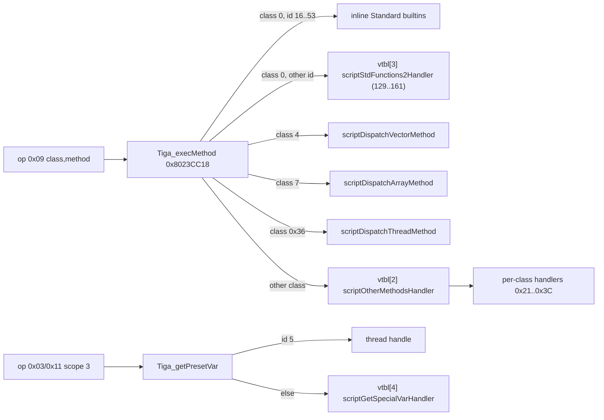

# Pokémon XD scripting engine

This document describes the script virtual machine of *Pokémon XD: Gale of Darkness* (PAL), as found in the RAM database `ram_xd.i64`. The engine is GS's "Tiga" VM (`GSscript`); the game drives field events, cutscenes, menus and many battle-side presentation steps with it.

All statements come from the binary: Hex-Rays output, disassembly, data tables and live RAM state in the PAL image, plus the compiled scripts on the PAL disc (`GXXP01`), which were decoded to see how the game's own scripts call each method. Repository notes were used only for orientation. Addresses are PAL effective addresses. Where a statement is an inference rather than an observation, it says so ("appears", "likely"). No method-name strings exist in the binary, so every script method name in the inventory is **derived** from its behaviour; the original names are unknown.

## Contents

1. [Overview](#overview)
2. [Script file and chunk format](#script-file-and-chunk-format)
3. [Bytecode](#bytecode)
4. [Value model](#value-model)
5. [Threads and scheduling](#threads-and-scheduling)
6. [Game integration](#game-integration)
7. [Diagnostics and quirks](#diagnostics-and-quirks)
8. [Builtin class inventory](#builtin-class-inventory)
9. [Open questions](#open-questions)

## Overview

Pokémon XD runs its field logic (floor setup, NPC talk, doors, fades, cutscenes) in a small stack-based bytecode VM. The engine-side code uses the prefix `Tiga_`. IDB comments link the PAL functions to public GXXE01 symbols: `GSscript::Tiga`, `GSscript::TigaThread`, `GSscript::tigaVariant`, `GSscript::tigaCellMemory`, `GSscript::TigaObjManager`, `GSscript::tigaArrayFixed`, `CChank` and `CChankBlock`. This document uses those class names where they help. The engine has three layers:

| Layer | Address range | Role |
|---|---|---|
| Tiga core | `0x8023B94C`–`0x8023FFFF` | Context and thread management, the interpreter `Tiga_execute`, the builtin dispatcher `Tiga_execMethod`, save/restore |
| GSscript runtime | `0x80240050`–`0x80245420` | Thread stacks, the value pools (`TigaObjManager`, `tigaCellMemory`), variant operators, (de)serialization, chunk parsing, and the vector, array and thread classes |
| Game integration | `0x801B9D70`–`0x801C7F68` (+ floor code near `0x80120000`–`0x8012C000`) | The extension vtable, special variables and about 20 game classes. The floor system loads scripts and starts them |

### Main structures

**`GSscriptVar` / `tigaVariant` (8 bytes).** Every script value, stack slot, global and register uses this layout.

| Offset | Type | Meaning |
|---|---|---|
| +0 | `s16` | Type tag (see [Value model](#value-model)) |
| +2 | `u16` | Padding. Every push writes 0 here |
| +4 | `u32` | Payload: an int, a float, or a pointer to a string, vector, array, GIRI entry or code word |

**`TigaContext` (0x988 bytes; the game allocates 0x9C0).** It is built by `Tiga_construct` (`0x8023FACC`). The context derives from `CChankBlock`: the first 16 bytes are the chunk object and the vtable pointer sits at +0x984.

| Offset | Field | Notes |
|---|---|---|
| +0x000 | `CChank` {base, end, count, vtable} | Parsed script image. The chunk vtable is at +0xC |
| +0x010 | image size | Copied from file header +4 on mapping. Saved and checked on restore |
| +0x014 | FTBL header word +0x18 | Copied on mapping; used only by `Tiga_makeStateData`/`Tiga_restoreStateData` to reject a save-anywhere state taken under a different script build. A 32-bit fingerprint of the script source: the same for every reuse of an image, different between byte-identical images built from different sources, and close for near-identical sources. It is not the name, archive id or resource id, and no common checksum of the image reproduces it. 0 in `common` and in 11 stub map scripts |
| +0x018 | `TigaObjManager` (0x8C0) | Vector refcounts `u8[128]` (+0x18), resource-occupied flags `u8[64]` (+0x98), `Vec3[128]` (+0xD8), resource IDs `u32[64][2]` (+0x6D8) |
| +0x8D8 | u32 | Dead field: never set by the constructor or the mapper, written only by `Tiga_restoreStateData` and read only by `Tiga_makeStateData`. 0 in both live contexts |
| +0x8DC | `active_thread_count` | |
| +0x8E0 | `float timers[4]` | Script clocks. `Tiga_executeThread` adds the frame time to each |
| +0x8F0 | `TigaThread* threads[8]` | Fixed set of 8 thread objects, 0x180 bytes each |
| +0x910 | `tigaCellMemory*` | String ownership (12 bytes) |
| +0x914 | `u32*` | Address of the running thread's IP field (thread+8). Builtins use it to reach thread+0x40 (see below) |
| +0x918 | `u8 syncFlags[16]` | Inter-thread flags (class 0x36). The IDB calls this `sync_flags`, which is wrong |
| +0x928 | `next_thread_handle` | Starts at 1 and skips 0 when it wraps |
| +0x92C | u8 | Cleared on every tick. Only saved and restored otherwise |
| +0x930 | u32 | Zeroed by the constructor. Only saved and restored otherwise |
| +0x934 | u32 | Used by the game's battle-actor class (handle count) |
| +0x938 | `GSscriptVar*` | Result of the last finished thread: it points at that thread's register 0 |
| +0x93C/+0x940 | HEAD count / data | The count bounds function IDs. The data pointer is set but never read |
| +0x944 | `code` | `u32*` to the CODE payload |
| +0x948/+0x94C | GVAR count / `globals` | |
| +0x950/+0x954 | STRG count / base | String literals are byte offsets into it |
| +0x958/+0x95C | VECT count / base | 12-byte vector literals |
| +0x960/+0x964 | GIRI count / base | 8-byte (groupID, resourceID) pairs |
| +0x968/+0x96C | ARRY count / `arrays` | Pointers to `tigaArrayFixed` objects |
| +0x970/+0x974 | FTBL count / `functions` | {code*, name*} pairs |
| +0x978 | `stack_capacity` = 512 | Written only. Threads use 256 slots |
| +0x97C | flags | Written only |
| +0x980 | `current_thread` | |
| +0x984 | vtable | Default `tigaContextVtable` (`0x804531D0`), or the game's at `0x804462A0` |
| +0x988 | (game) 7×8-byte battle-actor handle slots | Cleared by `scriptReinitCtx` and the load hook |

The global at `0x80525FA0` (SDA `r13-0x4460`, unnamed) holds the "current Tiga context". `Tiga_execute`, `Tiga_executeOneThread` and `Tiga_restoreStateData` set it, and the operators and pools use it to find the cell memory and the object pool.

**`TigaThread` (0x180 bytes).** It is built by `scriptThreadConstructor` (`0x80240A78`) and reset by `scriptThreadResetExecution` (`0x80240880`).

| Offset | Field | Notes |
|---|---|---|
| +0x000 | state flags | 1 active, 2 blocked, 4 sleeping on a context clock, 0x10 excluded from save |
| +0x004 | wait timer (float seconds) | Counted down by `Tiga_executeOneThread` |
| +0x008 | IP | `u32*` into CODE |
| +0x00C | FP (frame pointer) | Points at the current frame's return-address slot |
| +0x010 | SP | Top of the value stack. The stack grows downward |
| +0x014 | return-stack pointer | Saved caller FPs. This stack also grows downward |
| +0x018 | `GSscriptVar regs[4]` | Register 0 holds the method/function result |
| +0x038 / +0x03C | value-stack base / return-stack base | |
| +0x040 | string scratch (up to 0x14B) | Builtins that return strings write here via ctx+0x914 |
| +0x14C | current source line | Set by opcode 0x10 and shown as "Line" by `Tiga_debugDump` |
| +0x150 / +0x154 | value-stack allocation / count (256) | +0x150 is also the overflow limit |
| +0x158 / +0x15C | return-stack allocation / count (128) | |
| +0x160 / +0x164 | sleep clock index / sleep deadline | |
| +0x168 / +0x169 / +0x16C | sync mode / sync flag index / sync value | |
| +0x170 | owner context | |
| +0x174 | handle | |
| +0x178 | group | The floor "attribute" active when the thread was created |
| +0x17C | host `GSthread*` | Set when the thread runs in its own OS-level cooperative thread |

## Script file and chunk format

Compiled scripts are `TCOD` images. `loadCommonScript` (`0x80128AE8` region) and `loadMapScript` check the 4-byte magic `TCOD` themselves and then call `Tiga_mappingScript` (`0x8023F894`). That function clears the timers and calls `scriptChunkBlockLoad(ctx, data, NULL)` (`0x802443F0`). It passes no magic, so the Tiga core does not check `TCOD` itself. Finally it calls `Tiga_setTpcChank` (`0x8023F57C`).

**File header (16 bytes):** `"TCOD"`, u32 total size, 8 bytes that are zero in observed images. Subchunks follow from +0x10, back to back. `scriptChunkBlockLoad` counts them by stepping each subchunk's size field until it reaches base+size.

**Subchunk header (32 bytes), with the payload at +0x20:**

| Offset | Meaning |
|---|---|
| +0x00 | FourCC |
| +0x04 | Size including the header (the step to the next subchunk) |
| +0x08 | Attribute. `Tiga_setTpcChank` always searches with attribute 0 (`scriptChunkFindByFourCCAndAttribute`) |
| +0x10 | Element count |
| +0x14 | Section-specific: CODE = instruction word count, GVAR = 8, VECT = 12 (element sizes), FTBL = offset of the name pool |
| +0x18 | FTBL: copied to ctx+0x14. HEAD: set to 1 by the mapper |

A loaded common script in the RAM dump (`0x80BD2AC4`, 0x3D20 bytes) has the sections FTBL(26), HEAD(26), CODE(0xE48 words), GVAR(5), STRG, VECT(0), GIRI(4), ARRY(0). A map script at `0x80AB5000` has a single function, `hero_main`.

`Tiga_setTpcChank` requires **HEAD, CODE, GVAR, STRG and VECT**, in that order. If any of them is missing, mapping silently stops partway and the context is left half-initialized. **GIRI, FTBL and ARRY** are optional. The mapper rewrites the image in place:

- **FTBL:** each entry's code word offset becomes `&code[offset]`, and each name offset becomes `ftbl + offset`.
- **ARRY:** each entry becomes `arry+0x10 + offset`, and the array's halfword at +0xA receives its index. That index is what save files store.
- **HEAD:** the u32 at +0x18 is set to 1, but nothing checks it. Mapping the same buffer twice would rebase the FTBL and ARRY pointers a second time. This is an inference; no guard exists in the code.

When mapping is done, `Tiga_setTpcChank` calls vtable slot 6, the load hook. `Tiga_unmappingScript` (`0x8023F804`) clears every section pointer, calls slot 7 and clears the object pool.

### Function IDs

A function ID is `fileID << 16 | index`:

- `Tiga_getNameToFuncId` (`0x8023CA08`) searches FTBL names with `strcmp` and returns `index | 0x01000000`, or 0 if there is no match.
- The common script uses file ID `0x0596`. `scriptGetFunctionTypeFromID` and `floorGetScriptCtxForFunction` send `0x0596xxxx` IDs to the common context and every other ID to the active map context. This matches the loaded common image: `floorSetFloorLoadScriptCallbacks(0x5960009, 0x5960019)` names FTBL entries 9 (`fade_out`) and 25 (`restart_fade_in`).
- `Tiga_runParams` (`0x8023F4D0`) rejects an ID whose high half is 0 or whose index is at least the HEAD count. It then calls `Tiga_getIdToCodeAdress` (`0x8023CB20`), which returns `functions[index].code`. Its own bound check is `index <= function_count`, an off-by-one. In practice the earlier HEAD-count check protects it.
- `Tiga_runParamsPC` (`0x8023F1D4`) takes a free thread slot (`Tiga_makeThread`) and copies the N parameters onto that thread's stack so that `params[0]` ends up nearest the top. It then pushes a null return address (tag 0x35), pushes the old FP onto the return stack and sets FP to that slot. The function starts with `frame[0]` = null return, `frame[1..N]` = params. If `separateThread` is set, it creates a host `GSthread` ("GSscript thread", 0x2000-byte stack, entry `scriptExecuteThreadUntilStopped`). Otherwise it runs `Tiga_execute` once, inline. It returns the thread handle.
- `Tiga_runParamsWait` (`0x8023F118`) starts the function inline and then, while the thread is alive, calls `Tiga_executeOneThread` with the last frame time and `GSthreadYield()`. On exit it copies the result (`*ctx+0x938`, register 0 of the finished thread) into `*result`. `Tiga_getResultValue` reads the same slot as an int.

## Bytecode

### Encoding

Code is a sequence of big-endian 32-bit words: `[op:8][a:8][b:16]`. `b` is read signed (`lha`) for variable IDs and unsigned for literal and jump operands. Opcode 0x02 with an int, float or 0x35 tag uses one extra word as its immediate. Branch targets are word indices into CODE: `code[(a << 16) | b]`, giving 24-bit reach.

### Interpreter loop

`Tiga_execute` (`0x8023D83C`) is the interpreter. `Tiga_executeThread` is misnamed: it only advances the four context timers. Each iteration of `Tiga_execute`:

1. Stops if `SP <= thread+0x150`, the stack allocation base. This is a stack-overflow guard. It leaves the loop without stopping the thread, so the thread hangs: every later tick returns immediately.
2. Fetches the opcode byte and dispatches through the switch below.
3. Repeats until an opcode clears the continue flag (0x08 at a null return, 0x09 with a nonzero method result, 0x0F).

The function saves and restores the global current-context pointer and ctx+0x914, so nested runs (for example `Tiga_runParamsWait` called from inside a builtin) work. It always returns 1.

| Op | Operands | Semantics |
|---|---|---|
| 0x00 | – | No-op: IP += 1 |
| 0x01 | a = sub-op | Expression. `a < 0x20`: unary `Tiga_calcExpr1` on the top value, which is replaced. `a >= 0x20`: binary `Tiga_calcExpr2(left = SP[1], right = SP[0])`. Both operands are released and the result replaces them (net one pop) |
| 0x02 | a = tag, b = index, [imm] | Push a literal. Tags 0, 1, 2: value = next word. Tag 0x35: pushes **tag 1 (int)** with value = next word. Tag 3: `STRG + b` (byte offset). Tag 4: `VECT + 12*b`. Tag 0x2C: `GIRI + 8*b`. Any other tag leaves the payload unset. Tags other than 1 and 2 are then duplicated into owned storage (strings are copied to the heap, vectors to the pool) |
| 0x03 | a&0xF = scope, b = id | Push a copy of a variable (strings and vectors are duplicated). Scope 0 = `globals[b]`, 1 = `FP[b]` (signed; locals are negative, arguments positive), 2 = `regs[b]`, 3 = preset variable `Tiga_getPresetVar(b)` |
| 0x04 | scope, id | Pop into a variable. The destination is released first. The value **moves**: it is not copied, and the stack slot is cleared without being released. Scope 3 goes to `Tiga_setPresetVar`, which is a no-op in the game |
| 0x05 | scope, a>>4 = component, id | Pop a number into one vector component (`scriptVariantSetVectorComponent`). The target is converted to a fresh zero vector if it was nil, int or float. Scope 3 goes to `Tiga_setPresetVar` with the component |
| 0x06 | a = n | Pop n values, releasing each |
| 0x07 | a:b = target | Call: push the return address (tag 0x35, IP+1), jump, push the old FP onto the return stack, FP = SP |
| 0x08 | – | Return: FP = pop(return stack). If `*SP`'s payload is non-null, IP = that payload and the slot is popped. If it is null, this was the outermost frame: the result pointer is set to `&regs[0]`, the thread stops and the active count drops |
| 0x09 | a = class, b = method | `Tiga_execMethod(ctx, a, b, args = SP, result = &regs[0])`. Arguments are **not** popped; the compiler emits a 0x06 after the call. A nonzero return makes the thread yield. IP is advanced first, so execution resumes after the call |
| 0x0A | a:b | Jump if `SP->value` (raw 32 bits) is nonzero, then pop |
| 0x0B | a:b | Jump if it is zero, then pop |
| 0x0C | a:b | Unconditional jump |
| 0x0D | a = n | Push n nils (reserve locals) |
| 0x0E | a = n | Pop n values with release. Same code as 0x06; compiled scripts use it to free locals before 0x08 |
| 0x0F | – | Stop the thread (end) |
| 0x10 | b = line | Store the source line number in thread+0x14C. Debug only. The IDB field name `source_line` is wrong |
| 0x11 | scope, id | Push a **reference**: the pointer is copied without duplication and a vector is retained (refcount + 1). If byte 1 of the *next* instruction is 4, a non-vector variable is first replaced by a new pool vector. In practice this means "next op is a method call on class 4 (vector)", so `v.method()` works on an uninitialized variable. Used to push method receivers |
| other | – | `default: continue` without advancing IP: the loop spins forever on an unknown opcode |

A real example is the map script `hero_main` at `0x80AB50A0`:

```
0D 01 0000      reserve 1 local
10 00 002C      line 44
11 01 FFFF      push ref FP[-1] (receiver)
09 26 0025      call class 0x26 (Floor) method 0x25
06 01 0000      pop 1 (receiver)
0E 01 0000      free local
08 00 0000      return (null return address -> thread ends)
```

The common script's `fade_in` pushes `0.5f` and then `2`, pushes a receiver with `11 01 00FF`, calls `09 29 0010` (class 0x29, Transition) and pops 3 with `06 03`. Arguments are pushed right to left, so `args[1]` is the first source argument. The receiver operand varies: `FP[-1]` (a local), `FP[255]` or preset variable 0x29 (`11 03 0029`, the same value as the class ID). The last two read out of range or return nil. That is harmless: of the 26 dispatchers, only Vector, Array, Character, Pkm and BattleActor read `args[0]` (see the inventory), so for every other class the receiver is a dummy.

### Calling convention summary

- **Script → script:** push the arguments right to left, then `07` (pushes the return address and sets FP). The callee reserves locals with `0D`, addresses them as `FP[-k]` and its arguments as `FP[+k]`, and returns with `0E`/`08`. Return values travel in register 0. This is likely: the compiler writes it with `04` scope 2. `Tiga_runParamsWait` and `Tiga_getResultValue` read register 0 of the finished thread.
- **Script → native:** `09 class method`. `args` points at the top of the stack. For class 0 (standard functions), `args[0]` is the first argument. For the other classes, `args[0]` is the receiver slot and `args[1..]` are the arguments (examples: `scriptDispatchThreadMethod`, `scriptLightMethods`). The result is written to `regs[0]` and is set to int 0 before dispatch. A nonzero return value means "yield now".
- **Globals** live in the GVAR section of the image, so the mapped image is mutable. **Registers** are per-thread (4 slots); the id is not range-checked. **Preset variables** (scope 3) go through the context vtable.

### Expression sub-opcodes

Unary, `Tiga_calcExpr1` (`0x8023E7D4`). The result starts as a copy of the operand.

| Sub | Meaning |
|---|---|
| 0x10 | Bitwise NOT (`not`). For a float: `~(int)f` converted back to float |
| 0x11 | Negate an int or float. A vector is negated **in place** through its pointer |
| 0x12 | Format as hex (`%08x`; floats are truncated first) into a new string |
| 0x13 | Convert to a string: `%d`, `%.3f` or `<%.3f, %.3f, %.3f>` |
| 0x14 | To int: float truncation or `atoi` on a string |
| 0x15 | To float: int conversion or `atof` |
| 0x16/0x17/0x18 | Vector `.x`/`.y`/`.z` as a float. A non-vector warns and gives 0.0 |
| 0x19 | Always float 0.0 (likely `.w`, since component setters accept index 3) |

Binary, `Tiga_calcExpr2` (`0x8023E504`), with left = the deeper stack slot:

| Sub | Op | Implementation |
|---|---|---|
| 0x20 / 0x21 / 0x22 | `^` `\|` `&` | Inline. Both operands coerced to int (strings via `atoi`) |
| 0x23 | `+` | `scriptOperatorAdd` (`0x80243958`) |
| 0x24 | `-` | `scriptOperatorSub` (`0x80243534`) |
| 0x25 | `*` | `scriptOperatorMul` (`0x80242FD4`) |
| 0x26 | `/` | `scriptOperatorDiv` (`0x80242B84`) |
| 0x27 | `%` | `scriptOperatorMod` (`0x80242A10`) |
| 0x30 | `==` | `scriptOperatorEqu` (`0x80242660`) |
| 0x31 | `>` | `scriptOperatorGt` (`0x80242138`) |
| 0x32 | `>=` | `scriptOperatorGe` (`0x80241F24`) |
| 0x33 | `<` | `scriptOperatorLt` (`0x80241D14`) |
| 0x34 | `<=` | `scriptOperatorLe` (`0x80241B00`) |
| 0x35 | `!=` | `scriptOperatorNeq` (`0x80242348`) |

Sub-opcodes 0x28–0x2F are unused (default). There are no logical `&&`/`||` operators; the compiler presumably emits them as branches. All operators take `(left, result, right)`.

**Arithmetic promotion** (Add, Sub, Mul, Div, Mod). If the tags differ, each tag is ranked: tags at or above 64 count as string, and string ranks 32. The higher rank wins. So int < float < vector < string, and int + string is a string concatenation.

- **Add:** concatenates strings (non-strings are formatted via `scriptVariantFormatIntoBuffer`) into the static `tmpScriptAddString` with an unbounded `strcpy`/`strcat`, then copies the result to the heap. Vectors add componentwise (`PSVECAdd`). For vector with scalar, the scalar is added to each component. Results are int or float otherwise.
- **Mul:** `string * n` repeats the string if `n*len <= 250`, otherwise it yields the literal `"null"`. Vectors multiply componentwise or by a scalar.
- **Div:** an int or float divisor of 0 warns ("integer div 0" / "single div 0") and gives 0.
- **Mod:** works on ints only. A zero divisor warns but **still executes** `divw`, whose result PowerPC leaves undefined.

**Comparisons** use `max(tagL, tagR)`:

- **`<` `<=` `>` `>=`:** compare ints, then floats. Two strings are compared by **length** (`strlen`).
- **`==`:** two strings use `scriptCustomStrcmp` (`0x80242978`), a matcher where `?` matches any one character and `*` matches the rest. Vectors (or a vector and a scalar) are equal if every component differs by less than 1e-5.
- **`!=`:** uses a plain `strcmp`. It is **not** the negation of `==`: `"ab*" == "abc"` is true and `"ab*" != "abc"` is also true.
- A string compared with a non-string gives 0 for both `==` and `!=`.
- Unsupported tags warn ("… convert error") and give int 0.

## Value model

`scriptVariantGetTypeName` (`0x80240F08`) indexes a 32-entry name table at `0x80453370`:

| Tag | Name | Notes |
|---|---|---|
| 0 | `type_nodef` | nil. Pushed by `0D`, written into cleared slots |
| 1 | `type_integer` | |
| 2 | `type_single` | float32 |
| 3 | `type_string` | `char*`. Owned copies are 256-byte heap blocks |
| 4 | `type_vector` | `Vec3*` into the context vector pool |
| 5 | `type_matrix` | 48-byte payload, serialized only |
| 6 | `type_object` | Serialized as its tag only |
| 7 | `type_tarray` | `tigaArrayFixed*` (ARRY section). Class 7 |
| 8 | `type_funcptr` | |
| 9–31 | `cmp_task`, `cmp_frame`, `cmp_model`, `cmp_light`, `cmp_texture`, `cmp_switch`, `cmp_frame_motion`, `cmp_pad`, `cmp_player`, `cmp_map`, `cmp_enemy`, `cmp_camera`, `cmp_chara`, `cmp_adpcm`, `cmp_text`, `cmp_fog`, `cmp_menu`, `cmp_blight`, `cmp_radio`, `cmp_item`, `cmp_effect`, `cmp_sound`, `cmp_last` | Names only. No code in the ranges examined handles these tags |
| 0x23 (35) | *(no name)* | Character handle: a pointer to a GIRI (group, resource) pair. The game's `scriptStoreNPC` writes it |
| 0x25 (37) | *(no name)* | Pokémon handle. The IDB enum calls it `pkm` |
| 0x2C (44) | *(no name)* | Literal tag that would push a GIRI entry pointer (op 0x02). No script on the disc uses it: compiled scripts emit only literal tags 1–4 and reach GIRI entries through preset variables 128+ |
| 0x35 (53) | *(no name)* | Code address (return address, thread-start sentinel) |

Tags 32–53 have no names. `scriptVariantGetTypeName` accepts every tag up to 53, so for tags 32–53 it reads past the table into unrelated data: NULLs, a `tigaCellMemory` vtable entry, a jump table. It also maps tag 55 to `type_nodef`. The type-name builtin can therefore return NULL or code bytes for character and Pokémon values.

Object tags match the dispatch class IDs: 4 vector, 7 array, 0x23 character, 0x25 Pokémon. Op 0x11's look-ahead relies on this.

**Coercions:**

- `scriptVariantParseInteger` and `scriptVariantParseFloat` apply `atoi`/`atof` to strings. Any other tag warns and gives 0.
- Operators convert int ↔ float directly.
- `scriptVariantCoerceVector` returns the pointer of a tag-4 value. For anything else it fills the static `tmpVectorBuffer` (`0x804EBE6C`), but the code (`stfsu`/`stfs 4`/`stfs 0`) writes **x twice and y once and never writes z**. A scalar coerced to a vector therefore keeps a stale z from the previous coercion. This affects `==` and `!=` between a vector and a scalar.
- Add/Sub/Mul/Div with one vector and one scalar only work when the vector is on the left. With the scalar on the left, the code reads the "vector" components from the scalar, warns ("vec.vx not access") and builds `<s,s,s>`.

**Ownership:**

- **Strings:** `scriptCellMemoryDuplicateVariant` (`0x80244188`) allocates 256 bytes, copies with `strncpy(…, 255)` (no explicit terminator) and records the block in a global 256-slot table. If more than 256 owned strings are live, `scriptStringPoolFindFreeSlot` returns NULL and the pointer is stored to address 0. `scriptCellMemoryReleaseVariant` frees only blocks found in that table, so literals and other borrowed strings are never freed.
- **Vectors:** a 128-entry pool in the context with `s8` refcounts. Duplicating takes a new slot and copies xyz; release decrements the count. `scriptVectorPoolAllocate` scans 129 bytes, one past the end. When all 128 slots are taken it claims `resourceOccupied[0]` and returns `vectors[128]`, which overlaps `resources[0]`. `scriptResourcePoolAllocate` has the same off-by-one and returns `resources[64]`, overlapping the vector refcounts.
- If vector allocation fails, the duplicated value keeps pointing at the source. The source is often an operator's stack buffer, so the value then points at dead stack memory.
- **Copy and move:** `03` copies (duplicates), `11` shares (no duplication; vectors retained), `04` moves, and pops release. Note that `11` on a string variable would push a borrowed pointer that a later pop releases, which frees the variable's string. This is an inference; in the analysed code `11` is only emitted for receivers.
- **Arrays** (`tigaArrayFixed`) live in the mapped image: {u32 size, u32 iterator, u8 no-save flag at +8, u16 index at +0xA, vtable at +0xC, elements at +0x10}. Append and resize are empty stubs. Out-of-range get/next return a shared static int-0 variant at `0x80525FA8`, so writing through it changes the sentinel for everyone.

### Serialization

`scriptSerializeVariant` (`0x80241398`) and `scriptDeserializeVariant` (`0x80240F6C`) are big-endian. The format is a u16 tag followed by:

| Tag | Payload |
|---|---|
| 0, 6, 8–34, 36–52 | none |
| 1, 2 | 4 bytes |
| 3 | u16 length including NUL, then the bytes. Restored through the static buffer `0x804EBD6C` and duplicated |
| 4 | 3 × f32. Restored into a new pool vector; if none is available the payload is skipped and a null vector pointer is left |
| 5 | 48 bytes. On restore it is copied to `value->value`, which was just set to 0, so it **writes to address 0** |
| 7 | u32 array index (array+0xA). Resolved through `arrays[]`; a bad index becomes int 0 |
| 0x23 | two u32s (groupID, resourceID). Resolved by a linear search of GIRI; a missing pair becomes int 0 |
| 0x35 | u32 word index relative to CODE (0 = null) |

`Tiga_makeStateData` (`0x8023C230`; size measured by `Tiga_getStateSize`, which writes nothing) emits, in order:

1. u32 version (0)
2. u32 ctx+0x8D8
3. u32 ctx+0x14 (FTBL ID)
4. u32 image size
5. u32 active count
6. the 4 timers
7. the 16 sync flags
8. u32 next handle
9. u8 ctx+0x92C
10. u32 ctx+0x930
11. the globals (count + variants)
12. the arrays (count, then per array a no-save byte; if it is 0, the size and the elements)
13. u32 8, then 8 thread records

Each thread record (`scriptSerializeThreadState`, `0x80240050`) holds:

- the flags, written as 0 when flag 0x10 is set
- the wait timer
- IP as a CODE word index
- SP, FP and the return-stack pointer as indices
- the 4 registers
- the line number
- all 256 stack slots
- all 128 return-stack slots
- the sleep and sync fields

`Tiga_restoreStateData` (`0x8023BC2C`) fails unless the version is 0, the FTBL ID matches (or both are 0) and the image size matches. It gives every live thread a **new handle** and a new host `GSthread`.

**Bug:** for each return-stack slot the serializer writes `(&returnStack[i] - base) >> 2`, which is just `i`, instead of the saved frame pointer. `TigaThread_restoreStateData` (`0x8023FCC4`) rebuilds the slot as `stackBase + 8*value`. As a result, a thread saved inside a nested script call gets wrong caller frame pointers after restore. Only the outermost frame survives intact. The game saves only the first frame's map context, in the "ANSW" (save-anywhere) blob built by `saveMapState`, and then runs `anywaysave_restart`.

## Threads and scheduling

Each context has exactly **8 thread slots**. Threads are cooperative: a thread runs until a builtin returns nonzero (yield), the thread ends, or the stack-overflow guard trips.

- **Creation:** `Tiga_makeThread` (`0x8023F030`) picks the first slot with flags = 0 and resets it. The reset puts a tag-53 null sentinel at the top of the stack and sets FP = SP = that slot. It then assigns the handle (skipping 0 when the counter wraps), sets the group to the current floor attribute (`floorContextGetAttributeGlobal`), the IP and flags = 1, and increments the active count. Callers are `Tiga_runParamsPC` and thread method 0x10 of class 0x36.
- **Per-frame execution:** there is no central scheduler loop over the 8 slots. Each thread started with `separateThread = 1` gets its own `GSthread` running `scriptExecuteThreadUntilStopped` (`0x80240DCC`). That function alternates `Tiga_executeOneThread(ctx, handle, lastFrameSeconds)` with `GSthreadYield()` until the thread is no longer running, so the GS cooperative thread scheduler provides the per-frame stepping. Synchronous calls run the same loop in the caller's thread (`Tiga_runParamsWait`).
- **`Tiga_executeOneThread` (`0x8023EBA0`):**
  1. A blocked thread (flag 2) counts as alive but does not run.
  2. Otherwise the wait timer is reduced by the frame time.
  3. If `scriptThreadCanResume` passes and the wait timer is at most 0, `Tiga_execute` runs.
- **Waits:**
  - *Timed wait:* builtin 17 sets the wait timer in seconds and yields.
  - *Clock wait:* a builtin sets flag 4 with a clock index and a deadline. `scriptThreadCanResume` (`0x80240768`) waits until `ctx->timers[idx] >= deadline`.
  - *Sync wait:* class 0x36 methods 0x16 and 0x17 set mode 1 (wait while `syncFlags[i] >= value`, i.e. until it is less) or mode 2 (wait until `syncFlags[i] == value`). The mode is cleared once it is satisfied.
  - *Context clocks:* `Tiga_executeThread` advances them. It is called only by `floorUpdateScriptTimers`, for the **active frame's** map context, so the common context's clocks never advance on their own (verified: the only other writers of `timers[]` are `Tiga_restoreStateData` and the Standard set-timer method).
- **Destruction:**
  - `TigaThread_stop` (`0x8023FC7C`) clears the flags and calls `GSthreadExit` on the host thread. It is called by op 0x08 (outermost return) and op 0x0F.
  - `Tiga_deleteThread` stops a thread and decrements the count.
  - Group operations (`Tiga_deleteThreadGroup`, `Tiga_blockThreadGroup`, `Tiga_unblockThreadGroup`) act on every live thread whose group equals the attribute. They back `floorStopScript`, `floorSuspendAttributeTasks` and `floorUnsuspendAttributeTasks`, which apply them to both the common and the map context.
- **Save exclusion:** `TigaThread_setSaveFlag` (`0x8023FC50`; its only caller is `scriptMenusMethods`) sets or clears the inverted no-save bit 0x10.
- **Host threads:** a script thread runs inside a GS cooperative thread whose entry point is `scriptExecuteThreadUntilStopped` (`0x80240DCC`). That function calls `Tiga_executeOneThread` once per frame until the script thread stops. The host is created by `Tiga_runParamsPC` (`lis`/`addi` of the entry point at `0x8023F454`) and by `Tiga_restoreStateData` (`0x8023BC2C`; load at `0x8023C1AC`). `Tiga_runParamsPC` is at `0x8023F1D4`. IDA records no cross-reference for these address loads, but the entry pointer is visible in live `GSthread` records (e.g. `0x8058C424`).
- **Script-spawned threads (verified):** `Tiga_makeThread` only resets the thread's execution state; the host is created separately by `Tiga_runParamsPC` (`floorCreateModuleInTransientHeap`). Class 0x36 method 0x10 calls `Tiga_makeThread` alone, so such a thread never runs unless a save/restore cycle (`Tiga_restoreStateData`) later gives it a host. Class 0x36 method 0x11 is a stub that returns 0.

## Game integration

### Contexts

There are two kinds of `TigaContext`, both using the game vtable:

- **Common context:** inline at FloorContext+0x1C (constructed via `floorContextConstruct` → `scriptReinitCtx`). It holds the image of the common script, file ID `0x0596`, with functions such as `fade_in`, `door_open`, `elevator`, `evolution` and `flagshop`.
- **Map context:** one per floor frame, created on demand by `floorFrameEnsureScriptCtx` → `scriptCreateCtx` (`0x801BFC8C`, `GSoperatorNew(0x9C0)`).

`scriptReinitCtx` (`0x801BFC40`) runs `Tiga_construct`, installs the vtable at `0x804462A0` into +0x984 and clears the actor-handle slots at +0x988.

### Extension vtable

| Slot | Default (`0x804531D0`) | Game (`0x804462A0`) | Called from |
|---|---|---|---|
| 2 | `Tiga_execExtendMethod` → 0 | `scriptOtherMethodsHandler` (`0x801BF868`) | `Tiga_execMethod`, class ∉ {0, 4, 7, 0x36}; args (ctx, class, method, args, result) |
| 3 | `Tiga_execExtendGlobalFunction` → 0 | `scriptStdFunctions2Handler` (`0x801BEBBC`), builtins 129–161 | class 0 with a method ID not handled inline |
| 4 | `Tiga_getExtendVariable` → 0 | `scriptGetSpecialVarHandler` (`0x801BEB24`) | `Tiga_getPresetVar` for ids other than 5 |
| 5 | `Tiga_setExtendVariable` | `scriptSetSpecialVarHandler` (`0x801BEB1C`), empty | `Tiga_setPresetVar` |
| 6 | `scriptMappingStub` | `scriptLoadFinishHandler` (`0x801BFBB4`): clears the 0x38-byte actor-handle block | end of `Tiga_setTpcChank` |
| 7 | `scriptUnmappingStub` | `scriptExtensionNoopHook` | `Tiga_unmappingScript` |
| 8 | `Tiga_destroy` | `scriptClearVarsHandler` (`0x801BFBE0`): resets the vtable and runs `Tiga_destroy` | destructor |

### Special (preset) variables

These are read with scope 3 of op 0x03 or op 0x11.

| ID | Meaning | Source |
|---|---|---|
| 5 | Current thread handle (int; 0 if none) | `Tiga_getPresetVar` (core) |
| 128–288 | Character handle (tag 0x23) = `GIRI + 8*(id−128)`. GIRI holds the script's referenced (group, resource) pairs; both observed images list (0,100), (0,101), (0,104), (0,105) | `scriptGetSpecialVarHandler` |
| 512–767 | `arrays[id−512]` as tag 7. Past `array_count` the result is int 0 | `scriptGetSpecialVarHandler` |
| anything else | nil (the handler returns false and the result stays tag 0) | |

There is no bound check of 128–288 against the GIRI count, so ids past the end produce pointers past the section. Every write to a special variable is discarded.

### How the game starts scripts

| Entry | Mechanism |
|---|---|
| Floor lifecycle | `floorPrepareLoadedModules` looks up `preprocess`, `hero_main` and `postprocess` in the map script and registers them as a script lifecycle module (`floorCreateScriptLifecycleModule`). Each phase starts asynchronously through `floorLoadMainScript` (`Tiga_runParams(..., 4 int params, separateThread = 1)`) and is polled or stopped via its task ID |
| Named synchronous hooks | `scriptCreateSyncELByName`: `modify_floor`, `pushpop_preprocess`, `pushpop_postprocess`, `anywaysave_callback`, `anywaysave_restart`, `sound`, `menu_button`, `menu_cursor` |
| By ID | `scriptCreateSyncEL` / `scriptCreateAsyncEL` take 4 int params and choose the context from the ID. Triggers (`floorDispatchTriggerEvent`), fade callbacks (`loadFloor`, `floorInvokeFadeOutScriptCallback`), queued field input, mail eligibility, and script-to-script calls from `scriptEventsMethods` |
| NPC interaction | `scriptExecSyncNPCIH` (talk) and `scriptExecAsyncNPCIH` (move scripts) resolve (group, resource) with `Tiga_searchResID` and pass a tag-0x23 handle as the only parameter. Followers 101, 104 and 105 use `talk_follower` (`peopleGetTalkSctID`) |
| From scripts | Builtin `scriptExeSpecialFuncAsSyncTask` runs a common-script function synchronously with a forwarded argument list |

### Class IDs dispatched by `scriptOtherMethodsHandler`

Unknown classes return 0 silently.

| Class | Handler | Class | Handler |
|---|---|---|---|
| 0x21 | `scriptCameraMethods` | 0x2E | `scriptCollisionObjectMethods` |
| 0x23 | `scriptCharacterMethods` | 0x2F | `scriptSoundFunctions` |
| 0x25 | `scriptPkmMethods` | 0x30 | `scriptControllerMethods` |
| 0x26 | `scriptFloorMethods` | 0x31 | `scriptMailAndNoticeMethods` |
| 0x27 | `scriptEventsMethods` | 0x32 | `scriptEvolutionPurificationAndMirorMethods` |
| 0x28 | `scriptMenusMethods` | 0x33 | `scriptFloorTextureResetMethods` |
| 0x29 | `scriptTransitionMethods` | 0x34 | `scriptDaycareMethods` |
| 0x2A | `scriptEncounterMethods` | 0x3A | `scriptBattleActorMethods` |
| 0x2B | `scriptPartyMethods` | 0x3B | `scriptShadowPkmMethods` |
| 0x2C | `scriptLightMethods` | 0x3C | `scriptPokeSpotMethods` |
| 0x2D | `scriptObjectMethods` | | |

The core also handles class 0 (Standard, inline ids 16–53), 4 (`scriptDispatchVectorMethod`), 7 (`scriptDispatchArrayMethod`) and 0x36 (`scriptDispatchThreadMethod`).



## Diagnostics and quirks

- **Warnings go nowhere.** Every runtime diagnostic goes through `scriptRuntimeWarningStub` (`0x80240E50`, `tigaErrMessage`), which is empty, and execution continues with a default value (usually int 0). Messages include "add/sub/mul/div/mod/equ/not/ls convert error", "integer div 0", "single div 0", "integer mod 0", "vec.vx/vy/vz not access", "vector index error", "vector set error" and "timer error". Mod by zero still divides.
- **Hangs instead of errors:** an unknown opcode spins forever (`default: continue`). Stack overflow makes `Tiga_execute` return on every tick without ending the thread.
- **Bounds checks that exist:** class 0x36 flag indices (< 16), timer indices ("timer error"), vector component index (< 4, i.e. **0–3** although vectors are 12 bytes, so index 3 writes past the vector into the next pool entry), array get/set, and the deserialized array index.
- **Bounds checks that are missing:** the register id (scope 2), the GIRI special-variable range, the string-pool slot table, the off-by-one pool allocators, and `Tiga_getIdToCodeAdress` (`<=`).
- **Silent mapping failure:** `Tiga_setTpcChank` stops silently if a required section is missing.
- **Unary operators on heap values (appears):** `Tiga_calcExpr1` copies the operand into the result and op 0x01 then releases the operand. For a vector operand of 0x11, the result keeps a pointer whose refcount has just been decremented. For an unsupported string operand of 0x10, the result points at a string that was just freed.
- **Comparisons:** string `<`/`>` compare lengths; `==` is wildcard-aware while `!=` is not; scalar-to-vector coercion leaves z stale.
- **Execution-context pointer (appears):** `Tiga_executeOneThread` does not restore the global current-context pointer on its "no thread" and "blocked" paths.
- **Save format:** the return stack is not round-tripped correctly. Restored threads get new handles, so handles stored in script variables across a save-anywhere become stale. Matrix restore writes to address 0.
- **Thread-local string results:** string-returning builtins write into a 255-byte thread-local buffer at thread+0x40 and return it in register 0 without heap ownership. The next such call overwrites it.
- **Static buffers:** concatenation and repetition use the unbounded static buffers `tmpScriptAddString` and `tmpScriptMultString`. Mul limits its output to 250 bytes; Add has no limit.
- **Debug overlay:** `Tiga_debugDump` (`0x8023B94C`, called from `loadFloor`) shows the run-thread count, the four timers and, per slot, the line, the stack depth and the function name. It finds the name by scanning FTBL for the last entry whose code starts at or before the IP, which assumes FTBL is sorted by code address.
- **Literal pool used as a scratch buffer (game bug):** `TigaContext.strings` (+0x954) is the `STRG` literal pool: `Tiga_setTpcChank` stores the chunk header word +0x10 at +0x950 and the data pointer (chunk+0x20) at +0x954, and opcode 2 with literal type 3 resolves `strings + offset` (`0x8023DA5C`). Yet `scriptPrintf`, `scriptAnyFlagMatchesPattern`, `scriptAllFlagsMatchPattern`, Events methods 18/19 and one Menus case pass it as the output buffer of `scriptVariantFormatIntoBuffer` whenever an argument is not a string. The pool has no reserved scratch area: in this RAM image the common context's pool begins with its first literal, and the current map context's `STRG` is empty, so its pointer lands on the following `VECT` chunk header (0x20 bytes, followed by the vector literals). Formatting a non-string argument therefore overwrites the first literals, or that header and possibly vector literals. Chunk headers are only looked up at load time, so header damage alone is harmless.
- **Type-name table overread (game bug):** `scriptVariantGetTypeName` (`0x80240F08`) accepts tags up to 53, but its table at `0x80453370` has valid entries only for 0–31; tags 32–53 return unrelated data as a name.
- **Dead battle branch (game bug):** in `scriptStartBattleEncounter` (`0x801C983C`) the flag-0x30D branch re-tests the same flag, so the `scriptStartGroupBattle` path can never run and `battleResult` would be uninitialised on it.

## Builtin class inventory

26 dispatchers implement **537 script methods**. Class names are derived, except Vector and Array, whose type-tag strings `type_vector` and `type_tarray` exist in the name table at `0x80453370`.

### Summary

| Class id | Class (derived) | Dispatcher | Receiver | Methods | Method ids |
|---|---|---|---|---:|---|
| 0 | Standard (core) | `Tiga_execMethod` `0x8023CC18`, inline | static | 25 | 16–53 (subset) |
| 0 | Standard (game extension) | `scriptStdFunctions2Handler` `0x801BEBBC` (vtable slot 3) | static | 29 | 129–161 (subset) |
| 4 | Vector | `scriptDispatchVectorMethod` `0x802449AC` | `args[0]` vector | 14 | 3, 16–28 |
| 7 | Array | `scriptDispatchArrayMethod` `0x802445F0` | `args[0]` array | 10 | 3–25 |
| 33 (0x21) | Camera | `scriptCameraMethods` `0x801BFCC8` | static | 48 | 16–63 |
| 35 (0x23) | Character | `scriptCharacterMethods` `0x801C57A4` | `args[0]` character handle (tag 35) | 98 | 1, 16–114 |
| 37 (0x25) | Pkm | `scriptPkmMethods` `0x801BDDE0` | `args[0]` Pokémon handle (tag 37); id 16 static | 22 | 16–38 |
| 38 (0x26) | Floor | `scriptFloorMethods` `0x801C1E78` | static | 52 | 16–67 |
| 39 (0x27) | Events | `scriptEventsMethods` `0x801BD83C` | static | 6 | 16–21 |
| 40 (0x28) | Menus | `scriptMenusMethods` `0x801C4224` | static | 48 | 16–79 |
| 41 (0x29) | Transition | `scriptTransitionMethods` `0x801BD70C` | static | 2 | 16–17 |
| 42 (0x2A) | Encounter | `scriptEncounterMethods` `0x801BCE1C` | static | 27 | 16–42 |
| 43 (0x2B) | Party | `scriptPartyMethods` `0x801C322C` | static | 54 | 16–69 |
| 44 (0x2C) | Light | `scriptLightMethods` `0x801BC8A8` | static | 8 | 16–23 |
| 45 (0x2D) | FloorObject | `scriptObjectMethods` `0x801BBC30` | static | 20 | 16–35 |
| 46 (0x2E) | CollisionObject | `scriptCollisionObjectMethods` `0x801BBB00` | static | 3 | 16–18 |
| 47 (0x2F) | Sound | `scriptSoundFunctions` `0x801BAE98` | static | 18 | 16–33 |
| 48 (0x30) | Controller | `scriptControllerMethods` `0x801BAC2C` | static | 5 | 16–20 |
| 49 (0x31) | MailAndNotice | `scriptMailAndNoticeMethods` `0x801BAAAC` | static | 5 | 16–20 |
| 50 (0x32) | EvolutionPurificationMiror | `scriptEvolutionPurificationAndMirorMethods` `0x801BA8C8` | static | 7 | 16–22 |
| 51 (0x33) | FloorTextureReset | `scriptFloorTextureResetMethods` `0x801BA828` | static | 2 | 16–17 |
| 52 (0x34) | Daycare | `scriptDaycareMethods` `0x801BA6BC` | static | 7 | 17–20, 22–24 |
| 54 (0x36) | Thread | `scriptDispatchThreadMethod` `0x80244FD4` | `args[0]` reserved, never read | 8 | 16–23 |
| 58 (0x3A) | BattleActor | `scriptBattleActorMethods` `0x801BA2E0` | `args[0]` actor handle (tag 58) | 7 | 16–22 |
| 59 (0x3B) | ShadowPkm | `scriptShadowPkmMethods` `0x801BA064` | static | 7 | 16–22 |
| 60 (0x3C) | PokeSpot | `scriptPokeSpotMethods` `0x801B9DFC` | static | 5 | 16–20 |

The method ids column gives the range only; see each class for gaps and shared cases.

### Script usage

The 243 compiled scripts on the disc (197 distinct images: the floor, menu and event scripts plus the common script embedded in `common_rel`) contain 33,720 method calls. They call 347 of the 537 methods and no undocumented method id. Whole classes go unused by script code: Vector (4), Thread (54) and FloorTextureReset (51). Of the inline Standard builtins only 18 (`yieldHostFrames`) is called; scripts wait with `Events.sleep` (39/21), and the arithmetic, bit and string builtins appear in no script. The most-used methods are Character 73 `doSequence` (4,068 sites in 131 scripts), Standard 133 `getFlagValue` (2,745), Character 16 `setVisible` (1,447), Character 29 `setPosition` (1,164) and Character 39 `waitMove` (1,049).

| Class | Methods | Called | Call sites | Never called by any script |
|---|---:|---:|---:|---|
| 0 Standard | 54 | 23 | 5,520 | inline 16, 17, 19–23, 25, 26, 28–36, 48–53; extension 138, 140, 143, 145, 146, 160, 161 |
| 4 Vector | 14 | 0 | 0 | all |
| 7 Array | 10 | 2 | 729 | all but 16 `get` and 17 `set` |
| 33 Camera | 48 | 30 | 2,364 | 16, 19, 20, 22, 24, 29, 30, 32, 34, 35, 41, 42, 43, 45, 49, 57, 58, 61 |
| 35 Character | 98 | 82 | 17,248 | 1, 26, 28, 32, 33, 34, 53, 57, 63, 65, 71, 78, 82, 85, 93, 99 |
| 37 Pkm | 22 | 17 | 130 | 18, 21, 29, 31, 33 |
| 38 Floor | 52 | 38 | 716 | 20, 26–29, 31, 32, 33, 35, 36, 47, 48, 64, 67 |
| 39 Events | 6 | 3 | 1,056 | 16, 18, 20 |
| 40 Menus | 48 | 38 | 607 | 19, 20, 22, 24–27, 32, 50, 73 |
| 41 Transition | 2 | 2 | 1,239 | — |
| 42 Encounter | 27 | 9 | 178 | 19–22, 24, 25, 27–32, 34–36, 38, 39, 41 |
| 43 Party | 54 | 38 | 1,582 | 16, 21, 22, 23, 25, 33, 36, 38, 40–43, 46, 48, 58, 62 |
| 44 Light | 8 | 6 | 271 | 18, 19 |
| 45 FloorObject | 20 | 11 | 465 | 22, 23, 24, 27, 28, 30, 32, 33, 34 |
| 46 CollisionObject | 3 | 1 | 376 | 17, 18 |
| 47 Sound | 18 | 13 | 668 | 20, 21, 26, 28, 32 |
| 48 Controller | 5 | 2 | 11 | 16, 17, 18 |
| 49 MailAndNotice | 5 | 4 | 22 | 17 |
| 50 EvolutionPurificationMiror | 7 | 4 | 4 | 18, 21, 22 |
| 51 FloorTextureReset | 2 | 0 | 0 | all |
| 52 Daycare | 7 | 6 | 8 | 18 |
| 54 Thread | 8 | 0 | 0 | all |
| 58 BattleActor | 7 | 6 | 448 | 20 |
| 59 ShadowPkm | 7 | 7 | 40 | — |
| 60 PokeSpot | 5 | 5 | 38 | — |

Methods that no script calls are not necessarily dead: several are reached from code paths or were used by debug scripts that did not ship.

### Calling convention (verified)

- **Call instruction.** Opcode 9 decodes the class id from instruction byte 1 and the method id from halfword 1 (`lbz r4,1(r5)` / `lha r5,2(r5)` at `0x8023E1E4`). It then calls `Tiga_execMethod(ctx, class, method, args = stack top, result = thread+0x18)`.
- **Arguments.** `args` points into the thread's operand stack. Each `GSscriptVar` is 8 bytes (`s16 type` at +0, value at +4), so `args[i]` is at `args + 8*i`. Arguments are pushed right to left, so `args[1]` is the first source-level argument and `args[0]` is a receiver slot.
- **Receiver.** Only Vector, Array, Character, Pkm and BattleActor read `args[0]`. Every other class ignores it, and its methods are effectively static. In the prototypes below, `args[0]` is omitted for static classes.
- **Default result.** `Tiga_execMethod` presets the result to `{int, 0}` before dispatching, so an unhandled method id, a no-op, or a failure path returns int 0. Method ids 0–15 are unused in every class except Character (id 1, a no-op), Vector (id 3) and Array (id 3).
- **Suspend flag.** Each dispatcher returns a byte. `Tiga_execute` computes `continue = (ret == 0)` (`cntlzw`/`srwi` at `0x8023E204`) and leaves its interpreter loop when the byte is nonzero (`0x8023E4DC`). The instruction pointer has already advanced, so the thread resumes after the call on a later frame. Only the sleep/wait methods and a few receiver-type failures return 1.
- **Coercion.** Integer arguments use the int value directly, truncate floats (`fctiwz`), and otherwise go through `scriptVariantParseInteger` (`0x80243FA8`, which applies `atoi` to strings). Float arguments convert ints and otherwise go through `scriptVariantParseFloat` (`0x80243F60`). Vector arguments use tag 4 directly and otherwise go through `scriptVariantCoerceVector` (`0x80243ECC`). String arguments use tag 3 directly and otherwise are formatted by `scriptVariantFormatIntoBuffer` (`0x80243E0C`). In the tables, "int" and "float" therefore also accept the other numeric type and numeric strings.
- **Handles.** A handle argument of the wrong tag triggers `scriptRuntimeWarningStub` (`0x80240E50`, empty in this build) and yields NULL. Several handlers dereference that NULL, so a mistyped character handle is not handled safely.
- **String and vector results.** These are written into the running thread's scratch area: `*(ctx+0x914)` is `thread+8`, the string buffer is at +0x38 (255 characters) and the vector buffer at +0x138. The result then points there, so it stays valid only until the next call that returns a string or vector.

### Class 0 (0x00): Standard — `Tiga_execMethod` (`0x8023CC18`)

25 ids are handled inline: 21 are functional and 4 are explicit no-ops. All other ids are forwarded to slot 3 (next section).

| ID | Name | Prototype | Returns | Description | Implementation |
|---|---|---|---|---|---|
| 16 (0x10) | nop16 (derived) | `int Standard.nop16()` | int 0 | Shares a jump target with 23/25/26: no operation. | jump to exit, ret 0 |
| 17 (0x11) | sleep (derived) | `int Standard.sleep(float seconds)` | int 0; dispatcher returns **1** | Sets `ctx->current_thread->wait_timer` (thread+4) to `seconds` and suspends. `Tiga_executeOneThread` subtracts frame seconds each frame and resumes the thread when the timer reaches 0 or below. | inline; `scriptVariantParseFloat` |
| 18 (0x12) | yieldHostFrames (derived) | `int Standard.yieldHostFrames(int count)` | int 0 | Calls `GSthreadYield` (`0x80104B48`) `count` times. This blocks the host GS cooperative thread, not just the script thread. Re-coerces `args[0]` on every iteration. | `GSthreadYield`, `scriptVariantParseInteger` |
| 19 (0x13) | setTimer (derived) | `int Standard.setTimer(int index, float value)` | int 0 | `ctx->timers[index] = value` (ctx+0x8E0, 4 floats). An index of 4 or more only triggers the empty `"timer error"` warning, so the write still goes out of bounds. | `scriptRuntimeWarningStub`, parse helpers |
| 20 (0x14) | getTimer (derived) | `float Standard.getTimer(int index)` | float `ctx->timers[index]` | Reads a context timer. `Tiga_executeThread` (`0x8023EC9C`) adds elapsed time to all 4 timers every frame. | same as above |
| 21 (0x15) | waitTimer (derived) | `int Standard.waitTimer(int index, float threshold)` | int 0; dispatcher returns **1** | Sets thread+0x160 = (u8)index, thread+0x164 = threshold, and `state_flags \|= 4`, then suspends. `scriptThreadCanResume` blocks while `timers[index] < threshold`. | parse helpers, warning stub |
| 22 (0x16) | print (derived) | `int Standard.print(string text)` | int 0 | Passes `text` directly as the format string to MSL `printf` (`0x800E0F90`). Non-strings are formatted first. | `printf`, `scriptVariantFormatIntoBuffer` |
| 23 (0x17) | nop23 (derived) | `int Standard.nop23()` | int 0 | No-op (same target as 16). | — |
| 25 (0x19) | nop25 (derived) | `int Standard.nop25()` | int 0 | No-op (same target as 16). | — |
| 26 (0x1A) | nop26 (derived) | `int Standard.nop26()` | int 0 | No-op (same target as 16). | — |
| 28 (0x1C) | typeOf (derived) | `int Standard.typeOf(any value)` | int type tag of `args[0]` | Returns the raw tag: 1 int, 2 float, 3 string, 4 vector, 7 array, 0x23 character, and so on. | inline |
| 29 (0x1D) | typeName (derived) | `string Standard.typeName(any value)` | string, e.g. `"type_vector"` | Name of the tag, copied into the per-thread string buffer. | `scriptVariantGetTypeName` (`0x80240F08`), `strncpy` (`0x800E3260`) |
| 30 (0x1E) | charAt (derived) | `int Standard.charAt(string text, int index)` | int byte value 0..255, or 0 | Returns `text[index]` (unsigned) if `0 <= index < strlen`, otherwise 0. | `strlen` (`0x800E335C`), formatting/parse helpers |
| 31 (0x1F) | chr (derived) | `string Standard.chr(int code)` | 1-character string | Builds a one-character string from `(u8)code`. | `strncpy` |
| 32 (0x20) | indexOf (derived) | `int Standard.indexOf(string haystack, string needle)` | always int -1 (bug) | Intended to search with `strncmp` (see notes). Both strings are read from `args[0]`, and the -1 store runs even after a match. | `strlen`, `strncmp` (`0x800E30CC`) |
| 33 (0x21) | setBit (derived) | `int Standard.setBit(int value, int bit)` | int `value \| (1 << bit)` | `bit` is truncated to a signed byte. | inline |
| 34 (0x22) | clearBit (derived) | `int Standard.clearBit(int value, int bit)` | int `value & ~(1 << bit)` | Same truncation as 33. | inline |
| 35 (0x23) | bitOr (derived) | `int Standard.bitOr(int a, int b)` | int `a \| b` | Bitwise OR with a mask. | inline |
| 36 (0x24) | bitClearMask (derived) | `int Standard.bitClearMask(int a, int mask)` | int `a & ~mask` | Clears the mask bits. | inline |
| 48 (0x30) | sinDeg (derived) | `float Standard.sinDeg(float degrees)` | float | `sin(deg * 0.017453292)` | `sin` (`0x800E7F38`) |
| 49 (0x31) | cosDeg (derived) | `float Standard.cosDeg(float degrees)` | float | `cos(deg * 0.017453292)` | `cos` (`0x800E79D0`) |
| 50 (0x32) | tanDeg (derived) | `float Standard.tanDeg(float degrees)` | float | `tan(deg * 0.017453292)` | `tan` (`0x800E8010`) |
| 51 (0x33) | atan2Deg (derived) | `float Standard.atan2Deg(float y, float x)` | float degrees | `57.29578 * atan2(args[0], args[1])`. This is C argument order, so `args[0]` is the numerator. | `atan2` (`0x800E80C8`) |
| 52 (0x34) | acosDeg (derived) | `float Standard.acosDeg(float x)` | float degrees | `57.29578 * acos(x)`. The input is a plain ratio, not degrees. | `acos` (`0x800E8088`) |
| 53 (0x35) | sqrt (derived) | `float Standard.sqrt(float x)` | float | Square root via `frsqrte` plus 3 Newton steps, multiplied by `x`. Returns NaN (`float32NaN`) for negative or NaN input and 0 for ±0. | inline |
| other | (forwarded) | — | — | Ids 0..15, 24, 27, 37..47 and 54 and above go to vtable slot 3. | `ctx->virtual_table[3]` |

Notes:

- **32 indexOf.** In the disassembly at `0x8023D6DC`..`0x8023D780`, both `needle` (r27) and `second` (r29) are loaded from `r31 = args`, i.e. `args[0]`, and `args[1]` is never read. On a match the code stores the index (`0x8023D750`) and then branches to `0x8023D770`, which unconditionally stores -1. The method therefore always returns -1. This is a genuine bug in the shipped code, not a decompiler artifact.
- **29 and 31.** These write the string result through `ctx->unknown_914`, not through `result`. The effect is the same because `unknown_914 + 0x10 == result` (see intro).
- **18.** The method returns 0, so the script thread does not end its slice. `GSthreadYield` switches host threads, so the whole script context pauses for `count` host frames.

---

### Class 0, game extension: Standard functions — `scriptStdFunctions2Handler` (`0x801BEBBC`, vtable slot 3)

The handler switches on `id-129` with an unsigned bound of `0x20`, which covers ids 129..161. It handles 29 ids. Ids 134, 135, 141 and 144, and every id outside 129..161 (including the forwarded 0..15, 24, 27 and 37..47), go to the default branch: nothing happens and result stays int 0. The handler always returns 0 and never suspends.

Flag-id guard used by 129..133: the call happens only if `id != 0 && id <= *off_80522FF0[0]` (the flag count).

| ID | Name | Prototype | Returns | Description | Implementation |
|---|---|---|---|---|---|
| 129 (0x81) | setFlagTrue (derived) | `int Standard.setFlagTrue(int flagId)` | int 0 | Sets a game flag to true, subject to the guard. | `GSflagSetToTrue` (`0x801A1C3C`) |
| 130 (0x82) | setFlagFalse (derived) | `int Standard.setFlagFalse(int flagId)` | int 0 | Clears a game flag, subject to the guard. | `GSflagSetToFalse` (`0x801A1C18`) |
| 131 (0x83) | setFlagValue (derived) | `int Standard.setFlagValue(int flagId, int value)` | int 0 | Writes a multi-bit flag value, subject to the guard. | `GSflagSet` (`0x801A1CA0`) |
| 132 (0x84) | checkFlag (derived) | `int Standard.checkFlag(int flagId)` | int 0/1 (0 if the id is invalid) | Boolean flag test. | `GSflagCheck` (`0x801A1BEC`) |
| 133 (0x85) | getFlagValue (derived) | `int Standard.getFlagValue(int flagId)` | int (0 if the id is invalid) | Packed flag value. | `GSflagGet` (`0x801A1C60`) |
| 136 (0x88) | printf (derived) | `int Standard.printf(string format, ...)` | int 0 | Script-level printf: `%d` needs int, `%f` float, `%s` string, `%c` string (prints the pointer as `%c`), `%v` vector, `%p` tag 0x23 (prints `grpID`/`resID`). Handles `\n` and `\t`. A type mismatch aborts. Output goes to `GSlog_WriteNoOp`, so retail prints nothing. | `scriptPrintf` (`0x801BE670`) |
| 137 (0x89) | random (derived) | `int Standard.random(int modulus)` | int `rand32 % modulus` | Combines two `HSD_Rand` values. There is no divide-by-zero guard. | `scriptRand32Mod` (`0x801C974C`) |
| 138 (0x8A) | setShadowPackedFlags (derived) | `int Standard.setShadowPackedFlags(int shadowId, int value)` | int 0 | Writes a 3-bit value into the shadow record's packed flags. `shadowId` is a u16 and `value` a u8. | `setShadowPackedFlagsById` (`0x8014D950`) |
| 139 (0x8B) | allFlagsMatch (derived) | `int Standard.allFlagsMatch(string pattern, int flagId...)` | int 1/0, or -1 for a bad pattern character | Each `'0'`/`'1'` in the pattern consumes the next `args[i]` flag, which must be false or true respectively. Returns 1 only if every flag matches. | `scriptAllFlagsMatchPattern` (`0x801BE53C`), `GSflagCheck` |
| 140 (0x8C) | anyFlagMatches (derived) | `int Standard.anyFlagMatches(string pattern, int flagId...)` | int 1/0, or -1 | Like 139, but returns 1 if any flag matches. | `scriptAnyFlagMatchesPattern` (`0x801BE408`) |
| 142 (0x8E) | callSpecialFuncSync (derived) | `int Standard.callSpecialFuncSync(int functionId, int argCount, any args...)` | int 0 (the callee's result is discarded) | Runs a function of the floor's special or common script context synchronously, pumping frames until it finishes. Arguments come from `args[2..]`. | `scriptExeSpecialFuncAsSyncTask` (`0x801BE34C`) → `floorGetSpecialScriptCtx` (`0x80127AB4`), `Tiga_runParamsWait` (`0x8023F118`) |
| 143 (0x8F) | setDebugMenuVisible (derived) | `int Standard.setDebugMenuVisible(int visible)` | int 0 | Writes the debug-menu visibility byte as a bool. | `setDebugMenuVisibility` (`0x801225B0`) |
| 145 (0x91) | setHumanCollisionEnabled (derived) | `int Standard.setHumanCollisionEnabled(int enabled)` | int 0 | Toggles floor human collision. | `floorSetHumanCollisionEnabled` (`0x8011FB48`) |
| 146 (0x92) | getHumanCollisionEnabled (derived) | `int Standard.getHumanCollisionEnabled()` | int 0/1 | Reads the same setting. | `floorGetHumanCollisionEnabled` (`0x8011FB38`) |
| 147 (0x93) | setTreasureTalkDistance (derived) | `int Standard.setTreasureTalkDistance(int treasureId, float distance)` | int 0 | Sets `PeopleWork.talkDistance` for the treasure's people entry. `treasureId` is a u16. | `peopleSetTreasureSearchDistance` (`0x802A23F4`) |
| 148 (0x94) | getMessageString (derived) | `msgstr Standard.getMessageString(int messageId)` | tag **8**, value = `const u16*` UTF-16 message text, or null | Looks up a message by id (bank = id>>20). | `GSmsg_GetString` (`0x80108960`) |
| 149 (0x95) | getTreasureHandle (derived) | `character Standard.getTreasureHandle(int treasureIndex)` | tag 0x23, pointer to a pool entry `{fsysId, resourceId}` | Finds or allocates a resource-pool entry for the current floor's FSYS and the treasure's resource id. | `floorGetFsysID` (`0x8012248C`), `floorGetTreasureResourceIdForGlobalIndex` (`0x80124300`), `scriptResourcePoolIndexOf/Allocate/Get` (`0x80240B08`/`0x80240B48`/`0x80240ADC`), `scriptCellMemoryDuplicateVariant` |
| 150 (0x96) | getSpeciesNameMessageId (derived) | `int Standard.getSpeciesNameMessageId(int species)` | int message id, or 0 | Species-name message id. `species` is a u16. | `getSpeciesNameMessageId` (`0x8014B49C`) |
| 151 (0x97) | arrayGetInt (derived) | `int Standard.arrayGetInt(array arr, int index)` | int | `scriptFixedArrayGet` with the element coerced to int. Out-of-range indices return 0. If `arr` is not an array, the empty `"pokemon not access"` warning runs and a null array is passed on, which reads address 0. | `scriptFixedArrayGet` (`0x80244078`) |
| 152 (0x98) | isHiddenMachineMove (derived) | `int Standard.isHiddenMachineMove(int moveId)` | int byte | Byte 0x12 of the move definition, the HM flag: 1 for exactly the eight HMs (Cut, Fly, Surf, Strength, Waterfall, Flash, Rock Smash, Dive), 0 otherwise. | `moveIsHiddenMachine` (`0x8013FDD8`) |
| 153 (0x99) | vectorDistance (derived) | `float Standard.vectorDistance(vector a, vector b)` | float | Euclidean distance. Non-vectors are coerced with `scriptVariantCoerceVector`. | `PSVECDistance` (`0x800B4E28`) |
| 154 (0x9A) | freeResource (derived) | `int Standard.freeResource(character\|int handle)` | int 0 | For tag 0x23, frees `entry->resourceId`. For an int, frees that resource id in the current FSYS. Other tags are ignored. | `GSresource_Free` (`0x8010707C`), `floorGetFsysID` |
| 155 (0x9B) | configureGlowEffect (derived) | `int Standard.configureGlowEffect(float intensity, int blurRadius, int alphaBlend, int halveFinalStage, int axisAligned, int sampleCount)` | int 0 | Creates or updates the singleton field glow effect. Arguments 2..4 are converted to bools; radius and count are u8. | `scriptConfigureGlowEffect` (`0x801C7778`) |
| 156 (0x9C) | destroyGlowEffect (derived) | `int Standard.destroyGlowEffect()` | int 0 | Destroys the singleton glow effect. | `scriptDestroyGlowEffect` (`0x801C7730`) |
| 157 (0x9D) | setLensFlarePosition (derived) | `int Standard.setLensFlarePosition(int resourceId, float visible, float x, float y, float z)` | int 0 | Sets the sun position of the floor lens flare. `visible` is a float compared with 0.0. | `scriptSetFloorLensFlarePosition` (`0x801C769C`) |
| 158 (0x9E) | getResourceHandle (derived) | `character Standard.getResourceHandle(int resourceId)` | tag 0x23 pool entry `{fsysId, resourceId}` | Same as 149, but takes the resource id directly. | same as 149 |
| 159 (0x9F) | getVsyncRate (derived) | `float Standard.getVsyncRate()` | float | Video vsync rate (e.g. 50/60). | `GSgfxVideoGetVsyncRate` (`0x802B07DC`) |
| 160 (0xA0) | getRomRegion (derived) | `int Standard.getRomRegion()` | int | ROM region code. | `getROMRegion` (`0x8005C3D8`) |
| 161 (0xA1) | getGameLanguage (derived) | `int Standard.getGameLanguage()` | int | Game language id. | `getGameLanguage` (`0x8005C260`) |

Notes:

- **Results of 149 and 158.** These are tagged 0x23, which `GSVarType` names `character`, and `scriptOtherMethodsHandler` dispatches class 0x23 to `scriptCharacterMethods`. The handle is the resource-pool pair, which `scriptPrintf %p` prints as `grpID:%d resID:%d`. The pool lives at `ctx+24`, the same `ObjectPool` that `scriptCellMemoryDuplicateVariant` uses for vectors (via `scriptVectorPoolAllocate`).
- **148.** This returns tag 8 with the `GSmsg_GetString` result. The VM's name table calls tag 8 `type_funcptr`, but no VM code interprets the tag (the only `case 8` in `Tiga_execute` is opcode 8). The game reuses it to mark a raw, non-owned pointer to game text (`const u16 *`).

---

### Class 4 (0x04): Vector — `scriptDispatchVectorMethod` (`0x802449AC`)

The switch is on `id-3` with bound `0x19` (ids 3..28). Handled ids are 3 and 16..28, 14 in total. Ids 1, 2, 4..15 and everything above 28 are no-ops that return 0. All paths return 0, so Vector methods never suspend. The receiver is `args[0]` (see the receiver convention above), referred to here as `this`.

| ID | Name | Prototype | Returns | Description | Implementation |
|---|---|---|---|---|---|
| 3 (0x03) | toString (derived) | `string Vector.toString()` | string `"<x,y,z>"` (`%.3f`) | Formats the receiver into the per-thread string buffer. | `sprintf` (`0x800E0DA0`), `strncpy` |
| 16 (0x10) | zero (derived) | `int Vector.zero()` | int 0 | Sets x, y and z to 0. | inline |
| 17 (0x11) | normalize (derived) | `int Vector.normalize()` | int 0 | Normalizes the receiver in place. | `PSVECNormalize` (`0x800B4C58`) |
| 18 (0x12) | set (derived) | `int Vector.set(float x, float y, float z)` | int 0 | Sets the components from `args[1..3]`. | `scriptVariantParseFloat` |
| 19 (0x13) | set2 (derived) | `int Vector.set2(float x, float y, float z)` | int 0 | Separate jump target, but the code is identical to 18. | `scriptVariantParseFloat` |
| 20 (0x14) | setAll (derived) | `int Vector.setAll(float v)` | int 0 | Sets x = y = z = v. | `scriptVariantParseFloat` |
| 21 (0x15) | abs (derived) | `int Vector.abs()` | int 0 | Takes the absolute value of each component. | inline |
| 22 (0x16) | negate (derived) | `int Vector.negate()` | int 0 | Negates each component. | inline |
| 23 (0x17) | isZero (derived) | `int Vector.isZero()` | int 1 if every \|component\| < 0.00001, else 0 | Near-zero test. | inline |
| 24 (0x18) | cross (derived) | `vector Vector.cross(vector other)` | vector `this × other` (per-thread vector buffer); int 0 if `other` is not type 4 | Cross product. | `PSVECCrossProduct` (`0x800B4D18`) |
| 25 (0x19) | dot (derived) | `float Vector.dot(vector other)` | float; 0.0 if `other` is not a vector | Dot product. | `PSVECDotProduct` (`0x800B4CF8`) |
| 26 (0x1A) | length (derived) | `float Vector.length()` | float | Magnitude. | `PSVECMag` (`0x800B4CB4`) |
| 27 (0x1B) | lengthSquared (derived) | `float Vector.lengthSquared()` | float | Squared magnitude. | `PSVECSquareMag` (`0x800B4C9C`) |
| 28 (0x1C) | angleTo (derived) | `float Vector.angleTo(vector other)` | float degrees in [0,180]; 0.0 if `other` is not a vector | Normalizes both vectors and returns `57.29578 * acos(dot)`. The result is then wrapped into [0,360), which never applies because acos is already in range. | `PSVECNormalize`, `PSVECDotProduct`, `acos`, `scriptVariantCoerceVector` (redundant after the type check) |

Notes:

- **18 and 19.** These are two distinct jump-table entries (`0x80244B00` and `0x80244BE8`) with identical bodies. The original methods may have differed in name only.
- **Mutators 16..22.** They modify `*(float(*)[3])args[0].value`, which is the variable's own vector: the receiver is pushed with opcode `0x11`, which copies the variant without duplicating it and, when the next instruction calls class 4, first converts the variable in place to a vector (`Tiga_execute`, case `0x11`). Mutations therefore persist in the variable.

---

### Class 7 (0x07): Array — `scriptDispatchArrayMethod` (`0x802445F0`)

The switch is on `id` with bound `0x1A` (ids 0..26). Handled ids are 3, 16..20 and 22..25, 10 in total. Ids 0..2, 4..15, 21, 26 and everything above 26 are no-ops that return 0. If the receiver is not a non-null array, the dispatcher returns 0 before the switch (id 1 excepted). It always returns 0. The array layout is `FixedArray {u32 size; u32 iterator; u32; u32; Variant elements[]}` at +0x10.

| ID | Name | Prototype | Returns | Description | Implementation |
|---|---|---|---|---|---|
| 3 (0x03) | toString (derived) | `string Array.toString()` | string `"tarray: size=%d"` | Debug description. | `sprintf`, `strncpy` |
| 16 (0x10) | get (derived) | `any Array.get(int index)` | element copy; int 0 if `index >= size` | The element is copied as-is. A string element is copied into the per-thread string buffer and a vector element into the per-thread vector buffer. A negative index reaches `scriptFixedArrayGet`, which returns a shared int-0 sentinel. | `scriptFixedArrayGet` (`0x80244078`), `strncpy` |
| 17 (0x11) | set (derived) | `int Array.set(int index, any value)` | int 0 | Copies the 8-byte variant `args[2]` into the slot if `0 <= index < size`. Ownership is not duplicated. | `scriptFixedArraySet` (`0x8024403C`) |
| 18 (0x12) | size (derived) | `int Array.size()` | int `size` | Element count. | inline |
| 19 (0x13) | resize (derived) | `int Array.resize(int count)` | int 0 | No effect: the callee is an empty stub for fixed arrays. | `scriptFixedArrayResizeStub` (`0x80243FF0`) |
| 20 (0x14) | append (derived) | `int Array.append(any value)` | int 0 | No effect (empty stub). | `scriptFixedArrayAppendStub` (`0x80243FEC`) |
| 22 (0x16) | resetIterator (derived) | `int Array.resetIterator()` | int 0 | Sets `iterator = 0`. | inline |
| 23 (0x17) | next (derived) | `any Array.next()` | element at the old iterator position (string and vector copied as in 16); int 0 once exhausted | Returns the element and advances the iterator (foreach). | `scriptFixedArrayNext` (`0x80243FF4`), `strncpy` |
| 24 (0x18) | atEnd (derived) | `int Array.atEnd()` | int `size <= iterator` (unsigned) | Iteration-finished test. | inline |
| 25 (0x19) | appendMany (derived) | `int Array.appendMany(int count, any values...)` | int 0 | Calls append for each of `args[2..count+1]`. No effect, because append is a stub. | `scriptFixedArrayAppendStub` |

---

### Class 33 (0x21): Camera — `scriptCameraMethods` (`0x801BFCC8`)

Class 33 drives the single game camera controller. Its state block is the global pointed to by `unk_80522A90`:

| Offset | Field |
|---|---|
| +0 | mode |
| +4 | eye |
| +16 | Euler angles |
| +28 | target |
| +40 | target offset |
| +52/+56/+60 | tracked character group, id and part |
| +64 | orbit height |
| +68 | orbit distance |
| +72 | FOV |
| +124 | target interpolator |
| +192 | target-offset interpolator |
| +260 | eye interpolator |
| +328 | Euler interpolator |
| +80 | FOV interpolator |
| +396/+400 | animated-camera resource |

It also drives the per-floor "field camera" (`floorCamera*`) and the default `Camera` resource (`GSresource_Get(0,0)`).

**Receiver:** static, and `args[0]` is never read. Arguments start at `args[1]`.

**Dispatch:** a jump table at `0x801BFD24` covers ids 16..63, all of them handled (48 methods). The table index is `method_id - 16`, compared unsigned against 0x2F. Any other id, including a negative one, takes the default case: it does nothing, leaves `return_value` unwritten and returns 0.

**Character handles:** a tag-35 (`character`) value holds a pointer to a `{groupId, resourceId}` pair. Ids 18 and 33 read the pair at `+0` and `+4`. If the tag is not 35, the handler calls `scriptRuntimeWarningStub("people not access")`. That call is a no-op, and the handler then dereferences a NULL pointer, so it reads from address 0. Ids 61 and 62 build the pair themselves as (`floorGetFsysID()`, `args[1]`), so a floor character's group id is the current floor's FSYS id.

**Ignored "mode" argument:** ids 33..39 and 53..60 take an int in `args[1]`, truncate it to u8 and load it into `r3` before calling the `cameraInterpolate*` helper. The disassembly confirms this (for example `clrlwi r3, r27, 24` at `0x801C0998`). The helpers never read `r3`; the IDB gives `cameraInterpolateToCharacter` an `unused` parameter for it. Ids 33..39 also pass the value to `cameraSetMode` first. Ids 53..60 do not, so for them `args[1]` has no effect.

| ID | Name | Prototype | Returns | Description | Implementation |
|---|---|---|---|---|---|
| 16 (0x10) | setFloorDefaults (derived) | `void Camera.setFloorDefaults(float height, float distance, float yaw)` | nothing | Stores this floor's default orbit height, distance and yaw. If the floor's camera record is in state 1, it moves the record to state 2 and also applies the values to the live camera. | `cameraSetFloorDefaults` (`0x8019BAAC`) |
| 17 (0x11) | setMode (derived) | `void Camera.setMode(int mode)` | nothing | Sets the controller mode (u8). Mode 3 first disables the field camera. | `floorCameraDisable` (`0x8012570C`) if mode==3; `cameraSetMode` (`0x80199974`) |
| 18 (0x12) | trackCharacter (derived) | `void Camera.trackCharacter(character chr)` | nothing | Makes the camera follow a character; part index is set to -1 (whole object). | `cameraTrackCharacter` (`0x801998FC`) |
| 19 (0x13) | setTargetXYZ (derived) | `void Camera.setTargetXYZ(float x, float y, float z)` | nothing | Writes the look-at target (+28) immediately. | `cameraSetTargetPositionXYZ` (`0x80198678`) |
| 20 (0x14) | setTarget (derived) | `void Camera.setTarget(vector pos)` | nothing | Vector form of 19. | `cameraSetTargetPositionXYZ` |
| 21 (0x15) | setTargetOffsetXYZ (derived) | `void Camera.setTargetOffsetXYZ(float x, float y, float z)` | nothing | Writes the target offset (+40). | `cameraSetTargetOffsetXYZ` (`0x8019868C`) |
| 22 (0x16) | setTargetOffset (derived) | `void Camera.setTargetOffset(vector ofs)` | nothing | Vector form of 21. | `cameraSetTargetOffsetXYZ` |
| 23 (0x17) | setEyeXYZ (derived) | `void Camera.setEyeXYZ(float x, float y, float z)` | nothing | Sets the eye position in the controller state and on the default `Camera` resource. | `cameraSetEyePosition` (`0x8019980C`), `GSresource_Get(0,0)`, `GScameraSetPosition` (`0x800EDDA8`) |
| 24 (0x18) | setEye (derived) | `void Camera.setEye(vector pos)` | nothing | Vector form of 23. | same as 23 |
| 25 (0x19) | setRotationXYZ (derived) | `void Camera.setRotationXYZ(float x, float y, float z)` | nothing | Sets the Euler angles in the state (+16) and on the default camera. | `cameraSetEulerAngles` (`0x80198620`) |
| 26 (0x1A) | setRotation (derived) | `void Camera.setRotation(vector angles)` | nothing | Vector form of 25. | `cameraSetEulerAngles` |
| 27 (0x1B) | playAnimation (derived) | `void Camera.playAnimation(int groupId, int resourceId, float startFrame, int loop)` | nothing | Switches to mode 4 and makes an authored camera resource the active camera. Plays at rate 0.5 from `startFrame`, looping if `loop != 0`. | `cameraUseAnimationObject` (`0x80198A78`) |
| 28 (0x1C) | detachAnimation (derived) | `void Camera.detachAnimation()` | nothing | Stops the animated camera and forgets its resource ids. | `cameraDetachAnimation` (`0x801987A0`) |
| 29 (0x1D) | stopAnimation (derived) | `void Camera.stopAnimation()` | nothing | Stops (pauses) the animated camera; the resource stays attached. | `cameraStopAnimation` (`0x80198750`) |
| 30 (0x1E) | resumeAnimation (derived) | `void Camera.resumeAnimation()` | nothing | Restarts the attached animated camera. | `cameraResumeAnimation` (`0x80198700`) |
| 31 (0x1F) | waitAnimation (derived) | `int Camera.waitAnimation(int block)` | int | If `block != 0`, yields until the camera animation has ended and returns 0. Otherwise returns 1 while it is still running and 0 when done or when nothing is attached. | `cameraWaitSyncAnime` (`0x80198804`) |
| 32 (0x20) | setAnimationRate (derived) | `void Camera.setAnimationRate(float rate)` | nothing | Sets the playback rate of the animated camera. | `cameraSetAnimationRate` (`0x801986A0`); misnamed, it calls `GScameraSetAnimRate` |
| 33 (0x21) | interpTargetToCharacter (derived) | `void Camera.interpTargetToCharacter(int mode, character chr, float duration)` | nothing | Sets the mode, then tracks `chr` and interpolates the target to its current position over `duration` seconds. A duration near 0 snaps instead. | `cameraSetMode`, `cameraInterpolateToCharacter` (`0x801996A0`) |
| 34 (0x22) | interpTargetXYZ (derived) | `void Camera.interpTargetXYZ(int mode, int x, int y, int z, int duration)` | nothing | Sets the mode and interpolates the target. All four numeric arguments are read as **ints** and then converted to float. | `cameraSetMode`, `cameraInterpolateTargetXYZ` (`0x8019956C`) |
| 35 (0x23) | interpTarget (derived) | `void Camera.interpTarget(int mode, vector pos, float duration)` | nothing | Vector form, with a float duration. | `cameraSetMode`, `cameraInterpolateTargetXYZ` |
| 36 (0x24) | interpEyeXYZ (derived) | `void Camera.interpEyeXYZ(int mode, float x, float y, float z, float duration)` | nothing | Sets the mode and interpolates the eye position. | `cameraSetMode`, `cameraInterpolateEyeXYZ` (`0x80199474`) |
| 37 (0x25) | interpEye (derived) | `void Camera.interpEye(int mode, vector pos, float duration)` | nothing | Vector form of 36. | same |
| 38 (0x26) | interpRotationXYZ (derived) | `void Camera.interpRotationXYZ(int mode, float x, float y, float z, float duration)` | nothing | Sets the mode and interpolates the Euler angles. The second read of `args[1]` here is float-then-`fctiwz`. | `cameraSetMode`, `cameraInterpolateEulerXYZ` (`0x80199304`) |
| 39 (0x27) | interpRotation (derived) | `void Camera.interpRotation(int mode, vector angles, float duration)` | nothing | Vector form of 38. | same |
| 40 (0x28) | waitInterpolation (derived) | `int Camera.waitInterpolation(int block)` | int | Checks the five interpolators. If `block != 0`, yields until all are idle and returns 0. Otherwise returns 1 if any is active and 0 if none is. | `cameraWaitAllInterpolations` (`0x80198CE4`) |
| 41 (0x29) | setOrbitHeight (derived) | `void Camera.setOrbitHeight(float h)` | nothing | Sets the live orbit height (+64) and this floor's override. | `cameraSetOrbitHeight` (`0x80198598`) |
| 42 (0x2A) | setOrbitDistance (derived) | `void Camera.setOrbitDistance(float d)` | nothing | Sets the live orbit distance (+68) and this floor's override. | `cameraSetOrbitDistance` (`0x80198510`) |
| 43 (0x2B) | setYaw (derived) | `void Camera.setYaw(float yaw)` | nothing | Sets the live yaw (Euler Y, +20) and this floor's override. | `cameraSetYaw` (`0x80198488`) |
| 44 (0x2C) | setFov (derived) | `void Camera.setFov(float fov)` | nothing | Stores the FOV, clamped to 3..120, in the state and the floor record. Also re-applies the default camera's perspective using the **unclamped** value. | `GScameraGetPerspective`, `cameraSetFieldOfView` (`0x801983D8`), `GScameraSetPerspective` |
| 45 (0x2D) | update (derived) | `void Camera.update()` | nothing | Runs one camera controller tick immediately: steps the interpolators, tracks characters, dispatches the mode and applies the result to the camera. | `cameraUpdate` (`0x801999B0`) |
| 46 (0x2E) | returnToPlayer (derived) | `void Camera.returnToPlayer(float duration, int wait)` | nothing | Switches back to mode 0 and the player-follow camera, interpolating over `duration`. If `wait != 0`, yields until all interpolators are idle. | `cameraReturnToPlayer` (`0x80198D8C`) |
| 47 (0x2F) | enableFieldCamera (derived) | `void Camera.enableFieldCamera()` | nothing | Sets mode 0 and re-enables and resets the per-floor field camera. | `cameraSetMode(0)`, `floorCameraEnableAndReset` (`0x80125718`) |
| 48 (0x30) | disableFieldCamera (derived) | `void Camera.disableFieldCamera()` | nothing | Disables the field camera and sets mode 3 (script-controlled). | `floorCameraDisable`, `cameraSetMode(3)` |
| 49 (0x31) | applyFieldCameraPose (derived) | `void Camera.applyFieldCameraPose(float seconds)` | nothing | Works out the field-camera pose for the player's position and floor zone, then eases target, offset, eye and Euler there over `seconds` (easing 0.08). Also sets the FOV. | `floorCameraApplyPoseTransition` (`0x80125490`) |
| 50 (0x32) | getFov (derived) | `float Camera.getFov()` | float | Returns the live FOV (+72). | `cameraGetFieldOfView` (`0x801983A8`) |
| 51 (0x33) | getEye (derived) | `vector Camera.getEye()` | vector | Returns the live eye position. | `cameraGetEyePosition` (`0x801997EC`); vector result written via `ctx+0x914` (see notes) |
| 52 (0x34) | getRotation (derived) | `vector Camera.getRotation()` | vector | Returns the live Euler angles. | `cameraGetEulerAngles` (`0x80199774`); same mechanism |
| 53 (0x35) | interpEyeEased (derived) | `void Camera.interpEyeEased(int unused, vector pos, float duration, float ease)` | nothing | Interpolates the eye, then enables ease-in/out with step `ease`. Does not change the mode. | `cameraInterpolateEyeXYZ`, `cameraEaseEyePosition` (`0x8019928C`) |
| 54 (0x36) | interpEyeXYZEased (derived) | `void Camera.interpEyeXYZEased(int unused, float x, float y, float z, float duration, float ease)` | nothing | Component form of 53. | same |
| 55 (0x37) | interpRotationEased (derived) | `void Camera.interpRotationEased(int unused, vector angles, float duration, float ease)` | nothing | Interpolates the Euler angles with easing. | `cameraInterpolateEulerXYZ`, `cameraEaseEulerAngles` (`0x80199264`) |
| 56 (0x38) | interpRotationXYZEased (derived) | `void Camera.interpRotationXYZEased(int unused, float x, float y, float z, float duration, float ease)` | nothing | Component form of 55. `args[1]` is read as float, then `fctiwz`. | same |
| 57 (0x39) | interpTargetEased (derived) | `void Camera.interpTargetEased(int unused, vector pos, float duration, float ease)` | nothing | Interpolates the target with easing. | `cameraInterpolateTargetXYZ`, `cameraEaseTargetPosition` (`0x801992DC`) |
| 58 (0x3A) | interpTargetXYZEased (derived) | `void Camera.interpTargetXYZEased(int unused, int x, int y, int z, int duration, float ease)` | nothing | Component form of 57. Like 34, x/y/z/duration are read as **ints**. | same |
| 59 (0x3B) | interpFov (derived) | `void Camera.interpFov(int unused, float fov, float duration)` | nothing | Starts a scalar FOV interpolation. This path does **not** clamp to 3..120. | `cameraInterpolateFieldOfView` (`0x80199430`) |
| 60 (0x3C) | interpFovEased (derived) | `void Camera.interpFovEased(int unused, float fov, float duration, float ease)` | nothing | Same as 59, plus easing. | `cameraInterpolateFieldOfView`, `cameraEaseFieldOfView` (`0x8019923C`) |
| 61 (0x3D) | trackFloorCharacter (derived) | `void Camera.trackFloorCharacter(int charId)` | nothing | Follows the character with resource id `charId` in the current floor's group. Part index is set to -1. | `floorGetFsysID` (`0x8012248C`), `cameraTrackCharacter` |
| 62 (0x3E) | trackFloorCharacterPart (derived) | `void Camera.trackFloorCharacterPart(int charId, int partIndex)` | nothing | Follows one model part (joint) of that character. Also clears the extra part offset (+440). | `floorGetFsysID`, `cameraTrackCharacterPart` (`0x801998CC`) |
| 63 (0x3F) | setTrackedPartOffset (derived) | `void Camera.setTrackedPartOffset(vector ofs)` | nothing | Sets the offset added to the tracked part's position (+440). | `cameraSetTrackedPartOffset` (`0x801998AC`) |

Notes:

- **Interpolation (33..39, 53..60).** Every `cameraInterpolate*XYZ` helper treats `|duration| < 1e-7` as "apply immediately". Otherwise it sets the "interpolating" byte (+1) and starts a vector or scalar interpolator from the current value. `cameraUpdate` then advances the interpolators by `XDTimeGetLastFrameSeconds()` each tick. The easing helpers (`vectorInterpolatorSetEasing` / `scalarInterpolatorSetEasing`) enable ease-in/out on the interpolator that was just started, with the given acceleration step.
- **Int-typed coordinates in 34 and 58.** These two ids read target x/y/z and the duration with the integer reader and then convert to float. A float script argument is therefore truncated toward zero. The other interpolate methods (35..39, 53..57, 59, 60) read floats. This looks like a quirk of the original source, not a decompiler artifact: the int-to-float `fsubs` sequence is visible at `0x801C0880`..`0x801C089C`.
- **Vector returns (51, 52).** These do not write `return_value`. They copy the vector to `*(ctx+0x914) + 312`, store that pointer at `*(ctx+0x914) + 20` and set the u16 at `+16` to 4. While a thread runs, `Tiga_execute` holds `&thread->instruction_pointer` (thread+8) in `ctx+0x914`; it saves the old value at entry and restores it at exit. The writes therefore land on `thread+0x18` (type) and `thread+0x1C` (value), with storage at `thread+0x140`. `thread+0x18` is the same `GSscriptVar` that opcode 9 passes as `return_value`, so the result is a tag-4 vector in the method's return slot. The vector and array dispatchers return vectors the same way.
- **Modes.** Values seen in these handlers: 0 is the field/player-follow camera (used together with `floorCameraEnableAndReset`), 3 is script-controlled with the field camera disabled, and 4 is the authored animation (`cameraUseAnimationObject`). `cameraUpdate` has cases up to 8. The meaning of 1, 2 and 5..8 was not established here.
- **46 returnToPlayer.** If the floor has a field-camera table, the helper takes that path: in mode 3 it rebuilds the target from the active camera, then sets mode 0 and calls `floorCameraEnableAndReset` and `floorCameraApplyPoseTransition(duration)`. Otherwise it sets mode 0, restores height, distance and FOV (clamped 3..120) from the floor record, and tracks character `(0, 100)`, the player (group 0, resource 0x64 is used by the player-specific helpers `scriptAnimateDoorPlayerOnly`, `peopleViewerFollowHeroPosition`, `gimmickBoxRotateHeroToBoxPushRotation`). It then interpolates the target to that character and the Euler angles to `(0, floorYaw, 0)`.
- **16 setFloorDefaults.** The handler takes three floats in argument order. The helper stores them in floor-record fields +8, +12 and +16. On the record's first use (state 1 to 2) it also copies them to the live height (+64), distance (+68) and yaw (+20). Calling the three values "height, distance, yaw" follows the live fields they feed.

---

### Class 35 (0x23): Character — `scriptCharacterMethods` (`0x801C57A4`)

**What it represents.** A field "people" object: an NPC, the player, or another floor character managed by the `people*` subsystem (`PeopleWork`). The methods drive:

- visibility, position, rotation and walking
- neck/head tracking and skeletal motions
- talk bubbles and canned conversation sequences
- walk lists, attachments, material animation and object rendering overrides

**Receiver convention.** Calls are instance methods, and `args[0]` is the receiver.

- The handler checks `args[0].type == 0x23` (`0x801C5804`–`0x801C580C`). The tag equals the class id.
- `value.asInt` points to a `CharacterIDs {u32 groupId; u32 resourceId}` pair. That pair is the people-subsystem key passed as `(groupId, resourceId)` to every `people*` helper.
- The player ("hero") is hard-coded elsewhere as group 0, resource 100 (0x64). See `peopleGazeHeroCheck` (`0x8029DBF4`) and the `peopleRotateToTarget(…, 0, 0x64, 1.0)` calls in method 73.
- Methods that take another character (38, 43, 49, 51, 81, and 73/20) read it with the same tag-0x23 reader.

**Dispatch structure.**

- The handler first sets a one-time byte at `r13-0x4750` to 1 if it is zero. That byte has no other effect in this function.
- `method_id == 1` returns 0 immediately. No receiver check is made and nothing is written to the result.
- If the receiver tag is not 0x23, the handler writes result = int 0 and returns **1**, which stops the run loop. No warning is printed on this path.
- Otherwise the handler uses a jump table at `0x804469B8`: the index is `method_id - 16`, it has 99 entries covering 16..114, and the switch is at `0x801C5860`.
- Method 73 has a nested 22-entry jump table (`0x80446960`, switch at `0x801C6444`) on `args[1]`, covering values 0..21.

**Unhandled ids.** With a valid receiver, ids 0, 2..15, 35, 86, anything ≥ 115 and negative ids all branch to `0x801C7308`. That path returns 0 and does not write the result. Ids 35 (0x23) and 86 (0x56) are explicit holes in the table.

**Count.** 98 handled ids: 1 plus 97 of 16..114. Method 73 additionally has 19 sub-operations.

| ID | Name | Prototype | Returns | Description | Implementation |
|---|---|---|---|---|---|
| 1 (0x01) | noop1 (derived) | `void Character.noop1()` | nothing written; handler returns 0 | Accepted for any receiver and does nothing. | inline early-out `0x801C57FC` |
| 16 (0x10) | setVisible (derived) | `void Character.setVisible(bool visible)` | — | Shows or hides the character. | `peopleSetDisp` `0x8029FE14` |
| 17 (0x11) | setMotion (derived) | `int Character.setMotion(int motionId, int initialFrame, bool loop)` | int, the helper result's low byte | Starts a skeletal motion (animation) unless that motion is already playing. | `peopleSetMotion` `0x8029F9AC` |
| 18 (0x12) | setMotionForce (derived) | `void Character.setMotionForce(int motionId, int initialFrame, bool loop)` | — | Forces a motion to restart. | `peopleSetMotionForce` `0x8029F704` |
| 19 (0x13) | stopMotion (derived) | `void Character.stopMotion()` | — | Stops the current motion. | `peopleStopMotion` `0x8029F6CC` |
| 20 (0x14) | waitMotion (derived) | `void Character.waitMotion(bool wait)` | — (helper result discarded) | Waits for, or polls, the end of the current motion. | `peopleWaitSyncMotion` `0x8029F608` |
| 21 (0x15) | talk (derived) | `void Character.talk(int messageId, bool closeAfter)` | — | Starts the speaking animation and shows a message in the character's bubble. When `closeAfter` is set it also ends the message, but it does not stop the speaking animation. | `peopleSpeakStart` `0x8029A19C`, `peopleTalkShowMessage` `0x802A51AC` (id narrowed to u16), `peopleTalkEndMessage` `0x802A4FB8` |
| 22 (0x16) | endTalk (derived) | `void Character.endTalk()` | — | Ends the current talk message and the speaking animation. | `peopleTalkEndMessage` `0x802A4FB8`, `peopleSpeakStop` `0x8029A178` |
| 23 (0x17) | loadModel (derived) | `int Character.loadModel(int modelId)` | int 1/0 (low byte) | Creates and registers the character on the floor with the given model. | `floorReadCharacter` `0x8011FFFC` |
| 24 (0x18) | close (derived) | `void Character.close()` | — | Removes the character and releases its resource. | `peopleClose(…, 1)` `0x802A043C` |
| 25 (0x19) | isInRect (derived) | `int Character.isInRect(float minX, float minZ, float maxX, float maxZ)` | int 0/1 | Tests whether the character's X/Z position lies inside an axis-aligned rectangle. It also draws a debug box when the debug display is on. | `peopleDebugDrawRectangle` `0x802A65CC` (returns a bool; see notes) |
| 26 (0x1A) | isInRectV (derived) | `int Character.isInRectV(Vector min, Vector max)` | int 0/1 | Same as 25, using `.x/.z` of two vectors. | `peopleDebugDrawRectangle` `0x802A65CC` |
| 27 (0x1B) | checkCrossLine (derived) | `int Character.checkCrossLine(float startX, float startZ, float endX, float endZ, float unused, bool adjustPosition)` | int (low byte) | Tests whether the character's last movement crossed a line segment, optionally pushing the character back. | `peopleCheckMovementAcrossLine` `0x802A5EE0` (args[5] is passed in f5 and ignored by the callee) |
| 28 (0x1C) | checkCrossLineV (derived) | `int Character.checkCrossLineV(Vector start, Vector end, bool adjustPosition)` | int (low byte) | Vector form of 27. | `peopleCheckMovementAcrossLine` `0x802A5EE0` |
| 29 (0x1D) | setPosition (derived) | `void Character.setPosition(float x, float y, float z)` | — | Teleports the character. | `peopleSetPosXYZ` `0x8029DBC4` |
| 30 (0x1E) | setPositionV (derived) | `void Character.setPositionV(Vector pos)` | — | Vector form of 29. | `peopleSetPosXYZ` `0x8029DBC4` |
| 31 (0x1F) | setRotation (derived) | `void Character.setRotation(float xDeg, float yDeg, float zDeg)` | — | Sets the Euler rotation in degrees. | `peopleSetRotXYZ` `0x8029DB84` |
| 32 (0x20) | setRotationV (derived) | `void Character.setRotationV(Vector rotDeg)` | — | Vector form of 31. | `peopleSetRot` `0x8029FD08` |
| 33 (0x21) | getPositionBroken (derived) | `void Character.getPositionBroken(float x, float y, float z)` | — | Writes the three floats into scratch `0x804B30A8`, then overwrites that scratch with the position. Nothing reaches the script, so it is effectively a no-op. | `peopleGetPos` `0x8029FCC8` |
| 34 (0x22) | getPositionInto (derived) | `void Character.getPositionInto(Vector out)` | — (out-param) | Writes the character position into the supplied vector object. | `peopleGetPos` `0x8029FCC8` |
| 35 (0x23) | — | — | handler returns 0 | Hole in the jump table; behaves as unhandled. | `0x801C7308` |
| 36 (0x24) | walkTo (derived) | `void Character.walkTo(bool rotate, float x, float y, float z)` | — | Starts walking to a point. Use 39 to wait for arrival. | `peopleWalkToXYZ` `0x8029DB54` |
| 37 (0x25) | walkToV (derived) | `void Character.walkToV(bool rotate, Vector dest)` | — | Vector form of 36. | `peopleWalkToXYZ` `0x8029DB54` |
| 38 (0x26) | walkToCharacter (derived) | `void Character.walkToCharacter(Character target, float stopDistance, bool rotate)` | — | Walks toward another character and stops `10*stopDistance` units short. | `peopleWalkToTarget` `0x8029F1F0` (bool(args[3]) is passed in r7; see notes) |
| 39 (0x27) | waitMove (derived) | `int Character.waitMove(bool wait)` | int (low byte) | Waits for, or polls, completion of the current movement or rotation. | `peopleMoveCheck` `0x8029EFD4` |
| 40 (0x28) | setFlags (derived) | `void Character.setFlags(int mask)` | — | ORs bits into the people flag word. | `peopleSetFlagOn` `0x8029FF2C` |
| 41 (0x29) | clearFlags (derived) | `void Character.clearFlags(int mask)` | — | Clears bits in the people flag word. | `peopleSetFlagOff` `0x8029FEF0` |
| 42 (0x2A) | lookAtPlayer (derived) | `void Character.lookAtPlayer()` | — | Makes the head track the hero immediately. | `peopleSetNeckTargetHero` `0x8029EECC` |
| 43 (0x2B) | lookAtCharacter (derived) | `void Character.lookAtCharacter(Character target)` | — | Makes the head track another character. | `peopleSetNeckTarget` `0x8029EEF4` |
| 44 (0x2C) | lookAtPoint (derived) | `void Character.lookAtPoint(int x, int y, int z)` | — | Makes the head track a fixed point. The coordinates are ints. | `peopleSetNeckTargetXYZ` `0x8029EE0C` |
| 45 (0x2D) | stopLooking (derived) | `void Character.stopLooking(float rate)` | — | Returns the head to neutral at a given rate. | `peopleRemoveNeckTarget` `0x8029E75C` |
| 46 (0x2E) | waitNeck (derived) | `int Character.waitNeck(bool wait)` | int (low byte) | Waits for, or polls, completion of a neck rotation. | `peopleCheckNeckRotate` `0x8029E694` |
| 47 (0x2F) | rotateTo (derived) | `void Character.rotateTo(float yawDeg)` | — | Starts turning the body to a yaw. | `peopleRotateTo` `0x8029F14C` |
| 48 (0x30) | rotateToPoint (derived) | `void Character.rotateToPoint(float x, float y, float z, float rate)` | — | Turns to face a point. | `peopleRotateToXYZ` `0x8029DF3C` |
| 49 (0x31) | rotateToCharacter (derived) | `void Character.rotateToCharacter(Character target, float rate)` | — | Turns to face another character. | `peopleRotateToTarget` `0x8029DDFC` |
| 50 (0x32) | setSpeedRate (derived) | `void Character.setSpeedRate(float rate)` | — | Scales movement speed. | `peopleSetSpeedRate` `0x8029B604` |
| 51 (0x33) | attachTo (derived) | `void Character.attachTo(Character parent, int partIndex)` | — | Parents this character to a joint of another character. | `peopleAttach` `0x8029B418` |
| 52 (0x34) | detach (derived) | `void Character.detach(bool restoreLocalTransform)` | — | Undoes 51 or 74. | `peopleDetach` `0x8029B380` |
| 53 (0x35) | taskSwitch (derived) | `void Character.taskSwitch()` | — | Yields the cooperative task. The receiver is checked but otherwise unused. | `peopleTaskSwich` `0x8029B360` |
| 54 (0x36) | allocWalkList (derived) | `int Character.allocWalkList(int count)` | int (low byte) | Allocates a waypoint list. `count` is narrowed to u16. | `peopleAllocateWalkList` `0x802A59F4` |
| 55 (0x37) | addWalkPoint (derived) | `int Character.addWalkPoint(float x, float y, float z)` | int (low byte) | Appends a waypoint. | `peopleAppendWalkPoint` `0x802A5950` |
| 56 (0x38) | startWalkList (derived) | `int Character.startWalkList(bool loop)` | int (low byte) | Starts following the waypoint list. | `peopleStartWalkList` `0x802A57E0` |
| 57 (0x39) | freeWalkList (derived) | `int Character.freeWalkList()` | int (low byte) | Frees the waypoint list. | `peopleFreeWalkList` `0x802A5774` |
| 58 (0x3A) | beginEvent (derived) | `void Character.beginEvent()` | — | Puts the character under script (event) control: resets the follower target and sets the event flag. | `peopleInitEvent` `0x8029AED4` |
| 59 (0x3B) | endEvent (derived) | `void Character.endEvent()` | — | Releases the character from event control. | `peopleTermEvent` `0x8029AE6C` |
| 60 (0x3C) | fallAppear (derived) | `void Character.fallAppear(float height)` | — | Shows the character falling in from a height and plays a landing motion. | `peopleFallAppear` `0x8029ACAC` |
| 61 (0x3D) | showMark (derived) | `void Character.showMark(int unused)` | — | Shows a temporary reaction mark (the "!" style) over the head and plays sound 22. args[1] is read into r5 but ignored by the callee. | `peopleDispMark` `0x8029AB5C` |
| 62 (0x3E) | setCollision (derived) | `void Character.setCollision(bool enabled)` | — | Enables or disables collision. It only takes effect while the character is visible. | `peopleSetCollision` `0x8029FFA4` |
| 63 (0x3F) | seesPlayer (derived) | `int Character.seesPlayer()` | int 0/1 | Tests whether the hero is within a fixed range and a fixed 30° view cone. | `peopleGazeHeroCheck` `0x8029DBF4` → `peopleGazeCheck(…, 0, 100, 3.0, 30.0)` |
| 64 (0x40) | blendMotion (derived) | `int Character.blendMotion(int firstMotion, int secondMotion, int blendFrames)` | int (low byte) | Cross-fades between two motions. | `peopleSetAnimBlend` `0x8029F77C` |
| 65 (0x41) | waitBlend (derived) | `int Character.waitBlend(bool wait)` | int (low byte) | Waits for a blend to finish. | `peopleWaitSyncMotionBlend` `0x8029F554` |
| 66 (0x42) | pauseWalk (derived) | `int Character.pauseWalk(bool paused)` | int | Pauses or resumes autonomous walking. | `peopleWalkPause` `0x8029A628` |
| 67 (0x43) | lookAtPointV (derived) | `void Character.lookAtPointV(Vector p)` | — | Vector form of 44. Components are truncated to int. | `peopleSetNeckTargetXYZ` `0x8029EE0C` |
| 68 (0x44) | rotateToPointV (derived) | `void Character.rotateToPointV(Vector p, float rate)` | — | Vector form of 48. | `peopleRotateToXYZ` `0x8029DF3C` |
| 69 (0x45) | addWalkPointV (derived) | `int Character.addWalkPointV(Vector p)` | int (low byte) | Vector form of 55. | `peopleAppendWalkPoint` `0x802A5950` |
| 70 (0x46) | changeModel (derived) | `void Character.changeModel(int modelId)` | — | If the character already exists, it replaces the model. Otherwise it loads the character as in 23. | `peopleFindHumanId` `0x802A02B4`, `peopleReadAndReplaceModel` `0x802A0598`, `floorReadCharacter` `0x8011FFFC` |
| 71 (0x47) | isRunning (derived) | `int Character.isRunning()` | int (u8) | Reports whether the character is in run mode. | `peopleRunOrNot` `0x8029A4FC` |
| 72 (0x48) | getSpeed (derived) | `float Character.getSpeed()` | float | Returns the current movement speed. | `peopleGetSpeed` `0x8029A4A4` |
| 73 (0x49) | doSequence (derived) | `int? Character.doSequence(int kind, ...)` | int only for kind 8; otherwise nothing written | Runs one of 19 canned talk, motion or battle sequences selected by `kind`. See the sub-table. | nested switch `0x801C6444` |
| 74 (0x4A) | attachToFloorObject (derived) | `void Character.attachToFloorObject(int parentResourceId, int partIndex, int mode)` | — | Attaches the character to a joint of a resource in the current floor archive. `mode` is narrowed to u8. | `floorGetFsysID` `0x8012248C`, `peopleAttachWithMode` `0x8029B43C` |
| 75 (0x4B) | getPosition (derived) | `Vector Character.getPosition()` | Vector (tag 4) | Returns the object's coordinates. If the resource is missing, it returns stale scratch data. | `GSresource_Get` `0x8010714C`, `objGetCoordinates` `0x800F9234`, `scriptReturnVector` `0x801C7340` |
| 76 (0x4C) | getYaw (derived) | `float Character.getYaw()` | float (degrees) | Returns the object's Y Euler angle × 57.29578. If the resource is missing, it returns a stale value. | `GSresource_Get`, `getObjRotationAngles` `0x800F9218` |
| 77 (0x4D) | setIdleAnimation (derived) | `void Character.setIdleAnimation()` | — | Starts the idle (wait) animation and sets the wait-animation flag. | `peopleSetWaitAnimation` `0x8029DAA0` |
| 78 (0x4E) | clearIdleAnimation (derived) | `void Character.clearIdleAnimation()` | — | Clears the wait-animation flag. | `peopleUnsetWaitAnimation` `0x8029DA78` |
| 79 (0x4F) | rotateToAngle (derived) | `void Character.rotateToAngle(float yawDeg, float rate)` | — | Starts a timed turn to an absolute yaw. The handler converts degrees to radians (×0.017453292). | `peopleRotateToAngle` `0x8029E05C` |
| 80 (0x50) | moveNeckAngle (derived) | `void Character.moveNeckAngle(float yawDeg, float pitchDeg, float rate)` | — | Turns the head to a relative angle. | `peopleMoveNeckAngle` `0x8029E9D0` |
| 81 (0x51) | moveNeckToCharacter (derived) | `void Character.moveNeckToCharacter(Character target, float rate)` | — | Turns the head toward a character at a rate. | `peopleMoveNeckTarget` `0x8029ED64` |
| 82 (0x52) | moveNeckToPlayer (derived) | `void Character.moveNeckToPlayer(float rate)` | — | Turns the head toward the hero at a rate. | `peopleMoveNeckTargetHero` `0x8029EC4C` |
| 83 (0x53) | moveNeckAngleWorld (derived) | `void Character.moveNeckAngleWorld(float yawDeg, float pitchDeg, float rate)` | — | Turns the head to a world-space angle. | `peopleMoveNeckAngleWorld` `0x8029E800` |
| 84 (0x54) | moveNeckToPoint (derived) | `void Character.moveNeckToPoint(int x, int y, int z, float rate)` | — | Turns the head toward a point at a rate. The coordinates are ints. | `peopleMoveNeckTargetXYZ` `0x8029EB4C` |
| 85 (0x55) | getYawDegrees (derived) | `void Character.getYawDegrees()` | nothing written | Calls the yaw getter but discards the float, so the script gets no value. | `peopleGetYDegreeRotation` `0x8029FC44` |
| 86 (0x56) | — | — | handler returns 0 | Hole in the jump table; behaves as unhandled. | `0x801C7308` |
| 87 (0x57) | autoAnimation (derived) | `void Character.autoAnimation()` | — | Returns animation control to the people system. | `peopleAutoAnimation` `0x8029D654` |
| 88 (0x58) | manualAnimation (derived) | `void Character.manualAnimation()` | — | Takes manual control of the animation. | `peopleManualAnimation` `0x8029D618` |
| 89 (0x59) | setMotionTable (derived) | `void Character.setMotionTable(Array<int> motions)` | — | Replaces the five-entry default motion table (idle, walk, run, …) with `motions[0..4]`. | `scriptParseArray`, `scriptFixedArrayGet` `0x80244078`, `peopleSetMotionTable` `0x8029D708` |
| 90 (0x5A) | resetMotionTable (derived) | `void Character.resetMotionTable()` | — | Restores the default motion table. | `peopleSetDefaultMotionTable` `0x8029D690` |
| 91 (0x5B) | slowDownOn (derived) | `void Character.slowDownOn()` | — | Enables movement slowdown (byte 349). | `peopleSpeedSlowDownOn` `0x8029CA3C` |
| 92 (0x5C) | slowDownOff (derived) | `void Character.slowDownOff()` | — | Disables movement slowdown. | `peopleSpeedSlowDownOff` `0x8029CA00` |
| 93 (0x5D) | blinkOnce (derived) | `void Character.blinkOnce()` | — | Plays a single blink. | `peopleBlinkOnce` `0x8029A208` |
| 94 (0x5E) | blinkStart (derived) | `void Character.blinkStart()` | — | Enables automatic blinking. | `peopleBlinkStart` `0x8029A1E4` |
| 95 (0x5F) | blinkStop (derived) | `void Character.blinkStop()` | — | Disables automatic blinking. | `peopleBlinkStop` `0x8029A1C0` |
| 96 (0x60) | speakStart (derived) | `void Character.speakStart()` | — | Starts the mouth/speaking animation. | `peopleSpeakStart` `0x8029A19C` |
| 97 (0x61) | speakStop (derived) | `void Character.speakStop()` | — | Stops the mouth/speaking animation. | `peopleSpeakStop` `0x8029A178` |
| 98 (0x62) | setTalkDistance (derived) | `void Character.setTalkDistance(float distance)` | — | Sets the interaction (talk) radius. | `peopleSetTalkDistance` `0x802A4DAC` |
| 99 (0x63) | getTalkDistance (derived) | `void Character.getTalkDistance()` | nothing written | Calls the getter but discards the float. | `peopleGetTalkDistance` `0x802A4DE4` |
| 100 (0x64) | startWalkListStrict (derived) | `int Character.startWalkListStrict(int loop)` | int (low byte) | Strict variant of 56. `loop` is passed as a raw int, not as a bool. | `peopleStartWalkListStrict` `0x802A5898` |
| 101 (0x65) | playHealScene (derived) | `void Character.playHealScene(int machineObjectId, Array<int> attachmentIds, Array<int> animationIds)` | — | Plays the Pokémon-Center healing-machine scene. It reads 6 attachment ids and 7 animation ids from the arrays. | `playPartyHealingScene` `0x801D0F4C` |
| 102 (0x66) | pauseWalkForTalk (derived) | `void Character.pauseWalkForTalk(bool paused)` | — (helper result discarded) | Pauses autonomous walking for a conversation and restores it afterwards. | `peopleWalkPauseTalkMode` `0x8029A588` |
| 103 (0x67) | setAnimationRate (derived) | `void Character.setAnimationRate(float rate)` | — | Sets the object's animation playback rate. | `GSresource_Get`, `GSobject_SetAnimationRate` `0x800F49E0` |
| 104 (0x68) | setWalkSpeed (derived) | `void Character.setWalkSpeed(float length, int speedKind)` | — | Sets walk or run speed from a stride length. | `peopleSetWalkSpeed` `0x8029B588` |
| 105 (0x69) | setNoCulling (derived) | `void Character.setNoCulling(bool disableCulling)` | — | Calls `GSobject_SetCullingEnabled(obj, arg == 0)`, so passing 1 disables culling. | `GSresource_Get`, `GSobject_SetCullingEnabled` `0x800F910C` |
| 106 (0x6A) | setMaterialAnimation (derived) | `void Character.setMaterialAnimation(int animationIndex, bool loop)` | — | Plays a material (texture/UV) animation. The helper waits for the current one to finish first. | `scriptSetCharacterMaterialAnimation` `0x801C7998` |
| 107 (0x6B) | attachEffect (derived) | `void Character.attachEffect(int effectPackageResourceId, int partIndex)` | — | Attaches a floor particle effect to a joint. Only `resourceId` of the receiver is used. | `scriptAttachFloorEffectToObjectPart` `0x801CA954` |
| 108 (0x6C) | setScale (derived) | `void Character.setScale(Vector scale)` | — | Sets the object's scale. | `GSresource_Get`, `GSobject_SetScale` `0x800F9384` |
| 109 (0x6D) | recomputeBounds (derived) | `void Character.recomputeBounds()` | — | Recomputes the object's bounds from its mesh. | `GSresource_Get`, `GSobject_ComputeSpatialBoundsFromMesh` `0x800F31E0` |
| 110 (0x6E) | isPointNearPath (derived) | `int Character.isPointNearPath(Vector segEnd, float halfWidth, Vector point)` | int 0/1 | Tests whether `point` lies within `halfWidth` of the segment from the character's position to `segEnd`. | `peopleGetPos`, `scriptSegmentNearPoint` `0x801C7F68` |
| 111 (0x6F) | getPartPosition (derived) | `Vector Character.getPartPosition(int partIndex)` | Vector (tag 4) | Returns the world position of a joint. The object is looked up as (current floor fsys id, `resourceId`), not by `groupId`. | `floorGetFsysID`, `GSresource_Get`, `GSobject_GetPart` `0x800FDF78`, `GSpart_GetWorldTransform` `0x80101928`, `GSpart_Release` `0x80101E44`, `scriptReturnVector` |
| 112 (0x70) | setColorPreset (derived) | `void Character.setColorPreset(int presetIndex)` | — | Applies a channel-remap and RGBA colour override from a nine-entry preset table at `0x80446918`. The index is not bounds-checked. | `GSresource_Get`, `GSobject_SetChannelOverride` `0x800FA354`, `GSobject_SetColorOverride` `0x800FA27C` |
| 113 (0x71) | stopMove (derived) | `void Character.stopMove()` | — | Sets `PeopleWork.moveKind = 0`. There is no null check. | `peopleGet` `0x8029A22C` |
| 114 (0x72) | stopMoveAndRotate (derived) | `void Character.stopMoveAndRotate()` | — | Stops rotation, then sets `moveKind = 0`. There is no null check. | `peopleGet`, `peopleRotateStop` `0x8029DDB8` |

#### Method 73 (0x49): `doSequence(kind, …)` sub-operations

`kind = int(args[1])`. Message ids are narrowed to u16 when passed to `peopleTalkShowMessage`.

"Talk(m)" below means `peopleSpeakStart`; `peopleTalkShowMessage(m)`; `peopleTalkEndMessage`; `peopleSpeakStop`. "Motion(x, loop)" means `peopleSetMotion(x, frame 0, loop)`. "Wait" means `peopleWaitSyncMotion(…, 1)`.

Kinds 0, 4 and 5 (the remaining slots of the 22-entry table) do nothing; the handler returns 0.

| kind | Args after kind | Behaviour | Result |
|---|---|---|---|
| 1 | `int msg` | Talk(msg). | — |
| 2 | `int msg` | Motion(11,0); Wait; Motion(12,1); Talk(msg); Motion(13,0); Wait; Motion(3,1). This is likely a talk-start / talk-loop / talk-end / idle motion set (inferred from the order). | — |
| 3 | `int msg, int closeFlag` | `peopleSpeakStart`; show msg. If `closeFlag == 1`, end the message and speaking (shared tail with method 22). | — |
| 6 | `int msg, int battleId` | Talk(msg), then `scriptStartBattleEncounter(battleId (s16), 1, 0)` `0x801C983C`. | — |
| 7 | `int motionA, int motionB, int msg` | Motion(A,0); Wait; Motion(B,0); Wait; Talk(msg). | — |
| 8 | `int msg` | Starts speaking and shows msg, then ducks the BGM (`peopleTalkBeginBgmDuck` `0x802A4EA4`). It asks yes/no with `getYesNoAnswer` `0x80065750`, then calls `winMsgCloseField(1)` `0x801189F0`, `peopleTalkEndBgmDuck` `0x802A4E78` and `peopleSpeakStop`. | int: `answer != 0` |
| 9 | `int msg, int battleId` | Talk(msg), then `battleStartById(battleId (s16))` `0x801F2A38`. | — |
| 10 | `int motionA, int motionB, int msg, int motionC` | Motion(A,0); Wait; Motion(B,1); Talk(msg); Motion(C,0); Wait; Motion(3,1). | — |
| 11 | `int msg` | `peopleDispMark`; sleep 1.0 s (`GSthreadSleepSeconds` `0x801C9794`); turn to the hero (0,100) at rate 1.0; Talk(msg). | — |
| 12 | `int msg` | Turn to the hero; `peopleDispMark`; sleep 1.0 s; Talk(msg). | — |
| 13 | `int msg` | Saves the flags; clears flag 0x20; Talk(msg); sets 0x20; turns to the hero; restores the flags. | — |
| 14 | `int msg, int treasureId, int amount` | Talk(msg), then `scriptChangeTreasure(treasureId, amount)` `0x801C9C2C`. | — |
| 15 | `int species, int msg` | `playPkmSpeciesCry(species (u16))` `0x801CA4EC`; show msg; end the message. There is no speak animation. | — |
| 16 | `int msg` | `winMsgOpenFieldWithoutSound(msg, 1, 0)` `0x80118A54`; `winMsgCloseField(1)`. The receiver is unused. | — |
| 17 | `int msg` | Clears flag 0x20; Talk(msg); sets flag 0x20. | — |
| 18 | `int msg, int matAnim, int modelId, int motion` | Talk(msg); manual animation; `scriptSetCharacterMaterialAnimation(matAnim, 0)`; Wait; `peopleReadAndReplaceModel(modelId)`; manual animation; `peopleSetMotionForce(motion, 0, 0)`; Wait; auto animation. This appears to be a model-transformation cut. | — |
| 19 | `int msg` | Saves the flags; clears 0x10 and 0x20; Talk(msg); restores the flags. | — |
| 20 | `int msg, Character lookTarget, int resetFlag, float rate` | Saves the flags; clears 0x10 and 0x20; `peopleSetNeckTarget(lookTarget)`; waits for the neck; Talk(msg). If `resetFlag == 1`, it calls `peopleRemoveNeckTarget(rate)` and waits again. Finally it restores the flags. | — |
| 21 | `int msg` | Saves the flags; clears 0x20; Talk(msg); restores the flags. | — |

#### Notes (class 35)

- **25/26 return a value although the IDB says `void`.** `peopleDebugDrawRectangle` (`0x802A65CC`) ends with an inclusive range compare of the character's X/Z against the rectangle: `li r3,1` / `li r3,0` at `0x802A68E8`/`0x802A68F0`. The handler stores `clrlwi r3,24` into the result (`0x801C5A38`–`0x801C5A44`). The box is drawn only when the debug-display resource (0,2) has its first byte set. So this is primarily an "is inside rectangle" query.
- **27: unused float argument.** The handler parses args[5] and passes it in f5 (`0x801C5AF8`). `peopleCheckMovementAcrossLine` saves only f1–f4 and never reads f5.
- **38: missing parameter in the IDB.** `peopleWalkToTarget` takes a sixth argument in r7 (`mr r31, r7` at `0x8029F220`), which is the `rotate` flag forwarded to `peopleWalkTo`. The handler passes `bool(args[3])` there.
- **63 takes no arguments.** `peopleGazeHeroCheck` loads its own constants (3.0 and 30.0) and ignores whatever is in f1/f2.
- **33, 85 and 99 return nothing to the script.** In 33 the parsed floats are overwritten by `peopleGetPos` writing into the scratch vector `0x804B30A8`. In 85 and 99 the float result in f1 is dropped and the handler jumps straight to `return 0` (`0x801C6EE8`, `0x801C7068`). These are probably vestigial or buggy getters; use 75, 76 or 34 instead.
- **75/111 write the vector themselves.** `scriptReturnVector` stores the vector into the context frame (`ctx+0x914` frame, offset 312) and sets that frame's result variant to tag 4. It does not go through the `return_value` pointer.
- **112 preset table.** `0x80446918` holds 9 entries of 8 bytes each: 4 channel bytes followed by RGBA. For example, entry 0 is channels `00 01 02 03` with colour `75 9D 62 FF`. Index 9 and above runs into the following jump table.

---

### Class 37 (0x25): Pkm — `scriptPkmMethods` (`0x801BDDE0`)

Class 37 is a script handle to one Pokémon data record (`XDPokemonRecord`: species halfword at +0, held item at +2, current HP at +4, ball at +0xF, OT ID at +0x24, nickname at +0x4E). The methods read and edit that record: moves, cry, name, status values and the move-tutor and move-learning menus.

**Receiver:** for every method id except 16, `args[0]` must have tag 37 (`pkm`), and its value is used as an `XDPokemonRecord *`. If the tag is anything else, the handler sets `return_value` to int 0 and returns **1**. That ends the thread's current execution slice (see Shared conventions); the call does nothing else. The check runs before the switch, so it also applies to unhandled ids. How scripts obtain a tag-37 value (probably from the Party or other classes) was not checked here. Method 16 is static and ignores `args[0]`.

**Dispatch:** a switch over 16..38. **Id 23 is not handled.** Id 23, any id above 38 and any id below 16 fall to the default case, which returns 0 without writing `return_value` (after the receiver check, for ids other than 16). Handled ids: 22 (16..22 and 24..38).

| ID | Name | Prototype | Returns | Description | Implementation |
|---|---|---|---|---|---|
| 16 (0x10) | playSpeciesCry (derived) | `void Pkm.playSpeciesCry(int species)` (static) | nothing | Plays the cry of a species id (u16). No receiver is needed. | `playPkmSpeciesCry` (`0x801CA4EC`), which calls `pokemonPlaySpeciesCry` |
| 17 (0x11) | deleteMove (derived) | `void Pkm.deleteMove(int slot)` | nothing | Clears move slot `slot` (u16) and shifts the following moves up so the list stays contiguous. | `removePkmMoveAndCompact` (`0x80140264`) |
| 18 (0x12) | copyMoveSlot (derived) | `void Pkm.copyMoveSlot(int dstSlot, int srcSlot)` | nothing | Copies move slot `srcSlot` over `dstSlot` (both u16). | `copyPkmMoveSlot_alias` (`0x801402E8`) |
| 19 (0x13) | playCry (derived) | `void Pkm.playCry()` | nothing | Plays this Pokémon's species cry through `XDAudio_PlayEffect`. | `playPokemonCryFromRecord` (`0x80140348`) |
| 20 (0x14) | getMoveCount (derived) | `int Pkm.getMoveCount()` | int 0..4 | Counts the filled move slots; returns 0 for an invalid record. | `countPkmMoves` (`0x801401F8`) |
| 21 (0x15) | getBall (derived) | `int Pkm.getBall()` | int | Ball the Pokémon was caught in (byte +0xF). | `getPkmBallCaughtWith` (`0x80148910`) |
| 22 (0x16) | getName (derived) | `text Pkm.getName()` | tag 8, pointer | Pointer to the nickname at record +0x4E, returned with type tag 8. | `getPkmName` (`0x8014AE48`) |
| 24 (0x18) | isShadow (derived) | `int Pkm.isShadow()` | int 0/1 | 1 if the Pokémon has a shadow id whose Shadow Pokémon is not yet purified. | `isPkmShadow` (`0x80148174`) |
| 25 (0x19) | getMove (derived) | `int Pkm.getMove(int slot)` | int move id | Move id in slot `slot` (u16); 0 if the slot does not resolve. | `getPkmMoveId` (`0x801486AC`) |
| 26 (0x1A) | getCurrentHP (derived) | `int Pkm.getCurrentHP()` | int | Current HP (halfword at +4). | `getPkmCurrentHP_safe` (`0x8014860C`) |
| 27 (0x1B) | getHeartGauge (derived) | `int Pkm.getHeartGauge()` | int | Purification counter (heart gauge). | `getPkmPurifCtr_safe` (`0x80148234`) |
| 28 (0x1C) | getSpecies (derived) | `int Pkm.getSpecies()` | int | Species index (halfword at +0). | `getPkmSpeciesIndex3` (`0x80148988`) |
| 29 (0x1D) | isLegendary (derived) | `int Pkm.isLegendary()` | int 0/1 | 1 if the species is in the legendary species table. | `pkmIsLegendary` (`0x8014C414`) |
| 30 (0x1E) | getHappiness (derived) | `int Pkm.getHappiness()` | int | Friendship value. | `getPkmHappiness` (`0x8014827C`) |
| 31 (0x1F) | getSpeciesNameMsgId (derived) | `int Pkm.getSpeciesNameMsgId()` | int | Message id of the species name. | `getPkmSpeciesIndex3`, `getSpeciesNameMessageId` (`0x8014B49C`) |
| 32 (0x20) | getHeldItem (derived) | `int Pkm.getHeldItem()` | int | Held item id (halfword at +2). | `getPkmHeldItem` (`0x80148624`) |
| 33 (0x21) | getTrainerId (derived) | `int Pkm.getTrainerId()` | int | Full 32-bit OT id (SID:TID word at +0x24). | `getPkmSIDAndTID2` (`0x801488E0`) |
| 34 (0x22) | learnMove (derived) | `int Pkm.learnMove(int moveId, int allowReplace)` | int | Teaches `moveId` (u16). See notes for the return codes. | `learnPkmMove` (`0x8014278C`) |
| 35 (0x23) | knowsMove (derived) | `int Pkm.knowsMove(int moveId)` | int 0/1 | 1 if any of the four current moves equals `moveId` (full int compare). | `scriptPokemonKnowsMove` (`0x801C7938`) |
| 36 (0x24) | canLearnTutorMove (derived) | `int Pkm.canLearnTutorMove(int moveId)` | int 0/1 | Maps `moveId` to a move-tutor index (0..11, or -1). Returns whether the species' tutor-compatibility byte for that index is nonzero. | `scriptMoveIdToTutorIndex` (`0x801C7840`), `getPkmSpeciesIndex3`, `canSpeciesLearnTutorMove` (`0x8014B028`) |
| 37 (0x25) | chooseMoveToForgetProtectHM (derived) | `int Pkm.chooseMoveToForgetProtectHM(int newMoveId)` | int | Opens the summary screen in move-choice mode with flags 89 (0x59; bit 0x40 refuses HM moves with "That move is too well learned") and the prospective move (s16), and returns the selection. Party and menu overlays 55, 64, 56 and 65 are hidden while it is open. | `summaryChooseMoveFlags89` (`0x80037504`), which calls `summaryOpen` |
| 38 (0x26) | chooseMoveToForgetAllowHM (derived) | `int Pkm.chooseMoveToForgetAllowHM(int newMoveId)` | int | Same as 37 with summary flags 25 (0x19): bit 0x40 is clear, so HM moves can be forgotten. Used by the Mt. Battle move deleter (`D2_pc_1F`); 37 is used by the Agate move-teaching lady (`M3_cave_1F_2`). | `summaryChooseMoveFlags25` (`0x8003741C`) |

Notes:

- **34 learnMove return codes.** -2 means the record is null or already knows the move (`findPkmMoveSlot` high bit clear). 0..3 is the empty slot that was filled. -1 means all four slots are full and `allowReplace == 0`. 3 means all slots were full and `allowReplace != 0`: slots 1..3 shift down, slot 0 is dropped and the new move goes into slot 3.
- **36 tutor index mapping.** The mapping is: 34 to 0, 38 to 1, 69 to 2, 102 to 3, 138 to 4, 86 to 5, 164 to 6, 196 to 7, 207 to 8, 143 to 9, 120 to 10, 171 to 11, anything else to -1. As a u16, -1 is at least 12, so the result is 0. These twelve move ids appear to be XD's move-tutor moves: Body Slam, Double-Edge, Seismic Toss, Mimic, Dream Eater, Thunder Wave, Substitute, Icy Wind, Swagger, Sky Attack, Selfdestruct and Nightmare. The function is about move tutors, not field actions.
- **37 and 38.** Flags 89 and 25 differ only in bit 0x40. `summaryRunDialog` tests it when a move slot is chosen: if set and the move's HM flag (move byte 0x12, see Standard 152) is nonzero, it refuses the choice with message 15100 "That move is too well learned. It can't be forgotten now." Both callers treat -1 as cancel and 4 as "give up the new move".
- **22 return tag 8.** Tag 8 marks a raw, non-owned game-text pointer, as with `scriptStdFunctions2Handler` 148, which returns `GSmsg_GetString(...)` (`const u16 *`) under the same tag. The nickname at +0x4E is returned the same way.
- **Slot index range.** `getPkmMoveSlot` decides the meaning of `slot` for 17, 18 and 25. Its IDB comment says 0..3 are effective moves and 4..7 are stored moves; that comment was not re-verified here.

---

### Class 38 (0x26): Floor — `scriptFloorMethods` (`0x801C1E78`)

"Floor" is XD's term for a map/room: each floor has an id, an FSYS archive, entry points (spawn markers), NPC/"event" records, treasure boxes, lights and cameras. The class gets and changes the current floor, opens special "floors" that are really full-screen modes (world map, title menu, Battle CD menu, Orre Colosseum bingo, move-demo), and controls floor texture/movie effects. It also has a few unrelated queries that were bolted on (Purification Chamber, shadow fade distances).

Dispatch: `method_id - 16` is bounds-checked (`cmplwi 0x33`) and indexed into a 52-entry jump table at `0x80446670` (`jpt_801C1ED8`). The table covers ids 16..67, and every slot is a real case. `getPartyData()` (`0x801546A4`, save block 2 = trainer/party block) is called before the switch and used by the respawn setters.

| ID | Name | Prototype | Returns | Description | Implementation |
|---|---|---|---|---|---|
| 16 (0x10) | getId (derived) | `int Floor.getId()` | int current floor id | Current floor id. | `floorGetID` `0x801273A0` |
| 17 (0x11) | getFsysId (derived) | `int Floor.getFsysId()` | int | FSYS archive id of the current floor. | `floorGetFsysID` `0x8012248C` |
| 18 (0x12) | getPreviousId (derived) | `int Floor.getPreviousId()` | int | Floor you came from (`floorChange_OldID`). | `floorGetPreviousFloorId` `0x80121D8C` |
| 19 (0x13) | getRequestedId (derived) | `int Floor.getRequestedId()` | int | Floor id of the pending/last change request. | `floorGetRequestedFloorId` `0x80121D7C` |
| 20 (0x14) | getUnusedChangeField (derived) | `int Floor.getUnusedChangeField()` | int, always 0 | Stub; the helper returns constant 0. | `floorGetUnusedChangeField` `0x80121D6C` |
| 21 (0x15) | setRespawnPoint (derived) | `void Floor.setRespawnPoint(u16 respawnFloor, int currentFloor, u8 entryIndex)` | none | Sets the saved battle-loss respawn floor and entry. `args[2]` is never read. | `setSavedRespawnFloorId` `0x801541FC` (trainer+0x95A), `setSavedRespawnEntryIndex` `0x801541EC` (trainer+0x95C) |
| 22 (0x16) | changeToEntry (derived) | `void Floor.changeToEntry(int floorId, int entryIndex)` | none | Requests a floor change to the given entry with no transition sound, then blocks until loading finishes. | `floorRequestChangeAtEntry` `0x80121B9C` → `floorRequestChangeAtEntryEx(id, entry, 0)`; `floorWaitUntilLoadingEnds` `0x80127614` |
| 23 (0x17) | changeToEntryEx (derived) | `void Floor.changeToEntryEx(int floorId, int entryIndex, int playSound)` | none | Same as 22, with the transition-sound flag passed through. Waits for the load. | `floorRequestChangeAtEntryEx` `0x80121BC0`, `floorWaitUntilLoadingEnds` |
| 24 (0x18) | setObjectActionState (derived) | `int Floor.setObjectActionState(int floorId, int actionIndex, u8 state)` | int (helper result) | Updates a persistent object-action record's flags, animation and sounds for state 0..3. | `floorSetObjectActionState` `0x80123794` |
| 25 (0x19) | runObjectAction (derived) | `int Floor.runObjectAction(int floorId, int actionIndex, u16 mode)` | int, duration in centiseconds | Plays an object action animation with no actor (actorGroupId = actorId = 0). | `floorRunObjectActionAnimation` `0x801233D0` (r6 = r7 = 0) |
| 26 (0x1A) | setTreasureVisible (derived) | `void Floor.setTreasureVisible(int eventIndex, bool visible)` | none | Shows or hides the treasure resource for a global treasure-event index. `visible` = (arg != 0). | `floorSetTreasureVisibilityByEventIndex` `0x80122BCC` |
| 27 (0x1B) | changeTreasure (derived) | `int Floor.changeTreasure(int eventIndex, u16 itemId, s8 quantity)` | int, -1 on range error | Rewrites a treasure table entry's item and quantity. | `floorEventChangeTresure` `0x80122C6C` |
| 28 (0x1C) | setNpcEventEnabled (derived) | `int Floor.setNpcEventEnabled(int index, int enabled)` | int, always 1 | Toggles flag 0x80 of a current-floor NPC/event record. | `scriptSetFloorNpcEnabled` `0x801CA768` → `floorGetCurrentNpcRecord`, `floorNpcRecordSetFlag80` |
| 29 (0x1D) | setNpcEventPosition (derived) | `int Floor.setNpcEventPosition(int index, float x, float y, float z)` | int, always 1 | Moves an NPC/event record. | `scriptSetFloorNpcPosition` `0x801CA730` → `floorNpcRecordSetPosition` |
| 30 (0x1E) | setLoadScriptCallbacks (derived) | `void Floor.setLoadScriptCallbacks(int fadeOutScriptId, int fadeInScriptId)` | none | Stores script ids run around the next floor load's fade-out and fade-in. | `floorSetFloorLoadScriptCallbacks` `0x80120210` |
| 31 (0x1F) | setRespawnPoint (alias, derived) | same as 21 | none | Byte-for-byte duplicate of 21 (separate code copy at `0x801C2788`). No script calls it. | as 21 |
| 32 (0x20) | setRespawnPoint (alias, derived) | same as 21 | none | Second duplicate of 21 (`0x801C2818`). No script calls it. | as 21 |
| 33 (0x21) | clearTransitionOverride (derived) | `void Floor.clearTransitionOverride()` | none | Clears the saved transition-override byte `0x80481561`. | `floorClearSavedTransitionOverride` `0x8012263C` |
| 34 (0x22) | startTextureEffect (derived) | `int Floor.startTextureEffect(int effectId)` | int (u8), 1 on success or if already active | Starts a predefined floor texture effect (a movie or animated model rendered into a texture), then waits for movie startup. | `floorTextureEffectStartById` `0x801270B0`, then `floorTextureEffectWaitMoviePlayback` `0x80127068` |
| 35 (0x23) | setNpcEventPositionVec (derived) | `int Floor.setNpcEventPositionVec(vector pos)` | int, always 1 | Intended as the vector form of 29, but reads both the vector and the index from `args[1]` (see notes). | `scriptVariantCoerceVector`, `scriptSetFloorNpcPosition` |
| 36 (0x24) | runWorldMap (derived) | `void Floor.runWorldMap()` | none | Runs the modal world map. | `XDWorldMapRunGlobal` `0x8000FBC8` |
| 37 (0x25) | runTitleMenu (derived) | `void Floor.runTitleMenu()` | none | Runs the title-screen selection state machine (new/load/battle mode). | `XDMenuTitle_RunSelectionFlow` `0x800A45D0` (r3 is stale and unused) |
| 38 (0x26) | open (derived) | `void Floor.open(int floorId)` | none | Pushes the current floor and opens the given one as an overlay, then waits for the load. | `floorStartOpening` `0x80127480`, `floorWaitUntilLoadingEnds` |
| 39 (0x27) | openPurifyHologram (derived) | `void Floor.openPurifyHologram()` | none | Opens floor 934 (`hologram_menu`), the Purify Chamber hologram view from which the purification ceremony runs, then waits. | as 38 |
| 40 (0x28) | openPurifySetEditor (derived) | `void Floor.openPurifySetEditor()` | none | Opens floor 931 (`relivehall_menu`), the Purify Chamber set editor, then waits. | as 38 |
| 41 (0x29) | runObjectActionWithCharacter (derived) | `int Floor.runObjectActionWithCharacter(int floorId, int actionIndex, u16 mode, character actor)` | int, duration | Like 25, but positions/animates the given character as the actor. | `floorRunObjectActionAnimation` `0x801233D0` (r6/r7 = handle words 0/1) |
| 42 (0x2A) | changeWithPosition (derived) | `void Floor.changeWithPosition(int floorId, float x, float y, float z, s16 yawDegrees)` | none | Requests a floor change to an explicit position and yaw. Does **not** wait. | `floorRequestChangeWithPosition` `0x80121AEC` |
| 43 (0x2B) | openPurifyEditorDemo (derived) | `void Floor.openPurifyEditorDemo()` | none | Opens floor 935 (`relivehall_menu` in guided-tour mode), the Purify Chamber usage demo, then waits. Floor 62 reads its cancel flag afterwards. | as 38 |
| 44 (0x2C) | openBingo (derived) | `void Floor.openBingo()` | none | Opens the bingo floor 904, then waits. | `bingoOpenFloor904` `0x8008B154`, `floorWaitUntilLoadingEnds` |
| 45 (0x2D) | getBingoCardHigh (derived) | `int Floor.getBingoCardHigh()` | int (u8) | High nibble of bingo byte `engine+0x98C34` (card selection). | `bingoGetCardHighNibble` `0x8008B12C` |
| 46 (0x2E) | getBingoCardLow (derived) | `int Floor.getBingoCardLow()` | int (u8) | Low nibble of the same byte. | `bingoGetCardLowNibble` `0x8008B108` |
| 47 (0x2F) | getEntryPosition (derived) | `vector Floor.getEntryPosition(int entryIndex)` | vector; int 0 on failure | Position of a current-floor entry marker. On failure it also returns handler byte 1. | `floorGetEntryPlacement` `0x801246F4` (pos only) |
| 48 (0x30) | getEntryYaw (derived) | `float Floor.getEntryYaw(int entryIndex)` | float radians; int 0 on failure | Yaw of an entry marker. On failure it also returns handler byte 1. | `floorGetEntryPlacement` (yaw only) |
| 49 (0x31) | changeToEntryWithCallbacks (derived) | `void Floor.changeToEntryWithCallbacks(int floorId, int entryIndex, int fadeOutScriptId, int fadeInScriptId)` | none | Requests the change (as 22), sets the load script callbacks (as 30), then waits. | `floorRequestChangeAtEntry`, `floorSetFloorLoadScriptCallbacks`, `floorWaitUntilLoadingEnds` |
| 50 (0x32) | startCustomTextureEffect (derived) | `void Floor.startCustomTextureEffect(int movieFileId, bool preloadWholeFile, bool loop, int targetResourceId, s16 width, s16 height)` | none | Builds an ad-hoc effect descriptor, plays a movie into a texture bound to a floor object, then waits for startup. | `floorTextureEffectStartCustom` `0x80126F5C`, `floorTextureEffectWaitMoviePlayback` |
| 51 (0x33) | openBattleDisk (derived) | `void Floor.openBattleDisk()` | none | Opens the Battle CD menu, then waits for the floor load. | `menuBattleDiskOpen` `0x800A22A8`, `floorWaitUntilLoadingEnds` |
| 52 (0x34) | getBattleDiskSelectId (derived) | `int Floor.getBattleDiskSelectId()` | int | Battle CD selected id. | `menuBattleDiskGetSelectID` `0x800A2258` |
| 53 (0x35) | getBattleDiskResult (derived) | `int Floor.getBattleDiskResult()` | int | Battle CD menu result. | `menuBattleDiskGetResult` `0x800A2248` |
| 54 (0x36) | resolveBingoCard (derived) | `int Floor.resolveBingoCard()` | int (u8) | If a bingo card is current, forwards global bingo data and the card to the card-data resolver. | `bingoResolveCurrentCardData` `0x8008B0C4` |
| 55 (0x37) | getBingoAvailableEp (derived) | `int Floor.getBingoAvailableEp()` | int (u8) | Sums bingo EP of the bingo party (order 1..4) plus the bonus pool. | `bingoGetAvailableEP` `0x8008AFB0` |
| 56 (0x38) | getBingoMasterBallCount (derived) | `int Floor.getBingoMasterBallCount()` | int (u8) | Bingo Master Ball counter (`0x804748C9`). | `bingoGetMasterBallCount` `0x8008AFA0` |
| 57 (0x39) | isLugiaReady (derived) | `int Floor.isLugiaReady()` | int (u8) bool | True if a Lugia visitor is in the Purification Chamber and all nine stages have tempo 96. | `PurifierHall_GetSaveData` `0x8028EC9C`, `PurifierHall_IsLugiaReady` `0x8028ECCC` |
| 58 (0x3A) | registerSceneLights (derived) | `void Floor.registerSceneLights(int resourceId)` | none | Registers the light set `resourceId` from the current floor's FSYS. | `floorGetFsysID`, `XDResourceRegisterSceneLightsFromArchive` `0x8002D7B4` |
| 59 (0x3B) | registerSceneCamera (derived) | `void Floor.registerSceneCamera(int resourceId)` | none | Same as 58, for a camera resource. | `floorGetFsysID`, `XDResourceRegisterSceneCameraFromArchive` `0x8002D728` |
| 60 (0x3C) | openBattleDiskFight (derived) | `void Floor.openBattleDiskFight()` | none | Opens the Battle CD "fight" path, then waits. | `menuBattleDiskOpenFight` `0x800A2268`, `floorWaitUntilLoadingEnds` |
| 61 (0x3D) | clearTextureEffects (derived) | `void Floor.clearTextureEffects()` | none | Stops the active texture effect and clears the descriptor table. | `floorTextureEffectClearTable` `0x80127230` |
| 62 (0x3E) | getPurificationTutorialCancelFlag (derived) | `int Floor.getPurificationTutorialCancelFlag()` | int (u8) | Raw cancel flag of the Purification Chamber edit tutorial (`0x8046FD16`). | `getPurificationEditTutorialCancelFlag` `0x80068750` |
| 63 (0x3F) | openMoveDemo (derived) | `void Floor.openMoveDemo(int variant)` | none | Opens the move-demo menu floor. Does not wait. | `XDMenuMoveDemo_OpenFloor` `0x800A7E44` |
| 64 (0x40) | isLugiaReady (alias, derived) | same as 57 | int (u8) bool | Duplicate of 57 (separate code copy at `0x801C3110`). No script calls it. | as 57 |
| 65 (0x41) | getBingoMovementRule (derived) | `int Floor.getBingoMovementRule()` | int (u8) | Bingo orthogonal-move rule byte (`0x804748C2`). | `bingoGetMovementRuleByte` `0x8008AF90` |
| 66 (0x42) | countPurifierReadyVisitors (derived) | `int Floor.countPurifierReadyVisitors()` | int | Number of chamber stages with a visitor ready to purify. | `PurifierHall_GetSaveData`, `PurifierHall_CountReadyVisitors` `0x8028EF90` |
| 67 (0x43) | setShadowDistanceThresholds (derived) | `void Floor.setShadowDistanceThresholds(float nearDist, float farDist)` | none | Sets the camera-distance thresholds for projected-shadow fade/cull. | `GSshadow_SetDistanceThresholds` `0x800FF71C` |

**Count:** 52 ids (16..67). There are 49 distinct behaviours, because 31 and 32 duplicate 21 and 64 duplicates 57.

#### Notes (Floor)

- **Aliases.** Scripts use only 21 (127 sites in 22 scripts) and 57 (4 sites, all in `M5_labo_1F`); 31, 32 and 64 are never called. The ignored `args[2]` of 21 is always the current floor id (a literal or `Floor.getId()`). Calls come in pairs around trainer battles: the first sets the respawn point to the current area, the second restores the default (floor 138, `M5_apart_1F`, entry 2).

- **21 / 31 / 32.** The three code blocks (`0x801C1F40`, `0x801C2788`, `0x801C2818`) are identical: they parse `args[1]`, write it as a u16 floor id, parse `args[3]`, and write it as a u8 entry index. `args[2]` is skipped in all three. This is likely a removed or ignored parameter, possibly a facing or sound value that was never used. The three ids probably existed as separately named script functions in the original source.
- **Waiting.** Ids 22, 23, 38, 39, 40, 43, 44, 49, 51 and 60 call `floorWaitUntilLoadingEnds`, which yields the script thread until the global floor-loading flag clears. Ids 42 and 63 do not wait.
- **34 and 50, the "StopBackend" call.** Both start an effect and then call `floorTextureEffectWaitMoviePlayback` (`0x80127068`). That function doesn't stop anything: if a movie descriptor is active and no alternate model exists, it calls `GSmoviePlayWait`, which yields until the movie handle reaches its startup state (9..11) or disappears. So these methods block until the texture movie has started. The IDB name is misleading.
- **35 bug.** The handler coerces `args[1]` to a vector, then coerces the same `args[1]` to an int for the record index (`0x801C2904`..`0x801C295C`). With a real vector argument the index comes from `scriptVariantParseInteger` on tag 4, which returns 0. So the method always moves NPC/event record 0. With an int argument, the "vector" is the scalar splatted to xyz. In practice it is probably usable only for record 0. Whether scripts call it is not verified.
- **41.** `args[4]` must be a `character` handle. Its two words (group id, resource id) become the actor ids for `floorRunObjectActionAnimation`. A non-character argument dereferences NULL.
- **42.** Argument order on the script side is floorId, x, y, z, then yaw in degrees as s16 (`args[5]`). The helper converts the yaw to radians.
- **47 / 48.** `floorGetEntryPlacement` bounds-checks the 16-byte entry table of the current floor descriptor. On success, 47 returns a vector through the thread scratch slot (`*(ctx+0x914)+0x138`) and 48 returns a float (yaw in radians, converted from s16 degrees). On failure both set `return_value = int 0` and return handler byte 1, which ends the current `Tiga_execute` pass.
- **37 and 54** are passed stale register values (the IDB types list "unused" parameters). The callees ignore them.

---

### Class 39 (0x27): Events — `scriptEventsMethods` (`0x801BD83C`)

Class 39 calls other script functions (event lists) by function id or by name, synchronously or as a new thread. It also reads the last synchronous result and sleeps the calling script.

**Receiver:** static, and `args[0]` is never read.

**Dispatch:** an if-chain (the compiler built a binary-search tree), not a switch. Handled ids are 16..21 (6 methods). Any other id does nothing and returns 0. Every method returns 0, so none suspends through the return value; the blocking ones yield inside their helper.

| ID | Name | Prototype | Returns | Description | Implementation |
|---|---|---|---|---|---|
| 16 (0x10) | call (derived) | `void Events.call(int functionId, int p1, int p2, int p3, int p4)` | nothing (result cached) | Runs the script function **synchronously**: `Tiga_runParamsWait` steps the new thread each frame and calls `GSthreadYield` between frames until it finishes. Its int result is cached for id 20. | `scriptCreateSyncEL` (`0x8012BB3C`) |
| 17 (0x11) | start (derived) | `void Events.start(int functionId, int p1, int p2, int p3, int p4)` | nothing | Starts the function as a separate thread and returns immediately. | `scriptCreateAsyncEL` (`0x8012BC2C`), which calls `Tiga_runParams(..., 4, 1)` |
| 18 (0x12) | callByName (derived) | `void Events.callByName(string name, int p1, int p2, int p3, int p4)` | nothing | Resolves `name` in the current floor script, then behaves like 16. | `scriptCreateSyncELByName` (`0x8012B8D0`), `Tiga_getNameToFuncId` |
| 19 (0x13) | startByName (derived) | `void Events.startByName(string name, int p1, int p2, int p3, int p4)` | nothing | Resolves `name` in the current floor script, then behaves like 17. | `scriptCreateAsyncELByName` (`0x8012B838`) |
| 20 (0x14) | getLastResult (derived) | `int Events.getLastResult()` | int | Integer result of the most recent synchronous call (16 or 18) on any thread. | `scriptGetELLastReturnedInt` (`0x8012BB34`), which reads `0x8052573C+4` |
| 21 (0x15) | sleep (derived) | `void Events.sleep(float seconds)` | nothing | Yields the calling GS thread until `seconds` of video time have passed (render time / vsync rate summed per frame). | `GSthreadSleepSeconds` (`0x801C9794`) |

Notes:

- **Which script context.** `scriptGetFunctionTypeFromID` (`0x8012BDB0`) returns 2 when the high half of `functionId` is `0x0596`; such calls go to `floorGetSpecialScriptCtx()`, which is likely the common script. All other ids go to `floorGetCurrentScriptCtx()`, the current map script. `Tiga_runParams` rejects an id whose high half is 0 or whose low half is not below `head_count`. If there is no current map script context, the call does nothing.
- **By-name lookup.** The name is resolved only in the current map script context, and only if `isScriptHEADSectionNotEmpty` is true. A name that does not resolve, or a missing context, does nothing silently.
- **Arguments.** The four parameters are always passed as ints (`scriptStoreInt`), so a float argument is truncated. The cached result comes from `Tiga_getResultValue`: int, truncated float, or 0 for any other tag.

---

### Class 40 (0x28): Menus — `scriptMenusMethods` (`0x801C4224`)

**What it represents.** A static facade over the game's UI. It covers:

- field and battle message windows
- yes/no and choice lists, and generic `GSmenu` choice menus
- message-variable substitution
- party, summary, naming, shop, PDA, bag and trade screens
- the move reminder and move tutor, money and coupon windows
- Orre Colosseum, and the Mew tutor questionnaire

**Receiver convention.** All methods are static. The handler never reads `args[0]`, and real arguments start at `args[1]`. Presumably args[0] is the class/null receiver slot required by the call opcode; its type is not checked.

**Dispatch structure.** A jump table at `0x80446818` is indexed by `method_id - 16` and has 64 entries (16..79); the switch is at `0x801C4260`. All handled paths return 0, except the two choice-list overflow errors (29 and 59), which return 1.

**Unhandled ids.** Ids 0..15, ≥ 80, negative ids and the holes 30, 31, 38, 40, 43–49 and 51–55 go to `0x801C578C`. That path returns 0 and does not write the result.

**Count.** 48 handled ids. Ids 32 and 33 have separate jump-table targets with identical code.

| ID | Name | Prototype | Returns | Description | Implementation |
|---|---|---|---|---|---|
| 16 (0x10) | openFieldMessage (derived) | `int Menus.openFieldMessage(int messageId, bool wait, bool revealImmediate)` | int | Opens a field message window with no sound. | `winMsgOpenFieldWithoutSound` `0x80118A54` |
| 17 (0x11) | openFieldMessageWithSound (derived) | `int Menus.openFieldMessageWithSound(int messageId, bool wait, bool revealImmediate, u8 soundSelector)` | int | Opens a field message window with a sound selector. | `winMsgOpenFieldWithSound` `0x80118A10` |
| 18 (0x12) | closeFieldMessage (derived) | `void Menus.closeFieldMessage(bool wait)` | — | Closes the field message window. | `winMsgCloseField` `0x801189F0` |
| 19 (0x13) | openBattleMessage (derived) | `int Menus.openBattleMessage(int messageId, bool wait, bool revealImmediate)` | int | Opens a battle message window. | `winMsgOpenBattle` `0x80118998` |
| 20 (0x14) | closeBattleMessage (derived) | `void Menus.closeBattleMessage(bool wait)` | — | Closes the battle message window. | `winMsgCloseBattle` `0x801188C4` |
| 21 (0x15) | yesNo (derived) | `int Menus.yesNo()` | int (signed byte selection) | Shows the default yes/no prompt (style 1, default position, initial choice 0). | `getYesNoAnswer` `0x80065750` |
| 22 (0x16) | yesNoEx (derived) | `int Menus.yesNoEx(u8 style, s16 x, s16 y, int initialChoice)` | int (signed byte) | Shows a yes/no prompt with style, position and default. | `XDMenuShowYesNoChoice` `0x80065640` |
| 23 (0x17) | threeChoices (derived) | `int Menus.threeChoices(int unused)` | int | Shows a three-way choice built from window 19 elements 52–54. args[1] is parsed but discarded. | `XDMenuShowThreeChoicesFromWindow19` `0x800655C4` |
| 24 (0x18) | runMenu (derived) | `int Menus.runMenu(int menuId, bool wait)` | int | Runs a `GSmenu` choice menu. | `GSmenu_RunChoice` `0x801105D4` |
| 25 (0x19) | closeMenu (derived) | `void Menus.closeMenu(int menuId)` | — | Requests a menu close. `menuId` 0 means the current menu. | `GSmenu_CloseCurrentOrNamed` `0x80110508` |
| 26 (0x1A) | getSelection (derived) | `int Menus.getSelection(int menuId)` | int (−1 if the menu is missing) | Returns the menu's selected index. | `GSmenu_GetSelectionIndex` `0x8011040C` |
| 27 (0x1B) | setSelection (derived) | `int Menus.setSelection(int menuId, s8 selection)` | int (0 ok, −1 missing) | Sets the menu's selected index. | `GSmenu_SetSelectionIndex` `0x801103C0` |
| 28 (0x1C) | setMessageVar (derived) | `void Menus.setMessageVar(int varId, any value)` | — | Sets a message-text substitution variable. The value is interpreted according to `varId` and the type of args[2]; see notes. | `_msgSetVar` `0x801569F4`, `GSmsg_GetString` `0x80108960`, `scriptVariantFormatIntoBuffer` `0x80243E0C`, `__cvt_fp2unsigned` `0x800DB66C` |
| 29 (0x1D) | choiceList (derived) | `int Menus.choiceList(Array<int> messageIds, int count, s16 x, s16 y, int initialChoice)` | int selection. If `count ≥ 128`: int 0, and the handler returns 1. | Shows a choice list of message ids with style 0 and optionA 1. `listFlags` is set to `count`. | `scriptFixedArrayGet` `0x80244078`, `XDMenuShowChoiceList` `0x80064F94` |
| 32 (0x20) | choosePartyPokemon (derived) | `int Menus.choosePartyPokemon()` | int | Opens the party screen in mode 6 (choose a Pokémon). | `promptPartyPkm(6, 0, 0)` `0x80014EEC` |
| 33 (0x21) | choosePartyPokemon2 (derived) | `int Menus.choosePartyPokemon2()` | int | Code identical to 32 at a separate address (`0x801C4E4C`). | `promptPartyPkm(6, 0, 0)` |
| 34 (0x22) | openSummary (derived) | `int Menus.openSummary()` | int | Opens the summary screen with the stored context. | `summaryFloorEntry` `0x800373D0` |
| 35 (0x23) | openSummaryForSlot (derived) | `int Menus.openSummaryForSlot(u8 partySlot)` | int (−1 if the slot is invalid) | Opens the summary for a party slot (0..5). | `summaryOpenPartySlot` `0x80037624` |
| 36 (0x24) | openNameEntry (derived) | `int Menus.openNameEntry(int targetMode, int targetIndex)` | int | Opens the naming-screen overlay. | `nameEntryOpenFloorOverlay` `0x80032D38` |
| 37 (0x25) | runNameEntry (derived) | `void Menus.runNameEntry()` | — | Runs the naming dialog session. | `nameEntryRunSession` `0x80032620` |
| 39 (0x27) | openShop (derived) | `void Menus.openShop(int shopId)` | — | Opens a shop floor while character updates are blocked. | `peopleBlock` `0x802A1214`, `XDShop_OpenShopFloor` `0x800636C4`, `peopleUnblock` `0x802A11E0` |
| 41 (0x29) | runPda (derived) | `void Menus.runPda()` | — | Runs the PDA main menu loop: shadow monitor, strategy memo, mail, Poké Spot. | `pdaRunMainScript` `0x800389BC` |
| 42 (0x2A) | enterTrade (derived) | `void Menus.enterTrade()` | — | Clears the save flag of the thread at `ctx+0x980`, then enters the trade floor. | `TigaThread_setSaveFlag(…, 0)` `0x8023FC50`, `tradeEnterFromFloor` `0x80099CE8` |
| 50 (0x32) | openBag (derived) | `void Menus.openBag()` | — | Opens the bag choice and follow-up item menu. | `scriptItemMenu` `0x801C8300` |
| 56 (0x38) | messageChoice (derived) | `int Menus.messageChoice(int messageId)` | int choice, or −1 if the helper does not report success | Shows a message-based choice at a fixed position (50,60). | `XDMenuShowMessageChoiceDefault` `0x80065900` |
| 57 (0x39) | chooseBattleFloor141 (derived) | `int Menus.chooseBattleFloor141()` | int | On floor 141, shows battle choice dialog 184. Elsewhere it shows "wrong location" message 0xEFF7. | `battleMenuChooseFloor141Battle` `0x8005F28C` |
| 58 (0x3A) | openBattleDialogFloor151 (derived) | `int Menus.openBattleDialogFloor151()` | int | On floor 151, shows dialog 175. Elsewhere it shows message 0xEFF7. | `battleMenuOpenFloor151Dialog` `0x8005F3D0` |
| 59 (0x3B) | choiceListEx (derived) | `int Menus.choiceListEx(u8 style, Array<int> messageIds, int count, s16 x, s16 y, int initialChoice, int listFlags, bool optionA)` | int selection. If `count ≥ 128`: int 0, and the handler returns 1. | Full-parameter form of 29. | `scriptFixedArrayGet`, `XDMenuShowChoiceList` `0x80064F94` |
| 60 (0x3C) | openMoveReminderFloor (derived) | `void Menus.openMoveReminderFloor(s16 partyIndex)` | — | Yields, then opens the move-menu floor (0x3A8) for a party member. | `GSthreadYield` `0x80104B48`, `moveMenuOpenFloor` `0x8005F254` |
| 61 (0x3D) | openMirorRadarAlert (derived) | `void Menus.openMirorRadarAlert()` | — | Opens window 193, the Miror B. radar alert, and sets its flag byte. Scripts open it around message 16004 ("Oh! MIROR B. may have appeared!") in `S1_out` and `M6_out`; the wandering Miror B. code (`appearMirabo`, `undertakerSetPlace`) also uses it. | `XDMenuOpenMirorRadarAlert` `0x80066B54` |
| 62 (0x3E) | closeMirorRadarAlert (derived) | `void Menus.closeMirorRadarAlert()` | — | Closes window 193 (the Miror B. radar alert) and waits. | `XDMenuCloseMirorRadarAlertSync` `0x80066B10` |
| 63 (0x3F) | showMoneyInfo (derived) | `void Menus.showMoneyInfo()` | — | Shows and closes money info (menu 217, archive 2339). | `moveMenuShowMoneyInfo` `0x8005F1E8` |
| 64 (0x40) | chooseReminderMove (derived) | `int Menus.chooseReminderMove(u16 partyIndex)` | int moveId / −1 | Opens the move reminder list (dialog 228). | `moveMenuChooseReminderMove` `0x8005F0FC` |
| 65 (0x41) | chooseTutorMove (derived) | `int Menus.chooseTutorMove()` | int moveId / −1 | Yields, then opens the move tutor list (dialog 229). The "already taught" output byte is discarded; read it with 69. | `GSthreadYield`, `moveMenuChooseTutorMove` `0x8005EFE4` |
| 66 (0x42) | markTutorMoveLearned (derived) | `void Menus.markTutorMoveLearned(u16 moveId)` | — | Yields, then sets the tutor-taught flag for a move. | `GSthreadYield`, `moveMenuMarkTutorLearned` `0x8005EF70` |
| 67 (0x43) | openMoneyWindow (derived) | `void Menus.openMoneyWindow(s16 x, s16 y)` | — | Opens the money window (menu 216) at a position. | `scriptOpenMoneyWindow` `0x8005EF20` |
| 68 (0x44) | closeMoneyWindow (derived) | `void Menus.closeMoneyWindow()` | — | Closes the money window. | `scriptCloseMoneyWindow` `0x8005EEFC` |
| 69 (0x45) | wasTutorChoiceUsed (derived) | `int Menus.wasTutorChoiceUsed()` | int (u8) | Returns the "already taught" byte from the last 65. | `moveMenuWasTutorChoiceUsed` `0x8005F0F4` |
| 70 (0x46) | openCouponsWindow (derived) | `void Menus.openCouponsWindow(s8 x, s8 y)` | — | Opens the Poké Coupons window (menu 258). The coordinates are sign-extended from 8 bits (`extsb`). | `scriptOpenPkcouponsWindow` `0x8005EEAC` |
| 71 (0x47) | closeCouponsWindow (derived) | `void Menus.closeCouponsWindow()` | — | Closes the coupons window. | `scriptClosePkcouponsWindow` `0x8005EE88` |
| 72 (0x48) | openOrreColosseum (derived) | `void Menus.openOrreColosseum(u16 cupId)` | — | Runs the Orre Colosseum menu. | `menuOrreColosseum` `0x800A2514` |
| 73 (0x49) | showCouponInfo (derived) | `void Menus.showCouponInfo()` | — | Shows and closes coupon info (menu 257). | `moveMenuShowCouponInfo` `0x8005F194` |
| 74 (0x4A) | getOrreColosseumResult (derived) | `int Menus.getOrreColosseumResult()` | int (u16) | Returns the result of the last Colosseum menu. | `menuOrreColosseumGetResult` `0x800A250C` |
| 75 (0x4B) | openPdaFloor (derived) | `void Menus.openPdaFloor(int startEntry)` | — | Enters the PDA floor at an entry. | `pdaOpenFloorWrapper` `0x8005F57C` |
| 76 (0x4C) | registerItemScript (derived) | `void Menus.registerItemScript(u16 itemId, int scriptValue)` | — | Registers or updates an item → script association in the bag's 8-entry cache. | `XDBagMenuRegisterItemScript` `0x80026480` |
| 77 (0x4D) | runMewTutor (derived) | `int Menus.runMewTutor()` | int (answer or −1) | Runs the Mew move-tutor questionnaire. | `MewTutor_Run` `0x802A695C` |
| 78 (0x4E) | getMewTutorMove (derived) | `int Menus.getMewTutorMove(int moveIndex)` | int (u16 moveId) | Returns the move chosen for a slot by the last questionnaire. | `MewTutor_GetSelectedMove` `0x802A6944` |
| 79 (0x4F) | chooseFieldMoveUser (derived) | `int Menus.chooseFieldMoveUser(int moveId)` | int | Maps a field move (Cut, Rock Smash, …) to an action index (0..11, or −1), then opens the party screen in mode 8 with that index. | `scriptMoveIdToTutorIndex` `0x801C7840`, `promptPartyPkm(8, idx (u16), 0)` |

#### Notes (class 40)

- **28 `setMessageVar` rules.** Let `varId = int(args[1])`.
  - `varId == 77` (0x4D): it stores `GSmsg_GetString(int(args[2]))` into variable 77, which inserts a message string by id.
  - Otherwise it dispatches on `args[2].type`:
    - **0x25 (a class-37 Pokémon handle):** stores the handle pointer. Any other tag on this path warns "pokemon not access" and stores null.
    - **1 (int):** stores the int.
    - **8:** stores the raw pointer `value.asInt`. The `scriptVariantFormatIntoBuffer` fallback at `0x801C4B08` is unreachable, because it is guarded by a second `type == 8` test.
    - **2 (float):** stores `(unsigned)float`.
    - **Any other tag:** nothing happens.
  - A tag-8 argument (raw game-text pointer, see Standard 148) is passed to `_msgSetVar` as is; any other value is first formatted to text by `scriptVariantFormatIntoBuffer` (into `ctx->strings`, see [Diagnostics and quirks](#diagnostics-and-quirks)). The VM name table calls tag 8 `type_funcptr`, but the VM never interprets it.
- **29 `listFlags` quirk.** `listFlags` is set from args[2], the same value as `count` (`0x801C4DC0`–`0x801C4E08`). This may be a bug or an intentional reuse; it is not resolved.
- **29/59 failure path.** In both methods the count is checked against 128 before any array is read, because the buffer is `choiceMessageIds[128]` on the stack. A non-array args[1] (29) or args[2] (59) produces the warning "pokemon not access" and then a null `scriptFixedArrayGet`.
- **Blocking methods.** Most menu methods (choice lists, yes/no, shops, PDA, summary, naming, tutor) appear to run their UI to completion inside the call, typically by yielding inside the helper. Several of them yield explicitly first (60, 65, 66).
- **41 returns.** `pdaRunMainScript` is typed `__noreturn` in the IDB, but it ends with `blr` at `0x80038C54`, and the handler branches to `return 0` after the call (`0x801C4FB4`). The decompiler's fall-through from 41 into 42 is therefore an artefact.

### Class 41 (0x29): Transition — `scriptTransitionMethods` (`0x801BD70C`)

Class 41 controls the full-screen transition effect (fades and wipes) through the globals `transitionIsRunning`, `transitionParams`, `transitionDuration`, `transitionChrono` and `transitionType`.

**Receiver:** static, and `args[0]` is never read.

**Dispatch:** an if-chain over ids 16 and 17 (2 methods). Any other id does nothing and returns 0. Both handled ids return 0.

| ID | Name | Prototype | Returns | Description | Implementation |
|---|---|---|---|---|---|
| 16 (0x10) | start (derived) | `void Transition.start(int flags, float duration)` | nothing | Starts a transition. `flags` is read as an int and truncated to u16. Bits 3 (0x8) and 0 (0x1) select type 1..4. | `setupTransition` (`0x801A9150`) |
| 17 (0x11) | wait (derived) | `int Transition.wait(int block)` | int | If `block == 0`, returns `transitionIsRunning` (1 while running). Otherwise yields until the transition ends, yields once more, and then returns the flag, normally 0. | `getTransitionStatus` (`0x801A9008`) |

Notes:

- **16 type mapping.** `setupTransition` sets running = 1, stores the params and the duration, resets elapsed time to 0, and picks the type: flags & 8 with & 1 gives type 4; & 8 only gives 3; & 1 only gives 2; neither gives 1. Types 1 and 2 are fades in and out; bit 1 of the flags picks black over white (see "Flag values used by scripts" below). The other `flags` bits are kept in `transitionParams`.

---

#### Flag values used by scripts

Scripts pass only four `flags` values to method 16, always as int literals. Bit 0 selects the direction (alpha rises when set) and bit 1 selects black over white:

| Flags | Sites | Type | Effect | Common wrapper |
|---:|---:|---:|---|---|
| 2 | 311 | 1 | Fade in from black | `fade_in`, `restart_fade_in` |
| 3 | 262 | 2 | Fade out to black; the screen stays covered afterwards | `fade_out`, `fade_zero` (duration 0) |
| 4 | 3 | 1 | Fade in from white | `white_in` |
| 5 | 3 | 2 | Fade out to white | `white_out` |

Most uses are cutscene cuts (fade out, reposition the camera and characters, fade in). Floor changes usually pass the common `fade_out`/`fade_in` or `white_out`/`white_in` functions as callbacks to Floor 49. Bits 3 and 4 (types 3–5) are only set by code paths such as `transitionStartDefaultEffect`.

### Class 42 (0x2A): Encounter — `scriptEncounterMethods` (`0x801BCE1C`)

Starts scripted battles and edits the global "battle setup overrides" block that `battleStartById` uses for the next battle. That block holds the arena, the participant message ids, the add (join) and swap parameters, the fight mode, the trainer kind, the destroy flag and the round number. It also covers battle-music helpers and the money and heal penalty after a loss.

**Dispatch.** A jump table on `method_id - 16` covers 0..26, which is ids 16-42. Ids 32 and 34 share a case. All other ids hit the default and do nothing. **Receiver:** static; `args[0]` is never read.

**The `dirty` protocol.** After every battle, `battleStartById` calls `battleResetSetupOverrides` and then `battleSetupSetDirtyFlag(o, 1)`. Every setter method (23, 26, 30, 33, 35, 37, 39, 42) first checks `battleSetupGetDirtyFlag(o) == 1` and, if so, calls `battleResetSetupOverrides(o)`, which also clears `dirty`. The getters skip this check.

All overrides helpers act on `o = battleGetSetupOverrides()` (`0x801F2934`). The struct type is `SetupOverrides`.

| ID | Name | Prototype | Returns | Description | Implementation |
|---|---|---|---|---|---|
| 16 (0x10) | startBattleEncounter (derived) | `int Encounter.startBattleEncounter(int battleId, int useTransition, int skipTransition)` | int: battle result | Runs battle `battleId` through the encounter flow: transition flag 0x323, restore-floor-on-loss check, and an optional post-battle transition. | `scriptStartBattleEncounter` (`0x801C983C`)(s16, `!=0`, int) |
| 17 (0x11) | startBattleById (derived) | `int Encounter.startBattleById(int battleId)` | int: u16 battle result | Runs a battle directly. | `battleStartById` (`0x801F2A38`)(s16) |
| 18 (0x12) | getBattleResult (derived) | `int Encounter.getBattleResult()` | int: u16 global result | Returns the last battle's global result. | `battleGetGlobalResult` (`0x8020F680`) |
| 19 (0x13) | playBattleBgm (derived) | `void Encounter.playBattleBgm(int enable)` | none | Starts the current battle definition's BGM once, when `enable != 0`. | `fightSoundOpenPlay` (`0x801F08C0`) |
| 20 (0x14) | playBattleEnvSound (derived) | `void Encounter.playBattleEnvSound(int enable)` | none | Same as 19, for the environment sound. | `fightSoundOpenPlayEnv` (`0x801F0864`) |
| 21 (0x15) | startShadowBattle (derived) | `void Encounter.startShadowBattle(int shadowId, int battleIfStatusHigh, int battleIfStatusLow)` | none (result discarded) | Picks one of two battle ids from the Shadow record's status and starts that battle. | `getShadowPkmDataAddressFromID` (`0x8014D668`), `getShadowPkmStatus` (`0x8014CBB8`), `battleStartById` |
| 22 (0x16) | getSetupOverridesPtr (derived) | `? Encounter.getSetupOverridesPtr()` | raw pointer in `value`; **type not written** | Stores the address of the overrides block into the return cell's value only. | `battleGetSetupOverrides` |
| 23 (0x17) | setArena (derived) | `void Encounter.setArena(int arenaId)` | none | Sets `arenaId` (+0x00), truncated to s16. | `battleSetupSetArenaId` (`0x801F2FE8`) |
| 24 (0x18) | getArena (derived) | `int Encounter.getArena()` | int: `arenaId` | | `battleSetupGetArenaId` (`0x801F2FF8`) |
| 25 (0x19) | getMessage (derived) | `int Encounter.getMessage(int index)` | int: u16 `participantMessages[index]` | `index` is truncated to u8 and is not range-checked (the array has 4 entries). | `battleSetupGetMsg` (`0x801F2FC8`) |
| 26 (0x1A) | setMessage (derived) | `void Encounter.setMessage(int index, int msgId)` | none | Sets `participantMessages[index]` (u8 index, not range-checked; s16 value). | `battleSetupSetMsg` (`0x801F2FB0`) |
| 27 (0x1B) | getAddMode (derived) | `int Encounter.getAddMode()` | int: u8 +0x0A | | `battleSetupGetAddMode` (`0x801F2F98`) |
| 28 (0x1C) | getAddPlace (derived) | `int Encounter.getAddPlace()` | int: u8 +0x0B | | `battleSetupGetAddPlace` (`0x801F2F70`) |
| 29 (0x1D) | getAddId (derived) | `int Encounter.getAddId()` | int: u8 +0x0C | | `battleSetupGetAddID` (`0x801F2F48`) |
| 30 (0x1E) | setAdd (derived) | `void Encounter.setAdd(int addMode, int addPlace, int addId)` | none | Sets all three add fields (each truncated to a byte). | `battleSetupSetAddMode` (`0x801F2F88`), `battleSetupSetAddPlace` (`0x801F2F60`), `battleSetupSetAddID` (`0x801F2F38`) |
| 31 (0x1F) | getSwapMode (derived) | `int Encounter.getSwapMode()` | int: u8 +0x0D | | `battleSetupGetSwapMode` (`0x801F2F20`) |
| 32 (0x20) | getSwapDeckNo (derived) | `int Encounter.getSwapDeckNo()` | int: u16 +0x0E | | `battleSetupGetSwapDeckNO` (`0x801F2EF8`) |
| 33 (0x21) | setSwap (derived) | `void Encounter.setSwap(int swapMode, int swapDeckNo)` | none | Sets the swap mode (byte) and the swap deck number. The deck number is truncated to **u8** before the u16 setter. | `battleSetupSetSwapMode` (`0x801F2F10`), `battleSetupSetSwapDeckNO` (`0x801F2EE8`) |
| 34 (0x22) | getSwapDeckNo2 (derived) | `int Encounter.getSwapDeckNo2()` | int: u16 +0x0E | Same case as 32. A "get fight mode" getter would be expected here, but there is none. | `battleSetupGetSwapDeckNO` |
| 35 (0x23) | setFightMode (derived) | `void Encounter.setFightMode(int fightMode)` | none | Sets `fightMode` (+0x10, byte). | `battleSetupSetFightMode` (`0x801F2EC0`) |
| 36 (0x24) | getDestroyFlag (derived) | `int Encounter.getDestroyFlag()` | int: u8 +0x12 | | `battleSetupGetDestroyFlag` (`0x801F2E80`) |
| 37 (0x25) | setDestroyFlag (derived) | `void Encounter.setDestroyFlag(int flag)` | none | | `battleSetupSetDestroyFlag` (`0x801F2E70`) |
| 38 (0x26) | getTrainerKind (derived) | `int Encounter.getTrainerKind()` | int: u8 +0x11 | | `battleSetupGetTrainerKind` (`0x801F2EA8`) |
| 39 (0x27) | setTrainerKind (derived) | `void Encounter.setTrainerKind(int kind)` | none | | `battleSetupSetTrainerKind` (`0x801F2E98`) |
| 40 (0x28) | restorePartyAfterLoss (derived) | `void Encounter.restorePartyAfterLoss()` | none | Charges the money penalty after a loss (16 x highest party level, per the IDB comment) and heals the party. | `battleRestorePartyAfterLoss` (`0x801F28BC`) |
| 41 (0x29) | getRoundNo (derived) | `int Encounter.getRoundNo()` | int: u32 +0x14 | | `battleSetupGetRoundNo` (`0x801F2E58`) |
| 42 (0x2A) | setRoundNo (derived) | `void Encounter.setRoundNo(int round)` | none | | `battleSetupSetRoundNo` (`0x801F2E48`) |

Notes:
- **16.** `scriptStartBattleEncounter` first clears flag 0x323.
  - If flag 0x30D is set, it runs `scriptSyncCallToFuncNamedSound` instead of a battle. Its other path, `scriptStartGroupBattle`, cannot be reached because flag 0x30D is re-tested right after being tested. On this path `battleResult` is never initialised, so the int returned to the script is undefined.
  - Otherwise it sets 0x323 when either flag argument is non-zero, then calls `battleStartById`.
  - If the definition restores the floor on a loss and the result is not an opponent loss, it yields 3 times. If neither `skipTransition` nor the restore happened and `useTransition` is set, it calls `setupTransition(2, 0.5)`.
  - It clears 0x323 at the end.
- **21.**
  - Behaviour: if `getShadowPkmStatus(rec) <= 2` it uses `args[3]`, otherwise `args[2]`. Statuses 3 and up mean "caught or later": `setShadowPkmStatus(…, 3)` is called by the capture flow and the gift path, and 4 by `markShadowPokemonPurified`.
  - Prototype: the first two arguments are certain. The parameter names for args[2] and args[3] are inferred.
  - Bug: there is no null check. A `shadowId >= 128` makes `getShadowPkmDataAddressFromID` return NULL, and `getShadowPkmStatus` then dereferences NULL.
- **22.** The disassembly at `0x801BD10C` confirms that the only instruction is `stw r3, 4(r30)`. The type tag of the return cell is left unchanged. This looks like a leftover debug or raw accessor.

### Class 43 (0x2B): Party — `scriptPartyMethods` (`0x801C322C`)

This class covers the player trainer and their field state. It manages the field characters (hero, follower and control), the bag, money and Poké Coupons, the six-slot party (counts, names, handles, gifts, healing, snapshots, ribbons), and a few counters stored in the trainer save block (`getPartyData()` = save block 2). It also queries PC storage and the shadow-Pokémon records.

Dispatch: `method_id - 16` is bounds-checked (`cmplwi 0x35`) into a 54-entry jump table `jpt_801C3274`, covering ids 16..69. `getPartyData()` is called first, and its result is passed as `partyData`/`trainerBlockAddress` where needed.

| ID | Name | Prototype | Returns | Description | Implementation |
|---|---|---|---|---|---|
| 16 (0x10) | initFieldCharacters (derived) | `int Party.initFieldCharacters(vector position, vector angles)` | int | Sets up the field characters for the map: places the player, resets the formation and caches, and restores the saved follower. | `initializeFieldCharactersForMap` `0x80153520` |
| 17 (0x11) | processFrameInput (derived) | `int Party.processFrameInput()` | int | One frame of field input: queued scripts, collision events, menu buttons, interactions and movement. | `processFieldFrameInput` `0x80152644` |
| 18 (0x12) | suspendControl (derived) | `void Party.suspendControl()` | none | Stops the active characters and disables player control and interaction. | `suspendFieldCharacterControl` `0x80150E84` |
| 19 (0x13) | resumeControl (derived) | `void Party.resumeControl()` | none | Re-enables the characters and player control. | `resumeFieldCharacterControl` `0x80150DDC` |
| 20 (0x14) | queueScriptCall (derived) | `void Party.queueScriptCall(int functionId, int p1, int p2, int p3, int p4)` | none | Queues a script function call with 4 integer arguments. The next `processFieldFrameInput` consumes it. | `queueFieldScriptCall` `0x80150C48` |
| 21 (0x15) | setFollowerEnabled (derived) | `void Party.setFollowerEnabled(bool enabled)` | none | Sets trainer field 0x18 and activates or deactivates field character 1 (the follower). | `scriptSetFollowerEnabled` `0x801C9664` |
| 22 (0x16) | setFollowMode (derived) | `int Party.setFollowMode(int characterIndex, int followMode)` | int bool | Sets follow mode 0/1 for an active field character. | `setFieldCharacterFollowMode` `0x801529A4` |
| 23 (0x17) | isFollowerPathClear (derived) | `int Party.isFollowerPathClear()` | int (u8) bool | If the saved follower maps to a live character, returns whether its path is clear; otherwise 0. | `scriptProbeFollowerPathWhenAvailable` `0x801C93EC` → `isFieldFollowerPathClear` |
| 24 (0x18) | animateDoor (derived) | `int Party.animateDoor(u16 floorId, int doorIndex, u16 actionFlags, int directionMode)` | int | Plays a door animation and walks the player through, with the follower when present and the mode is outside 2..5. | `scriptAnimateDoor` `0x801C9350` |
| 25 (0x19) | moveFollowerAroundObstacle (derived) | `int Party.moveFollowerAroundObstacle(character obstacle)` | int | Moves the follower around the given character or obstacle. | `scriptMoveFollowerAroundObstacle` `0x801C7AB8` (handle words 0/1) |
| 26 (0x1A) | changeTreasure (derived) | `int Party.changeTreasure(int treasureId, int amount)` | int | Forwards to the floor-event type-4 (treasure) helper. | `scriptChangeTreasure` `0x801C9C2C` |
| 27 (0x1B) | changeBagItem (derived) | `int Party.changeBagItem(u16 itemId, int quantity)` | int | Adds (qty > 0) or removes (qty < 0) bag items. With qty 0 the return is unspecified. | `scriptChangeBagItemQuantity` `0x801C9BC4` |
| 28 (0x1C) | hasItem (derived) | `int Party.hasItem(u16 itemId)` | int | Bag query for an item id. | `scriptBagHasItem` `0x801C9B98` |
| 29 (0x1D) | addMoney (derived) | `int Party.addMoney(int amount)` | int new money | Adds or subtracts money (signed) and returns the new total. | `giveMoney` `0x801C9AB4` |
| 30 (0x1E) | getMoney (derived) | `int Party.getMoney()` | int | Current Poké Dollars. | `getMoney` `0x801C9AF8` |
| 31 (0x1F) | getColosseumPrizePool (derived) | `int Party.getColosseumPrizePool()` | int | Reads flag 0x319, the pending Colosseum prize money. The receptionist scripts pay it out with `Party.addMoney`. | `scriptGetFlag0x319` `0x801C9A90` |
| 32 (0x20) | setColosseumPrizePool (derived) | `void Party.setColosseumPrizePool(int value)` | none | Writes flag 0x319; the receptionists reset it to 0 when a challenge starts. | `scriptSetFlag0x319` `0x801C9A68` |
| 33 (0x21) | addColosseumPrizePool (derived) | `int Party.addColosseumPrizePool(int amount)` | int new value | Adds to flag 0x319. Not called by scripts: during battle `WS_OKODUKAI_CALC` adds prize money to the pool when the fight kind sets its pool flag. | `incrementFlag0x319` `0x801C9A24` |
| 34 (0x22) | countPokemon (derived) | `int Party.countPokemon()` | int | Number of valid party Pokémon. | `scriptCountPartyPkm` `0x801CA6B4` |
| 35 (0x23) | countShadowPokemon (derived) | `int Party.countShadowPokemon()` | int | Number of valid Shadow Pokémon in the party. | `scriptCountShadowPartyPkm` `0x801CA628` |
| 36 (0x24) | getPokemonName (derived) | `string Party.getPokemonName(int slot)` | string (copy, max 255 chars) | Copies the party slot's name into the thread string scratch and returns it. | `scriptGetPartyPkmNameAsStr` `0x801CA50C`, `strncpy` `0x800E3260` |
| 37 (0x25) | receiveGiftPokemon (derived) | `int Party.receiveGiftPokemon(u8 giftId)` | int (s16) | Gives a scripted gift Pokémon (ids 1..14, including the Shadow gift). | `scriptReceiveSpecialPokemon` `0x801C9FCC` |
| 38 (0x26) | countPurifiablePokemon (derived) | `int Party.countPurifiablePokemon()` | int | Shadow party Pokémon whose purification counter is exactly 0. | `scriptCountPurifiablePartyPkm` `0x801CA578` |
| 39 (0x27) | heal (derived) | `void Party.heal()` | none | Fully heals the party with no animation. | `healParty` `0x801D0E7C` |
| 40 (0x28) | startGroupBattle (derived) | `int Party.startGroupBattle(bool flag)` | int, always 0 | Requests floor 0x395 (917, `colosseumbattle_menu`, the battle-entry party-selection screen). The argument is coerced to bool and passed in r3, but the callee ignores it. | `scriptStartGroupBattle` `0x801CB21C` → `floorRequestChange(0x395)` |
| 41 (0x29) | countNotFainted (derived) | `int Party.countNotFainted()` | int | Valid party Pokémon that are not fainted. | `scriptCountNotFaintedPartyPkm` `0x8014DFB0` |
| 42 (0x2A) | getFirstEmptySlot (derived) | `int Party.getFirstEmptySlot()` | int, -1 if full | First empty party slot. | `scriptGetFirstInvalidPartyPkmIndex` `0x8014DF38` |
| 43 (0x2B) | countValid (derived) | `int Party.countValid()` | int | Valid party Pokémon (same meaning as 34, different helper). | `countValidPartyPkm` `0x8014DEBC` |
| 44 (0x2C) | getPokemon (derived) | `pkm Party.getPokemon(u16 slot)` | `pkm` handle (tag 37) | Returns a handle to the party record (partyData+0x30+0xC4*slot). There is no range check for slots above 5. | `getPartyPokemonSlot` `0x80154990` |
| 45 (0x2D) | isOwnPokemon (derived) | `int Party.isOwnPokemon(pkm p)` | int (u8) bool | True if the Pokémon's OT id and name match the player. | `scriptCheckPkmOwnership` `0x8014E6C8` |
| 46 (0x2E) | changeFollower (derived) | `void Party.changeFollower(int modelId)` | none | Swaps the follower character model. | `peopleChangeFollower` `0x802A0714` |
| 47 (0x2F) | getActiveFollowerIndex (derived) | `int Party.getActiveFollowerIndex()` | int | Maps the saved follower resource 101/104/105 to index 1/2/3. | `getActiveSavedFollowerIndex` `0x80152BC8` |
| 48 (0x30) | setHeroModelResource (derived) | `void Party.setHeroModelResource(character who, int modelResourceId)` | none | Saves the follower group, resource and model ids taken from the handle, swaps the model and updates the follow mode. | `setHeroModelResource` `0x8014F3A0` |
| 49 (0x31) | countCapturedShadow (derived) | `int Party.countCapturedShadow()` | int | Captured (or purified) Shadow Pokémon records. | `countCapturedShadowRecords` `0x8014D414` |
| 50 (0x32) | decayMovementInput (derived) | `void Party.decayMovementInput()` | none | Decays the buffered field movement input once, with a fixed rate (`flt_805281B0`) and advanceFollowers = 0. | `decayFieldMovementInputWrapper` `0x801508D4` |
| 51 (0x33) | purifierHasReadyVisitor (derived) | `int Party.purifierHasReadyVisitor()` | int bool | Any chamber stage has a visitor ready to purify. | `PurifierHall_GetSaveData`, `PurifierHall_HasReadyVisitor` `0x8028EFF8` |
| 52 (0x34) | isPcFull (derived) | `int Party.isPcFull()` | int bool | True only if all 8 PC boxes × 30 slots are full. | `getPCData` `0x8015799C` (result unused), `isPCPokemonStorageFull` `0x80157DCC` |
| 53 (0x35) | countLegendary (derived) | `int Party.countLegendary()` | int (u8) | Legendary Pokémon in the party. | `scriptCountLegendaryPartyPkm` `0x801545B4` |
| 54 (0x36) | selectHeroAppearance (derived) | `int Party.selectHeroAppearance(u8 appearance, u8 followMode)` | int, the **captured-shadow count** | Sets the hero/follower appearance 0..3, then falls through into case 49. | `selectHeroAppearance` `0x8014F27C`, then `countCapturedShadowRecords` |
| 55 (0x37) | snapshotParty (derived) | `void Party.snapshotParty()` | none | Records the identity flags of the current party members (trainer 0x908..0x913). | `scriptSnapshotPartyIdentityFlags` `0x801C9E2C` |
| 56 (0x38) | hasPartyChanged (derived) | `int Party.hasPartyChanged()` | int (u8) bool | 1 if the current party differs from the snapshot taken by 55. | `scriptHasPartyChangedSinceSnapshot` `0x801C9C58` |
| 57 (0x39) | healWithTransition (derived) | `void Party.healWithTransition(int callbackContext)` | none | Heals the party with a screen transition, healing sound 968 and a field callback (mode 3). | `healPartyWithTransition` `0x801D0EDC` |
| 58 (0x3A) | playHealingScene (derived) | `void Party.playHealingScene(int machineObjectId, array attachmentIds[6], array animationIds[7])` | none | Plays the healing-machine animation with Poké Ball models per party member and heals each one. | `scriptFixedArrayGet` `0x80244078` ×13, `playPartyHealingScene` `0x801D0F4C` (group 0, character 0) |
| 59 (0x3B) | countPurifiedShadow (derived) | `int Party.countPurifiedShadow()` | int | Purified Shadow Pokémon records. | `countPurifiedShadowPkm` `0x8014D3CC` |
| 60 (0x3C) | giveMtBattleRibbons (derived) | `int Party.giveMtBattleRibbons()` | int, count | Gives the (Mt. Battle) ribbon to every valid party Pokémon. | `scriptGiveMtBattleRibbons` `0x801C9F4C` |
| 61 (0x3D) | getPokeCoupons (derived) | `int Party.getPokeCoupons()` | int | Current Poké Coupons (trainer field 0xD). | `getPkCoupons` `0x801C99F8` |
| 62 (0x3E) | setPokeCoupons (derived) | `void Party.setPokeCoupons(int amount)` | none | Sets Poké Coupons. | `scriptSetPkCoupons` `0x801C99CC` |
| 63 (0x3F) | addPokeCoupons (derived) | `void Party.addPokeCoupons(int amount)` | none (the helper's return is discarded) | Adds or subtracts coupons. | `scriptGivePkCoupons` `0x801C9978` |
| 64 (0x40) | countScenarioShadow (derived) | `int Party.countScenarioShadow()` | int (u16) | Shadow reference entries flagged as scenario Pokémon. | `countEnabledShadowReferences` `0x8014D86C` |
| 65 (0x41) | setPlayerModelVariant (derived) | `void Party.setPlayerModelVariant(u8 variant, bool updateNow)` | none | Writes trainer byte 0x959. If `updateNow`, it also swaps the live player model (variants 0/1/2). | `setSavedPlayerModelVariant` `0x80154314` |
| 66 (0x42) | setControlDisabled (derived) | `void Party.setControlDisabled(bool disabled)` | none | Sets the global hero-control-disabled flag. | `setHeroControlDisabled` `0x8014FB20` |
| 67 (0x43) | grantReward (derived) | `int Party.grantReward(u8 rewardKind, int itemId, int quantity, bool playFanfare)` | int | Gives an item or currency with the reward UI, an optional sound (974), and bag-full messages. | `floorGrantRewardWithMessages` `0x80122CD4` |
| 68 (0x44) | pcHasSpecies (derived) | `int Party.pcHasSpecies(u16 species)` | int (u8) bool | Scans the PC boxes for the species value. | `scriptPCHasPkmSpecies` `0x801C7618` |
| 69 (0x45) | erasePokemon (derived) | `int Party.erasePokemon(int slot)` | int bool | Range-checks the slot, requires a valid Pokémon, then erases its 0xC4-byte record. | `scriptErasePartyPkm` `0x8015475C` |

**Count:** 54 ids (16..69), all distinct entry points. 54 shares the tail of 49 (see notes).

#### Notes (Party)

- **54 falls through into 49.** The block at `0x801C3BE8` calls `selectHeroAppearance` and has no branch to the epilogue. It runs straight into the case-49 block at `0x801C3C6C`, which sets `return_value = int countCapturedShadowRecords()`. Scripts therefore get the captured-shadow count back from `selectHeroAppearance`. This looks like a missing `break` in the original source, which is harmless.
- **36** returns a string by copying (`strncpy`, 0xFF bytes) into `*(ctx+0x914)+0x38` and setting the result to tag 3 pointing there.
- **40.** At `0x801C3A28`..`0x801C3A30` the handler computes `(arg != 0)` into r3 before calling `scriptStartGroupBattle`, but the callee (`0x801CB21C`) only does `floorRequestChange(0x395)` and returns 0. The script result is `(0 != 0)` = 0. The name "group battle" is the IDB's and is unverified; it only shows that floor 917 is requested.
- **44** returns a raw pointer as a `pkm` handle (tag 37). That is the receiver id space used by the Pokémon class (37): a pointer to an `XDPokemonRecord`. **45** consumes the same handle.
- **25 / 48** take a `character` handle (tag 35). The value is a pointer to {groupId, resourceId}, and the handler passes both words. A wrong type dereferences NULL.
- **58.** Six elements are read from `args[2]` and seven from `args[3]`, each through `scriptFixedArrayGet` and integer coercion. A non-array argument gives NULL to `scriptFixedArrayGet`. The receiver-like values (group 0, character 0) are hard-coded.
- **50.** The handler calls the wrapper with stale r3/f1, but the wrapper ignores both and loads its own constants (`li r3,0`; `lfs f1, flt_805281B0`).

---

### Class 44 (0x2C): Light — `scriptLightMethods` (`0x801BC8A8`)

This class controls the scene lights of the current floor (HSD `LObj`s wrapped as `GSlight`): it toggles them, plays light animations, and sets type, position and color.

Dispatch: `method_id - 16` is bounds-checked (`cmplwi 7`) into an 8-entry jump table `jpt_801BC8E4`, covering ids 16..23.

There are **two different id spaces** in this class:
- **Ids 16..19** take a full **resource id** and resolve it with `GSresource_GetById`. Missing lights are logged through the no-op `GSlog_WriteNoOp` and are otherwise ignored.
- **Ids 20..23** take a **floor-local light index** resolved by `lightGetLight` (`0x802960CC`). That function returns `GSresource_GetById(lightPrefix | index)` for `index < count`, a global extra/debug light (`dword_80526170+8`) for `index == count`, and NULL otherwise. The GSlight setters/getters have no NULL check, so an out-of-range index crashes.

| ID | Name | Prototype | Returns | Description | Implementation |
|---|---|---|---|---|---|
| 16 (0x10) | setActive (derived) | `void Light.setActive(int lightResourceId, bool active)` | none | Turns a light on or off. | `scriptSetLightActive` `0x801C95E0` → `GSlightSetActive` |
| 17 (0x11) | playAnimation (derived) | `void Light.playAnimation(int lightResourceId, int animIndex, int startFrame, bool loop)` | none | Selects an animation clip, sets the rate to 0.5 and the start frame, sets loop or once, and starts it. | `scriptPlayLightAnimation` `0x801C9520` |
| 18 (0x12) | stopAnimation (derived) | `void Light.stopAnimation(int lightResourceId)` | none | Stops the light's animation. | `scriptStopLightAnimation` `0x801C94D0` |
| 19 (0x13) | waitAnimation (derived) | `int Light.waitAnimation(int lightResourceId, bool waitUntilEnd)` | int, always 0 | If `waitUntilEnd`, yields the thread until the animation has ended; otherwise it checks once. | `scriptWaitLightAnimation` `0x801C9448` |
| 20 (0x14) | setType (derived) | `void Light.setType(int lightIndex, int type)` | none | Sets the light type 0..3 (maps to the HSD LObj flag low bits) and stores it. | `lightGetLight`, `GSlightSetType` `0x800EFCE4` |
| 21 (0x15) | setPosition (derived) | `void Light.setPosition(int lightIndex, vector position)` | none | Moves the light. | `lightGetLight`, `GSlightSetPosition` `0x800EFC70` |
| 22 (0x16) | setColor (derived) | `void Light.setColor(int lightIndex, u8 r, u8 g, u8 b, u8 a)` | none | Sets the light's RGBA color. | `lightGetLight`, `GSlightSetColor` `0x800EFC94` |
| 23 (0x17) | getPosition (derived) | `vector Light.getPosition(int lightIndex)` | vector | Returns the light position through the thread vector scratch (`*(ctx+0x914)+0x138`). | `lightGetLight`, `GSlightGetPosition` `0x800EFB74` |

**Count:** 8 ids (16..23).

#### Notes (Light)

- 19 always returns int 0, even when the lookup fails. Its only use is the blocking wait.
- 23 ignores `GSlightGetPosition`'s success flag. The vector is written unconditionally from a stack buffer, so it holds garbage if the HSD getter fails.
- The log string used by the 16..19 helpers is Shift-JIS, meaning roughly "failed to get light [%d]".

### Class 45 (0x2D): FloorObject — `scriptObjectMethods` (`0x801BBC30`)

Controls models placed in the current floor archive: visibility, animation, attachment to parts, effect packages, position, culling, and temporary character models. The "instance" is a floor **resource id** passed in `args[1]`, which the handler resolves with `GSresource_Get(floorGetFsysID(), id)`. Character resources are routed to character helpers inside the `scriptXxxFloorObject*` wrappers.

**Dispatch.** A switch over ids 16-35, with no gaps. All other ids are no-ops. **Receiver:** static; `args[0]` is never read. The object handle is the resource id in `args[1]` (resource-id space of the current floor FSYS group).

| ID | Name | Prototype | Returns | Description | Implementation |
|---|---|---|---|---|---|
| 16 (0x10) | createTemporaryCharacter (derived) | `int FloorObject.createTemporaryCharacter(int modelId)` | int: new resource id (`0x7FFE0000 \| serial`) or 0 | Creates a temporary actor in the current floor with culling disabled. | `scriptCreateTemporaryCharacter` (`0x801CB0EC`) |
| 17 (0x11) | removeTemporaryCharacter (derived) | `void FloorObject.removeTemporaryCharacter(int resourceId)` | none | Removes that actor. | `scriptRemoveTemporaryCharacter` (`0x801CB0B4`) |
| 18 (0x12) | setVisible (derived) | `void FloorObject.setVisible(int resourceId, int visible)` | none | Shows or hides a floor object or character. | `scriptSetFloorObjectVisible` (`0x801CB030`) |
| 19 (0x13) | playAnimation (derived) | `void FloorObject.playAnimation(int resourceId, int animIndex, int initialFrame, int loop)` | none | Selects a joint/material clip, sets the frame, rate 0.5 and loop, and resumes playback. | `scriptPlayFloorObjectAnimation` (`0x801CAF08`) |
| 20 (0x14) | pauseAnimation (derived) | `void FloorObject.pauseAnimation(int resourceId)` | none | | `scriptPauseFloorObjectAnimation` (`0x801CAC7C`) |
| 21 (0x15) | waitAnimation (derived) | `int FloorObject.waitAnimation(int resourceId, int blocking)` | int: 1 while pending (polling mode), 0 when finished | Waits for or polls the animation's end; may yield. | `scriptWaitFloorObjectAnimation` (`0x801CABC8`) |
| 22 (0x16) | attachToPart (derived) | `int FloorObject.attachToPart(int resourceId, int parentResourceId, int partIndex)` | int: helper result (0 if either object is absent) | Attaches an object to a parent's joint (flags 7). | `scriptAttachFloorObjectToPart` (`0x801CAAF4`) |
| 23 (0x17) | detach (derived) | `int FloorObject.detach(int resourceId)` | int: helper result | | `scriptDetachFloorObject` (`0x801CAA78`) |
| 24 (0x18) | setEffectPackage (derived) | `void FloorObject.setEffectPackage(int resourceId, int effectPackageId, int unused)` | none | Assigns an effect-package resource to an object (auxiliary mode 4). `args[3]` is coerced and then discarded. | `scriptSetObjectEffectPackage` (`0x801CAA14`) |
| 25 (0x19) | destroyEffectInstances (derived) | `void FloorObject.destroyEffectInstances(int effectPackageId, int removeParticles)` | none | Destroys the live instances of an effect package. | `scriptDestroyFloorEffectPackageInstances` (`0x801CA9D4`) |
| 26 (0x1A) | getPartPosition (derived) | `vector FloorObject.getPartPosition(int resourceId, int partIndex)` | vector (tag 4) | Returns a joint's world position. | `GSresource_Get` (`0x8010714C`), `GSobject_GetPart` (`0x800FDF78`), `GSpart_GetWorldTransform` (`0x80101928`), `GSpart_Release` (`0x80101E44`) |
| 27 (0x1B) | translate (derived) | `void FloorObject.translate(int resourceId, vector delta)` | none | Adds `delta` to the object's position. Does nothing if the resource is missing. | `GSobject_Translate` (`0x800F9250`) |
| 28 (0x1C) | setAllObjectsVisible (derived) | `void FloorObject.setAllObjectsVisible(int visible)` | none | Sets visibility on **every** object in the global object list. | `GSobject_ForEach` (`0x800F8FA4`) with `scriptObjectVisibilityVisitor` (`0x801BC87C`) → `GSobject_SetVisible` |
| 29 (0x1D) | playAnimationEx (derived) | `void FloorObject.playAnimationEx(int resourceId, int animIndex, int initialFrame, float rate, int loop)` | none | Same as 19, with an explicit playback rate (the float is passed in f1). | `scriptPlayFloorObjectAnimationEx` (`0x801CADCC`) |
| 30 (0x1E) | setCulling (derived) | `void FloorObject.setCulling(int resourceId, int enabled)` | none | Sets or clears object flag 0x100000. | `GSobject_SetCullingEnabled` (`0x800F910C`) |
| 31 (0x1F) | playAnimationAfterWait (derived) | `int FloorObject.playAnimationAfterWait(int resourceId, int animIndex, int loop)` | int: helper result | Waits for the current animation to end, then starts the new clip. | `scriptPlayFloorObjectAnimationAfterWait` (`0x801CACE4`) |
| 32 (0x20) | attachEffectToPart (derived) | `void FloorObject.attachEffectToPart(int resourceId, int effectPackageId, int partIndex)` | none | Spawns effect 0 of the package and keeps it attached to a joint (mode 7). | `scriptAttachFloorEffectToObjectPart` (`0x801CA954`) |
| 33 (0x21) | setFixedAnimStepDisabled (derived) | `void FloorObject.setFixedAnimStepDisabled(int resourceId, int enabled)` | none | Toggles an object option bit. | `scriptSetObjectDisableFixedAnimationStep` (`0x801CA914`) → `GSobject_SetDisableFixedAnimationStep` |
| 34 (0x22) | computeBounds (derived) | `void FloorObject.computeBounds(int resourceId)` | none | Recomputes the mesh bounds. | `GSobject_ComputeSpatialBoundsFromMesh` (`0x800F31E0`) |
| 35 (0x23) | enableTransformReadback (derived) | `void FloorObject.enableTransformReadback(int resourceId)` | none | Sets object flag 0x400 (and clears 0x20000000). | `GSobject_SetTransformReadback` (`0x800F34A0`)(obj, 1) |

Notes:
- **26.** Missing resource: if the object does not resolve, the handler returns immediately without writing the return cell.
- **26.** Writing the result: the handler does not use `return_value`. It writes through `ctx+0x914` (which holds `&thread->instruction_pointer`, i.e. thread+8). It copies the position to thread+0x140, stores that pointer at thread+0x1C and sets the type tag to 4 at thread+0x18. That is the same return cell `Tiga_execute` passes as `result`, so the effect is a vector return backed by a per-thread scratch buffer. A later vector-returning call overwrites the buffer.
- **30, 34, 35.** These call the `GSobject_*` helper on the `GSresource_Get` result without a null check. I did not check whether the callees tolerate NULL.

### Class 46 (0x2E): CollisionObject — `scriptCollisionObjectMethods` (`0x801BBB00`)

Class 46 turns individual collision objects in the floor's collision system (`GScolsys`) on and off, either by object id or for the object whose trigger launched the running script.

**Receiver:** static, and `args[0]` is never read. Object ids are `GScolsys` collision-object indices for the current floor. The "current trigger" id is the global `unk_80522AC0`. According to the IDB comment it is set just before a floor-trigger script is dispatched; that was not re-verified.

**Dispatch:** an if-chain over ids 16..18 (3 methods). Any other id does nothing and returns 0. All three return 0 and **never** write `return_value`.

| ID | Name | Prototype | Returns | Description | Implementation |
|---|---|---|---|---|---|
| 16 (0x10) | setEnabled (derived) | `void CollisionObject.setEnabled(int objectId, int enabled)` | nothing | Enables (`enabled != 0`) or disables collision object `objectId`. A negative id is ignored. | `scriptSetCollisionObjectEnabled` (`0x801C9B70`), which calls `GScolsys_SetObjectEnabled` (`0x80119378`) |
| 17 (0x11) | getCurrentTriggerId (derived) | `void CollisionObject.getCurrentTriggerId()` | nothing (bug) | Calls the getter for the current trigger's collision id but throws the result away; `return_value` is not written. As shipped it does nothing. | `scriptGetCurrentTriggerCollisionId` (`0x801C9B58`) |
| 18 (0x12) | setCurrentTriggerEnabled (derived) | `void CollisionObject.setCurrentTriggerEnabled(int enabled)` | nothing | Enables or disables the collision object of the trigger that is currently running. | `scriptSetCurrentTriggerCollisionEnabled` (`0x801C9B24`) |

Notes:

- **Enable flag.** `GScolsys_SetObjectEnabled` clears bit 0 of the object's runtime u16 flags to enable it and sets the bit to disable it. It returns 1 if no collision system is loaded and 2 if the id is out of range; the script handler discards that status.
- **17 is a getter only by intent.** The name is inferred from the helper; scripts calling it get nothing back. Whatever value the return slot held before the call stays there. For opcode 9 that slot is the thread's `unknown_018` result variable.

### Class 47 (0x2F): Sound — `scriptSoundFunctions` (`0x801BAE98`)

The script interface to the game audio layer (`XDAudio_*`): BGM and sound-effect play, stop, fade and transition, 3D emitters, the BGM-ducking parameters used during dialogue, and a fire-and-forget async sound thread.

**Dispatch.** A switch over ids 16-33, with no gaps. All other ids are no-ops. **Receiver:** static; `args[0]` is never read. Sound handles are plain sound ids.

| ID | Name | Prototype | Returns | Description | Implementation |
|---|---|---|---|---|---|
| 16 (0x10) | playBgm (derived) | `int Sound.playBgm(int soundId, int fadeMs, int volume)` | int | Plays a track and tracks it as the current BGM (volume truncated to u8). | `XDAudio_PlayCurrentBgm` (`0x80184FF4`) |
| 17 (0x11) | playSound (derived) | `int Sound.playSound(int soundId, int fadeMs, int volume)` | int | Plays a track and tracks it as the "current sound". | `XDAudio_PlayCurrentSound` (`0x80184FD0`) |
| 18 (0x12) | stopSound (derived) | `int Sound.stopSound(int soundId, int fadeMs)` | int | | `XDAudio_StopSound` (`0x80184D8C`) |
| 19 (0x13) | stopCurrentSound (derived) | `int Sound.stopCurrentSound(int fadeMs)` | int | | `XDAudio_StopCurrentSound` (`0x80184D64`) |
| 20 (0x14) | createEmitter (derived) | `int Sound.createEmitter(int soundId, float x, float y, float z)` | int | Creates a positional emitter. | `XDAudio_CreateEmitterAtPosition` (`0x80184D28`) |
| 21 (0x15) | createListener (derived) | `int Sound.createListener()` | int | Creates the default listener. | `XDAudio_CreateDefaultListener` (`0x80184CE8`) |
| 22 (0x16) | fadeBgm (derived) | `int Sound.fadeBgm(int volume, int ms)` | int | Fades the current BGM's volume (u8 volume, u16 ms). | `XDAudio_FadeCurrentBgm` (`0x80184C84`) |
| 23 (0x17) | playSoundDuckedBlocking (derived) | `int Sound.playSoundDuckedBlocking(int soundId, int fadeMs, int unused)` | int | Ducks the BGM and current sound, plays `soundId` to completion, then restores them. Blocks the thread. `args[3]` is coerced and then discarded. | `scriptPlaySoundWithBgmDuckBlocking` (`0x801C74DC`) |
| 24 (0x18) | setVolumeFade (derived) | `int Sound.setVolumeFade(int soundId, int ms, int volume)` | int | | `XDAudio_SetVolumeFade` (`0x80184CC8`) |
| 25 (0x19) | transitionBgm (derived) | `int Sound.transitionBgm(int soundId, int stopFadeMs, int startFadeMs, int volume)` | int | Fades out the old BGM and starts the new one. | `XDAudio_TransitionBgm` (`0x80184F50`) |
| 26 (0x1A) | transitionSound (derived) | `int Sound.transitionSound(int soundId, int stopFadeMs, int startFadeMs, int volume)` | int | Same as 25, for the current sound. | `XDAudio_TransitionSound` (`0x80184ED0`) |
| 27 (0x1B) | getCurrentBgm (derived) | `int Sound.getCurrentBgm()` | int: sound id | | `XDAudio_GetCurrentBgmId` (`0x80184A18`) |
| 28 (0x1C) | setTalkDuckEnabled (derived) | `void Sound.setTalkDuckEnabled(int enabled)` | none | Turns BGM ducking during dialogue on or off. | `peopleTalkSetBgmDuckEnabled` (`0x802A4F68`) |
| 29 (0x1D) | setTalkDuckFade (derived) | `void Sound.setTalkDuckFade(float fadeInSec, float fadeOutSec)` | none | | `peopleTalkSetBgmDuckFadeSeconds` (`0x802A4F0C`) |
| 30 (0x1E) | setTalkDuckVolume (derived) | `void Sound.setTalkDuckVolume(float factor)` | none | | `peopleTalkSetBgmDuckVolume` (`0x802A4ED0`) |
| 31 (0x1F) | waitSoundStopped (derived) | `void Sound.waitSoundStopped(int soundId)` | none | Yields until the sound stops. | `XDAudio_WaitUntilStopped` (`0x80184A80`) |
| 32 (0x20) | replaceSoundBlocking (derived) | `int Sound.replaceSoundBlocking(int soundId, int fadeMs, int volume)` | int | Plays a sound, waits for it, then releases it. Blocks the thread. | `XDAudio_ReplaceSoundBlocking` (`0x80184A20`) |
| 33 (0x21) | playSoundAsync (derived) | `void Sound.playSoundAsync(int duckBgm, int soundId, int fadeMs, int volume)` | none | Runs the blocking play-and-wait (option 32, or the ducked BGM variant) on a separate floor thread, so the script continues immediately. | `floorCreateAsyncModule` (`0x801276BC`)(0x80, 0, 1, `scriptSoundAsyncTask` (`0x801B9D70`)), `GSthreadSetArgs` (`0x80104DF8`) |

Notes:
- **33.** The thread entry `scriptSoundAsyncTask(duckBgm, soundId, fadeMs, volume)` calls `XDAudio_TransitionBgmBlocking` when `duckBgm != 0`, and `XDAudio_ReplaceSoundBlocking` otherwise.
- **Return values.** The meaning of the int results of the `XDAudio_*` calls (success flag or handle) was not checked further.

### Class 48 (0x30): Controller — `scriptControllerMethods` (`0x801BAC2C`)

Polls the pad and fires timed rumble.

**Dispatch.** An if-chain covering 16, 17, 18, 19 and 20. Any other id is a no-op. **Receiver:** static; `args[0]` is never read.

| ID | Name | Prototype | Returns | Description | Implementation |
|---|---|---|---|---|---|
| 16 (0x10) | isAnyInputHeld (derived) | `int Controller.isAnyInputHeld()` | int bool | True if any direction or any action button (mask 0x1F70) is held. | `scriptAnyInputHeld` (`0x801CA7EC`) |
| 17 (0x11) | isDirectionHeld (derived) | `int Controller.isDirectionHeld()` | int bool | True if the D-pad (mask 0xF) is pressed or the main stick is beyond 2 on either axis. | `scriptAnyDirectionInputHeld` (`0x801CA838`) |
| 18 (0x12) | isActionButtonHeld (derived) | `int Controller.isActionButtonHeld()` | int bool | True if buttons & 0x1F70 is non-zero. | `scriptAnyActionButtonHeld` (`0x801CA7A8`) |
| 19 (0x13) | rumble (derived) | `void Controller.rumble(int mode, int strength, int durationTicks, int decay)` | none | If rumble is not disabled in the save options, spawns a thread that restarts the rumble every frame for `durationTicks` frames. | `getSaveHeaderAttribute` (`0x80159624`)(NULL, 9 = rumble disabled), `floorCreateAsyncModule`(0x80, 0, 1, `scriptTimedRumbleTask` (`0x801BAE1C`)), `GSthreadSetArgs`(5 args, last = 1) |
| 20 (0x14) | getButtons (derived) | `int Controller.getButtons()` | int: held-button mask | Returns the held buttons of controller id 1. | `GSinput_GetButtons` (`0x801058A0`)(1) |

Note:
- **19.** The thread entry calls `GSinput_StartRumble(1, mode, strength, durationTicks, decay)` and `GSthreadYield` once per tick, `durationTicks` times. When rumble is disabled, the arguments are not even coerced.

### Class 49 (0x31): MailAndNotice — `scriptMailAndNoticeMethods` (`0x801BAAAC`)

Covers P*DA mail delivery and viewing, the strategy-memo "new" flags, and a fixed notice dialog (menu/dialog 151).

**Dispatch.** An if-chain covering 16-20. Any other id is a no-op. **Receiver:** static; `args[0]` is never read.

| ID | Name | Prototype | Returns | Description | Implementation |
|---|---|---|---|---|---|
| 16 (0x10) | sendMail (derived) | `void Mail.sendMail(int mailId)` | none | Adds a mail to the mailbox if the player does not already have it, and arms the new-mail notification. | `sendMailByScript` (`0x801D127C`)(u16) |
| 17 (0x11) | clearMemoNewFlags (derived) | `int Mail.clearMemoNewFlags()` | int bool | Clears the strategy memo's "new" flags. | `scriptClearMemoFlags` (`0x801C9640`) → `strategyMemoClearNewFlags` |
| 18 (0x12) | showNotice (derived) | `void Mail.showNotice()` | none | Runs dialog 151, mode 0, and closes it. | `shadowNoticeShowDefault` (`0x8005F89C`) |
| 19 (0x13) | openMail (derived) | `void Mail.openMail(int mailId)` | none | Opens the P*DA mail floor on that mail. | `pdaMailOpenFloorWrapper` (`0x8005F64C`) → `pdaMailOpenFloor` |
| 20 (0x14) | noticeSendAndOpenMail (derived) | `void Mail.noticeSendAndOpenMail(int mailId)` | none | Shows the notice, then sends the mail, then opens it (18 + 16 + 19). | `shadowNoticeShowDefault`, `sendMailByScript`, `pdaMailOpenFloorWrapper` |

### Class 50 (0x32): EvolutionPurificationMiror — `scriptEvolutionPurificationAndMirorMethods` (`0x801BA8C8`)

Entry points for the evolution scene, the Relic Stone ("hokora") purification ceremony, cologne use, and Miror B.'s roaming state (`underTaker*`).

**Dispatch.** A switch over ids 16-22. Any other id is a no-op. **Receiver:** static; `args[0]` is never read.

| ID | Name | Prototype | Returns | Description | Implementation |
|---|---|---|---|---|---|
| 16 (0x10) | runEvolution (derived) | `void Relive.runEvolution()` | none | Runs `evolutionStart` with arguments that were stored earlier by native code, saves the result, and reloads the floor. | `evolution` (`0x80237F2C`) |
| 17 (0x11) | setPurificationParam (derived) | `void Relive.setPurificationParam(int mode, int parameter, int fadeBack)` | none | Stores `parameter` and, if `mode <= 1`, runs `preReliveMain(fadeBack != 0)`. | `preReliveSetParameter` (`0x802358CC`) |
| 18 (0x12) | runPurification (derived) | `void Relive.runPurification()` | none | Runs the purification ceremony for the pending Pokémon, then reloads the floor. | `reliveMain` (`0x80235738`) |
| 19 (0x13) | showShrineParticles (derived) | `void Relive.showShrineParticles()` | none | Starts the Relic Stone particle thread when the party has a purifiable Pokémon. | `preReliveDisplayHokoraParticle` (`0x8023487C`) |
| 20 (0x14) | useCologne (derived) | `int Relive.useCologne(int itemId, int partySlot)` | int | Runs the cologne heart-gauge reduction sequence on a party slot (u16 slot). | `XDMenuItem_RunColognePurificationSequence` (`0x800A6218`) |
| 21 (0x15) | getMirorBLocation (derived) | `int Relive.getMirorBLocation()` | int | Reads Miror B.'s current location. | `underTakerGetMiraboPlace` (`0x80297B20`) |
| 22 (0x16) | removeMirorB (derived) | `void Relive.removeMirorB()` | none | Clears Miror B.'s location and counters and closes the radar window. | `underTakerMiraboDisAppear` (`0x80297E64`) |

### Class 51 (0x33): FloorTextureReset — `scriptFloorTextureResetMethods` (`0x801BA828`)

Two small wrappers that reset the floor texture effect. Method 16 adds a cutscene-style message.

**Dispatch.** An if-chain covering 16 and 17. Any other id is a no-op. **Receiver:** static; `args[0]` is never read.

| ID | Name | Prototype | Returns | Description | Implementation |
|---|---|---|---|---|---|
| 16 (0x10) | resetTextureEffectWithMessage (derived) | `int FloorTexture.resetWithMessage(int unused)` | int: always 1 | Suspends field control, resets the texture effect, sleeps 3 s, opens and closes field message 1 (sound selector 5), then resumes control. `args[1]` is coerced and then discarded. | `scriptResetFloorTextureEffectAndShowMessage` (`0x801C96D0`) |
| 17 (0x11) | resetTextureEffect (derived) | `int FloorTexture.reset()` | int: always 1 | Calls `floorTextureEffectStartById(-1)` and then `floorTextureEffectWaitMoviePlayback`. | `scriptResetFloorTextureEffect` (`0x801C9720`) |

### Class 52 (0x34): Daycare — `scriptDaycareMethods` (`0x801BA6BC`)

Access to the single-slot Day Care: deposit, withdraw, cost, levels gained, heart-gauge drop, and the stored Pokémon.

**Dispatch.** A switch over 17, 18, 19, 20, 22, 23 and 24. **Ids 16 and 21 are not handled**, nor is anything outside the range; these are no-ops. **Receiver:** static; `args[0]` is never read.

| ID | Name | Prototype | Returns | Description | Implementation |
|---|---|---|---|---|---|
| 17 (0x11) | getLevelsGained (derived) | `int Daycare.getLevelsGained()` | int: u8 | Current level minus the level at deposit. | `getDaycareLevelsGained` (`0x801EEBD4`) |
| 18 (0x12) | getHeartGaugeDrop (derived) | `int Daycare.getHeartGaugeDrop()` | int | (initial heart gauge − current heart gauge) / 100. | `getDaycareHeartGaugeReductionHundreds` (`0x801EEB60`) |
| 19 (0x13) | deposit (derived) | `void Daycare.deposit(int partySlot)` | none | Moves a party Pokémon into the Day Care and compacts the party. | `depositPartyPokemonInDaycare` (`0x801EE97C`)(u16) |
| 20 (0x14) | withdraw (derived) | `void Daycare.withdraw(int partySlot)` | none | Copies the stored Pokémon into a party slot, clears the Day Care and heals the Pokémon. | `withdrawDaycarePokemonToParty` (`0x801EE888`)(u16) |
| 22 (0x16) | getWithdrawCost (derived) | `int Daycare.getWithdrawCost(int levelsGained)` | int | 100·levels + 100, plus a heart-gauge term. | `calculateDaycareWithdrawalCost` (`0x801EE7BC`) |
| 23 (0x17) | getOccupancy (derived) | `int Daycare.getOccupancy()` | int: 0 empty, 1 occupied, −1 invalid | | `getDaycareOccupancy` (`0x801EE754`) |
| 24 (0x18) | getPokemon (derived) | `pkm Daycare.getPokemon()` | **`pkm` (tag 0x25)** = pointer to the embedded `XDPokemonRecord` | Returns a Pokémon handle for the stored record. Occupancy is not checked. | `getDaycarePokemon` (`0x801EEC3C`)(NULL) |

### Class 54 (0x36): Thread — `scriptDispatchThreadMethod` (`0x80244FD4`)

The switch is on `id-16` with bound 8 (ids 16..24). Handled ids are 16..23, 8 in total. Id 24 and every id outside 16..24 return 0 with result int 0. `args[0]` is never read; parameters start at `args[1]`. Sync flags are 16 bytes at TigaContext+0x918. The IDB types this field as `unsigned int resource_cache[4]`.

| ID | Name | Prototype | Returns | Description | Implementation |
|---|---|---|---|---|---|
| 16 (0x10) | start (derived) | `int Thread.start(int entryOffset)` | int thread handle; int 0 if all 8 slots are busy | Starts a new script thread at `ctx->code + 4*entryOffset` (a word offset into the code). | `Tiga_makeThread` (`0x8023F030`) |
| 17 (0x11) | stub17 (derived) | `int Thread.stub17()` | int 0 | Explicitly writes int 0 and does nothing else. | inline |
| 18 (0x12) | getActiveCount (derived) | `int Thread.getActiveCount()` | int `ctx->active_thread_count` (+0x8DC) | Number of running threads. | inline |
| 19 (0x13) | kill (derived) | `int Thread.kill(int handle)` | int 0 | Stops the thread with that handle and decrements the active count. | `Tiga_deleteThread` (`0x8023EFA0`) |
| 20 (0x14) | setSyncFlag (derived) | `int Thread.setSyncFlag(int index, int value)` | int 0 | `syncFlags[index] = (u8)value` if `index < 16` (unsigned). | inline |
| 21 (0x15) | getSyncFlag (derived) | `int Thread.getSyncFlag(int index)` | int byte; 0 if `index >= 16` | Reads a sync flag. | inline |
| 22 (0x16) | waitSyncFlagLess (derived) | `int Thread.waitSyncFlagLess(int index, int value)` | int 0; dispatcher returns **1** if `index < 16`, otherwise 0 with no wait | Sets current_thread+0x168 = 1 (mode), +0x169 = (u8)index, +0x16C = value, then suspends. Resumes when `syncFlags[index] < value`. | inline; `scriptThreadCanResume` (`0x80240768`) evaluates the condition |
| 23 (0x17) | waitSyncFlagEqual (derived) | `int Thread.waitSyncFlagEqual(int index, int value)` | same as 22 | Mode 2: resumes when `syncFlags[index] == value`. | same as 22 |

Note: `scriptThreadCanResume` clears the mode byte once the condition is met. The comparison in mode 1 is between the unsigned flag byte and the int `value`.

### Class 58 (0x3A): BattleActor — `scriptBattleActorMethods` (`0x801BA2E0`)

Lets field scripts play battle move ("waza") animation sequences outside battle. A handle pairs a sequence actor with a battle sequence created for a move id. Up to 7 handles can be live per script context.

**Receiver.** This is the only class here with a real receiver.
- Method 16 is a constructor: it returns a value whose type tag is 58 and whose value is a `BattleActorHandle *`.
- Methods 17-22 require `args[0].type == 58`. Otherwise they call `scriptRuntimeWarningStub("waza not access")` (an empty function in this build) and treat the handle as NULL, which does nothing.
- The id space is pointers into the context's slot array at `ctx+0x988 .. ctx+0x9C0`: 7 slots of `{Actor *actor, Sequence *sequence}`.
- The live count is kept at `ctx+0x934`.

**Dispatch.** A switch over ids 16-22. Any other id is a no-op.

| ID | Name | Prototype | Returns | Description | Implementation |
|---|---|---|---|---|---|
| 16 (0x10) | create (derived) | `waza WazaActor.create()` | tag 58 handle, or cell untouched if all 7 slots are in use | Takes a free slot, creates a base sequence actor, and increments `ctx+0x934`. | `scriptAcquireBattleActorHandleSlot` (`0x801BFB70`), `createSequenceActorBaseWrapper` (`0x801D4440`) |
| 17 (0x11) | play (derived) | `void WazaActor.play(waza this, int moveId, int sequenceKind, int variant, int wait)` | none | On first use, creates the battle sequence for this move (u16 move, u8 kind, u8 variant). Starts it, and if `wait == 1`, yields until it is no longer active. | `createBattleSequence` (`0x801D1D70`), `startRegisteredBattleSequence` (`0x801D21C0`)(seq, false), `isBattleSequenceActiveUnpaused` (`0x801D1D08`), `GSthreadYield` (`0x80104B48`) |
| 18 (0x12) | setPosition (derived) | `void WazaActor.setPosition(waza this, vector pos)` | none | | `setRegisteredSequenceActorCoordinates` (`0x801D3994`) |
| 19 (0x13) | setRotationDeg (derived) | `void WazaActor.setRotationDeg(waza this, vector degrees)` | none | Converts the vector from degrees to radians (× 0.017453292) **in place**, then sets the angles. | `setRegisteredSequenceActorAngles` (`0x801D3924`) |
| 20 (0x14) | setScale (derived) | `void WazaActor.setScale(waza this, vector scale)` | none | | `setRegisteredSequenceActorScale` (`0x801D38B4`) |
| 21 (0x15) | wait (derived) | `void WazaActor.wait(waza this)` | none | Yields until the sequence is no longer active and unpaused. | `isBattleSequenceActiveUnpaused`, `GSthreadYield` |
| 22 (0x16) | destroy (derived) | `void WazaActor.destroy(waza this)` | none | Destroys the sequence and the actor, frees the slot, and decrements `ctx+0x934`. | `destroyRegisteredBattleSequence` (`0x801D1F94`), `deleteRegisteredSequenceActor` (`0x801D3F38`), `scriptReleaseBattleActorHandleSlot` (`0x801BFB38`) |

Notes:
- **17.** A sequence is created only when `handle->sequence == 0`. Later calls replay the same sequence and ignore the move, kind and variant arguments. `args[4]` is coerced only after the start.
- **19.** When `args[1]` is a real vector (tag 4), the helper changes the script's own vector storage. The caller's variable ends up holding radians.
- **21.** There is no null check on `handle->sequence` before `isBattleSequenceActiveUnpaused`. The callee checks the registry, per its IDB comment.
- **22.** `ctx+0x934` is decremented even when the receiver is invalid, which can unbalance the live count.

### Class 59 (0x3B): ShadowPkm — `scriptShadowPkmMethods` (`0x801BA064`)

Reads and writes the save file's per-Shadow-Pokémon records: the status in the top 3 bits of byte 0, the species, the encounter order, flags, and the storage location.

**Receiver.** Static in the VM sense: `args[0]` is never read. Every method takes a **Shadow ID** in `args[1]`, in the shadow-record id space 0..127. The handler does this **before** dispatching:
1. It loads `trainer = queryMainData(NULL, 2)` (`0x801D0A8C`).
2. It coerces `args[1]` to u16 and resolves it with `getShadowPkmDataAddressFromID` (`0x8014D668`).
3. If the result is NULL (id ≥ 128), it writes int 0 to the return cell and **returns 1**, which ends the thread's execution slice. This happens for every method id, including unhandled ones.

**Dispatch.** A switch over ids 16-22. With a valid id, any other method id is a no-op.

| ID | Name | Prototype | Returns | Description | Implementation |
|---|---|---|---|---|---|
| 16 (0x10) | isPurified (derived) | `int ShadowPkm.isPurified(int shadowId)` | int bool: status == 4 | | `getShadowPkmStatus` (`0x8014CBB8`) |
| 17 (0x11) | isCaught (derived) | `int ShadowPkm.isCaught(int shadowId)` | int bool: status ≥ 3 | | `getShadowPkmStatus` |
| 18 (0x12) | setStatus (derived) | `void ShadowPkm.setStatus(int shadowId, int status)` | none | Sets the status (u8, written into the top 3 bits). | `setShadowPkmStatus` (`0x8014CBE0`) |
| 19 (0x13) | getSpecies (derived) | `int ShadowPkm.getSpecies(int shadowId)` | int: u16 species (+0x1A) | | `getShadowRecordSpecies` (`0x8014C8E0`) |
| 20 (0x14) | getStatus (derived) | `int ShadowPkm.getStatus(int shadowId)` | int: 0..7 | | `getShadowPkmStatus` |
| 21 (0x15) | registerEncounter (derived) | `void ShadowPkm.registerEncounter(int shadowId)` | none | Gives the record the next encounter ordinal, raises its status to at least 1, sets encounter floor 0xB5 (181) and sets the encountered flag. | `getPartyNextShadowEncounterOrder` (`0x801549C4`), `setPartyNextShadowEncounterOrder` (`0x801549BC`), `setShadowEncounterOrder` (`0x8014CA7C`), `upgradeShadowPkmStatus` (`0x8014CBC4`), `setShadowEncounterFloorId` (`0x8014CA5C`), `setShadowEncounterFlag` (`0x8014C9D8`) |
| 22 (0x16) | setStorage (derived) | `void ShadowPkm.setStorage(int shadowId, int storageUnit, int index)` | none | Records where the Pokémon is stored (party, PC or purifier unit; u8 index). | `setShadowPkmCurrentStorageUnit` (`0x8014D58C`) |

Notes:
- **Status meaning (verified).** 1 = encountered (`markShadowPokemonEncountered`), 2 = set by `battleUpdateShadowStatusAfterBattle`, 3 = caught (`fightActionFlowSyuuryou`, `createAndReceivePokemon`), 4 = purified (`markShadowPokemonPurified`).
- **21.** The hard-coded floor 0xB5 suggests this registers a Shadow Pokémon that the player meets outside a normal battle, for example one received as a gift. That is an inference.

### Class 60 (0x3C): PokeSpot — `scriptPokeSpotMethods` (`0x801B9DFC`)

Poké Spot ("esaba") snack and visitor state. The spot index selects one of the three spots (`esaba_A`, `esaba_B`, `esaba_C`).

**Dispatch.** An if-chain covering 16-20. Any other id is a no-op. **Receiver:** static; `args[0]` is never read. Every method takes a spot index in `args[1]`.

| ID | Name | Prototype | Returns | Description | Implementation |
|---|---|---|---|---|---|
| 16 (0x10) | chooseSnackAmount (derived) | `int PokeSpot.chooseSnackAmount(int spotIndex)` | int: changed flag from `esabaSet` | Yields, prompts the player for a Poké Snack amount (0..min(10, current + bag)), and reconciles the bag and PC stock. If the result is non-zero, plays sound 0x576 (1398) at volume 0xFF. | `GSthreadYield`, `esabaSet` (`0x80296828`), `XDAudio_PlayCurrentBgm` (`0x80184FF4`)(0x576, 0, 0xFF) |
| 17 (0x11) | getVisitorSpecies (derived) | `int PokeSpot.getVisitorSpecies(int spotIndex)` | int: u16 species | | `esabaGetPokemonID` (`0x80296C88`) |
| 18 (0x12) | setSnackCount (derived) | `void PokeSpot.setSnackCount(int spotIndex, int count)` | none | Also clears the spot's clocks when `count` is 0. | `esabaSetEsaNum` (`0x80296CBC`) |
| 19 (0x13) | getSnackCount (derived) | `int PokeSpot.getSnackCount(int spotIndex)` | int | | `esabaGetEsaNum` (`0x80296D2C`) |
| 20 (0x14) | isVisitorShiny (derived) | `int PokeSpot.isVisitorShiny(int spotIndex)` | int bool | Tests the stored personality value against the player's trainer id. | `esabaGetPokemonIsRare` (`0x80296B84`) |

Note:
- **16.** The handler writes the result to the return cell and then re-reads it through the generic int coercion before testing it. The sound effect goes through the *BGM* play path, so `XDAudio_PlayCurrentBgm` may be misnamed, or the game reuses that path for this cue.

## Open questions

- **Script-header fingerprint.** The FTBL header word (`TigaContext+0x014`) behaves like a checksum of the script source text, but its algorithm is not recoverable from the compiled images.
- **Uncalled methods.** The 190 methods no shipped script calls (see "Script usage") are described from their code alone; their intended script-level use cannot be confirmed.

The per-class notes also mark individual uncertain methods.
